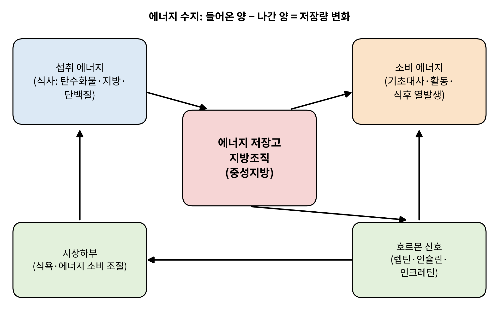
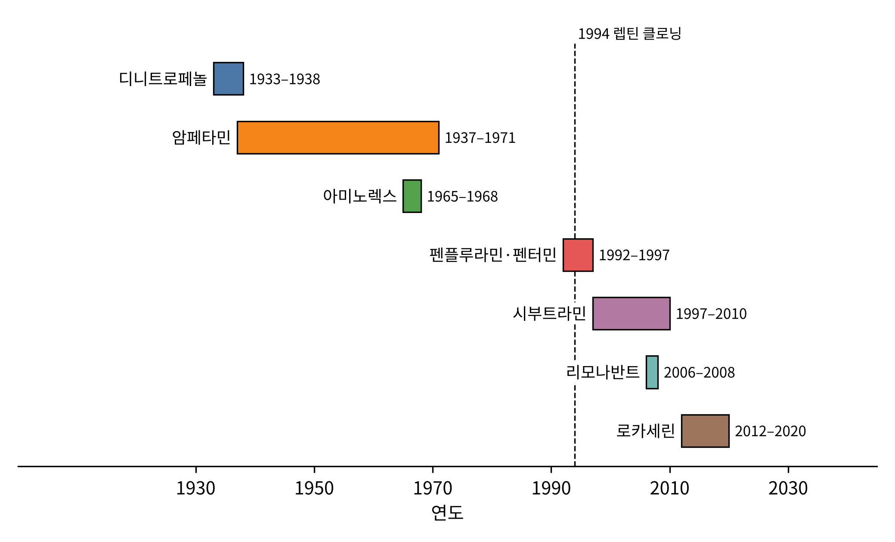

# 제1부 출발점

## 제1장 비만이라는 병, 그리고 실패의 역사

> **이 장의 출발점** 에너지는 들어오고 나가며, 남은 만큼 몸에 쌓인다. 이 단순한 계산이 어떻게 한 세기 동안 약물 개발자들을 좌절시켰는지, 그리고 그 좌절에서 무엇을 배웠는지를 본다. 이 장은 2권 「세포에너지대사학」의 1장(에너지란 무엇인가)과 17장(식후 대사 에너지), 22장(공복의 시간표)으로 이어진다.

### 1.1 몸이 에너지를 쌓는 방식

우리 몸은 하루에도 수없이 에너지를 받아들이고 내보낸다. 밥을 먹으면 탄수화물, 지방, 단백질이 들어오고, 그 화학에너지는 숨 쉬고, 체온을 유지하고, 걷고, 소화하는 데 쓰인다. 쓰고 남은 에너지는 버려지지 않는다. 몸은 남은 에너지를 **지방조직(adipose tissue)** 에 **중성지방(triglyceride)** 의 형태로 저장한다. 중성지방은 글리세롤 한 분자에 지방산 세 분자가 붙은 구조로, 같은 무게로 비교하면 글리코겐보다 훨씬 많은 에너지를 담을 수 있는 저장 형태다.

그림 1-2는 이 관계를 개념도로 나타낸 것이다. 왼쪽 위의 섭취 에너지는 지방조직으로 들어가고, 지방조직은 필요할 때 오른쪽 위의 소비 에너지로 쓰인다. 아래쪽에는 이 흐름을 조절하는 두 층이 있다. 하나는 렙틴, 인슐린, 인크레틴 같은 호르몬 신호이고, 다른 하나는 이 신호를 받아 식욕과 에너지 소비를 조정하는 **시상하부(hypothalamus)** 다. 이 그림에서 눈여겨볼 곳은 폐곡선이다. 지방조직이 늘면 호르몬 신호가 바뀌고, 신호가 바뀌면 시상하부가 섭취와 소비를 다시 조정한다. 비만이 어려운 이유는 이 되먹임 회로가 체중을 낮추려는 시도에 저항하도록 짜여 있기 때문이다. 이 회로의 구성 요소를 하나씩 해부하는 것이 이 책 전체의 일이다.

**그림 1-2. 에너지 수지의 개념도.** 섭취, 저장, 소비의 흐름과 이를 조절하는 호르몬 신호·시상하부의 되먹임 고리를 나타낸 개념도다. 정량 자료가 아니다.

에너지 수지를 정량으로 다룬 대표적인 연구가 Hall 등(2011)의 모형이다. 이들은 섭취와 소비의 차이가 체중을 어떻게 바꾸는지를 수학 모형으로 계산하여, 흔히 말하는 "지방 1kg은 약 7,700kcal"라는 단순 규칙이 장기 체중 변화를 과대 예측한다는 점을 보였다. 체중이 줄면 에너지 소비도 함께 줄기 때문이다. 이 사실은 뒤의 여러 장에서 거듭 등장한다. 체중 감량이 정체기에 이르는 것은 의지의 문제가 아니라 생리의 문제이고, 약물이 풀어야 할 과제도 여기에 있다.

비만의 규모는 이미 개인의 문제를 넘어섰다. 세계 성인 비만 유병률은 1990년 이후 크게 늘었고, 2022년에는 10억 명이 넘는 사람이 비만 상태에 있다고 추정된다(NCD Risk Factor Collaboration, 2024). 이런 규모에서 약물은 오래전부터 가장 기대를 받은 해법이면서, 가장 많이 실패한 해법이기도 했다.

### 1.2 불붙는 약: 디니트로페놀의 짧은 전성기

비만 약물의 역사에서 가장 극적인 첫 장면은 1930년대 미국 스탠퍼드대학에서 벌어졌다. 제1차 세계대전 때 군수공장에서 폭약 재료인 **디니트로페놀(2,4-dinitrophenol, DNP)** 을 다루던 노동자들이 체온이 오르고 땀을 흘리며 살이 빠진다는 사실이 보고되어 있었다. Tainter와 동료들은 이 물질을 환자에게 투여해 보았고, 기초대사율이 크게 오르면서 체중이 줄어드는 것을 관찰했다(Cutting et al., 1933). 당시에는 작용 원리가 알려지지 않았다. 훗날 DNP가 미토콘드리아 내막에서 양성자를 통과시켜 **ATP 합성효소(ATP synthase)** 를 거치지 않고 열로 에너지를 흘려버리는 **탈공역제(uncoupler)** 임이 밝혀졌다. 먹은 에너지를 ATP로 바꾸지 않고 열로 태워 없애는 약이었던 셈이다. 이 원리는 2권 10~13장에서 미토콘드리아의 화학삼투 이론과 함께 자세히 설명한다.

DNP는 체중을 줄였지만 용량 안전역이 좁았다. 체온이 조절 범위를 넘으면 고열과 사망으로 이어졌고, 백내장과 피부 발진, 말초신경 장애 등도 보고되었다. 이 약은 1938년 미국에서 시장에서 사라졌다. 이 사건의 교훈은 단순하다. 에너지 소비를 높이는 방향은 맞았지만, 모든 세포의 미토콘드리아를 동시에 건드리면 어떤 조직에서든 조절 불능이 생길 수 있다. 오늘날 UCP1을 가진 갈색지방만 선택적으로 겨냥하려는 연구가 계속되는 이유가 여기에 있다.

### 1.3 식욕을 누르는 약의 시대

DNP 이후 약물 개발은 소비를 늘리는 쪽에서 섭취를 줄이는 쪽으로 방향을 틀었다. 1930년대 후반에 **암페타민(amphetamine)** 이 식욕을 억제한다는 임상 보고가 나왔고, 이후 수십 년 동안 암페타민 계열과 그 유도체가 체중 감량 목적으로 널리 처방되었다. 효과는 있었으나 중추신경 흥분, 불면, 의존이라는 대가가 따랐다.

1960년대에는 **아미노렉스(aminorex)** 라는 식욕억제제가 유럽 일부 국가에서 판매되었다. 이 약을 복용한 사람들 사이에서 **폐동맥고혈압(pulmonary arterial hypertension)** 이 이례적으로 늘어나자 약은 시장에서 회수되었다. 이 일은 한 가지 사실을 처음 보여 주었다. 식욕을 누르려고 뇌의 모노아민 신호를 바꾸는 약은 폐 혈관 같은 말초 조직에서도 같은 수용체를 건드릴 수 있다는 것이다. 이 교훈은 곧 더 큰 규모로 반복되었다.

### 1.4 펜플루라민-펜터민 사건

1990년대 초 미국에서는 비만 약물에 대한 기대가 다시 높아졌다. **펜플루라민(fenfluramine)** 은 뇌의 세로토닌 신경말단에서 세로토닌을 방출시키고 재흡수를 막아 포만감을 높이는 약이고, **펜터민(phentermine)** 은 카테콜아민 계열 자극제였다. 두 약을 함께 쓰는 "펜-펜(fen-phen)" 요법은 성공적인 조합으로 소개되어 1990년대 중반 미국에서만 수백만 건의 처방이 이루어졌다. 이후 펜플루라민의 오른손 이성질체인 **덱스펜플루라민(dexfenfluramine)** 도 1996년 미국에서 승인되었다.

1997년, 미국 메이오 클리닉의 심장내과 의사 Heidi Connolly와 동료들이 이상한 패턴을 발견했다. 펜-펜을 복용한 여성들에게서 정상적이지 않은 심장판막 질환이 나타난 것이다. 그들은 24명의 환자를 보고했는데, 이 환자들은 심초음파에서 대동맥판과 승모판 등에 판막 역류가 있었고, 병리 소견에서는 판막 표면에 섬유증식이 덮여 있었다(Connolly et al., 1997). 이 판막의 모습은 종양에서 분비된 세로토닌이 과다한 **카르시노이드 증후군(carcinoid syndrome)** 환자의 심장판막과 닮아 있었다. 연구자들은 여기서 단서를 얻었다. 세로토닌 신호를 과하게 켜는 일이 판막 섬유증식을 일으킨다는 가설이다.

그 가설을 분자 수준에서 확인한 것이 Rothman 등(2000)의 연구다. 이들은 펜플루라민 자체가 아니라 그 대사체인 **노르펜플루라민(norfenfluramine)** 이 **세로토닌 2B 수용체(5-hydroxytryptamine receptor 2B, 5-HT2B)** 에 강하게 결합하여 활성화시킨다는 것을 시험관 실험에서 보였다. 판막의 섬유모세포는 5-HT2B를 가지고 있고, 이 수용체가 지속적으로 자극되면 세포 증식이 일어난다. 결국 식욕을 낮추기 위해 겨냥한 뇌의 세로토닌 경로와, 판막에 병을 일으킨 말초의 세로토닌 수용체는 같은 신호 체계의 다른 가지였다. 펜플루라민과 덱스펜플루라민은 1997년 시장에서 철수되었다.

이 사건에서 얻은 중요한 교훈은 약의 **수용체 선택성(receptor selectivity)** 이다. 표적 수용체 하나를 켜는 것으로 충분하지 않고, 비슷한 계열의 다른 수용체를 건드리지 않는다는 것을 **전 수용체 수준에서 확인**해야 한다. 이 확인은 오늘날 약물 개발 초기 단계의 필수 절차가 되었다. 3권에서 다룰 분자 도킹과 선택성 예측은 이 요구에서 출발한다.

### 1.5 시부트라민, 리모나반트, 로카세린: 심혈관과 정신의 벽

1990년대 후반 이후에도 신약은 이어졌다. **시부트라민(sibutramine)** 은 세로토닌과 노르에피네프린의 재흡수를 함께 막는 약으로 1997년 미국에서 승인되었다. 체중 감량 효과는 분명했지만, 혈압과 맥박을 올리는 작용이 있었다. 이를 확인하기 위해 설계된 대규모 시험이 SCOUT(Sibutramine Cardiovascular Outcomes) 시험이었다. 이 시험은 심혈관 위험이 높은 과체중·비만 성인 9,804명을 대상으로 했고, 시부트라민군에서 비치명적 심근경색과 뇌졸중을 포함한 주요 심혈관 사건의 위험이 위약군보다 높게 나왔다(위험비 1.16)(James et al., 2010). 시부트라민은 2010년에 시장에서 철수되었다.

**리모나반트(rimonabant)** 는 전혀 다른 표적을 겨냥했다. 대마초가 식욕을 높이는 현상에서 출발하여, 뇌의 **칸나비노이드 1형 수용체(cannabinoid receptor type 1, CB1)** 를 막으면 식욕이 줄 것이라는 가설이다. 이 약은 2006년 유럽에서 승인되었으나, 불안과 우울 같은 정신과 이상반응이 보고되었다. Christensen 등(2007)은 무작위 대조시험을 합친 메타분석에서 리모나반트를 복용한 사람들이 위약군보다 우울과 불안 같은 정신과 이상반응을 더 많이 겪는다는 것을 보였다. 약은 2008년 유럽에서 철수되었다. CB1 수용체는 시상하부에만 있는 것이 아니라 편도체, 해마를 포함한 뇌 전반에 분포하기 때문에, 식욕 조절 회로만 선택적으로 막을 수 없었던 것이다.

**로카세린(lorcaserin)** 은 펜플루라민의 교훈을 반영하여 **5-HT2C 수용체(5-hydroxytryptamine receptor 2C)** 에 선택적인 작용제로 설계되었고, 2012년 승인되었다. 5-HT2B와 5-HT2A에 대한 선택성을 높이는 것이 설계 목표였다. 대규모 안전성 시험인 CAMELLIA-TIMI 61에서는 심혈관 안전성 비열등성이 확인되었다(Bohula et al., 2018). 그러나 이후 암 발생 신호가 제기되었고, 약은 2020년 미국 시장에서 철수되었다. 선택성을 개선해도, 장기 사용 시 예상하지 못한 안전성 문제가 나타날 수 있다는 점을 보여 준 사례다.

그림 1-1은 이 약물들의 판매 기간을 연도별로 나열한 것이다. 막대의 왼쪽 끝은 출시 시점, 오른쪽 끝은 철수 시점이다. 이 그림에서 두 가지가 읽힌다. 첫째, 막대의 길이는 대체로 수년에서 십여 년이다. 시장에 나와 사용된 기간이 충분했지만, 문제는 승인 전 시험에서 잡히지 않고 출시 후에 드러났다는 뜻이다. 둘째, 1994년의 점선(렙틴 클로닝)을 기준으로 보면, 이 점선 이후에도 철수는 계속되었다. 호르몬 하나가 발견되어도 신약은 바로 나오지 않았다.

**그림 1-1. 20세기 이후 주요 비만 약물의 시장 사용 기간.** 각 막대는 대표 약물의 시장 사용 시작과 종료 연도를 나타낸다. 시점은 근사값을 포함하며 장 끝 검증 목록에 정리했다. (자료: 그림 데이터 `figures/data/fig1-1-timeline.csv`)

표 1-1은 같은 약물을 작용 표적과 실패 원인으로 비교한 것이다.

**표 1-1. 초기 비만 약물의 표적과 철수 원인.**

| 약물 | 표적·기전 | 철수·규제 시기 | 핵심 문제 |
|---|---|---|---|
| 디니트로페놀 | 미토콘드리아 탈공역 | 1930년대 후반 | 고열, 좁은 안전역 |
| 아미노렉스 | 모노아민 방출 | 1960년대 후반 | 폐동맥고혈압 |
| 펜플루라민·덱스펜플루라민 | 세로토닌 방출 | 1997년 | 심장판막 질환(5-HT2B) |
| 시부트라민 | 세로토닌·노르에피네프린 재흡수 억제 | 2010년 | 심혈관 사건 증가 |
| 리모나반트 | CB1 수용체 차단 | 2008년 (유럽) | 우울·불안 |
| 로카세린 | 5-HT2C 선택 작용 | 2020년 | 암 발생 신호 |

표를 읽는 방법은 간단하다. 오른쪽 열의 문제를 왼쪽 열의 표적과 연결해 보면, 거의 모든 사례에서 문제는 **표적이 몸 전체에 퍼져 있다**는 사실에서 나온다. 세로토닌 수용체는 뇌, 판막, 폐, 장에 모두 있고, CB1 수용체는 뇌 전반에, 미토콘드리아는 모든 세포에 있다. 이 표가 이 책 전체에서 되풀이될 질문을 만든다. 식욕과 에너지 소비를 조절하면서도 다른 조직에서는 조용한 표적이 있는가?

### 1.6 렙틴: 처음으로 보인 지방의 목소리

약물이 실패를 거듭하는 동안, 기초과학은 다른 질문에 도달해 있었다. 몸은 자기 지방의 양을 어떻게 아는가?

1950년 미국 잭슨 연구소의 Ingalls 등은 실험실 마우스 집단에서 극단적으로 살이 찐 돌연변이 마우스를 발견하여 *obese*(*ob*)라 이름 붙였다(Ingalls et al., 1950). 뒤이어 다른 계통에서는 *diabetes*(*db*) 마우스가 발견되었다. 두 마우스는 모두 살이 쪘지만, 원인이 같은지는 알려져 있지 않았다. 이 질문에 답한 것이 1970년대 Douglas Coleman의 **병체결합(parabiosis)** 실험이다. 두 마리의 혈액 순환을 수술로 연결하면 한쪽에 있는 순환 인자가 다른 쪽으로 넘어간다. Coleman은 *ob* 마우스를 정상 마우스와 연결하면 *ob* 마우스의 체중이 줄고, *db* 마우스를 정상 마우스와 연결하면 정상 마우스가 굶어 죽는다는 것을 보였다(Coleman, 1973). 해석은 이렇다. *ob* 마우스는 포만 신호 물질을 만들지 못하는 것이고, *db* 마우스는 그 신호를 받는 수용체가 고장 난 것이다. 결국 혈액에는 지방의 양을 알려 주는 호르몬이 있어야 한다는 예측이 나왔다.

그 호르몬을 찾는 데는 20년 넘게 걸렸다. 1994년 록펠러대학의 Jeffrey Friedman 연구실에서 Yiying Zhang 등이 *ob* 유전자를 위치 클로닝으로 분리하고 사람의 대응 유전자도 확인했다(Zhang et al., 1994). 이 유전자가 만드는 단백질이 **렙틴(leptin)** 이다. 이름은 그리스어로 "가늘다"를 뜻하는 *leptos*에서 왔다. 지방세포가 지방량에 비례하여 렙틴을 분비하고, 렙틴은 시상하부에 도달해 식욕을 낮춘다. 1997년에는 렙틴 유전자에 변이가 있어 어릴 때부터 심한 비만이 나타나는 사람이 보고되었다(Montague et al., 1997). 이로써 마우스의 유전 현상이 사람에게도 성립한다는 것이 확인되었다.

렙틴 발견은 비만 연구의 방향을 바꾸었다. 비만은 의지의 문제가 아니라 신호 체계의 문제일 수 있게 된 것이다. 그러나 약으로는 기대에 미치지 못했다. 대부분의 비만 환자는 렙틴 농도가 이미 높았고, 렙틴을 더 주사해도 체중이 줄지 않았다. 이를 **렙틴 저항성(leptin resistance)** 이라 한다. 렙틴 결핍이 원인인 희귀 비만에서만 렙틴 치료가 극적으로 작용했다. 이 사건은 이 책의 중요한 대비를 마련한다. 한 신호 경로를 발견하는 것과 그 경로를 약으로 바꾸는 것 사이에는 큰 거리가 있다. 이 거리를 메운 사례가 2장에서 다룰 인크레틴이다.

### 1.7 실패에서 얻은 설계 원칙

앞의 사례들을 한꺼번에 놓고 보면 몇 가지 원칙이 보인다. 이 원칙들은 이 책이 3권에서 신약 설계를 다룰 때 점검표로 되돌아온다.

첫째, 표적의 **조직 분포**를 먼저 확인한다. 표적이 뇌 한 곳에서만 일하는지, 심장과 폐에서도 발현되는지는 설계 이전에 알 수 있다. 이 질문에는 GTEx 같은 공개 발현 데이터가 쓰인다(3권 6장).

둘째, **수용체 선택성**을 같은 계열 전체에서 시험한다. 펜플루라민의 5-HT2B 문제는 처음부터 수용체 패널 시험을 했다면 확인할 수 있었던 일이다.

셋째, **장기 안전성**은 시간이 지나야 보인다. 로카세린의 암 신호는 승인 후 대규모 시험에서 나타났다. 약을 설계하는 단계부터 장기 추적을 전제하여 위험 신호를 계량하는 틀이 필요하다.

넷째, 체중 감량의 **생리적 저항**을 고려한다. 체중이 줄면 에너지 소비가 낮아지고 식욕은 오른다. 표적 하나로 식욕만 누르면 몸이 다른 경로로 보상한다. 이 점이 이후 여러 호르몬을 동시에 겨냥하는 이중·삼중 작용제의 근거가 된다.

다음 장에서는 이 문제들을 한꺼번에 푼 것처럼 보이는 분자, **글루카곤유사펩타이드-1(glucagon-like peptide-1, GLP-1)** 의 이야기를 시작한다. 위장관 호르몬이 어떻게 발견되었고, 왜 처음에는 약이 될 수 없었으며, 어떤 분자 설계가 이를 바꾸었는지를 따라간다.

---

#### 참고문헌

Bohula, E. A., Wiviott, S. D., McGuire, D. K., Inzucchi, S. E., Kuder, J., Im, K., Fanola, C. L., Qamar, A., Brown, C., Budaj, A., Garcia-Castillo, A., Gupta, M., Leiter, L. A., Weerakkody, G. J., Sattar, N., Bays, H. E., Kozlovski, P., ... Scirica, B. M. (2018). Cardiovascular safety of lorcaserin in overweight or obese patients. *New England Journal of Medicine, 379*(12), 1107–1117. https://doi.org/10.1056/NEJMoa1808721

Christensen, R., Kristensen, P. K., Bartels, E. M., Bliddal, H., & Astrup, A. (2007). Efficacy and safety of the weight-loss drug rimonabant: A meta-analysis of randomised trials. *The Lancet, 370*(9600), 1706–1713. https://doi.org/10.1016/S0140-6736(07)61721-8

Coleman, D. L. (1973). Effects of parabiosis of obese with diabetes and normal mice. *Diabetologia, 9*(4), 294–298. https://doi.org/10.1007/BF01221857

Connolly, H. M., Crary, J. L., McGoon, M. D., Hensrud, D. D., Edwards, B. S., Edwards, W. D., & Schaff, H. V. (1997). Valvular heart disease associated with fenfluramine–phentermine. *New England Journal of Medicine, 337*(9), 581–588. https://doi.org/10.1056/NEJM199708283370901

Cutting, W. C., Mehrtens, H. G., & Tainter, M. L. (1933). Actions and uses of dinitrophenol: Promising metabolic applications. *JAMA, 101*(3), 193–195.

Hall, K. D., Sacks, G., Chandramohan, D., Chow, C. C., Wang, Y. C., Gortmaker, S. L., & Swinburn, B. A. (2011). Quantification of the effect of energy imbalance on bodyweight. *The Lancet, 378*(9793), 826–834. https://doi.org/10.1016/S0140-6736(11)60812-X

Ingalls, A. M., Dickie, M. M., & Snell, G. D. (1950). Obese, a new mutation in the house mouse. *Journal of Heredity, 41*(12), 317–318.

James, W. P. T., Caterson, I. D., Coutinho, W., Finer, N., Van Gaal, L. F., Maggioni, A. P., Torp-Pedersen, C., Sharma, A. M., Shepherd, G. M., Rode, R. A., & Renz, C. L. (2010). Effect of sibutramine on cardiovascular outcomes in overweight and obese subjects. *New England Journal of Medicine, 363*(10), 905–917. https://doi.org/10.1056/NEJMoa1003114

Montague, C. T., Farooqi, I. S., Whitehead, J. P., Soos, M. A., Rau, H., Wareham, N. J., Sewter, C. P., Digby, J. E., Mohammed, S. N., Hurst, J. A., Cheetham, C. H., Earley, A. R., Barnett, A. H., Prins, J. B., & O'Rahilly, S. (1997). Congenital leptin deficiency is associated with severe early-onset obesity in humans. *Nature, 387*(6636), 903–908. https://doi.org/10.1038/43185

NCD Risk Factor Collaboration. (2024). Worldwide trends in underweight and obesity from 1990 to 2022: A pooled analysis of 3663 population-representative studies with 222 million children, adolescents, and adults. *The Lancet, 403*(10431), 1027–1050. https://doi.org/10.1016/S0140-6736(23)02750-2

Rothman, R. B., Baumann, M. H., Savage, J. E., Rauser, L., McBride, A., Hufeisen, S. J., & Roth, B. L. (2000). Evidence for possible involvement of 5-HT2B receptors in the cardiac valvulopathy associated with fenfluramine and other serotonergic medications. *Circulation, 102*(23), 2836–2841. https://doi.org/10.1161/01.CIR.102.23.2836

Zhang, Y., Proenca, R., Maffei, M., Barone, M., Leopold, L., & Friedman, J. M. (1994). Positional cloning of the mouse obese gene and its human homologue. *Nature, 372*(6505), 425–432. https://doi.org/10.1038/372425a0
