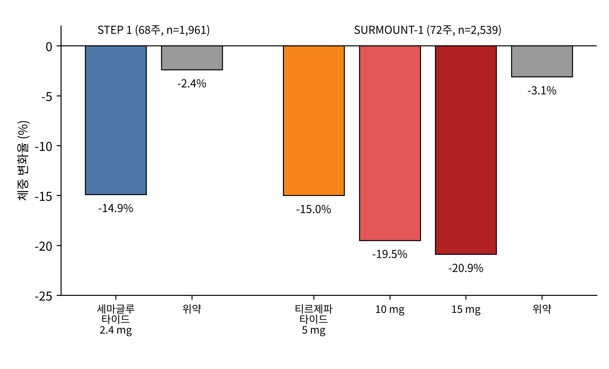

# 제1부 출발점

## 제2장 인크레틴의 발견에서 위고비까지

> **이 장의 출발점** 1장에서 우리는 식욕과 에너지 소비를 건드리는 약이 왜 번번이 실패했는지 보았다. 이 장은 장(腸)이 보내는 호르몬 신호에서 출발한 약이 어떻게 이 실패의 고리를 끊었는지를 따라간다. 이 장의 호르몬은 2권 17장(식후 대사 에너지)에서 식후 상태를 조절하는 핵심 신호로 다시 등장한다.

### 2.1 십이지장 추출물과 최초의 호르몬

호르몬이라는 개념은 한 실험에서 태어났다. 1902년 런던 유니버시티 칼리지의 William Bayliss와 Ernest Starling은 마취한 개의 십이지장 점막을 산으로 처리해 분쇄한 추출물을 혈관에 주사하면 췌장이 소화액을 분비한다는 것을 보였다(Bayliss & Starling, 1902). 신경이 끊어진 상태에서도 반응이 일어났으므로, 장이 혈액을 통해 췌장에 화학 신호를 보낸다는 결론이 나왔다. 이들은 이 물질을 **세크레틴(secretin)** 이라 불렀고, 1905년 Starling이 이런 물질들을 통틀어 "호르몬(hormone)"이라 부르자고 제안했다. 장이 단순한 소화관이 아니라 내분비 기관이라는 발상이 여기서 시작되었다.

이 발상은 곧 당뇨병과 연결되었다. 1906년 Moore 등은 장 점막 추출물을 당뇨 환자에게 먹이면 소변 당이 줄지 않을까 하는 시도를 했다. 결과는 성공적이지 않았지만, 장에서 혈당을 낮추는 물질이 나올 수 있다는 가설은 이후 수십 년 동안 살아남았다. 1920~30년대에는 장 추출물이 혈당을 낮춘다는 보고가 이어졌고, 1932년 La Barre는 이 가설적 물질을 "인슐린을 자극하는 장 호르몬"이라는 뜻으로 **인크레틴(incretin)** 이라 이름 붙였다. 이름은 붙었으나 정체는 이후 30년 넘게 알려지지 않았다.

### 2.2 같은 포도당, 다른 반응

결정적인 단서는 1960년대에 나왔다. 포도당을 입으로 먹을 때와 정맥으로 주사할 때를 비교하는 단순한 실험이다. 혈중 포도당 농도를 두 방법에서 똑같이 만들어도, 먹은 경우의 **인슐린 분비**가 훨씬 컸다. Elrick 등(1964)과 McIntyre 등(1964)이 독립적으로 이 결과를 보고했다. 포도당이 같은데 인슐린이 다르다면, 입으로 들어간 포도당이 장을 지나면서 무언가 다른 신호를 만들어 췌장의 β세포에 전달한다는 뜻이다. 이 차이를 **인크레틴 효과(incretin effect)** 라 부른다. 건강한 사람에서 경구 포도당 부하 시 인슐린 분비의 상당 부분(대략 절반 이상)이 이 효과에서 나온다는 것이 이후 연구의 정설이 되었다.

이 현상은 이 책의 큰 주제와 맞닿아 있다. 몸은 먹은 음식이 장에 도착하는 순간 이미 그 사실을 췌장, 뇌, 위에 알린다. 먹은 뒤의 몸이 어떻게 달라지는가에 대한 이야기는 2권 17장에서 자세히 다룬다.

이 효과를 일으키는 물질로 처음 분리된 것이 **포도당 의존성 인슐린 분비 자극 폴리펩타이드(glucose-dependent insulinotropic polypeptide, GIP)** 다. 1971년 John Brown 등이 돼지 장 추출물에서 위산 분비를 억제하는 펩타이드로 처음 분리했고, 이후 포도당이 있을 때 인슐린 분비를 자극한다는 것이 밝혀지면서 현재의 이름을 얻었다. 그러나 GIP는 당뇨병 환자에서 인슐린 분비 효과가 약해져 있어 당뇨병 치료제로 쓰기에는 매력이 적었다. 이 점은 훗날 티르제파타이드의 설계에서 의외의 반전을 맞는다.

### 2.3 글루카곤 유전자 속에 숨은 두 번째 호르몬

두 번째 인크레틴의 발견은 분자생물학의 이야기다. 1980년대 초 Graeme Bell 등은 혈당을 올리는 호르몬 **글루카곤(glucagon)** 의 전구체 유전자를 햄스터에서 복제했다. 놀랍게도 **프로글루카곤(proglucagon)** 이라는 하나의 전구체 단백질이 글루카곤 하나만이 아니라 글루카곤과 비슷한 서열을 가진 펩타이드를 두 개 더 포함하고 있었다(Bell et al., 1983). 글루카곤과 닮았다는 뜻에서 이들을 **글루카곤유사펩타이드-1과 -2(glucagon-like peptide-1, GLP-1; glucagon-like peptide-2, GLP-2)** 라 부르게 되었다.

처음에는 이 펩타이드의 기능을 아무도 몰랐다. 1987년 Mojsov, Weir, Habener는 GLP-1의 한 형태인 **GLP-1(7–37)** 이 관류시킨 쥐 췌장에서 인슐린 분비를 강하게 자극한다는 것을 보였다(Mojsov et al., 1987). 같은 해 Drucker 등(1987)은 배양한 췌장 세포에서, Kreymann 등(1987)은 사람 실험에서 같은 결과를 확인했다. 이 펩타이드의 번호 7–37은 전구체에서 잘려 나온 활성형의 위치를 가리킨다. 첫 여섯 개의 아미노산이 떨어져 나간 뒤에야 활성이 나타난다.

이 발견이 중요했던 이유는 GLP-1이 포도당 의존적으로만 인슐린을 분비시킨다는 점 때문이다. 혈당이 정상이면 효과가 작아지므로, 인슐린 주사나 설폰요소제의 약점이었던 저혈당 위험이 낮을 것이라는 기대가 생겼다. 1993년 Nauck 등은 제2형 당뇨병 환자에게 GLP-1(7–36 amide)을 정맥 주입했을 때 공복 고혈당이 정상화된다고 보고했다(Nauck et al., 1993). 약으로서의 가능성은 이제 증명되었다. 문제는 그 분자를 약으로 쓸 수 없다는 것이었다.

### 2.4 몇 분 만에 사라지는 호르몬

천연 GLP-1은 혈중에서 반감기가 몇 분에 지나지 않는다. 혈액 속 효소 **디펩티딜 펩티데이스-4(dipeptidyl peptidase-4, DPP-4)** 가 펩타이드 N-말단에서 두 번째 위치의 알라닌 뒤를 잘라 7번과 8번 아미노산을 떼어 내면 활성이 사라지고, 신장에서도 빠르게 제거된다. 하루 한 번의 주사로는 약이 될 수 없었다. 환자가 연속으로 주입받는 방법 외에는 쓸 수 없는 분자였던 셈이다.

이 문제를 푸는 길은 두 갈래였다. 하나는 DPP-4 효소 자체를 막는 약(시타글립틴 등)이고, 다른 하나는 DPP-4에 잘리지 않는 GLP-1 유사체를 설계하는 것이다. 이 책은 두 번째 길을 따른다. 그 출발점에 뜻밖의 동물이 있었다.

### 2.5 도마뱀의 독에서 온 단서

1992년 뉴욕 브롱크스 재향군인병원의 John Eng은 북미 사막에 사는 독도마뱀인 **길라 몬스터(Gila monster, *Heloderma suspectum*)** 의 독에서 새로운 펩타이드를 분리하고 **엑센딘-4(exendin-4)** 라 불렀다(Eng et al., 1992). 이 펩타이드는 서열이 GLP-1과 약 반 정도 같았고, 췌장 세포에서 GLP-1 수용체를 활성화시켰다. 중요한 것은 엑센딘-4의 N-말단 두 번째 아미노산이 DPP-4가 인식하는 알라닌이 아니었다는 점이다. 그 때문에 이 펩타이드는 DPP-4에 의해 쉽게 분해되지 않았고, 사람에게서의 반감기도 몇 시간 수준으로 훨씬 길었다.

도마뱀의 독은 먹이를 포획한 뒤 오래 먹지 않고 살아가야 하는 이 동물의 생리와 관련이 있다고 해석되지만, 이 가설은 이 책의 중심 논지가 아니다. 중요한 것은 자연이 이미 DPP-4에 저항하는 GLP-1 작용제를 만들어 두었다는 사실이다. 이 분자에서 파생된 **엑세나타이드(exenatide)** 는 2005년 미국에서 제2형 당뇨병 치료제로 승인된 첫 GLP-1 수용체 작용제가 되었다. 하루 두 번 주사해야 했지만 개념은 증명되었다. 환자들은 혈당뿐 아니라 체중도 줄었다.

### 2.6 지방산을 붙여 알부민에 매달다

다음 단계는 천연 GLP-1의 서열을 바탕으로 사람의 몸에 오래 머무는 분자를 설계하는 일이었다. 덴마크 노보 노디스크의 Lotte Bjerre Knudsen 연구진이 택한 전략은 몸에 가장 흔한 운반 단백질, **알부민(albumin)** 에 약을 매다는 것이었다. 알부민은 혈액 속에 많이 있고 신장에서 잘 걸러지지 않으며 반감기가 약 3주로 길다. 지방산이 알부민에 잘 결합한다는 성질을 이용해, GLP-1 펩타이드에 지방산 곁사슬을 붙이면 약이 알부민과 느슨하게 결합하여 분해와 배설을 늦출 수 있다.

**리라글루타이드(liraglutide)** 는 이 전략의 첫 성공작이다. 사람 GLP-1 서열에서 34번 라이신을 아르기닌으로 바꾸고, 26번 라이신에 글루탐산 연결 고리를 거쳐 16탄소 지방산(팔미토일)을 붙였다(Knudsen et al., 2000). 반감기는 약 13시간으로 늘어 하루 한 번 주사가 가능해졌다. 2009~2010년에 당뇨병 치료제로 승인되었고, 용량을 3.0 mg까지 높인 제형이 2014년 비만 치료제 사세다(Saxenda)로 승인되었다. 무작위 대조시험에서 리라글루타이드 3.0 mg은 56주 후 체중을 평균 약 8% 줄였고 위약군은 약 2.6% 줄였다(Pi-Sunyer et al., 2015).

**세마글루타이드(semaglutide)** 는 이 설계를 더 밀어붙인 분자다. 연구진은 DPP-4가 자르는 위치인 8번 아미노산을 일반 알라닌 대신 비천연 아미노산인 **아미노이소부티르산(α-aminoisobutyric acid, Aib)** 으로 바꾸었다. Aib는 메틸기가 둘 달린 구조라서 효소가 접근하기 어렵다. 동시에 지방산 곁사슬을 16탄소에서 18탄소 이산(diacid)으로 바꾸고 연결 고리를 길게 만들어 알부민과 훨씬 단단히 결합하도록 했다(Lau et al., 2015). 그 결과 반감기는 약 일주일에 이르렀고, 주 1회 주사가 가능해졌다. 표 2-1은 세 분자의 설계 차이를 비교한 것이다.

**표 2-1. 천연 GLP-1과 두 약물의 구조·약동학 비교.**

| 항목 | 천연 GLP-1 | 리라글루타이드 | 세마글루타이드 |
|---|---|---|---|
| DPP-4 저항 | 없음(2번 알라닌 절단) | 부분적(지방산 결합에 의한 보호) | 높음(8번 Aib 치환) |
| 지방산 곁사슬 | 없음 | C16 팔미토일 | C18 이산 |
| 알부민 결합 | 없음 | 있음 | 더 강함 |
| 혈중 반감기 | 1~2분 | 약 13시간 | 약 1주 |
| 투여 간격 | 연속 주입 필요 | 하루 1회 | 주 1회 |

표를 읽는 방법은 간단하다. 위에서 아래로 갈수록 분해에 대한 저항과 알부민에 매달리는 정도가 커지고, 그 결과 반감기가 분 단위에서 시간 단위, 일 단위로 늘어난다. 같은 호르몬의 서열을 바꾸지 않고도 약동학만 바꿔 약으로 만든 사례다. 이후 설계 원리는 이 책 3권에서 펩타이드 약물 설계 실습의 출발점이 된다.

### 2.7 체중이 숫자로 증명되다

세마글루타이드를 비만 치료제로 평가한 STEP 시험 프로그램의 첫 시험, STEP 1은 당뇨병이 없는 과체중·비만 성인 1,961명을 대상으로 했다. 참가자들은 생활습관 중재와 함께 주 1회 세마글루타이드 2.4 mg 또는 위약을 68주 동안 맞았고, 세마글루타이드군은 평균 14.9%, 위약군은 2.4%의 체중이 줄었다(Wilding et al., 2021). 세마글루타이드는 이 결과를 바탕으로 2021년 미국에서 위고비(Wegovy)라는 이름으로 비만 치료제로 승인되었다.

그다음 이정표는 **GIP**(앞에서 본 포도당 의존성 인슐린 분비 자극 폴리펩타이드)와 GLP-1의 두 수용체를 동시에 활성화시키는 **티르제파타이드(tirzepatide)** 였다. GIP는 한때 당뇨병 치료 표적으로 매력이 적다고 평가되었으나, Coskun 등(2018)은 두 수용체를 함께 겨냥한 단일 펩타이드가 마우스와 사람에서 GLP-1 단독보다 큰 효과를 낸다는 것을 보였다. 이어 SURMOUNT-1 시험에서 비만 성인 2,539명이 72주 동안 티르제파타이드 5, 10, 15 mg 또는 위약을 주 1회 맞았고, 평균 체중 감소는 각각 15.0%, 19.5%, 20.9%였으며 위약군은 3.1%였다(Jastreboff et al., 2022).

그림 2-1은 두 시험의 결과를 함께 나타낸 것이다. 막대의 아래쪽 끝이 평균 체중 감소율이다. 이 그림에서 세 가지가 읽힌다. 첫째, 두 시험 모두 위약군도 체중이 약간 줄었다. 생활습관 중재의 몫이 있다는 뜻이다. 둘째, 약물군과 위약군의 차이는 1장에서 본 이전 약물들의 차이보다 훨씬 크다. 셋째, 티르제파타이드는 용량이 늘수록 감소폭이 커지는 용량 반응을 보인다. 다만 두 시험은 설계, 대상, 기간이 달라서 막대의 높이를 곧바로 비교해 한 약이 다른 약보다 낫다고 결론 내릴 수는 없다.

**그림 2-1. 세마글루타이드(STEP 1)와 티르제파타이드(SURMOUNT-1)의 평균 체중 변화율.** 왼쪽 두 막대는 STEP 1의 세마글루타이드 2.4 mg과 위약(68주), 오른쪽 네 막대는 SURMOUNT-1의 티르제파타이드 5·10·15 mg과 위약(72주)이다. 서로 다른 시험이므로 직접 비교하지 않는다. (자료: `figures/data/fig2-1-trials.csv`)

### 2.8 연대표: 한 세기 반의 질문

표 2-2는 이 장에서 본 발견들을 연도 순으로 정리한 것이다.

**표 2-2. 인크레틴 연구의 주요 이정표.**

| 연도 | 사건 | 핵심 인물·문헌 |
|---|---|---|
| 1902 | 세크레틴 발견, 장 호르몬 개념의 탄생 | Bayliss & Starling |
| 1932 | "인크레틴" 명명 | La Barre |
| 1964 | 경구 포도당이 정맥 주사보다 더 큰 인슐린 반응을 일으킴 | Elrick; McIntyre |
| 1971 | GIP 분리 | Brown 등 |
| 1983 | 프로글루카곤 유전자에서 GLP-1·GLP-2 서열 확인 | Bell 등 |
| 1987 | GLP-1(7–37)의 인슐린 분비 효과 확인 | Mojsov; Drucker; Kreymann |
| 1992 | 길라 몬스터 독에서 엑센딘-4 분리 | Eng 등 |
| 1993 | GLP-1 주입으로 제2형 당뇨병 공복 고혈당 정상화 | Nauck 등 |
| 2005 | 엑세나타이드 승인 | — |
| 2009~2010 | 리라글루타이드 당뇨병 승인 | — |
| 2021 | 세마글루타이드(위고비) 비만 승인 | Wilding 등 |
| 2022~2023 | 티르제파타이드 승인 | Jastreboff 등 |

표의 오른쪽 열을 따라가면, 발견은 서로 다른 나라의 서로 다른 분야 연구자들에게서 나왔다. 생리학자는 현상을 보았고, 분자생물학자는 서열을 읽었고, 동물학적 우연이 안정한 분자를 제공했고, 약물화학자는 이를 약으로 바꾸었다. 이 책이 세포신호, 분자생물학, 구조, 컴퓨터 설계를 한 권으로 묶는 이유도 같다.

### 2.9 이 약들은 어떻게 작용하는가: 이후 장의 지도

이 장에서 본 약들은 모두 **GLP-1 수용체(glucagon-like peptide-1 receptor, GLP1R)** 를 활성화시킨다. GLP1R은 세포막을 일곱 번 가로지르는 **G단백질 연결 수용체(G protein-coupled receptor, GPCR)** 이며, 췌장의 β세포에서는 인슐린 분비를, 뇌의 시상하부와 뇌간에서는 식욕 억제를, 위에서는 위 배출 지연을 일으킨다. 이 세 가지 효과가 모여 체중을 줄인다고 이해되지만, 각각의 비중과 신호 경로는 아직도 연구 중이다. 3장부터 5장까지는 이 수용체의 구조와 신호전달을, 6장부터는 뇌와 조직 수준의 작용을 단계적으로 다룬다.

1장의 점검표로 돌아가 보자. GLP1R은 표적이 몸 전체에 퍼져 있다는 1장의 문제를 피했는가? 완전히 피하지는 못했다. 오심과 구토 같은 위장관 이상반응은 뇌간 수용체의 활성화와 관련이 있고, 담낭 질환과 췌장염 위험 같은 문제가 지금도 감시되고 있다. 그러나 1장의 약물들과 달리 이 약들은 대규모 시험에서 심혈관 사건을 늘리지 않았다. 그 근거는 12장에서 다룬다.

---

#### 참고문헌

Bayliss, W. M., & Starling, E. H. (1902). The mechanism of pancreatic secretion. *The Journal of Physiology, 28*(5), 325–353. https://doi.org/10.1113/jphysiol.1902.sp000920

Bell, G. I., Santerre, R. F., & Mullenbach, G. T. (1983). Hamster preproglucagon contains the sequence of glucagon and two related peptides. *Nature, 302*(5910), 716–718. https://doi.org/10.1038/302716a0

Coskun, T., Sloop, K. W., Loghin, C., Alsina-Fernandez, J., Urva, S., Bokvist, K. B., Cui, X., Briere, D. A., Cabrera, O., Roell, W. C., Kuchibhotla, U., Moyers, J. S., Benson, C. T., Gimeno, R. E., D'Alessio, D. A., & Haupt, A. (2018). LY3298176, a novel dual GIP and GLP-1 receptor agonist for the treatment of type 2 diabetes mellitus: From discovery to clinical proof of concept. *Molecular Metabolism, 18*, 3–14. https://doi.org/10.1016/j.molmet.2018.09.009

Drucker, D. J., Philippe, J., Mojsov, S., Chick, W. L., & Habener, J. F. (1987). Glucagon-like peptide I stimulates insulin gene expression and increases cyclic AMP levels in a rat islet cell line. *Proceedings of the National Academy of Sciences, 84*(10), 3434–3438. https://doi.org/10.1073/pnas.84.10.3434

Elrick, H., Stimmler, L., Hlad, C. J., Jr., & Arai, Y. (1964). Plasma insulin response to oral and intravenous glucose administration. *The Journal of Clinical Endocrinology & Metabolism, 24*(10), 1076–1082. https://doi.org/10.1210/jcem-24-10-1076

Eng, J., Kleinman, W. A., Singh, L., Singh, G., & Raufman, J. P. (1992). Isolation and characterization of exendin-4, an exendin-3 analogue, from *Heloderma suspectum* venom. *Journal of Biological Chemistry, 267*(11), 7402–7405. https://doi.org/10.1016/S0021-9258(18)42531-8

Jastreboff, A. M., Aronne, L. J., Ahmad, N. N., Wharton, S., Connery, L., Alves, B., Kiyosue, A., Zhang, S., Liu, B., Bunck, M. C., & Stefanski, A. (2022). Tirzepatide once weekly for the treatment of obesity. *New England Journal of Medicine, 387*(3), 205–216. https://doi.org/10.1056/NEJMoa2206038

Knudsen, L. B., Nielsen, P. F., Huusfeldt, P. O., Johansen, N. L., Madsen, K., Pedersen, F. Z., Thøgersen, H., Wilken, M., & Agersø, H. (2000). Potent derivatives of glucagon-like peptide-1 with pharmacokinetic properties suitable for once daily administration. *Journal of Medicinal Chemistry, 43*(9), 1664–1669. https://doi.org/10.1021/jm9909645

Kreymann, B., Williams, G., Ghatei, M. A., & Bloom, S. R. (1987). Glucagon-like peptide-1 7-36: A physiological incretin in man. *The Lancet, 330*(8571), 1300–1304. https://doi.org/10.1016/S0140-6736(87)91194-9

Lau, J., Bloch, P., Schäffer, L., Pettersson, I., Spetzler, J., Kofoed, J., Madsen, K., Knudsen, L. B., McGuire, J., Steensgaard, D. B., Strauss, H. M., Gram, D. X., Knudsen, S. M., Nielsen, F. S., Thygesen, P., Reedtz-Runge, S., & Kruse, T. (2015). Discovery of the once-weekly glucagon-like peptide-1 (GLP-1) analogue semaglutide. *Journal of Medicinal Chemistry, 58*(18), 7370–7380. https://doi.org/10.1021/acs.jmedchem.5b00726

McIntyre, N., Holdsworth, C. D., & Turner, D. S. (1964). New interpretation of oral glucose tolerance. *The Lancet, 284*(7349), 20–21. https://doi.org/10.1016/S0140-6736(64)90011-X

Mojsov, S., Weir, G. C., & Habener, J. F. (1987). Insulinotropin: Glucagon-like peptide I (7-37) co-encoded in the glucagon gene is a potent stimulator of insulin release in the perfused rat pancreas. *Journal of Clinical Investigation, 79*(2), 616–619. https://doi.org/10.1172/JCI112855

Nauck, M. A., Kleine, N., Ørskov, C., Holst, J. J., Willms, B., & Creutzfeldt, W. (1993). Normalization of fasting hyperglycaemia by exogenous glucagon-like peptide 1 (7-36 amide) in type 2 (non-insulin-dependent) diabetic patients. *Diabetologia, 36*(8), 741–744. https://doi.org/10.1007/BF00401145

Pi-Sunyer, X., Astrup, A., Fujioka, K., Greenway, F., Halpern, A., Krempf, M., Lau, D. C. W., le Roux, C. W., Violante Ortiz, R., Jensen, C. B., & Wilding, J. P. H. (2015). A randomized, controlled trial of 3.0 mg of liraglutide in weight management. *New England Journal of Medicine, 373*(1), 11–22. https://doi.org/10.1056/NEJMoa1411892

Wilding, J. P. H., Batterham, R. L., Calanna, S., Davies, M., Van Gaal, L. F., Lingvay, I., McGowan, B. M., Rosenstock, J., Tran, M. T. D., Wadden, T. A., Wharton, S., Yokote, K., Zeuthen, N., & Kushner, R. F. (2021). Once-weekly semaglutide in adults with overweight or obesity. *New England Journal of Medicine, 384*(11), 989–1002. https://doi.org/10.1056/NEJMoa2032183
