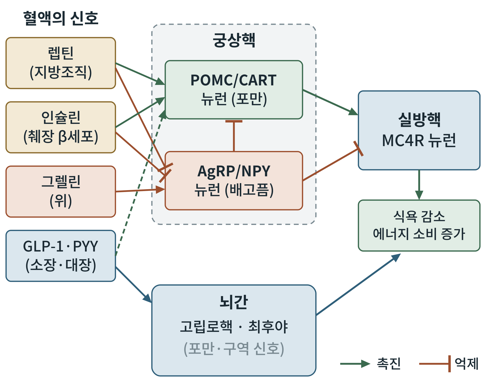

# 제2부 생리학: 몸 전체에서

## 제3장 에너지 항상성의 뇌: 시상하부, 뇌간, 보상회로

> **이 장의 출발점** 1~2장에서 우리는 약이 어디에서 실패했고, 어떤 분자가 처음으로 성공했는지를 보았다. 이제 질문은 "그 분자가 뇌의 어디에서 무엇을 바꾸는가"다. 이 장은 배고픔과 포만이 만들어지는 회로를 해부한다. 공복일 때 이 회로가 받는 신호(렙틴 감소, 그렐린 증가)는 2권 27장에서, 식후와 공복 사이의 전환은 2권 29장에서 다시 다룬다.

### 3.1 쥐의 뇌를 태우다: 시상하부의 발견

시상하부가 몸무게와 관계있다는 사실은 임상 관찰에서 먼저 드러났다. 20세기 초 신경과 의사들은 뇌하수체 근처에 종양이 생긴 환자가 병적으로 살이 찌는 경우가 있다고 보고했다. 처음에는 뇌하수체 호르몬이 부족해서 생긴 문제로 해석되었으나, 이 설명에는 허점이 있었다. 뇌하수체를 제거해도 비만이 생기지 않는 동물이 있었기 때문이다.

문제를 푼 것은 정교한 동물 실험이었다. 1940년 Hetherington과 Ranson은 쥐의 시상하부 복내측 부위에 전기 병변을 만들면 쥐가 과식하고 심하게 살이 찐다는 것을 보였다(Hetherington & Ranson, 1940). 뇌하수체가 아니라 그 위에 있는 **시상하부(hypothalamus)** 가 원인이라는 증거였다. 1951년 Anand와 Brobeck은 반대쪽, 곧 시상하부 외측 부위를 파괴하면 동물이 먹기를 멈추고 굶어 죽는다는 것을 보였다(Anand & Brobeck, 1951). 이 두 결과는 오랫동안 "복내측은 포만 중추, 외측은 섭식 중추"라는 단순한 그림으로 교과서에 실렸다.

이 그림은 틀리지 않았지만 지나치게 거칠었다. 병변은 한 부위만 파괴하는 것이 아니라 그곳을 지나는 신경 섬유까지 함께 파괴한다. 그래서 어느 세포가 무슨 일을 하는지는 알 수 없었다. 이 질문에 답하려면 20세기 후반의 분자생물학과 21세기의 신경회로 기술이 필요했다. 1장에서 본 렙틴의 클로닝(1994)이 그 분기점이었다. 렙틴 수용체가 시상하부, 특히 **궁상핵(arcuate nucleus)** 에 풍부하다는 사실이 드러나자 연구는 이 작은 핵에 집중되었다.

### 3.2 궁상핵의 두 뉴런

궁상핵은 시상하부 바닥, 제3뇌실 바로 옆에 있다. 이 부위는 혈액-뇌 장벽이 비교적 느슨해서 혈액 속 호르몬이 뇌 조직에 닿기 쉽다. 렙틴, 인슐린, 그렐린 같은 말초 신호가 가장 먼저 도착하는 입구인 셈이다.

여기에는 서로 반대로 일하는 두 뉴런 집단이 있다. 그림 3-1의 가운데 점선 상자가 궁상핵이고, 위쪽의 초록 상자와 아래쪽의 붉은 상자가 두 집단이다.

**POMC/CART 뉴런**은 **프로오피오멜라노코르틴(pro-opiomelanocortin, POMC)** 과 **코카인-암페타민 조절 전사체(cocaine- and amphetamine-regulated transcript, CART)** 를 만든다. POMC는 잘려서 **알파-멜라닌세포자극호르몬(α-melanocyte-stimulating hormone, α-MSH)** 이 되고, 이것이 **멜라노코르틴 4형 수용체(melanocortin 4 receptor, MC4R)** 를 활성화시키면 식욕이 줄고 에너지 소비가 늘어난다. 이 뉴런이 켜지면 포만 쪽으로 움직인다. Cowley 등(2001)은 렙틴이 이 뉴런을 직접 활성화시킨다는 것을 전기생리 실험으로 보였다.

**AgRP/NPY 뉴런**은 **아구티 관련 단백질(agouti-related protein, AgRP)** 과 **신경펩타이드 Y(neuropeptide Y, NPY)** 를 만든다. 이 뉴런이 켜지면 배고픔이 나타난다. AgRP는 MC4R에 대해 α-MSH와 경쟁하는 길항제이자 역작용제로 작용해 포만 신호를 막고(Ollmann et al., 1997), NPY는 식욕을 직접 높인다. 이 뉴런은 또한 같은 궁상핵 안의 POMC 뉴런을 신경전달물질 GABA로 억제한다. 그림 3-1에서 AgRP 뉴런에서 POMC 뉴런으로 올라가는 붉은 막대 화살표가 이 억제다.

**그림 3-1. 에너지 항상성 회로도.** 혈액의 말초 신호(왼쪽)가 궁상핵의 두 뉴런에 도달하고, 두 뉴런은 실방핵의 MC4R 뉴런에 반대 방향으로 작용한다. 뇌간(아래)은 장에서 오는 신호를 받아 포만과 구역 신호를 만든다. 초록 화살표는 촉진, 붉은 막대 화살표는 억제, 점선은 간접 경로를 나타낸다. 개념도이며 정량 자료가 아니다.

그림에서 읽을 것이 세 가지 있다. 첫째, 렙틴과 인슐린은 두 뉴런에 반대로 작용한다. POMC 뉴런은 켜고, AgRP 뉴런은 끈다. 둘째, 그렐린은 위에서 나와 AgRP 뉴런만 켠다. 배고플 때 위가 보내는 신호다. 셋째, 두 뉴런은 실방핵의 MC4R 뉴런에서 만난다. 한쪽은 가속기를 밟고 다른 쪽은 그 가속기를 막는다. 이 구조는 이후 장의 약물 표적을 이해하는 기본 지도가 된다.

이 지도가 실제로 맞는지는 유전학이 먼저 확인했다. 1997년 Huszar 등은 MC4R 유전자를 없앤 마우스가 과식하고 심하게 살이 찐다는 것을 보였다(Huszar et al., 1997). 사람에게서도 같은 일이 일어났다. 1998년 Vaisse 등과 Yeo 등은 심한 비만 환자에서 MC4R 유전자의 변이를 보고했고(Vaisse et al., 1998; Yeo et al., 1998), 이후 연구들은 MC4R 변이가 심한 소아 비만의 흔한 단일 유전자 원인임을 보였다(Farooqi et al., 2003). 이 경로를 켜는 약물이 세트멜라노타이드(setmelanotide)다. 이 약은 16장에서 다룬다.

### 3.3 배고픔 뉴런을 켜고 끄다

신경회로를 직접 조작하는 기술이 나오자 이 모형은 한층 더 분명해졌다. 광유전학과 화학유전학으로 AgRP 뉴런만 골라서 켜면 어떻게 될까? Aponte 등(2011)과 Krashes 등(2011)은 배부른 마우스에서 AgRP 뉴런을 인위로 활성화시켰더니, 마우스가 몇 분 안에 먹이를 찾아 먹기 시작한다는 것을 보였다. 켜기만 했는데 먹이를 먹은 것이다. 반대로 성체 마우스에서 AgRP 뉴런을 없애면 마우스가 먹기를 거부하고 굶어 죽었다(Luquet et al., 2005). 이 뉴런은 배고픔의 충분조건이자 필요조건에 가깝다.

이 이야기에서 가장 놀라운 장면은 2015년에 나왔다. Chen 등(2015)은 AgRP 뉴런의 활동을 생쥐가 깨어 있는 동안 실시간으로 기록했다. 굶은 쥐의 AgRP 뉴런은 높은 활성을 보였다. 그런데 먹이를 보여 주거나 냄새를 맡게 하면, 한 입도 먹기 전에 이 뉴런의 활성이 빠르게 떨어졌다. 뇌는 칼로리가 실제로 들어오기 전에 먹이를 감각하는 것만으로 이 뉴런을 끈다. 몸이 영양소를 받기 전에 예측으로 배고픔 신호를 낮춘다는 뜻이다. 이 사실은 먹기 시작한 뒤의 포만 신호만으로는 식욕 조절을 설명할 수 없다는 것을 보여 준다. 이후 2권 17장의 식후 대사 에너지 설명에서, 몸이 먹기 전부터 식후 상태를 준비하는 과정이 다시 나온다.

### 3.4 실방핵과 병렬 회로

두 뉴런이 모이는 곳이 **실방핵(paraventricular nucleus, PVH)** 이다. 이 핵의 MC4R 뉴런은 식욕, 에너지 소비, 스트레스 호르몬 분비를 조정한다. Atasoy 등(2012)은 AgRP 뉴런에서 실방핵으로 뻗은 축삭만 광유전학으로 자극해도 배고픔 행동이 일어난다는 것을 보였다.

그러나 이 회로가 단순한 직렬 구조는 아니다. Betley 등(2013)은 AgRP 뉴런이 실방핵 외에도 여러 다른 뇌 영역으로 따로 축삭을 뻗고, 각 투사가 독립적으로 섭식을 일으킬 수 있다는 것을 보였다. 이를 병렬 회로라 한다. 병렬 구조에서는 한 경로를 약물로 막아도 다른 경로가 일을 이어 가므로 체중 감소에 한계가 생길 수 있다. 1장에서 말한 생리적 저항의 한 가지 회로학적 설명이다.

### 3.5 뇌간: 장에서 올라오는 편지의 도착지

궁상핵이 혈액의 호르몬을 읽는 곳이라면, **뇌간(brainstem)** 은 장에서 신경으로 올라오는 신호를 읽는 곳이다. 뇌간의 **고립로핵(nucleus of the solitary tract, NTS)** 은 **미주신경(vagus nerve)** 의 구심 섬유가 닿는 첫 중계소다. 위가 늘어나거나 소장에 영양소가 닿으면 이 신호가 NTS로 올라가 포만과 식사 종료를 알린다. 바로 옆에 있는 **최후야(area postrema)** 는 혈액-뇌 장벽이 없는 특수한 부위로, 혈액 속 독소와 약물을 감지해 구토를 일으키는 구역 중추다.

GLP-1 수용체 작용제가 어디에서 체중 감소를 일으키는지는 활발히 연구되는 문제다. Secher 등(2014)은 리라글루타이드가 궁상핵에 접근해 POMC/CART 뉴런을 활성화하고, 간접적으로 AgRP/NPY 뉴런을 억제한다는 것을 보였다. Gabery 등(2020)은 세마글루타이드가 한 부위가 아닌 여러 뇌 영역의 신경경로를 통해 체중을 낮춘다는 것을 보고했다. 한편 뇌간의 최후야와 고립로핵에도 GLP-1 수용체가 있어서, 이 부위가 포만과 함께 오심·구토 같은 부작용에 관여할 가능성이 제기되었다. 이 부분의 증거와 한계는 17장에서 부작용 기전과 함께 자세히 본다.

### 3.6 배고픔과 즐거움: 보상회로

사람은 몸이 에너지를 필요로 하지 않을 때도 먹는다. 케이크 한 조각은 배가 불러도 먹히는 이유를 항상성 회로만으로는 설명할 수 없다. Berthoud(2011)는 식욕에 두 가지 구동력이 있다고 정리했다. 하나는 에너지 결핍을 채우려는 **항상성적(homeostatic)** 구동이고, 다른 하나는 맛있는 음식이 주는 쾌락을 쫓는 **쾌락적(hedonic)** 구동이다. 후자는 **복측피개영역(ventral tegmental area, VTA)** 에서 **측좌핵(nucleus accumbens)** 으로 가는 도파민 경로를 포함한 중뇌변연계 보상회로가 담당한다.

두 구동력은 서로 영향을 준다. 궁상핵의 신호는 보상회로의 민감도를 바꾸고, 보상회로의 활동은 항상성 신호를 덮어쓸 수 있다. 환자들이 GLP-1 작용제를 쓰면서 "음식에 대한 생각이 줄었다"고 보고하는 현상이 후자와 관련되는지는 지금도 연구 중이다. 이 책은 근거가 확립된 범위에서만 이 가설을 다루고, 확인되지 않은 부분은 그렇다고 표시한다.

### 3.7 신경 집단 요약

표 3-1은 이 장에서 다룬 신경 집단을 정리한 것이다.

**표 3-1. 에너지 항상성 신경 집단의 신경펩타이드와 기능.**

| 위치 | 신경 집단 | 주요 신경펩타이드·수용체 | 켜졌을 때의 효과 |
|---|---|---|---|
| 궁상핵 | POMC/CART 뉴런 | α-MSH, CART | 식욕 감소, 에너지 소비 증가 |
| 궁상핵 | AgRP/NPY 뉴런 | AgRP, NPY, GABA | 식욕 증가, 에너지 소비 감소 |
| 실방핵 | MC4R 뉴런 | MC4R | 식욕 감소, 에너지 소비 증가 |
| 뇌간 | 고립로핵 뉴런 | 미주신경 구심 입력 | 포만, 식사 종료 |
| 뇌간 | 최후야 뉴런 | GLP-1 수용체 등 | 구역·구토 관련 신호(연구 중) |
| 중뇌 | VTA 도파민 뉴런 | 도파민 | 쾌락적 섭식 구동 |

표를 읽는 방법은 간단하다. 가운데 열이 이 뉴런의 "언어"이고 오른쪽 열이 그 뉴런의 "행동"이다. 약물 설계의 관점에서 보면, 이 표의 각 줄이 후보 표적이다. 이 책의 3~5부는 이 가운데 어떤 줄이 약물 표적으로 쓰였고 어떤 줄이 아직 비어 있는지를 하나씩 확인해 간다.

### 3.8 이 장에서 얻은 것과 다음 장

시상하부는 하나의 "식욕 중추"가 아니라 서로 반대로 일하는 뉴런들의 균형이고, 그 균형은 혈액의 호르몬과 장에서 올라오는 신경 신호, 그리고 쾌락 회로의 영향을 함께 받는다. 약물이 체중을 줄이는 방법은 결국 이 균형을 포만 쪽으로 기울이는 것이다. 그런데 이 회로에 입력을 보내는 분자들은 어디에서 나오며, 하루 동안 어떤 모양으로 오르내리는가? 4장은 장이 보내는 호르몬 지도를 그린다.

---

#### 참고문헌

Anand, B. K., & Brobeck, J. R. (1951). Hypothalamic control of food intake in rats and cats. *Yale Journal of Biology and Medicine, 24*(2), 123–140.

Aponte, Y., Atasoy, D., & Sternson, S. M. (2011). AGRP neurons are sufficient to orchestrate feeding behavior rapidly and without training. *Nature Neuroscience, 14*(3), 351–355. https://doi.org/10.1038/nn.2739

Atasoy, D., Betley, J. N., Su, H. H., & Sternson, S. M. (2012). Deconstruction of a neural circuit for hunger. *Nature, 488*(7410), 172–177. https://doi.org/10.1038/nature11270

Berthoud, H.-R. (2011). Metabolic and hedonic drives in the neural control of appetite: Who is the boss? *Current Opinion in Neurobiology, 21*(6), 888–896. https://doi.org/10.1016/j.conb.2011.09.004

Betley, J. N., Cao, Z. F. H., Ritola, K. D., & Sternson, S. M. (2013). Parallel, redundant circuit organization for homeostatic control of feeding behavior. *Cell, 155*(6), 1337–1350. https://doi.org/10.1016/j.cell.2013.11.002

Chen, Y., Lin, Y.-C., Kuo, T.-W., & Knight, Z. A. (2015). Sensory detection of food rapidly modulates arcuate feeding circuits. *Cell, 160*(5), 829–841. https://doi.org/10.1016/j.cell.2015.01.033

Cowley, M. A., Smart, J. L., Rubinstein, M., Cerdán, M. G., Diano, S., Horvath, T. L., Cone, R. D., & Low, M. J. (2001). Leptin activates anorexigenic POMC neurons through a neural network in the arcuate nucleus. *Nature, 411*(6836), 480–484. https://doi.org/10.1038/35078085

Farooqi, I. S., Keogh, J. M., Yeo, G. S. H., Lank, E. J., Cheetham, T., & O'Rahilly, S. (2003). Clinical spectrum of obesity and mutations in the melanocortin 4 receptor gene. *New England Journal of Medicine, 348*(12), 1085–1095. https://doi.org/10.1056/NEJMoa022050

Gabery, S., Salinas, C. G., Paulsen, S. J., Ahnfelt-Rønne, J., Alanentalo, T., Baquero, A. F., Buckley, S. T., Farkas, E., Fekete, C., Frederiksen, K. S., Helms, H. C. C., Jeppesen, J. F., John, L. M., Pyke, C., Nøhr, J., Lu, T. T., Polex-Wolf, J., Prevot, V., Raun, K., ... Knudsen, L. B. (2020). Semaglutide lowers body weight in rodents via distributed neural pathways. *JCI Insight, 5*(6), e133429. https://doi.org/10.1172/jci.insight.133429

Hetherington, A. W., & Ranson, S. W. (1940). Hypothalamic lesions and adiposity in the rat. *The Anatomical Record, 78*(2), 149–172. https://doi.org/10.1002/ar.1090780203

Huszar, D., Lynch, C. A., Fairchild-Huntress, V., Dunmore, J. H., Fang, Q., Berkemeier, L. R., Gu, W., Kesterson, R. A., Boston, B. A., Cone, R. D., Smith, F. J., Campfield, L. A., Burn, P., & Lee, F. (1997). Targeted disruption of the melanocortin-4 receptor results in obesity in mice. *Cell, 88*(1), 131–141. https://doi.org/10.1016/S0092-8674(00)81865-6

Krashes, M. J., Koda, S., Ye, C., Rogan, S. C., Adams, A. C., Cusher, D. S., Maratos-Flier, E., Roth, B. L., & Lowell, B. B. (2011). Rapid, reversible activation of AgRP neurons drives feeding behavior in mice. *Journal of Clinical Investigation, 121*(4), 1424–1428. https://doi.org/10.1172/JCI46229

Luquet, S., Perez, F. A., Hnasko, T. S., & Palmiter, R. D. (2005). NPY/AgRP neurons are essential for feeding in adult mice but can be ablated in neonates. *Science, 310*(5748), 683–685. https://doi.org/10.1126/science.1115524

Ollmann, M. M., Wilson, B. D., Yang, Y.-K., Kerns, J. A., Chen, Y., Gantz, I., & Barsh, G. S. (1997). Antagonism of central melanocortin receptors in vitro and in vivo by agouti-related protein. *Science, 278*(5335), 135–138. https://doi.org/10.1126/science.278.5335.135

Secher, A., Jelsing, J., Baquero, A. F., Hecksher-Sørensen, J., Cowley, M. A., Dalbøge, L. S., Hansen, G., Grove, K. L., Pyke, C., Raun, K., Schäffer, L., Tang-Christensen, M., Verma, S., Witgen, B. M., Vrang, N., & Bjerre Knudsen, L. (2014). The arcuate nucleus mediates GLP-1 receptor agonist liraglutide-dependent weight loss. *Journal of Clinical Investigation, 124*(10), 4473–4488. https://doi.org/10.1172/JCI75276

Vaisse, C., Clement, K., Guy-Grand, B., & Froguel, P. (1998). A frameshift mutation in human MC4R is associated with a dominant form of obesity. *Nature Genetics, 20*(2), 113–114. https://doi.org/10.1038/2407

Yeo, G. S. H., Farooqi, I. S., Aminian, S., Halsall, D. J., Stanhope, R. G., & O'Rahilly, S. (1998). A frameshift mutation in MC4R associated with dominantly inherited human obesity. *Nature Genetics, 20*(2), 111–112. https://doi.org/10.1038/2404
