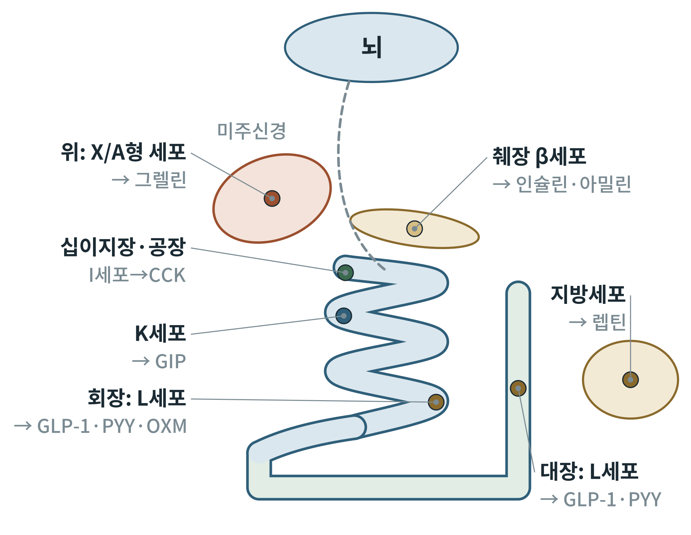
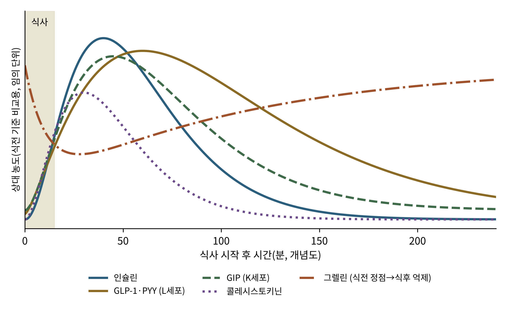

# 제2부 생리학: 몸 전체에서

## 제4장 몸이 보내는 신호: 장·췌장·지방의 호르몬 지도

> **이 장의 출발점** 3장에서 우리는 뇌가 신호를 받는 회로를 보았다. 이 장은 그 신호가 어디서 출발하는지, 곧 위·장·췌장·지방조직이 식사 전후에 어떤 호르몬을 내보내는지를 한 장의 지도로 정리한다. 각 호르몬이 수용체에 붙어 세포 안에서 일으키는 변화는 2권 15장에서, 식후 인크레틴 효과의 정량적 모형은 2권 19장에서, 공복 때 이 신호들이 어떻게 뒤집히는지는 2권 27~29장에서 이어 다룬다.

### 4.1 동물의 입에 호르몬을 넣다: 포만 신호 발견 이야기

1장과 2장에서 보았듯이 20세기의 비만약은 대부분 뇌를 직접 건드리는 분자였다. 그런데 뇌의 회로가 알려지자 한 가지 질문이 남았다. 뇌는 도대체 무엇을 보고 "배부르다"고 판단하는가. 답은 몸의 다른 곳에 있었다.

1973년 Gibbs, Young, Smith는 쥐에게 **콜레시스토키닌(cholecystokinin, CCK)** 을 주사하면 식사량이 줄어든다는 실험을 발표했다(Gibbs et al., 1973). CCK는 원래 지방이 십이지장에 들어오면 담낭을 수축시키는 호르몬으로 알려져 있었다. 소화를 돕는 호르몬이 동시에 "이제 그만 먹어라"는 말도 한다는 발견이었다. 이 실험은 장 호르몬이 식욕 신호라는 개념의 출발점으로 자주 인용된다.

반대 방향의 신호는 한참 뒤에야 나왔다. 1999년 Kojima 등은 위에서 **그렐린(ghrelin)** 을 분리했다(Kojima et al., 1999). 이 발견의 경로가 특이했다. 그들은 먼저 성장호르몬 분비 자극 약물이 붙는 수용체를 알고 있었지만 그 수용체에 붙는 천연 물질은 몰랐다. 이처럼 수용체는 알려졌으나 짝이 되는 리간드를 모르는 수용체를 **고아 수용체(orphan receptor)** 라 하고, 고아 수용체의 짝을 찾는 방식을 역약리학(reverse pharmacology)이라 한다. 위 추출물에서 그 짝을 찾아낸 것이 그렐린이었다. 이름은 성장호르몬을 뜻하는 어근 "ghre"에서 왔다. 그런데 이 물질은 성장호르몬만 올리는 것이 아니었다. 곧 사람에게 주사하면 배가 고파진다는 사실이 드러났다(Wren et al., 2001).

2002년 Batterham 등은 장에서 나오는 **펩타이드 YY(peptide YY, PYY)** 의 일부 조각인 PYY3-36을 사람에게 주입하면 식사량이 줄어든다고 보고했다(Batterham et al., 2002). 이로써 하나의 그림이 완성되었다. 장은 먹을 때 포만 신호를 내고, 위는 비었을 때 배고픔 신호를 낸다. 이 호르몬들의 이름과 위치는 외워야 한다. 이후 모든 장에서 약물 표적으로 다시 나오기 때문이다.

### 4.2 장은 가장 큰 내분비 기관이다

소화관 점막에는 영양분을 감지해 호르몬을 내보내는 **장내분비세포(enteroendocrine cell)** 가 흩어져 있다. 이 세포들은 점막 상피 세포 중 아주 작은 비율이지만, 모두 합치면 몸에서 가장 많은 종류의 호르몬을 만드는 기관이 된다는 점에서 "가장 큰 내분비 기관"이라 불린다(Gribble & Reimann, 2016).

그림 4-1은 이 장에서 다룰 세포의 위치다. 위의 X/A형 세포는 그렐린을, 십이지장과 공장의 I세포는 CCK를, 같은 부위의 K세포는 **포도당 의존성 인슐린 분비 자극 폴리펩타이드(GIP)** 를 만든다. 회장과 대장에 많은 L세포는 **글루카곤 유사 펩타이드 1(glucagon-like peptide 1, GLP-1)**, PYY, 그리고 **옥신토모듈린(oxyntomodulin, OXM)** 을 만든다. 췌장의 β세포는 인슐린과 **아밀린(amylin)** 을, 지방세포는 1장에서 본 렙틴을 분비한다.

**그림 4-1. 에너지 항상성 호르몬을 분비하는 세포의 위치.** 위(그렐린), 십이지장·공장(CCK, GIP), 회장·대장(GLP-1, PYY, OXM), 췌장(인슐린, 아밀린), 지방조직(렙틴)에서 나온 신호는 혈액과 미주신경을 통해 뇌에 도달한다. 점선은 미주신경을 나타낸다. 개념도이며 크기와 비례는 실제와 다르다. OXM은 옥신토모듈린.

그림에서 두 가지를 읽는다. 첫째, 장 호르몬은 장의 길이를 따라 나뉘어 분비된다. GIP는 영양분이 먼저 닿는 윗부분(근위부)에서, GLP-1과 PYY는 더 아래쪽에서 많이 나온다. 그런데 GLP-1은 식사 직후 짧은 시간에 혈중 농도가 오르는 것으로 알려져 있어서, 소장 아래쪽까지 음식이 도달하기 전에 어떻게 분비되는가가 오래 논의되었다. 근위부에서 보내는 신경 신호나 다른 호르몬이 먼저 L세포를 자극한다는 가설과, 근위부에도 소수의 L세포가 있다는 설명이 함께 제시되어 있다(Holst, 2007; Gribble & Reimann, 2016). 둘째, 세포들은 각자 감지하는 영양소가 다르다. 대체로 지방산, 아미노산, 포도당이 각기 다른 수용체와 수송체를 통해 세포를 자극한다. 이 감지 분자들은 약물 표적이 될 수 있어서 3권에서 다시 다룬다.

### 4.3 식후 호르몬의 합창

음식을 먹으면 호르몬들은 한꺼번에 변한다. 그림 4-2는 이 변화를 한 장에 겹쳐 그린 개념도다. 정량 곡선이 아니라, 문헌에서 반복해서 서술되는 방향과 대략적인 시간 순서만 옮긴 것이다. 실제 곡선은 식사의 크기와 성분, 사람에 따라 크게 달라서 2권 19장에서 논문의 원자료와 함께 다시 그린다.

**그림 4-2. 식사 전후 호르몬 변화의 개념도.** 식사(회색 띠) 뒤에 인슐린, GIP, GLP-1, PYY, CCK는 오르고 그렐린은 식전 정점에서 식후 감소한다. 곡선의 모양과 정점 시간은 방향을 설명하기 위한 도식이며 측정값이 아니다.

곡선을 보면 CCK와 GIP는 식사 직후 빠르게, GLP-1과 PYY는 조금 뒤에 오래 오른다고 서술된다. 그렐린은 반대로 식사 전에 정점이고 식후에 떨어진다. Cummings 등(2001)은 사람에서 그렐린이 식사 전에 오르고 식후에 감소하는 날 주기 패턴을 보고했다. 이 장에서 기억할 핵심은 곡선 모양이 아니라 **방향**이다. 대부분의 포만 호르몬은 식후에 오르고, 그렐린만 식전에 오른다.

비만에서는 이 패턴이 약해진다는 보고가 있다. 예를 들어 식후 GLP-1이나 PYY 반응이 낮다는 연구가 있고, 반대로 차이가 없다는 연구도 있어서 일관되지 않다. 이 불일치는 논문 데이터베이스 검색으로 정리해야 하는 주제이므로 2권 19장에서 문헌 근거와 함께 다룬다. 여기서는 "신호 감소가 비만의 원인인가, 결과인가"가 아직 열린 질문이라는 점만 짚어 둔다.

### 4.4 그렐린: 배고픔을 켜는 호르몬

그렐린은 28개 아미노산으로 이루어진 펩타이드다. 이 호르몬의 특이한 점은 세 번째 아미노산(세린)에 지방산인 옥탄산이 붙어야 활성이 생긴다는 것이다. 이 지방산 부착을 맡는 효소가 **그렐린 O-아실전달효소(ghrelin O-acyltransferase, GOAT)** 다. 분비된 그렐린이 수용체 **성장호르몬 분비 촉진 인자 수용체(growth hormone secretagogue receptor, GHSR)** 에 붙으면 시상하부의 AgRP/NPY 뉴런이 켜진다. 3장의 그림 3-1에서 그렐린 화살표가 AgRP 뉴런으로만 들어가던 이유다.

그렐린은 비만 약물 개발에서 독특한 위치를 차지한다. 대부분의 장 호르몬은 "늘려서" 약으로 쓰는데, 그렐린은 "막아서" 약으로 쓰려는 시도가 있었다. 그러나 그렐린 경로를 막는 약이 체중을 의미 있게 줄이지 못했다는 점은 이 신호가 중복 경로 가운데 하나일 뿐임을 시사한다. 이 서술의 구체적 임상 근거는 검증 대기 목록에 두었으며, 그렐린 경로의 약물 시도는 2권 15장과 3권에서 문헌으로 확인해 보강한다.

### 4.5 췌장과 지방: 장기적인 신호

장 호르몬이 "이번 식사"에 대한 신호라면, 췌장과 지방조직의 호르몬은 "몸에 쌓인 에너지"에 대한 신호다.

**인슐린(insulin)** 은 혈당이 오르면 췌장 β세포에서 분비되어 근육·지방·간의 포도당 이용을 높인다. 동시에 뇌에서도 작용한다. 1979년 Woods 등은 개코원숭이의 뇌실에 인슐린을 만성적으로 주입하면 섭식량과 체중이 줄어든다고 보고해, 인슐린이 뇌에서 에너지 균형 신호로 작동할 수 있음을 보였다(Woods et al., 1979). 따라서 인슐린은 혈당 호르몬이자 뇌에 보내는 비만 신호이기도 하다. 이 이중성 때문에 인슐린 투여는 혈당을 낮추면서 체중을 늘리는 방향으로 작용하기 쉽고, 이는 2권에서 에너지 저장과 분해의 균형으로 다시 다룬다.

**아밀린(amylin)** 은 β세포가 인슐린과 함께 분비하는 37개 아미노산 펩타이드다(Cooper et al., 1987). 위 배출을 늦추고 뇌간의 최후야(area postrema)에 작용해 포만감을 높인다고 알려져 있다. 아밀린 수용체는 칼시토닌 수용체와 **수용체 활성 변형 단백질(receptor activity-modifying protein, RAMP)** 의 복합체로 구성된다. 아밀린 유사체는 당뇨병 치료에 먼저 쓰였고, 현재는 비만 약물로도 개발되고 있다. 현황은 시간이 지나며 빠르게 바뀌므로 12장에서 최신 문헌으로 정리한다.

**렙틴(leptin)** 은 1장에서 본 것처럼 지방세포가 만들며, 지방이 많을수록 혈중 농도가 높다. 3장에서 보았듯이 렙틴은 궁상핵에서 POMC 뉴런을 켜고 AgRP 뉴런을 끈다. 그런데 비만인 사람은 렙틴 농도가 높은데도 체중이 줄지 않는다. 이를 **렙틴 저항성(leptin resistance)** 이라 한다. 이 현상의 기전은 아직 완전히 정리되지 않았으며, 렙틴을 그대로 약으로 쓰는 방식이 일반 비만에서 성공하지 못한 이유로 자주 거론된다.

### 4.6 위가 비는 속도: 호르몬의 또 다른 길

호르몬이 뇌에 직접 말하는 것과 별개로, 같은 호르몬은 위장의 움직임을 바꿔 포만을 만든다. GLP-1, PYY, CCK, 아밀린은 모두 위 배출을 늦춘다고 알려져 있다. 위가 천천히 비면 포만감이 오래 지속되고, 식후 혈당의 급상승도 완만해진다. 반대로 위 배출이 빠르면 영양분이 소장으로 급하게 내려가 장 호르몬이 짧고 강하게 분비된다.

이 효과는 약물 해석에서 중요하다. 2장의 GLP-1 작용제를 처음 투여하면 위 배출이 확연히 느려지지만, 지속 투여하면 이 효과가 약해진다는 서술이 문헌에 있다(이른바 속성내성). 반면 뇌를 통한 식욕 억제는 지속된다고 해석된다. 이 구분의 정확한 근거는 2권 19장에서 문헌 자료로 제시한다. 위 배출 지연은 약 복용 후 오심·구토와도 연결되므로 12장의 이상반응 논의에서 다시 만난다.

### 4.7 신호가 뇌에 닿는 두 길

장과 췌장의 신호가 뇌에 닿는 경로는 크게 둘이다. **혈액 경로**는 호르몬이 혈류를 타고 가서, 3장에서 본 혈액-뇌 장벽이 느슨한 부위(궁상핵, 최후야)에 닿는 방식이다. **신경 경로**는 장 벽의 미주신경 말단이 호르몬이나 영양분, 장의 팽창을 감지해 뇌간의 **고립로핵(nucleus of the solitary tract, NTS)** 으로 신호를 올려 보내는 방식이다. 그림 4-1의 점선이 이 경로다.

GLP-1이 혈액에서 반감기가 매우 짧은 점(2장)을 생각하면, 장에서 분비된 GLP-1이 혈액으로 뇌에 도달하는 몫은 작고 장 가까운 미주신경 신호의 몫이 크다는 가설이 제기된 적이 있다. 반면 약으로 투여한 GLP-1 작용제는 반감기가 길어 혈액 경로로 뇌에 닿는다. 천연 호르몬이 일하는 방식과 약이 일하는 방식이 다를 수 있다는 점은 약물 설계에서 반복해서 등장하는 주제이며, 2권 15장과 19장에서 정량적으로 다룬다.

### 4.8 약물 지도: 어떤 호르몬이 약이 되었나

표 4-1은 이 장의 호르몬을 한 장에 정리한 것이다. 마지막 열은 비만 약물 개발에서 그 신호가 어떻게 쓰이는지 개요만 적었다. 임상 시험의 숫자와 구조는 2장과 이후 장에서 다룬다.

**표 4-1. 에너지 항상성 호르몬의 분비 부위, 수용체, 작용, 약물 연결.**

| 호르몬 | 분비 세포·부위 | 주 수용체 | 식욕·대사 작용 | 비만 약물과의 연결 |
|---|---|---|---|---|
| 그렐린 | 위 X/A형 세포 | GHSR | 배고픔 증가(AgRP/NPY 활성) | 억제 시도(근거 검증 대기) |
| CCK | 십이지장·공장 I세포 | CCK1 수용체 | 식사 종결 신호, 담낭 수축 | 단독 약물은 어려움 |
| GIP | 십이지장·공장 K세포 | GIP 수용체 | 인슐린 분비 촉진 | 티르제파타이드의 한 축(2장) |
| GLP-1 | 회장·대장 L세포 | GLP-1 수용체 | 포만, 인슐린 분비, 위 배출 지연 | 리라글루타이드, 세마글루타이드(2장) |
| PYY | 회장·대장 L세포 | Y2 수용체(PYY3-36) | 식사 후 포만 | 병용·다중 작용제 연구 |
| 옥신토모듈린 | 회장·대장 L세포 | GLP-1 수용체, 글루카곤 수용체 | 식욕 감소, 에너지 소비 증가 가능성 | 이중·삼중 작용제 설계의 원형 |
| 인슐린 | 췌장 β세포 | 인슐린 수용체 | 포도당 이용, 뇌에서 섭식 억제 신호 | 체중 증가 위험 |
| 아밀린 | 췌장 β세포 | 칼시토닌 수용체+RAMP | 위 배출 지연, 포만 | 유사체 개발 중 |
| 렙틴 | 지방세포 | 렙틴 수용체 | 포만, 에너지 소비 | 일반 비만에선 효과 제한(렙틴 저항성) |

표에서 읽을 것이 있다. 약물이 된 신호는 GLP-1과 GIP처럼 **하나의 호르몬이 여러 곳(뇌, 췌장, 위)에 동시에 작용하는 것**이다. 그런데 한 호르몬만 쓴 약은 효과의 한계가 있었고, 옥신토모듈린처럼 두 수용체를 함께 켜는 분자가 다음 세대의 설계 원리가 되었다. 옥신토모듈린은 Wynne 등(2005)이 과체중·비만 성인에서 피하 투여로 체중이 줄었다고 보고한 바 있다. 여러 호르몬을 한 분자에 담는 전략은 13장과 16장에서 본격적으로 다룬다.

### 이 장의 요점

장에서는 그렐린만이 배고픔 신호이고 나머지는 대부분 포만 신호다. 신호는 혈액과 미주신경을 거쳐 3장의 궁상핵과 뇌간에 닿는다. 약이 된 것은 GLP-1과 GIP였고, 여러 신호를 동시에 쓰는 다중 작용제가 다음 단계다. 이 장의 곡선과 표는 방향과 구조를 보인 개념 자료이며, 정량 값은 2권에서 원자료로 확인한다.

#### 참고문헌

Batterham, R. L., Cowley, M. A., Small, C. J., Herzog, H., Cohen, M. A., Dakin, C. L., Wren, A. M., Brynes, A. E., Low, M. J., Ghatei, M. A., Cone, R. D., & Bloom, S. R. (2002). Gut hormone PYY3-36 physiologically inhibits food intake. *Nature, 418*(6898), 650–654. https://doi.org/10.1038/nature00887

Cooper, G. J. S., Willis, A. C., Clark, A., Turner, R. C., Sim, R. B., & Reid, K. B. M. (1987). Purification and characterization of a peptide from amyloid-rich pancreases of type 2 diabetic patients. *Proceedings of the National Academy of Sciences, 84*(23), 8628–8632. https://doi.org/10.1073/pnas.84.23.8628

Cummings, D. E., Purnell, J. Q., Frayo, R. S., Schmidova, K., Wisse, B. E., & Weigle, D. S. (2001). A preprandial rise in plasma ghrelin levels suggests a role in meal initiation in humans. *Diabetes, 50*(8), 1714–1719. https://doi.org/10.2337/diabetes.50.8.1714

Gibbs, J., Young, R. C., & Smith, G. P. (1973). Cholecystokinin decreases food intake in rats. *Journal of Comparative and Physiological Psychology, 84*(3), 488–495. https://doi.org/10.1037/h0034870

Gribble, F. M., & Reimann, F. (2016). Enteroendocrine cells: Chemosensors in the intestinal epithelium. *Annual Review of Physiology, 78*, 277–299. https://doi.org/10.1146/annurev-physiol-021115-105439

Holst, J. J. (2007). The physiology of glucagon-like peptide 1. *Physiological Reviews, 87*(4), 1409–1439. https://doi.org/10.1152/physrev.00034.2006

Kojima, M., Hosoda, H., Date, Y., Nakazato, M., Matsuo, H., & Kangawa, K. (1999). Ghrelin is a growth-hormone-releasing acylated peptide from stomach. *Nature, 402*(6762), 656–660. https://doi.org/10.1038/45230

Woods, S. C., Lotter, E. C., McKay, L. D., & Porte, D., Jr. (1979). Chronic intracerebroventricular infusion of insulin reduces food intake and body weight of baboons. *Nature, 282*(5738), 503–505. https://doi.org/10.1038/282503a0

Wren, A. M., Seal, L. J., Cohen, M. A., Brynes, A. E., Frost, G. S., Murphy, K. G., Dhillo, W. S., Ghatei, M. A., & Bloom, S. R. (2001). Ghrelin enhances appetite and increases food intake in humans. *Journal of Clinical Endocrinology & Metabolism, 86*(12), 5992. https://doi.org/10.1210/jcem.86.12.8111

Wynne, K., Park, A. J., Small, C. J., Patterson, M., Ellis, S. M., Murphy, K. G., Wren, A. M., Frost, G. S., Meeran, K., Ghatei, M. A., & Bloom, S. R. (2005). Subcutaneous oxyntomodulin reduces body weight in overweight and obese subjects: A double-blind, randomized, controlled trial. *Diabetes, 54*(8), 2390–2395. https://doi.org/10.2337/diabetes.54.8.2390
