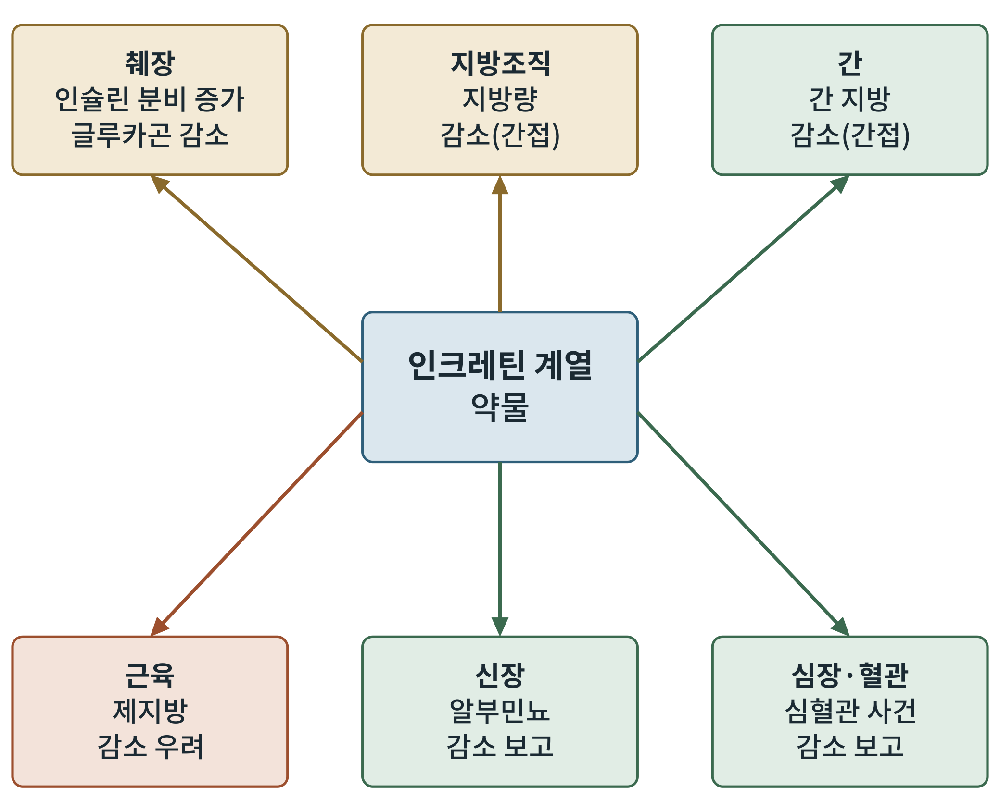

# 제2부 생리학: 몸 전체에서

## 제5장 표적 장기: 췌장, 지방, 간, 근육, 신장, 심장

> **이 장의 출발점** 4장에서 우리는 호르몬이 어디서 나와 뇌에 닿는지를 보았다. 그러나 인크레틴 계열 약물은 뇌에서만 일하지 않는다. 몸 여러 장기에서 동시에 일하고, 그 가운데 어떤 효과는 약이 직접 만든 것이고 어떤 효과는 체중이 줄어서 따라온 결과다. 이 장은 장기별로 그 구분을 정리한다. 장기별 대사의 상세는 2권 31장(간), 32장(근육), 33장(지방조직), 34장(뇌와 β세포)에서 다룬다.

### 5.1 랑게르한스의 섬: 췌장

1869년 독일의 의학도 Paul Langerhans는 현미경으로 췌장을 들여다보다가, 소화액을 만드는 세포 사이에 작은 세포 무리가 흩어져 있는 것을 보고 학위 논문에 기록했다. 그는 이 세포 무리의 기능을 몰랐다. 훗날 이 무리는 **랑게르한스섬(islets of Langerhans, 췌도)** 으로 불리게 되고, 몸의 혈당을 조절하는 중심 기관으로 밝혀진다. 이 이야기의 연도와 서술은 검증 대기 목록에 두었다.

췌도에는 세 종류의 세포가 있다. **α세포**는 **글루카곤(glucagon)** 을 분비해 간에서 포도당을 내놓게 한다. **β세포**는 인슐린을 분비한다. **δ세포**는 **소마토스타틴(somatostatin)** 을 분비해 두 세포 모두에 브레이크 역할을 한다. 인크레틴 계열 약물의 췌장 작용은 이 세 세포에 대한 작용으로 정리된다. GLP-1은 β세포의 인슐린 분비를 포도당이 높을 때에만 늘리고, α세포의 글루카곤 분비를 줄이는 방향으로 작용한다고 알려져 있다(Campbell & Drucker, 2013). 7장에서 보겠지만 "포도당이 높을 때에만"이라는 조건이 저혈당 위험을 낮추는 핵심이다.

이 장면에서 한 가지 눈여겨볼 점이 있다. 비만약으로 쓰는 GLP-1 작용제의 가장 확실한 직접 작용점이 췌장이지만, 비만 환자의 체중 감소는 주로 뇌를 통한 식욕 감소로 설명된다(3장). 따라서 췌장 작용은 당뇨병 치료 효과의 기반이고, 체중 감소는 다른 경로가 만든다고 정리하는 것이 안전하다. 2권 19장에서 식후 인슐린 분비의 시간 곡선과 함께 정량적으로 다룬다.

### 5.2 지방조직: 저장소에서 내분비 기관으로

과거에는 지방을 에너지를 쌓아 두는 창고로만 여겼다. 렙틴의 발견(1장)이 이 인식을 바꾸었다. 지방은 호르몬을 분비하는 내분비 기관이다.

지방조직에는 세 종류가 있다. **백색지방**은 에너지를 중성지방으로 저장한다. **갈색지방**은 미토콘드리아가 많고 탈공역 단백질 1(UCP1)로 에너지를 열로 태운다. **베이지지방**은 백색지방 속에서 자극에 따라 갈색지방과 비슷한 성질을 띠는 세포다. 성인에게도 갈색지방이 있다는 사실은 2009년 양전자 단층촬영 연구로 확인되었다(Cypess et al., 2009). 이 발견 때문에 갈색지방을 약물 표적으로 삼으려는 시도가 이어졌다. 이 열발생의 세포 내 기전은 2권 12장에서 자세히 본다.

인크레틴 계열 약물로 줄어든 체중은 대부분 지방 감소로 보고된다. 그런데 이 지방 감소가 약물이 지방세포에 직접 작용해서 생기는지, 섭취가 줄어서 생기는지는 구분해야 한다. 현재의 일반적 해석은 후자다. 즉 약물이 먼저 식욕을 낮추고, 그 결과 에너지 수지가 음이 되어 지방이 줄어든다. 지방세포에 GLP-1 수용체가 거의 없다는 점도 이 해석과 맞는다. 이 해석은 검증 대기 목록에 있으며 33장에서 다시 정리한다.

### 5.3 간: 지방간이라는 조용한 동반 질환

간은 지방산을 합성하고 저장하는 장기이자, 포도당을 만들어 내놓는 장기다. 비만에서는 간에 지방이 쌓이는 경우가 많다. 이 상태를 이 책은 앞서 1장에서 쓴 대로 **대사이상 관련 지방간질환**이라 부른다. 용어는 최근 몇 해 사이 국제적으로 개정되었으므로 문헌마다 명칭이 다르다.

GLP-1 작용제가 이 질환을 개선한다는 근거는 임상시험에서 나왔다. Newsome 등(2021)은 세마글루타이드를 지방간염 환자에게 투여한 시험에서 지방간염의 소실이 위약군보다 많았다고 보고했다. 다만 이 효과가 간세포의 GLP-1 수용체에 직접 작용한 결과인지, 체중과 인슐린 저항의 개선을 통한 간접 효과인지는 아직 논쟁 중이다. 간세포에서의 수용체 발현 자체가 연구마다 일치하지 않는 것으로 알려져 있다. 이 논점은 2권 31장에서 다룬다.

### 5.4 근육: 줄어든 몸무게 속에 무엇이 들어 있나

체중이 줄 때 줄어드는 것이 지방만은 아니다. 근육을 포함한 제지방량도 일부 줄어든다. 이는 약물과 상관없이 식이 제한으로 체중을 줄일 때도 나타나는 현상이다. 문제는 인크레틴 계열 약물이 만드는 체중 감소의 폭이 크기 때문에 절대적인 근육 감소량도 클 수 있다는 점이다. 임상시험에서 보고된 제지방 감소의 비율은 시험과 측정 방법에 따라 다르며, 어떤 비율이 정상 범위인지에 대해서는 합의가 완전하지 않다. 정확한 수치는 2권 32장에서 원논문의 측정 방법과 함께 정리한다.

근육은 몸에서 가장 큰 포도당 소비 조직이다. 근육이 줄면 기초대사량이 낮아지고 체중이 다시 늘기 쉬운 조건이 만들어진다는 우려가 제기된다. 이 때문에 16장의 차세대 표적에는 근육을 보존하려는 접근이 포함된다. 단백질 섭취와 저항 운동 같은 비약물적 개입의 근거도 함께 다룬다.

### 5.5 신장과 심장: 체중 이상의 이득

비만약의 임상적 의미는 체중 감소만으로 끝나지 않는다. 대규모 심혈관 결과 시험은 이 약물들이 심장과 신장에 미치는 영향을 보여 주었다.

당뇨병 환자를 대상으로 한 세마글루타이드 시험(SUSTAIN-6)에서 주요 심혈관 사건이 위약보다 적었다(Marso et al., 2016). 비만하지만 당뇨병이 없는 심혈관 질환자를 대상으로 한 SELECT 시험에서도 세마글루타이드가 주요 심혈관 사건의 위험을 낮추었다(Lincoff et al., 2023). 신장에서는 당뇨병성 신장병 환자를 대상으로 한 FLOW 시험이 신장 결과를 낮추는 방향의 결과를 보고했다(Perkovic et al., 2024). 각 시험의 정확한 위험비와 대상, 추적 기간은 검증을 마친 뒤 13~17장에서 해당 약물과 함께 서술한다.

여기서 반드시 구분할 것이 있다. 이 이득이 체중 감소 때문인지, 혈압·혈당·염증의 개선 때문인지, 약물이 심장과 신장에 직접 작용하기 때문인지는 아직 분리되지 않았다. 심근에서 GLP-1 수용체의 발현은 사람에서 일관되지 않다는 보고가 있다. 이 구분은 3권 12장에서 "약물 밖의 신호"를 논할 때도 중요하다.

### 5.6 지도로 정리하기

그림 5-1은 이 장의 내용을 한 장에 모은 것이다. 중앙에 약물을 두고, 장기별 작용을 화살표로 이었다. 화살표 색은 해석의 위상을 나타낸다.

**그림 5-1. 인크레틴 계열 약물의 장기별 효과 지도.** 중앙의 약물에서 여섯 장기로 가는 화살표. 갈색은 직접 작용이 비교적 분명한 장기(췌장)와 체중 감소의 결과로 설명되는 지방조직, 초록은 임상 결과가 보고되었으나 직접·간접 구분이 열려 있는 장기(간, 신장, 심장·혈관), 붉은색은 부정적 영향이 우려되는 장기(근육)를 뜻한다. 개념도이며 효과의 크기는 나타내지 않는다.

그림에서 읽을 것은 두 가지다. 첫째, 이 약물의 장기별 작용은 위상이 서로 다르다. 췌장 작용은 수용체-세포 수준에서 설명이 가능하지만, 심장과 신장의 이득은 아직 임상 결과가 설명보다 앞서 있다. 둘째, 근육은 유일하게 부정적 방향으로 표시되었다. 이것이 16장 이후에서 새 약물의 요구 조건이 되는 이유다.

표 5-1은 장기별 근거의 수준을 비교하기 위한 것이다. 근거 수준은 "임상시험 결과 존재", "기전 근거 존재", "직접 작용 확인" 세 단계로 구분했고, 이 구분은 책 전체에서 일관되게 쓴다.

**표 5-1. 장기별 작용 방식과 근거 수준.**

| 장기 | 관찰된 변화 | 직접 작용 근거 | 대표 시험 또는 문헌 | 이 책의 상세 위치 |
|---|---|---|---|---|
| 췌장 | 포도당 의존성 인슐린 분비 증가, 글루카곤 감소 | 비교적 분명 | Campbell & Drucker (2013) | 2권 19장, 1권 7장 |
| 지방조직 | 지방량 감소 | 간접(섭취 감소)으로 해석 | Cypess 등 (2009; 갈색지방) | 2권 33장 |
| 간 | 지방간염 소실 증가 | 논쟁 중 | Newsome 등 (2021) | 2권 31장 |
| 근육 | 제지방 감소 우려 | 해당 없음(체중 감소의 부작용) | 시험별 측정 | 2권 32장, 1권 16장 |
| 신장 | 신장 결과 감소 방향 | 논쟁 중 | Perkovic 등 (2024) | 1권 17장 |
| 심장·혈관 | 주요 심혈관 사건 감소 | 논쟁 중 | Marso 등 (2016); Lincoff 등 (2023) | 1권 13장 |

### 이 장의 요점

약물이 표적으로 삼는 것은 뇌와 췌장이지만, 임상 효과는 간, 신장, 심장으로 퍼진다. 어느 부분이 직접 작용이고 어느 부분이 체중 감소의 결과인지를 구분하는 일이 새 약물 설계의 출발점이다. 이 구분은 3권 2장의 표적 점수화에서 "직접 작용 근거" 항목으로 쓰인다.

**2부 점검:** 4~5장으로 호르몬-회로-장기 지도가 완성되었다(산출물 1).

#### 참고문헌

Campbell, J. E., & Drucker, D. J. (2013). Pharmacology, physiology, and mechanisms of incretin hormone action. *Cell Metabolism, 17*(6), 819–837. https://doi.org/10.1016/j.cmet.2013.04.008

Cypess, A. M., Lehman, S., Williams, G., Tal, I., Rodman, D., Goldfine, A. B., Kuo, F. C., Palmer, E. L., Tseng, Y.-H., Doria, A., Kolodny, G. M., & Kahn, C. R. (2009). Identification and importance of brown adipose tissue in adult humans. *New England Journal of Medicine, 360*(15), 1509–1517. https://doi.org/10.1056/NEJMoa0810780

Lincoff, A. M., Brown-Frandsen, K., Colhoun, H. M., Deanfield, J., Emerson, S. S., Esbjerg, S., Hardt-Lindberg, S., Hovingh, G. K., Kahn, S. E., Kushner, R. F., Lingvay, I., Oral, T. K., Michelsen, M. M., Plutzky, J., Tornøe, C. W., & Ryan, D. H. (2023). Semaglutide and cardiovascular outcomes in obesity without diabetes. *New England Journal of Medicine, 389*(24), 2221–2232. https://doi.org/10.1056/NEJMoa2307563

Marso, S. P., Bain, S. C., Consoli, A., Eliaschewitz, F. G., Jódar, E., Leiter, L. A., Lingvay, I., Rosenstock, J., Seufert, J., Warren, M. L., Woo, V., Hansen, O., Holst, A. G., Pettersson, J., & Vilsbøll, T. (2016). Semaglutide and cardiovascular outcomes in patients with type 2 diabetes. *New England Journal of Medicine, 375*(19), 1834–1844. https://doi.org/10.1056/NEJMoa1607141

Newsome, P. N., Buchholtz, K., Cusi, K., Linder, M., Okanoue, T., Ratziu, V., Sanyal, A. J., Sejling, A.-S., & Harrison, S. A. (2021). A placebo-controlled trial of subcutaneous semaglutide in nonalcoholic steatohepatitis. *New England Journal of Medicine, 384*(12), 1113–1124. https://doi.org/10.1056/NEJMoa2028395

Perkovic, V., Tuttle, K. R., Rossing, P., Mahaffey, K. W., Mann, J. F. E., Bakris, G., Baeres, F. M. M., Idorn, T., Bosch-Traberg, H., Lausvig, N. L., & Pratley, R. (2024). Effects of semaglutide on chronic kidney disease in patients with type 2 diabetes. *New England Journal of Medicine, 391*(2), 109–121. https://doi.org/10.1056/NEJMoa2403347
