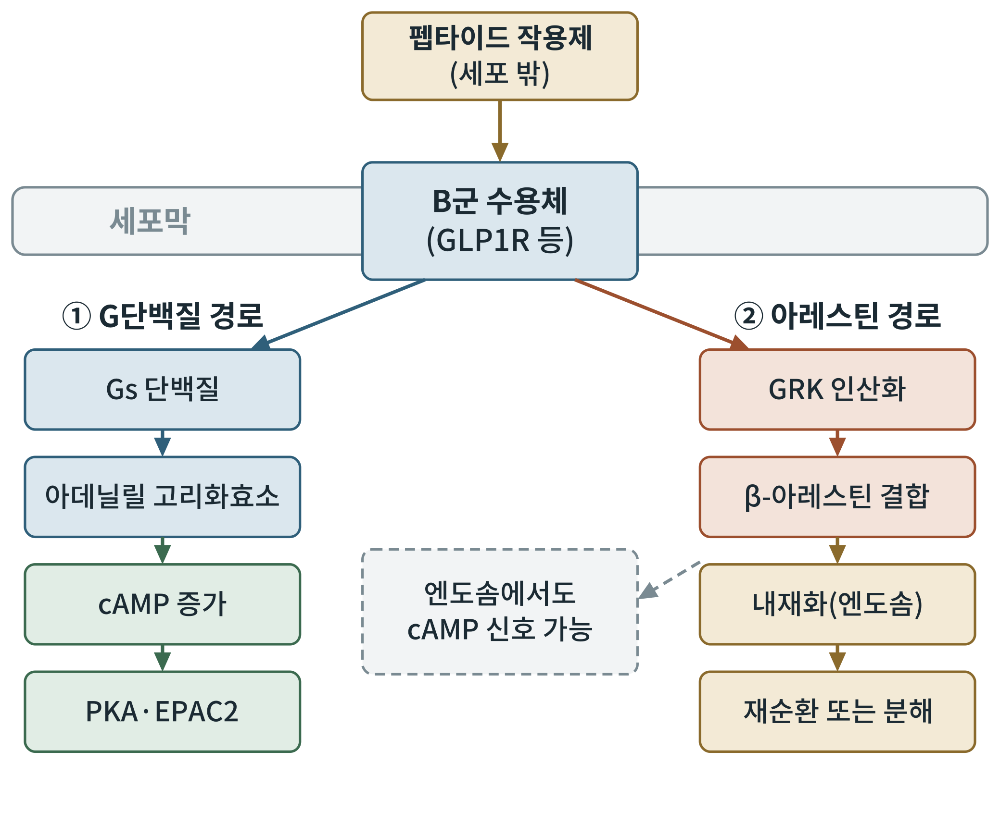
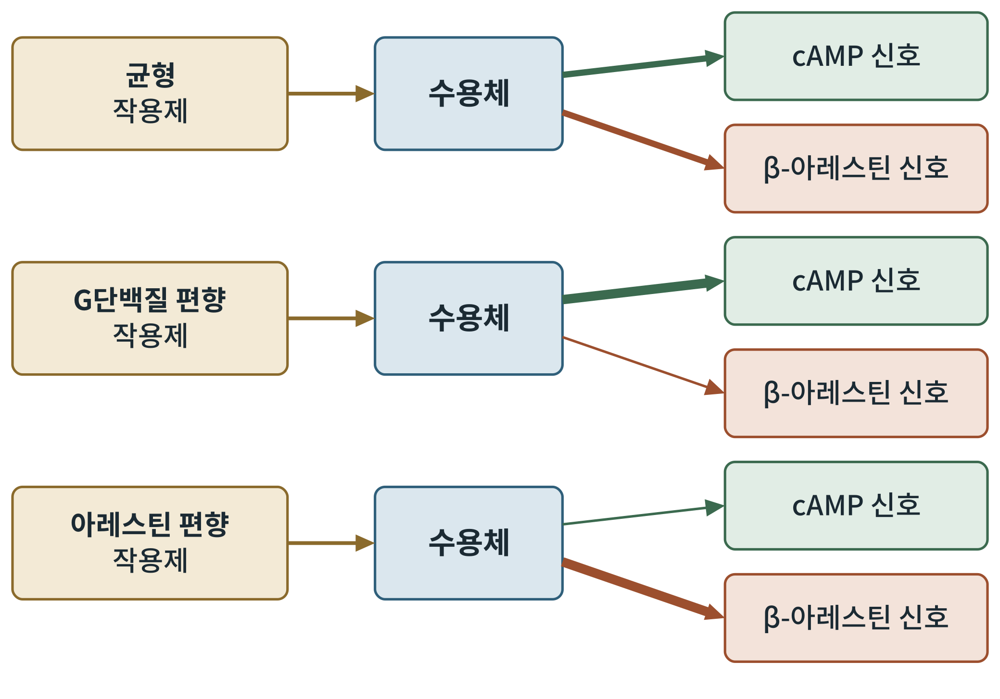

# 제3부 세포학과 신호전달

## 제6장 수용체의 세포학: B군 G단백질 연결 수용체와 세포막

> **이 장의 출발점** 5장까지 우리는 약물이 몸의 어느 장기에서 무엇을 바꾸는지 보았다. 이제 시선을 한 개의 세포로 옮긴다. 약물은 세포막 위의 수용체 한 종류에 붙고, 그 순간부터의 사건이 모든 효과를 만든다. 이 장은 그 수용체가 무엇이고, 약이 붙으면 어떻게 모양을 바꾸며, 신호가 어디로 갈라지는지를 다룬다. 호르몬 신호의 일반 원리는 2권 15장에서 이어서 다룬다.

### 6.1 수용체를 잡아라: 복제의 시대

2장에서 우리는 GLP-1이라는 호르몬이 1980년대에 발견되는 과정을 보았다. 호르몬이 있다면 그것을 받는 수용체가 있어야 한다. 그러나 수용체는 세포막에 박힌 단백질이고, 한 세포에 많지 않아서 혈액이나 조직에서 정제하기가 극히 어려웠다. 수용체를 찾는 길은 결국 그 유전자를 찾는 일이었다.

1992년 Thorens는 쥐의 췌도 세포에서 GLP-1 수용체의 유전자를 복제했다(Thorens, 1992). 이 수용체는 세포막을 일곱 번 가로지르는 구조를 가진 **G단백질 연결 수용체(G protein-coupled receptor, GPCR)** 였다. 그런데 이 수용체는 우리가 교과서에서 흔히 보던 GPCR과 달랐다. 세포 밖으로 나온 부분이 유난히 길었고, 서열 계통도 아드레날린 수용체와 같은 큰 가족(A군)에 속하지 않고 세크레틴 수용체 가족, 곧 **B군(class B1)** 에 속했다. 이 가족에는 GLP-1 수용체 외에 GIP 수용체, 글루카곤 수용체, 칼시토닌 수용체 등이 들어 있다. 이 가족의 이름과 분류는 검증 대기 목록에 두었다.

이 사실이 약물 설계에 의미하는 바는 크다. A군 수용체는 작은 분자가 막 안쪽의 포켓에 들어가 켜고 끄는 방식이 많다. B군 수용체의 리간드는 30~40개 아미노산으로 이루어진 비교적 큰 펩타이드다. 그래서 오랫동안 이 수용체를 겨냥한 약은 펩타이드 주사제였고, 경구 소분자는 거의 없었다. 15장에서 다룰 소분자 작용제가 왜 어려운 과제인지는 이 구조에서 나온다.

### 6.2 두 도메인 모형: 펩타이드는 수용체를 어떻게 잡는가

B군 수용체는 크게 두 부분으로 이루어진다. 세포 밖에 길게 나온 **세포 외 도메인(extracellular domain, ECD)** 과, 막을 일곱 번 가로지르는 **막횡단 도메인(transmembrane domain, TMD)** 이다. 펩타이드 리간드의 한쪽 끝(C 말단 쪽)이 먼저 세포 외 도메인에 붙어 위치를 잡고, 다른 쪽 끝(N 말단 쪽)이 막횡단 도메인의 안쪽으로 들어가 수용체를 활성화시킨다는 설명이 오래 전부터 널리 받아들여졌다. 이를 **두 도메인 모형**이라 부른다.

이 모형은 2017년 극저온 전자현미경으로 활성화된 GLP-1 수용체와 G단백질의 복합체 구조가 풀리면서 눈으로 확인되었다(Zhang et al., 2017). 구조에서 펩타이드는 막횡단 도메인이 만든 틈 안으로 N 말단 쪽이 깊이 들어가 있고, 수용체의 막 안쪽 부분이 벌어지면서 G단백질이 들어올 자리가 열린다. 이 이야기에서 약물 설계자가 얻는 것은 두 가지다. 첫째, 리간드의 N 말단 몇 개 아미노산이 활성의 열쇠다. 2장의 세마글루타이드에서 8번 위치에 Aib를 넣은 이유가 효소 분해를 막으려는 것이었다는 점을 떠올리면 좋다. 둘째, 수용체의 모양 변화가 막 속에서 일어난다는 것은 지질 환경이 활성에 영향을 준다는 뜻이다.

### 6.3 세포막이라는 무대

세포막은 지질 이중층이다. 수용체는 이 이중층에 박혀 있고, 막의 두께와 지질 조성, 콜레스테롤의 양이 단백질의 모양과 움직임에 영향을 준다는 보고가 있다. 이 효과가 GLP-1 수용체 신호에 어느 정도 기여하는지는 아직 정리되어 있지 않아서, 이 책은 막 환경이 수용체 기능의 변수가 될 수 있다는 정도로만 서술한다. 3권 6장에서 막단백질을 분자동역학으로 계산할 때 지질 이중층을 직접 구성하는 이유가 바로 이것이다.

### 6.4 두 갈래의 신호: G단백질과 아레스틴

리간드가 붙은 수용체는 모양을 바꾸고, 세포 안쪽에서 두 종류의 단백질을 부른다. 그림 6-1이 이 갈림길이다.

**그림 6-1. B군 수용체 활성화 뒤의 두 신호 경로.** 펩타이드 작용제가 수용체에 붙으면 한쪽(왼쪽)에서는 Gs 단백질이 아데닐릴 고리화효소를 켜서 cAMP가 늘고 PKA와 EPAC2가 활성화된다. 다른 쪽(오른쪽)에서는 수용체가 GRK에 인산화되어 β-아레스틴이 결합하고, 수용체가 내재화되어 재순환되거나 분해된다. 점선은 내재화된 수용체가 엔도솜에서 신호를 낼 수 있다는 보고를 뜻한다. 개념도이며 속도와 양은 나타내지 않는다. GRK는 G단백질 연결 수용체 인산화효소, PKA는 단백질 인산화효소 A, EPAC2는 cAMP 직접 활성화 교환인자 2.

왼쪽 경로가 약리 효과의 주경로다. GLP-1 수용체는 주로 **Gs 단백질**과 연결되어 **아데닐릴 고리화효소**를 켜고, 세포 안의 **고리형 아데노신 일인산(cyclic AMP, cAMP)** 이 늘어난다. cAMP는 **단백질 인산화효소 A(PKA)** 와 **cAMP 직접 활성화 교환인자 2(EPAC2)** 를 켜서 인슐린 분비와 유전자 발현을 일으킨다. 이 흐름의 하류는 7장에서 따라간다. 일부 보고는 GLP-1 수용체가 Gq 단백질과도 연결될 수 있다고 하나, 연결의 크기와 생리적 의미는 세포 종류와 조건에 따라 달라 아직 논쟁 중이다.

오른쪽 경로는 신호를 끄는 장치로 알려졌다. 활성화된 수용체는 **G단백질 연결 수용체 인산화효소(GRK)** 에 의해 인산화되고, 여기에 **β-아레스틴(β-arrestin)** 이 달라붙는다. 아레스틴이 붙으면 수용체는 G단백질과 더 이상 만나지 못하고, 막에서 안쪽으로 끌려 들어간다. 이 과정을 **내재화(internalization)** 라 한다. 내재화된 수용체는 다시 막으로 돌아가 재사용되거나(재순환), 분해된다. 어느 쪽으로 가는지가 약의 효과 지속 시간과 내성에 영향을 줄 수 있다.

그런데 이 구도는 지난 십수 년 사이에 수정되었다. 내재화된 수용체가 엔도솜 안에서도 신호를 계속 낼 수 있다는 개념이 다른 수용체에서 먼저 보고되었다(Irannejad et al., 2013). 그림의 점선 상자가 이것이다. 이 개념이 GLP-1 수용체에 어느 정도 적용되는지는 연구가 진행 중이며, 이 책은 가능성으로만 서술한다. 어떤 경우든 수용체의 신호를 "켜기"와 "끄기"로 나누는 이분법은 지나친 단순화다.

### 6.5 같은 수용체, 다른 신호: 편향 작용

같은 수용체에 붙는 약물이라도 두 경로를 똑같이 켜지 않을 수 있다. 어떤 약물은 G단백질 경로를 강하게 켜고 아레스틴 경로는 약하게 켠다. 반대 경우도 있다. 이 현상을 **편향 작용(biased agonism)** 이라 한다(Kenakin & Christopoulos, 2013). 약학적으로 말하면 수용체는 켜짐과 꺼짐의 두 상태만 가진 스위치가 아니라, 리간드가 어떻게 붙느냐에 따라 여러 모양을 취하는 다기능 단백질이다.

**그림 6-2. 편향 작용의 개념도.** 같은 수용체에 세 종류의 작용제가 붙었을 때 cAMP 신호와 β-아레스틴 신호의 세기 비율이 달라진다. 화살표의 굵기가 신호의 세기를 나타내며, 균형 작용제는 두 신호를 비슷하게, G단백질 편향 작용제는 cAMP 쪽을 강하게, 아레스틴 편향 작용제는 아레스틴 쪽을 강하게 일으킨다. 개념도이며 실제 측정값이 아니다.

이 개념이 비만약에서 중요한 이유는 두 가지다. 첫째, 아레스틴 경로가 약하면 내재화가 줄어 수용체가 막에 더 오래 남고, 효과가 오래갈 수 있다는 가설이 있다(Jones et al., 2018). 둘째, 두 경로의 신호가 서로 다른 생리 효과와 부작용에 연결될 수 있다는 가설이 있다. 티르제파타이드가 GLP-1 수용체에서 cAMP 쪽으로 편향되어 있다는 보고가 있다(Willard et al., 2020). 다만 편향의 크기가 임상 효과나 이상반응의 차이로 이어지는지는 아직 정립되지 않았다. 이 책은 편향을 "설계 변수의 하나"로 두되, 임상적 의미는 단정하지 않는다. 3권 10장에서 독자가 직접 편향 계수를 계산해 보도록 사례로 구성한 이유다.

### 6.6 가족의 다른 구성원: GIP, 글루카곤, 아밀린 수용체

같은 B군에 속한 수용체들은 구조가 비슷해서 한 약물이 둘 이상에 붙을 수 있다. 티르제파타이드가 GIP 수용체와 GLP-1 수용체에 모두 작용하는 것이 대표적이다(14장). 글루카곤 수용체는 간에서 포도당을 내놓는 신호를 맡지만, 에너지 소비를 늘리는 쪽으로도 연구되고 있다.

아밀린 수용체는 구성이 특이하다. 칼시토닌 수용체 하나만으로는 아밀린을 잘 받지 못하고, **수용체 활성 변형 단백질(receptor activity-modifying protein, RAMP)** 이 붙어서 짝을 이루어야 아밀린 수용체가 된다. 1998년 McLatchie 등은 비슷한 수용체인 CGRP 수용체에서 이 현상을 처음 보고했고(McLatchie et al., 1998), 이후 칼시토닌 수용체와 RAMP1, RAMP2, RAMP3의 조합이 서로 다른 수용체 약리를 만든다는 것이 정리되었다(Poyner et al., 2002). 하나의 유전자 산물이 짝에 따라 다른 수용체가 된다는 점이 약물 선택성을 설계할 때 변수가 된다. 표 6-1에 이 가족의 특징을 모았다.

**표 6-1. 비만약 관련 B군 수용체의 특징.**

| 수용체 | 주 리간드 | 주 연결 G단백질 | 주요 발현 부위(보고) | 관련 약물 | 비고 |
|---|---|---|---|---|---|
| GLP1R | GLP-1 | Gs(Gq 연결은 논쟁) | 췌도 β세포, 뇌(시상하부·뇌간) | 리라글루타이드, 세마글루타이드, 티르제파타이드 | 내재화·재순환 연구 활발 |
| GIPR | GIP | Gs | 췌도, 지방조직, 뇌 | 티르제파타이드 | 작용 방향에 논쟁 |
| GCGR | 글루카곤 | Gs | 간, 일부 다른 조직 | 삼중 작용제 후보 | 에너지 소비 증가 가능성 |
| 아밀린 수용체 | 아밀린 | Gs | 뇌간 최후야 등 | 아밀린 유사체 | 칼시토닌 수용체와 RAMP의 복합체 |

### 이 장의 요점

B군 수용체는 큰 세포 외 도메인과 막횡단 도메인을 가지고, 펩타이드의 한쪽 끝은 도메인 사이에서 위치를 잡고 다른 끝은 안쪽으로 들어가 활성화한다. 활성화된 수용체는 G단백질과 아레스틴의 두 갈래로 신호를 낸다. 같은 수용체도 약물에 따라 두 갈래의 비율이 달라질 수 있고, 이것이 새 약물 설계의 변수다. 다음 7장에서는 첫 갈래의 신호가 췌장 β세포에서 인슐린 분비로 이어지는 하류를 따라간다.

#### 참고문헌

Irannejad, R., Tomshine, J. C., Tomshine, J. R., Chevalier, M., Mahoney, J. P., Steyaert, J., Rasmussen, S. G. F., Sunahara, R. K., El-Samad, H., Huang, B., & von Zastrow, M. (2013). Conformational biosensors reveal GPCR signalling from endosomes. *Nature, 495*(7442), 534–538. https://doi.org/10.1038/nature12000

Jones, B., Buenaventura, T., Kanda, N., Chabosseau, P., Owen, B. M., Scott, R., Goldin, R., Angkathunyakul, N., Corrêa, I. R., Jr., Bosco, D., Johnson, P. R., Piemonti, L., Marchetti, P., Shapiro, A. M. J., Cochran, B. J., Hanyaloglu, A. C., Inoue, A., Tan, T., Rutter, G. A., … Bloom, S. R. (2018). Targeting GLP-1 receptor trafficking to improve agonist efficacy. *Nature Communications, 9*, Article 1602. https://doi.org/10.1038/s41467-018-03941-2

Kenakin, T., & Christopoulos, A. (2013). Signalling bias in new drug discovery: Detection, quantification and therapeutic impact. *Nature Reviews Drug Discovery, 12*(3), 205–216. https://doi.org/10.1038/nrd3954

McLatchie, L. M., Fraser, N. J., Main, M. J., Wise, A., Brown, J., Thompson, N., Solari, R., Lee, M. G., & Foord, S. M. (1998). RAMPs regulate the transport and ligand specificity of the calcitonin-receptor-like receptor. *Nature, 393*(6683), 333–339. https://doi.org/10.1038/30666

Poyner, D. R., Sexton, P. M., Marshall, I., Smith, D. M., Quirion, R., Born, W., Muff, R., Fischer, J. A., & Foord, S. M. (2002). International Union of Pharmacology. XXXII. The mammalian calcitonin gene-related peptides, adrenomedullin, amylin, and calcitonin receptors. *Pharmacological Reviews, 54*(2), 233–246. https://doi.org/10.1124/pr.54.2.233

Thorens, B. (1992). Expression cloning of the pancreatic beta cell receptor for the gluco-incretin hormone glucagon-like peptide 1. *Proceedings of the National Academy of Sciences, 89*(18), 8641–8645. https://doi.org/10.1073/pnas.89.18.8641

Willard, F. S., Douros, J. D., Gabe, M. B. N., Showalter, A. D., Wainscott, D. B., Suter, T. M., Capozzi, M. E., van der Velden, W. J. C., Stutsman, C., Cardona, G. R., Urva, S., Emmerson, P. J., Holst, J. J., D'Alessio, D. A., Coghlan, M. P., Rosenkilde, M. M., Campbell, J. E., & Sloop, K. W. (2020). Tirzepatide is an imbalanced and biased dual GIP and GLP-1 receptor agonist. *JCI Insight, 5*(17), Article e140532. https://doi.org/10.1172/jci.insight.140532

Zhang, Y., Sun, B., Feng, D., Hu, H., Chu, M., Qu, Q., Tarrasch, J. T., Li, S., Sun Kobilka, T., Kobilka, B. K., & Skiniotis, G. (2017). Cryo-EM structure of the activated GLP-1 receptor in complex with a G protein. *Nature, 546*(7657), 248–253. https://doi.org/10.1038/nature22394
