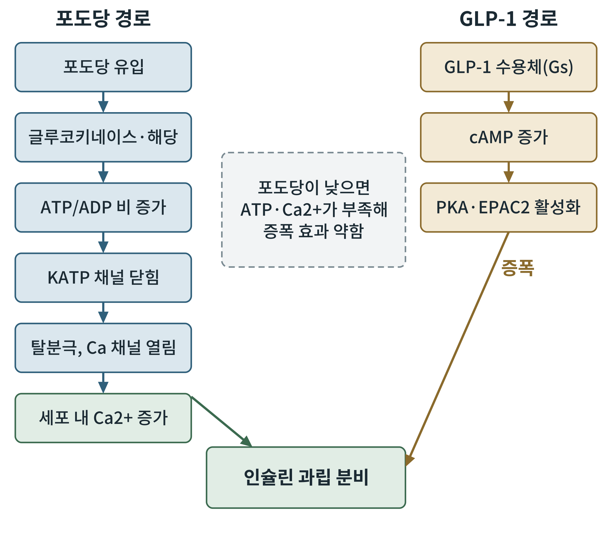
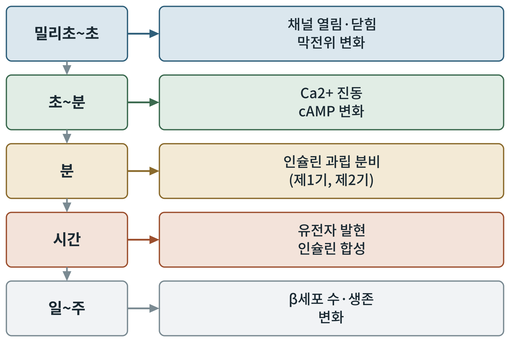

## 제7장 cAMP에서 인슐린 분비까지: 신호의 하류

> **이 장의 출발점** 6장에서 우리는 GLP-1 수용체가 Gs 단백질을 깨워 세포 안에 cAMP(cyclic adenosine monophosphate, 고리형 아데노신 일인산)를 만든다는 데까지 왔다. 이 장은 그 cAMP가 췌장 β세포 안에서 어떤 단백질을 움직여 마침내 인슐린 과립이 세포 밖으로 나가게 하는지를 따라간다. 그리고 왜 이 약이 혈당이 낮을 때는 거의 인슐린을 내지 않는지, 곧 포도당 의존성의 뿌리를 설명한다. (2권 19장 β세포 에너지 감지, 21장 칼슘 신호와 연결된다.)

### 7.1 신호를 따라가는 법: 상류와 하류

생물학에서 신호의 흐름을 말할 때, 수용체에 가까운 쪽을 상류, 최종 반응에 가까운 쪽을 하류라고 부른다. 6장까지가 상류의 이야기였다면 이 장은 하류다. 약을 만드는 사람에게 하류를 아는 일은 두 가지 이유로 중요하다. 첫째, 약이 왜 어떤 조건에서는 듣고 어떤 조건에서는 듣지 않는지가 하류의 구조에서 나온다. 둘째, 상류의 수용체를 건드리는 방법 말고도 하류의 단백질을 직접 겨냥하는 길이 있기 때문이다.

β세포(beta cell)는 췌도(pancreatic islet)에서 인슐린을 만드는 세포다. 이 세포는 혈액 속 포도당 농도를 재는 센서이면서 동시에 그 결과로 호르몬을 내보내는 분비기관이다. 한 세포 안에 "재는 장치"와 "내보내는 장치"가 함께 있다는 점이, 이 세포를 이해하는 열쇠다.

### 7.2 포도당이 스스로 내는 신호: 방아쇠 경로

인슐린 분비를 일으키는 첫 번째 길은 포도당 자체다. 이 길은 헨퀸(Henquin, 2000)의 정리에 따라 흔히 방아쇠 경로(triggering pathway)라고 부른다. 단계는 다음과 같다.

1. 포도당이 수송체를 통해 β세포 안으로 들어온다.
2. 글루코키네이스(glucokinase)가 포도당을 인산화한다. 이 효소는 혈당 범위에서 반응 속도가 농도에 민감하게 달라져서 포도당 센서 역할을 한다고 이해된다.
3. 해당과정과 미토콘드리아 산화로 ATP(adenosine triphosphate, 아데노신 삼인산)가 만들어져 세포 안의 ATP/ADP 비가 올라간다.
4. ATP에 민감한 칼륨 채널(KATP 채널)이 닫힌다.
5. 칼륨이 나가지 못해 막이 탈분극(depolarization)되고, 전압 의존성 칼슘 채널이 열린다.
6. 칼슘 이온(Ca2+)이 세포 안으로 들어와 인슐린 과립의 방출을 일으킨다.

KATP 채널은 Kir6.2라는 구멍 단백질과 SUR1이라는 조절 단백질이 함께 이룬 복합체다. 이 채널이 닫히는 것을 처음 단일 채널 수준에서 보인 연구가 애쉬크로프트와 동료들(Ashcroft et al., 1984)의 실험이다. 이 채널은 약의 표적이기도 하다. 설폰요소제(sulfonylurea)는 SUR1에 붙어 채널을 닫아 인슐린을 내게 하는데, 포도당이 낮아도 채널을 닫기 때문에 저혈당 위험이 있다. 반대로 채널 유전자(KCNJ11, ABCC8)의 기능 획득 돌연변이는 채널이 닫히지 못해 신생아 당뇨병을 일으키며, 이 환자들이 설폰요소제로 치료될 수 있음이 보고되었다(Gloyn et al., 2004). 한 단백질의 이야기가 병, 진단, 약을 모두 설명하는 드문 사례다.

### 7.3 cAMP가 더하는 신호: 증폭 경로

방아쇠 경로만으로도 인슐린은 나온다. 그러나 포도당만 있을 때보다 훨씬 많이 나오게 하는 것이 증폭 경로(amplifying pathway)이고, 여기에 GLP-1이 들어온다. 헨퀸(2000)은 포도당이 칼슘 신호 외에도 분비를 키우는 신호를 낸다고 정리했으며, 장 호르몬은 cAMP를 통해 이 증폭을 더한다.

GLP-1 수용체에서 Gs가 아데닐릴 사이클레이스(adenylyl cyclase)를 켜면 cAMP가 늘고, cAMP는 크게 두 갈래의 단백질을 움직인다.

- **PKA(protein kinase A, 단백질 인산화효소 A)**: 여러 단백질을 인산화하여 칼슘 채널의 활동과 과립 방출 준비 상태에 영향을 준다.
- **EPAC2(exchange protein directly activated by cAMP 2)**: PKA를 거치지 않고 cAMP에 직접 반응하는 단백질로, 과립 방출 장치와 관련된 단백질(Rim2 등)과 연결되어 인슐린 분비의 증폭에 기여한다고 보고되었다(Kashima et al., 2001).

두 갈래의 상대적 기여 비율은 조건과 연구 방법에 따라 보고가 다르므로, 이 책에서는 "둘 다 관여한다"는 수준으로만 쓴다. 중요한 것은 구조다. cAMP는 방아쇠를 당기는 신호가 아니라, 이미 당겨진 방아쇠의 효과를 키우는 신호라는 점이다.

**그림 7-1. β세포의 두 신호 경로.** 왼쪽은 포도당이 만드는 방아쇠 경로, 오른쪽은 GLP-1이 만드는 증폭 경로다. 두 경로는 인슐린 과립 분비에서 만난다. 가운데 점선 상자는 포도당이 낮을 때 증폭이 약한 이유를 요약한다.

그림 7-1을 읽는 방법은 간단하다. 왼쪽 줄이 끊기면, 곧 포도당이 낮아 ATP와 칼슘이 오르지 않으면, 오른쪽 줄이 아무리 켜져 있어도 분비를 크게 키울 재료가 없다. 증폭은 곱셈에 가깝고, 기본 신호가 0에 가까우면 결과도 작다. 이것이 GLP-1 계열 약이 정상 혈당에서는 인슐린을 크게 올리지 않는 구조적 이유로 이해된다.

### 7.4 포도당 의존성: 약에게 안전장치가 있는 이유

이 현상은 임상에서도 관찰되었다. 낫이 같은 연구자들(Nauck et al., 1993)은 GLP-1 주입이 높은 혈당에서는 인슐린 분비를 크게 늘렸지만 혈당이 정상 범위로 내려오면 그 효과가 사라지는 양상을 보고했다. 홀츠와 동료들(Holz et al., 1993)은 세포 수준에서, GLP-1이 포도당에 반응하지 못하던 β세포가 반응하도록 만들 수 있음을 보였다. 두 보고는 "포도당이 있어야 GLP-1이 일한다"는 같은 이야기를 서로 다른 규모에서 말한다.

다만 포도당 의존성이 저혈당 위험이 없다는 뜻은 아니다. 설폰요소제나 인슐린과 함께 쓰면 위험이 올라간다는 점은 임상에서 잘 알려져 있다. 약이 하나의 안전장치를 갖는 것과, 다른 약과 겹쳐 그 안전장치가 무력해지는 것은 별개의 일이다.

### 7.5 시간 눈금으로 보는 신호

세포 안의 신호는 서로 다른 속도로 흐른다. 채널이 열리고 닫히는 것은 밀리초에서 초, 칼슘과 cAMP의 변동은 초에서 분, 과립 분비는 분 단위, 유전자 발현과 인슐린 합성은 시간 단위, β세포의 수와 생존 변화는 일에서 주 단위의 일이다. 약을 설계할 때 어느 눈금의 효과를 노리는지를 분명히 해야 하는 이유가 여기에 있다. 하루 한 번 맞는 약과 주 한 번 맞는 약이 같은 수용체를 쓰더라도 세포 안에서 겪는 신호의 시간 눈금은 같지 않다.

**그림 7-2. 인슐린 분비 신호의 시간 눈금.** 위에서 아래로 갈수록 느린 현상이다. 왼쪽 상자는 대략의 시간 범위, 오른쪽 상자는 그 시간대에 일어나는 대표 현상이다.

그림 7-2에서 보듯 한 번의 자극이 짧게는 세포막의 전기 변화, 길게는 세포 집단의 변화까지 이어진다. 만성 투여 약의 효과는 아래쪽 눈금까지 닿는 반면, 식후 한 번의 반응은 위쪽 눈금에서 끝난다. 2권에서 다룰 에너지 대사의 시간 눈금도 같은 방식으로 읽을 수 있다.

### 7.6 하류의 단백질들을 한눈에

**표 7-1. β세포 인슐린 분비 신호의 주요 구성요소.**

| 구성요소 | 역할 | 약·질환과의 연결 | 비고 |
|---|---|---|---|
| 글루코키네이스 | 포도당 센서 효소 | 활성화제 개발 시도 | 간에도 존재 |
| KATP 채널(Kir6.2/SUR1) | ATP 증가를 막전위로 번역 | 설폰요소제 표적, 신생아 당뇨병 | 채널 닫힘이 방아쇠 |
| 전압 의존성 칼슘 채널 | Ca2+ 유입 | 칼슘 신호 | 탈분극에 반응 |
| 아데닐릴 사이클레이스 | cAMP 생성 | GLP-1·GIP 수용체의 하류 | Gs가 활성화 |
| PKA | 인산화로 분비 준비 조절 | 증폭 경로 | cAMP 표적 |
| EPAC2 | cAMP 직접 감지, 과립 방출 연결 | 증폭 경로 | PKA 비의존 |

### 이 장의 요점

β세포의 인슐린 분비는 포도당이 만드는 방아쇠 신호와 cAMP가 만드는 증폭 신호가 만나는 곳에서 결정된다. 증폭은 기본 신호가 있을 때만 크게 나타나므로 GLP-1 계열 약은 포도당 의존적으로 인슐린을 늘린다. 이 약리가 세포 안의 구조에서 나온다는 점이 이 장의 핵심이다. 다음 8장에서는 같은 약이 뇌의 뉴런 안에서 렙틴, 멜라노코르틴, AMPK, mTOR 신호와 어떻게 만나는지를 살펴본다.

#### 참고문헌

Ashcroft, F. M., Harrison, D. E., & Ashcroft, S. J. H. (1984). Glucose induces closure of single potassium channels in isolated rat pancreatic β-cells. *Nature, 312*(5993), 446–448. https://doi.org/10.1038/312446a0

Gloyn, A. L., Pearson, E. R., Antcliff, J. F., Proks, P., Bruining, G. J., Slingerland, A. S., Howard, N., Srinivasan, S., Silva, J. M. C. L., Molnes, J., Edghill, E. L., Frayling, T. M., Temple, I. K., Mackay, D., Shield, J. P. H., Sumnik, Z., van Rhijn, A., Wales, J. K. H., Clark, P., … Hattersley, A. T. (2004). Activating mutations in the gene encoding the ATP-sensitive potassium-channel subunit Kir6.2 and permanent neonatal diabetes. *New England Journal of Medicine, 350*(18), 1838–1849. https://doi.org/10.1056/NEJMoa032922

Henquin, J. C. (2000). Triggering and amplifying pathways of regulation of insulin secretion by glucose. *Diabetes, 49*(11), 1751–1760. https://doi.org/10.2337/diabetes.49.11.1751

Holz, G. G., IV, Kühtreiber, W. M., & Habener, J. F. (1993). Pancreatic beta-cells are rendered glucose-competent by the insulinotropic hormone glucagon-like peptide-1(7-37). *Nature, 361*(6410), 362–365. https://doi.org/10.1038/361362a0

Kashima, Y., Miki, T., Shibasaki, T., Ozaki, N., Miyazaki, M., Yano, H., & Seino, S. (2001). Critical role of cAMP-GEFII·Rim2 complex in incretin-potentiated insulin secretion. *Journal of Biological Chemistry, 276*(49), 46046–46053. https://doi.org/10.1074/jbc.C100388200

Nauck, M. A., Kleine, N., Ørskov, C., Holst, J. J., Willms, B., & Creutzfeldt, W. (1993). Normalization of fasting hyperglycaemia by exogenous glucagon-like peptide 1 (7-36 amide) in type 2 (non-insulin-dependent) diabetic patients. *Diabetologia, 36*(8), 741–744. https://doi.org/10.1007/BF00401145
