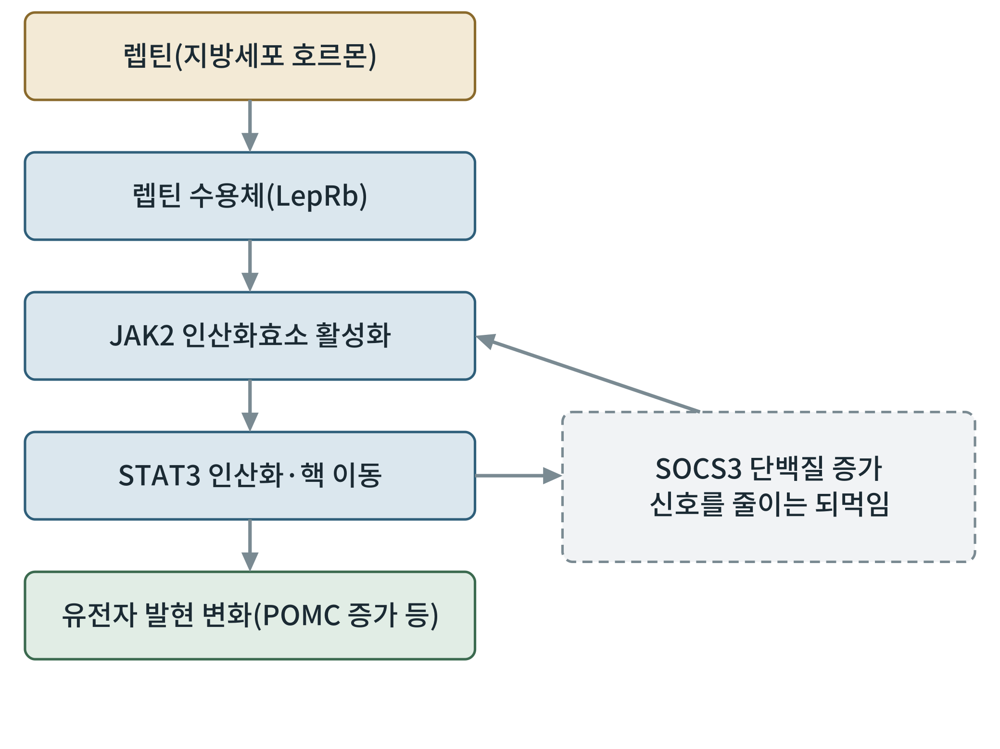
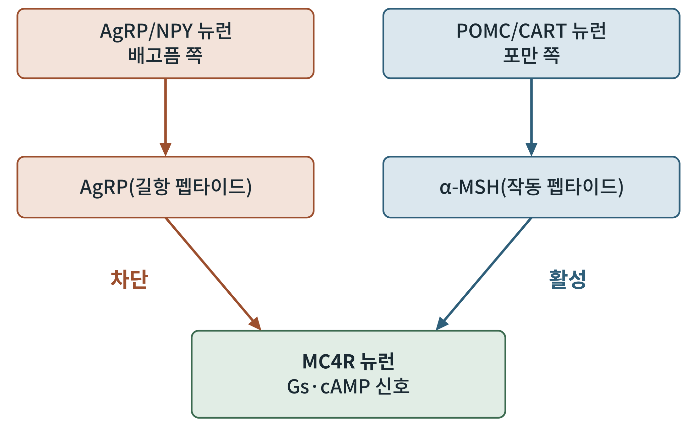

## 제8장 뉴런 안의 신호: 렙틴, 멜라노코르틴, AMPK, mTOR

> **이 장의 출발점** 7장에서는 췌장 β세포 안으로 신호를 따라 들어갔다. 이번에는 같은 약이 뇌로 들어가는 길을 간다. 시상하부 활꼴핵(arcuate nucleus)의 두 뉴런 집단, 렙틴이라는 지방의 보고서, 그리고 세포 안의 에너지 계기판인 AMPK와 mTOR가 이 장의 주인공이다. 4장에서 본 호르몬 지도의 종착지가 뉴런 안에서 어떻게 읽히는지를 살핀다. (2권 15장 AMPK와 에너지 센서, 16장 mTOR와 영양 감지와 연결된다.)

### 8.1 지방이 뇌에 보내는 보고서: 렙틴의 발견

1994년 프리드먼(Jeffrey Friedman) 연구진은 비만 생쥐(ob/ob)에서 망가진 유전자를 위치 클로닝으로 찾아내고, 이 유전자가 지방조직에서 만들어지는 호르몬을 부호화한다는 것을 보고했다(Zhang et al., 1994). 이 호르몬이 렙틴(leptin)이다. 렙틴은 몸의 지방량에 비례해 혈중에 나오는 신호로, 뇌에 "저장된 에너지가 충분하다"는 보고서를 전달한다고 이해된다(Friedman & Halaas, 1998). 렙틴이 없는 생쥐와 사람은 끝없이 먹고 심한 비만이 되며, 렙틴을 보충하면 이 증상이 좋아진다.

그러나 이야기는 여기서 끝나지 않았다. 일반적인 비만에서는 렙틴이 오히려 높은데도 식욕이 줄지 않는다. 이 현상을 렙틴 저항성(leptin resistance)이라 부르고, 원인은 지금도 논쟁 중이다. 그래서 렙틴 자체는 비만약이 되지 못했고, 그 사실이 1장에서 본 실패의 역사의 한 장을 이룬다.

### 8.2 렙틴 수용체 안의 신호

렙틴이 시상하부 뉴런의 렙틴 수용체(LepRb)에 붙으면 수용체에 결합해 있는 JAK2(Janus kinase 2, 야누스 인산화효소 2)가 켜지고, 수용체의 특정 부위가 인산화된다. 여기에 STAT3(signal transducer and activator of transcription 3)가 붙어 인산화되면 핵으로 들어가 유전자 발현을 바꾼다. 이 경로 중 STAT3가 붙는 부위를 없앤 생쥐가 비만이 된다는 결과는 STAT3 신호가 에너지 균형에 필요함을 보여 준다(Bates et al., 2003).

이 경로는 스스로를 줄이는 장치도 갖고 있다. STAT3가 켜지면 SOCS3(suppressor of cytokine signaling 3) 단백질이 늘어 JAK2 신호를 낮춘다. 이 되먹임이 렙틴 저항성의 한 설명 후보로 논의되지만, 사람에서 얼마나 중요한지는 확정되어 있지 않다.

**그림 8-1. 렙틴 수용체의 세포 내 신호.** 위에서 아래로 렙틴이 수용체에 붙고, JAK2와 STAT3를 거쳐 유전자 발현을 바꾼다. 오른쪽 점선 상자는 STAT3 신호로 늘어난 SOCS3가 JAK2 쪽을 약하게 만드는 되먹임이다.

그림 8-1에서 중요한 것은 구조의 모양이다. 위로 가는 신호가 앞으로만 흐르지 않고, 자기 자신을 줄이는 고리를 가진다. 신호 경로를 읽을 때마다 되먹임이 있는지 먼저 찾아보는 습관은 약을 설계할 때에도 쓸모가 있다. 약의 효과가 시간이 지나며 줄어드는 이유를 설명하는 후보가 되기 때문이다.

### 8.3 활꼴핵의 두 뉴런과 멜라노코르틴 회로

4장에서 본 것처럼 활꼴핵에는 서로 반대 방향으로 일하는 두 뉴런 집단이 있다. POMC/CART 뉴런은 먹는 것을 줄이는 쪽, AgRP/NPY 뉴런은 먹는 것을 늘리는 쪽이다. 렙틴은 POMC 뉴런을 켜고 AgRP 뉴런을 낮추는 방향으로 작용한다는 보고가 있다(Cowley et al., 2001).

두 뉴런이 만나는 곳은 MC4R(melanocortin 4 receptor, 멜라노코르틴 4 수용체)을 가진 아래쪽 뉴런이다. POMC 뉴런에서 나오는 α-MSH가 MC4R을 켜고, AgRP 뉴런에서 나오는 AgRP 펩타이드는 이를 막는다. MC4R은 6장의 용어로는 Gs에 연결되는 GPCR이어서, 켜지면 cAMP가 올라가는 신호를 낸다. 즉 이 회로는 7장에서 본 구조가 뉴런에서 다른 결과를 만드는 사례다.

**그림 8-2. 멜라노코르틴 회로.** 왼쪽은 배고픔 쪽 AgRP/NPY 뉴런이 AgRP 펩타이드로 MC4R을 막는 경로, 오른쪽은 포만 쪽 POMC/CART 뉴런이 α-MSH로 MC4R을 켜는 경로다. 두 경로가 MC4R 뉴런에서 만난다.

이 회로가 사람의 체중에 실제로 중요하다는 증거는 유전학에서 나왔다. POMC 유전자의 돌연변이는 어릴 때부터 시작되는 심한 비만과 연결되어 보고되었고(Krude et al., 1998), MC4R 유전자 돌연변이는 사람에서 비교적 흔한 단일 유전자성 비만의 원인으로 알려져 있다(Farooqi et al., 2003). 이 증거는 약물 표적을 고를 때 가장 믿을 만한 근거 중 하나다. 사람에서 기능을 잃으면 병이 되는 유전자는, 거꾸로 기능을 키워 주면 약이 될 가능성이 있기 때문이다.

### 8.4 GLP-1 계열 약은 이 회로 어디에 닿는가

세마글루타이드나 리라글루타이드 같은 약이 체중을 줄이는 경로에도 활꼴핵이 들어 있다. 리라글루타이드에 관한 쥐 연구는 이 약이 활꼴핵을 통해 체중 감소를 일으키며, POMC/CART 뉴런을 간접적으로 활성화하고 AgRP/NPY 뉴런은 억제 신호를 통해 낮춘다고 보고했다(Secher et al., 2014). 다만 이는 동물 결과이고, 사람 뇌에서 약이 어느 뉴런에 어떻게 닿는지는 아직 정밀하게 밝혀지지 않았다는 점을 분명히 해 둔다. 이 부분은 3권 실무편에서 "근거 수준"을 표시하는 이유 중 하나다.

### 8.5 세포 안의 에너지 계기판: AMPK와 mTOR

뉴런 안에는 에너지 상태를 직접 재는 단백질도 있다. AMPK(AMP-activated protein kinase, AMP 활성화 단백질 인산화효소)는 세포 안에서 ATP가 줄고 AMP가 늘 때 켜지는 에너지 센서다. 시상하부에서는 굶거나 그렐린이 작용할 때 AMPK가 켜지고 렙틴이나 영양분이 들어오면 줄어들며, 이 변화가 먹는 양에 영향을 준다고 보고되었다(Minokoshi et al., 2004).

mTOR(mechanistic target of rapamycin, 라파마이신의 기계적 표적)는 AMPK와 거의 반대 방향의 센서로 이해할 수 있다. 영양분, 특히 아미노산과 호르몬 신호가 충분할 때 켜지는 세포 성장 조절 단백질이다. 시상하부에서 mTOR 신호가 먹는 양을 조절한다는 결과가 보고되었고, 렙틴의 식욕 억제 효과에 mTOR가 관여한다는 해석이 제시되었다(Cota et al., 2006). 두 센서의 방향은 AMPK는 "부족하다", mTOR는 "충분하다"로 요약할 수 있지만, 실제 뉴런에서는 두 신호가 서로 겹치므로 단순한 스위치로만 읽어서는 안 된다.

**표 8-1. 뉴런 안 에너지·영양 감지 신호의 비교.**

| 신호 | 켜지는 조건 | 연결된 입력 | 먹는 행동에 대한 방향(보고) | 이 책의 다른 장 |
|---|---|---|---|---|
| LepRb–JAK2–STAT3 | 렙틴 증가(지방량 신호) | 렙틴 | 포만 쪽 | 8장 |
| MC4R–Gs–cAMP | α-MSH 증가, AgRP 감소 | POMC·AgRP 뉴런 | 포만 쪽 | 6장, 8장 |
| AMPK | 세포 내 AMP/ATP 비 증가 | 굶음, 그렐린 | 식욕 증가 쪽 | 2권 |
| mTOR | 아미노산·호르몬 충분 | 영양분, 렙틴 | 식욕 억제 쪽 | 2권 |

표 8-1의 마지막 두 줄이 보여 주듯 이 책이 1권과 2권으로 나뉜 이유가 여기서 드러난다. 1권은 신호가 어떻게 흐르는지를, 2권은 신호가 읽는 대상인 세포 에너지가 어떻게 만들어지고 쓰이는지를 다룬다. 2권 15장과 16장에서 AMPK와 mTOR를 에너지 대사의 언어로 다시 살펴볼 것이다.

### 이 장의 요점

렙틴은 지방의 보고서이고, 렙틴 수용체 안의 JAK2–STAT3 신호는 스스로를 줄이는 되먹임을 가진다. 활꼴핵의 POMC 뉴런과 AgRP 뉴런은 MC4R에서 만나 포만과 배고픔을 가르며, 이 회로가 사람에게도 중요하다는 증거는 유전학에서 나왔다. AMPK와 mTOR는 뉴런 안에서 에너지와 영양을 읽는 센서로, 약 효과의 하류에 놓일 수 있다. 다음 9장에서는 이 신호들이 세포소기관의 상태, 곧 미토콘드리아·소포체·오토파지와 어떻게 이어지는지 살펴본다.

#### 참고문헌

Bates, S. H., Stearns, W. H., Dundon, T. A., Schubert, M., Tso, A. W. K., Wang, Y., Banks, A. S., Lavery, H. J., Haq, A. K., Maratos-Flier, E., Neel, B. G., Schwartz, M. W., & Myers, M. G., Jr. (2003). STAT3 signalling is required for leptin regulation of energy balance but not reproduction. *Nature, 421*(6925), 856–859. https://doi.org/10.1038/nature01388

Cota, D., Proulx, K., Smith, K. A. B., Kozma, S. C., Thomas, G., Woods, S. C., & Seeley, R. J. (2006). Hypothalamic mTOR signaling regulates food intake. *Science, 312*(5775), 927–930. https://doi.org/10.1126/science.1124147

Cowley, M. A., Smart, J. L., Rubinstein, M., Cerdán, M. G., Diano, S., Horvath, T. L., Cone, R. D., & Low, M. J. (2001). Leptin activates anorexigenic POMC neurons through a neural network in the arcuate nucleus. *Nature, 411*(6836), 480–484. https://doi.org/10.1038/35078085

Farooqi, I. S., Keogh, J. M., Yeo, G. S. H., Lank, E. J., Cheetham, T., & O'Rahilly, S. (2003). Clinical spectrum of obesity and mutations in the melanocortin 4 receptor gene. *New England Journal of Medicine, 348*(12), 1085–1095. https://doi.org/10.1056/NEJMoa022050

Friedman, J. M., & Halaas, J. L. (1998). Leptin and the regulation of body weight in mammals. *Nature, 395*(6704), 763–770. https://doi.org/10.1038/27376

Krude, H., Biebermann, H., Luck, W., Horn, R., Brabant, G., & Grüters, A. (1998). Severe early-onset obesity, adrenal insufficiency and red hair pigmentation caused by POMC mutations in humans. *Nature Genetics, 19*(2), 155–157. https://doi.org/10.1038/509

Minokoshi, Y., Alquier, T., Furukawa, N., Kim, Y.-B., Lee, A., Xue, B., Mu, J., Foufelle, F., Ferré, P., Birnbaum, M. J., Stuck, B. J., & Kahn, B. B. (2004). AMP-kinase regulates food intake by responding to hormonal and nutrient signals in the hypothalamus. *Nature, 428*(6982), 569–574. https://doi.org/10.1038/nature02440

Secher, A., Jelsing, J., Baquero, A. F., Hecksher-Sørensen, J., Cowley, M. A., Dalbøge, L. S., Hansen, G., Grove, K. L., Pyke, C., Raun, K., Schäffer, L., Tang-Christensen, M., Verma, S., Witgen, B. M., Vrang, N., & Bjerre Knudsen, L. (2014). The arcuate nucleus mediates GLP-1 receptor agonist liraglutide-dependent weight loss. *Journal of Clinical Investigation, 124*(10), 4473–4488. https://doi.org/10.1172/JCI75276

Zhang, Y., Proenca, R., Maffei, M., Barone, M., Leopold, L., & Friedman, J. M. (1994). Positional cloning of the mouse obese gene and its human homologue. *Nature, 372*(6505), 425–432. https://doi.org/10.1038/372425a0
