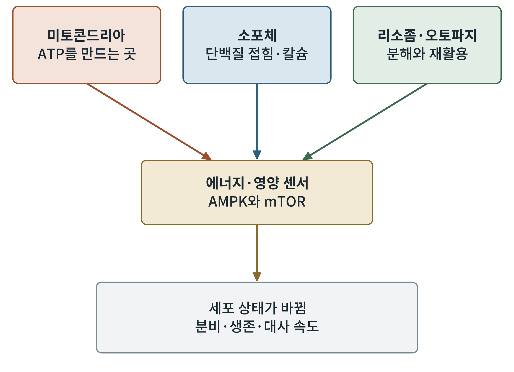
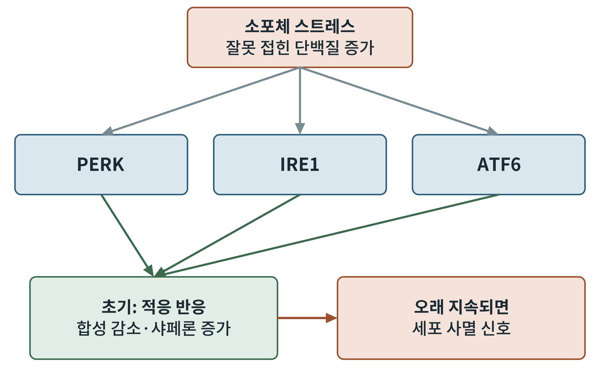

## 제9장 세포소기관이 읽는 신호: 미토콘드리아, 소포체, 오토파지

> **이 장의 출발점** 7장과 8장은 신호가 세포막에서 세포질과 핵으로 가는 길을 따라갔다. 이 장은 신호가 도착하는 또 하나의 장소, 세포소기관(organelle)을 살핀다. 약이 만든 신호는 세포 안의 발전소(미토콘드리아), 단백질 공장(소포체), 재활용 센터(리소좀과 오토파지)의 상태에 따라 다르게 읽힌다. 이 장은 1권 3부의 마지막이며, 2권의 세포 에너지 대사 이야기로 넘어가는 다리다. (2권 5·6부 식후·공복 에너지, 9부 세포소기관 질환과 연결된다.)

### 9.1 같은 신호가 다른 세포에서 다르게 읽히는 이유

약을 같은 용량으로 주어도 어떤 세포는 크게 반응하고 어떤 세포는 덜 반응한다. 수용체의 수가 다르기 때문이기도 하지만, 세포 안 소기관의 상태가 다른 이유도 크다. 에너지를 충분히 만들 수 있는 세포와 그렇지 못한 세포, 단백질을 잘 접는 세포와 접지 못해 스트레스를 받는 세포는 같은 cAMP 신호를 받아도 서로 다른 일을 한다. 이것이 비만과 당뇨의 환경에서 약의 효과가 사람마다 다른 이유의 일부라고 이해된다.

### 9.2 미토콘드리아: 신호를 에너지로 바꾸는 곳

미토콘드리아(mitochondrion)는 영양분을 산화해 ATP를 만드는 세포소기관이다. 그러나 이것은 발전소이면서 동시에 신호의 허브다. 7장에서 본 β세포의 방아쇠 경로는 미토콘드리아에서 만든 ATP가 KATP 채널을 닫는 것으로 시작한다. 즉 포도당이 인슐린 분비로 번역되는 첫 단계가 미토콘드리아에 있다. 미토콘드리아의 기능이 떨어지면 신호의 출발점 자체가 약해진다.

미토콘드리아는 한 번 만들어지면 끝나는 구조물이 아니고, 합쳐지고 나뉘고 낡은 것은 제거되는 역동적 집단이다. 이 품질 관리가 흔들리면 세포가 병드는 것은 미토콘드리아 질환 연구에서 정리된 내용이다(Nunnari & Suomalainen, 2012). 이 책이 이 장을 별도로 두는 까닭은, 비만약의 효과를 오래 이어 가는 일이 결국 세포소기관의 건강과 연결되기 때문이다.

### 9.3 소포체: 단백질 공장의 스트레스

소포체(endoplasmic reticulum)는 분비 단백질과 막 단백질을 접어서 만드는 곳이다. β세포는 인슐린을 아주 많이 만들어야 하므로 소포체의 부담이 특히 크다. 잘못 접힌 단백질이 쌓이면 소포체 스트레스가 생기고, 세포는 미접힘 단백질 반응(unfolded protein response, UPR)이라는 대응 체계를 켠다. UPR에는 PERK, IRE1, ATF6의 세 감지 단백질이 있어, 단백질 합성을 줄이고 접힘을 돕는 샤페론(chaperone) 단백질을 늘려서 상황을 되돌리려 한다(Walter & Ron, 2011). 그러나 스트레스가 해소되지 않고 오래 이어지면 같은 체계가 세포 사멸 쪽 신호를 낸다(Tabas & Ron, 2011).

**그림 9-1. 세포소기관과 에너지·영양 센서.** 위쪽의 세 소기관이 각각 에너지, 단백질 접힘, 분해·재활용의 상태를 AMPK와 mTOR로 대표되는 센서에 알리고, 센서가 아래의 세포 상태 변화를 이끈다.

**그림 9-2. 미접힘 단백질 반응의 흐름.** 소포체 스트레스를 감지하는 PERK, IRE1, ATF6가 초기에는 적응 반응을 일으키고, 스트레스가 오래 지속되면 사멸 신호로 넘어간다.

그림 9-1은 세포소기관이 센서로 신호를 보내는 구조를, 그림 9-2는 그중 소포체 한 곳의 반응이 시간에 따라 어떻게 성격을 바꾸는지를 보여 준다. 두 그림에서 얻을 점은 같다. 같은 경로도 지속 시간에 따라 보호가 될 수도, 손상이 될 수도 있다는 것이다. 약물의 장기 투여를 평가할 때 늘 이 시간 축을 함께 보아야 하는 이유다.

### 9.4 오토파지: 세포가 자신을 재활용하는 방법

오토파지(autophagy, 자가포식)는 세포가 자신의 일부를 막으로 싸서 리소좀으로 보내 분해하고 재활용하는 과정이다(Mizushima & Komatsu, 2011). 굶을 때는 에너지와 재료를 얻는 수단이 되고, 평소에는 낡은 소기관과 단백질을 청소하는 품질 관리 수단이 된다.

이 과정은 8장에서 본 두 센서가 직접 조절한다. 에너지가 부족해 AMPK가 켜지면 오토파지 시작에 핵심인 ULK1을 인산화해 켜고, 영양이 충분해 mTOR 복합체가 활성화되면 ULK1을 인산화해 막는 방향으로 일한다고 보고되었다(Kim et al., 2011). 한 효소가 두 센서의 의견을 모아 결정을 내리는 구조다. 췌도에서는 오토파지가 고지방 식이에 대응해 β세포 질량이 늘어나는 데 중요하다는 쥐 결과가 있다(Ebato et al., 2008). 다만 이는 동물 결과이므로 사람에게 그대로 적용하지 않는다.

### 9.5 약의 효과와 소기관의 연결: 지금 아는 것과 모르는 것

GLP-1 계열 약이 소포체 스트레스를 줄이거나 오토파지를 조절한다는 보고가 있지만, 사람에서 얼마나 중요한지는 근거 수준이 낮고 연구마다 결과가 다르다. 이 책은 이런 내용을 확정된 사실처럼 쓰지 않고, 3권 실무편에서 근거 수준 표시와 함께 다룬다. 지금 확실히 말할 수 있는 것은 세포소기관이 신호를 받는 쪽의 상태를 정하고, 센서인 AMPK와 mTOR가 이 상태를 읽는다는 구조까지다.

**표 9-1. 세포소기관별 상태, 센서, 약 설계에서 보는 지점.**

| 세포소기관 | 하는 일 | 문제가 생기면 | 연결된 센서·경로 | 약 설계에서 보는 지점 |
|---|---|---|---|---|
| 미토콘드리아 | ATP 생산, 신호 허브 | 방아쇠 신호 약화, 활성산소 증가 | AMPK | 에너지 상태가 신호 크기를 정함 |
| 소포체 | 단백질 접힘, 칼슘 저장 | 소포체 스트레스, UPR | PERK, IRE1, ATF6 | 장기 투여 때의 세포 부담 |
| 리소좀·오토파지 | 분해와 재활용 | 낡은 소기관 축적 | AMPK→ULK1, mTOR→ULK1 | 굶음·영양 상태 조절 |

### 이 장의 요점

신호는 세포막에서 끝나지 않고 세포소기관의 상태에 의해 크기와 성격이 달라진다. 미토콘드리아는 신호의 출발점이자 에너지 공급원이고, 소포체는 시간에 따라 보호와 손상 사이를 오가며, 오토파지는 AMPK와 mTOR가 함께 조절한다. 이 장으로 1권 3부가 끝난다. 다음 4부(10장부터)에서는 지금까지의 구조를 바탕으로 실제 약물 설계의 원리를 다룬다.

#### 참고문헌

Ebato, C., Uchida, T., Arakawa, M., Komatsu, M., Ueno, T., Komiya, K., Azuma, K., Hirose, T., Tanaka, K., Kominami, E., Kawamori, R., Fujitani, Y., & Watada, H. (2008). Autophagy is important in islet homeostasis and compensatory increase of beta cell mass in response to high-fat diet. *Cell Metabolism, 8*(4), 325–332. https://doi.org/10.1016/j.cmet.2008.08.009

Kim, J., Kundu, M., Viollet, B., & Guan, K.-L. (2011). AMPK and mTOR regulate autophagy through direct phosphorylation of Ulk1. *Nature Cell Biology, 13*(2), 132–141. https://doi.org/10.1038/ncb2152

Mizushima, N., & Komatsu, M. (2011). Autophagy: Renovation of cells and tissues. *Cell, 147*(4), 728–741. https://doi.org/10.1016/j.cell.2011.10.026

Nunnari, J., & Suomalainen, A. (2012). Mitochondria: In sickness and in health. *Cell, 148*(6), 1145–1159. https://doi.org/10.1016/j.cell.2012.02.035

Tabas, I., & Ron, D. (2011). Integrating the mechanisms of apoptosis induced by endoplasmic reticulum stress. *Nature Cell Biology, 13*(3), 184–190. https://doi.org/10.1038/ncb0311-184

Walter, P., & Ron, D. (2011). The unfolded protein response: From stress pathway to homeostatic regulation. *Science, 334*(6059), 1081–1086. https://doi.org/10.1126/science.1209038
