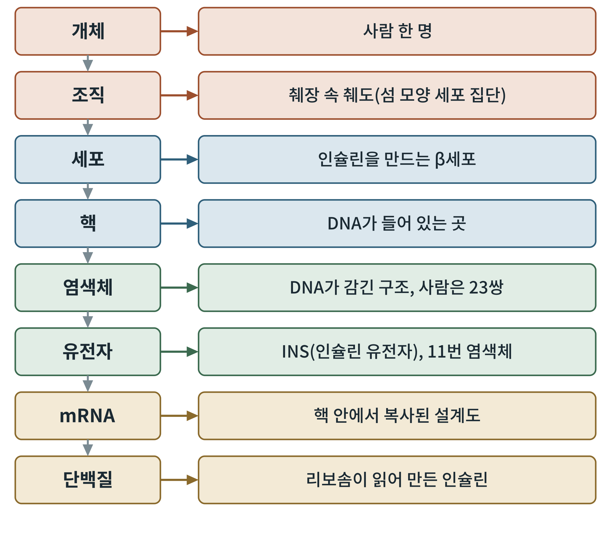
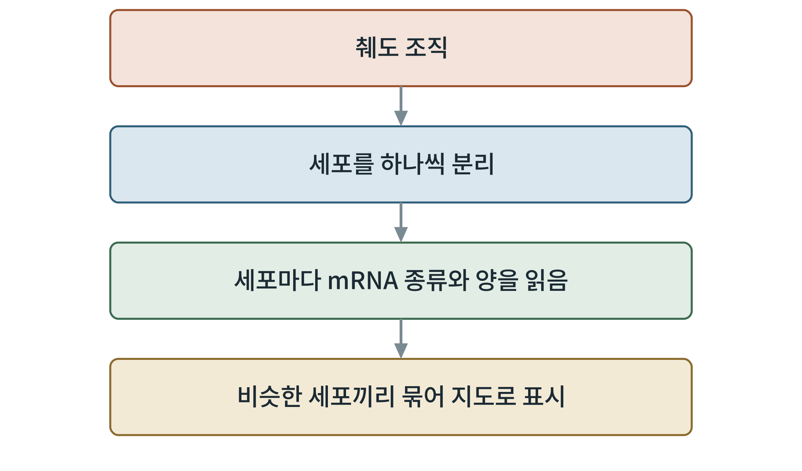

# 제4부 분자생물학, 유전학, 단백질학

## 제10장 유전자 발현과 후성유전

> **이 장의 출발점** 3부에서 우리는 신호가 세포막에서 세포소기관까지 가는 길을 따라갔다. 신호가 끝내 도착하는 마지막 장소는 핵이다. 이 장에서는 신호가 전사인자를 거쳐 유전자 발현을 바꾸는 방식, 그리고 유전자 자체는 바뀌지 않아도 읽히는 방식이 달라지는 후성유전을 살핀다. (2권 3부 유전자와 에너지 대사, 5부 세포 에너지 신호와 연결된다.)

### 10.1 개체에서 mRNA까지: 한 줄로 그리는 지도

생물학에서 가장 자주 길을 잃는 곳은 규모가 바뀌는 지점이다. "비만"은 사람 한 명의 이야기이고, "cAMP"는 세포 한 개 안의 이야기이며, "유전자 발현"은 핵 안의 DNA 이야기다. 이 규모들을 한 줄로 이어 두면 이후 장에서 길을 잃지 않는다.

**그림 10-1. 개체에서 mRNA와 단백질까지.** 사람 한 명에서 시작해 췌도 조직, β세포, 핵, 염색체, 인슐린 유전자(INS), mRNA, 단백질로 내려가는 규모의 사다리다. 오른쪽 상자가 각 단계의 뜻을 한 줄로 보여 준다.

그림 10-1을 읽는 방법은 위에서 아래로 한 칸씩 확대하는 것이다. 인슐린 유전자는 사람의 11번 염색체에 있고, 핵 안에서 mRNA로 복사된 뒤 세포질의 리보솜이 이를 읽어 인슐린 단백질을 만든다. 약이 하는 일은 이 사다리의 어느 칸에서든 개입할 수 있는데, 대부분의 약은 맨 위쪽의 수용체 신호로 시작해 맨 아래쪽 칸인 단백질의 양과 종류를 바꾼다.

### 10.2 cAMP에서 전사인자로: CREB

7장에서 만든 cAMP는 PKA를 켜고, PKA는 핵 안의 전사인자 CREB(cAMP response element-binding protein)를 인산화한다. 인산화된 CREB는 유전자 앞부분의 cAMP 반응 부위(CRE)에 붙어 표적 유전자의 전사를 높인다(Mayr & Montminy, 2001). 이것은 세포가 단기 신호를 장기 반응으로 바꾸는 가장 대표적인 통로다.

CREB가 쓰이는 곳은 장기마다 다르다. 간에서는 공복에 글루카곤이 cAMP를 올려 CREB와 공동 활성인자 TORC2가 포도당 신생합성 유전자를 켠다는 보고가 있다(Koo et al., 2005). β세포에서는 cAMP–CREB 경로가 세포 생존과 연결된다는 보고가 있다. 즉 같은 cAMP–CREB 경로가 간에서는 혈당을 올리는 쪽, β세포에서는 세포를 지키는 쪽으로 쓰이는 셈이다. 한 신호가 세포 종류에 따라 다른 유전자 세트를 켠다는 점은 약의 조직 선택성을 논할 때 기본 전제가 된다.

### 10.3 β세포의 정체성을 정하는 전사인자: PDX1

β세포가 β세포로 있게 하는 것은 특정 전사인자들이다. 그중 PDX1(pancreatic and duodenal homeobox 1, IPF1이라고도 부름)은 췌장 발생에 필요하며, 이 유전자가 없는 생쥐는 췌장이 만들어지지 않는다(Jonsson et al., 1994). 사람에서도 이 유전자가 한 염기 결실된 경우 췌장이 발생하지 않은 사례가 보고되었다(Stoffers et al., 1997). 성인 β세포에서는 인슐린 유전자 자체의 발현을 유지하는 데 이 전사인자가 관여한다고 이해된다.

이 사실은 약물 개발 관점에서 두 가지를 말해 준다. 첫째, β세포의 기능이 "수용체가 있는가"만으로는 정해지지 않고 "β세포다운 유전자 발현 상태가 유지되는가"에 달려 있다. 둘째, 장기간의 대사 스트레스는 이 정체성 전사인자의 발현을 흔들 수 있으므로, 약의 장기 효과는 신호의 세기만이 아니라 정체성 유지와도 연결해 평가해야 한다.

### 10.4 후성유전: 유전자는 같고 읽는 방식이 다르다

후성유전(epigenetics)은 DNA 염기서열은 바꾸지 않으면서 유전자를 켜고 끄는 표지가 달라지는 현상이다. 대표적인 표지가 DNA 메틸화(DNA methylation)로, DNA의 특정 부위에 메틸기가 붙으면 그 부위의 유전자 발현이 낮아지는 경향이 있고, 이 표지는 세포 분열을 거쳐 전달될 수 있다(Bird, 2002). 그래서 같은 유전체를 가진 간세포와 β세포가 서로 다른 단백질을 만든다.

비만 연구에서 후성유전이 주목받는 이유는, 환경과 영양 상태가 이 표지를 통해 오래 남는 흔적을 만들 수 있다는 가능성 때문이다. 다만 사람의 비만에서 어떤 표지가 원인이고 어떤 표지가 결과인지는 아직 구분이 어려워, 이 책은 후성유전을 확정된 약물 표적으로 쓰지 않고 해석의 한계를 표시하는 도구로 쓴다.

### 10.5 세포 하나하나의 발현을 읽다: 단일세포 지도

조직 전체를 갈아서 측정하면 세포 종류가 섞인 평균만 얻는다. 췌도에는 β세포 외에 α세포, δ세포 등이 섞여 있어, 평균값으로는 "어느 세포에서 무엇이 바뀌었는지"를 알 수 없다. 이 한계를 넘는 방법이 세포 하나에서 mRNA 전체를 읽는 단일세포 전사체 분석이다(Tang et al., 2009). 사람 췌도에 이를 적용해 건강한 사람과 제2형 당뇨병 환자의 세포 종류별 발현 차이를 정리한 연구가 대표적이다(Segerstolpe et al., 2016).

**그림 10-2. 단일세포 지도를 만드는 흐름.** 조직에서 세포를 하나씩 분리하고, 세포마다 mRNA의 종류와 양을 읽은 뒤, 비슷한 세포끼리 묶어 지도로 표시한다.

단일세포 지도는 약 연구에서 두 가지로 쓰인다. 하나는 약의 수용체가 어느 세포에 실제로 발현되는지 확인하는 것이고, 다른 하나는 약을 준 뒤 어느 세포의 발현이 바뀌는지 보는 것이다. 3권 실무편에서 공개 데이터로 이 분석을 직접 해 보는 장이 나온다.

**표 10-1. 신호, 전사인자, 표적 유전자의 연결(보고된 예).**

| 신호 | 전사인자 | 표적 유전자·기능 | 조직 | 근거 |
|---|---|---|---|---|
| cAMP–PKA | CREB(+TORC2) | 포도당 신생합성 유전자 | 간 | Koo et al. (2005) |
| cAMP–PKA | CREB | β세포 생존 관련 유전자 | β세포 | 보고 있음(확인 필요) |
| 렙틴–STAT3 | STAT3 | POMC 발현, SOCS3(되먹임) | 시상하부 | 8장 |
| 췌장 발생 | PDX1 | 인슐린 유전자 등 β세포 유전자 | 췌장 | Jonsson et al. (1994) |
| 환경·영양 | DNA 메틸화 | 장기 유전자 발현 표지 | 여러 조직 | Bird (2002) |

### 이 장의 요점

신호는 전사인자를 거쳐 유전자 발현을 바꾸고, 같은 신호도 세포의 종류에 따라 다른 유전자를 켠다. PDX1 같은 전사인자는 β세포의 정체성을 정하고, 후성유전은 같은 DNA를 다르게 읽게 한다. 단일세포 지도는 이 차이를 세포 하나하나에서 보게 해 준다. 다음 11장에서는 사람의 유전학이 약물 표적에 대해 무엇을 말해 주는지 살펴본다.

#### 참고문헌

Bird, A. (2002). DNA methylation patterns and epigenetic memory. *Genes & Development, 16*(1), 6–21. https://doi.org/10.1101/gad.947102

Jonsson, J., Carlsson, L., Edlund, T., & Edlund, H. (1994). Insulin-promoter-factor 1 is required for pancreas development in mice. *Nature, 371*(6498), 606–609. https://doi.org/10.1038/371606a0

Koo, S.-H., Flechner, L., Qi, L., Zhang, X., Screaton, R. A., Jeffries, S., Hedrick, S., Xu, W., Boussouar, F., Brindle, P., Takemori, H., & Montminy, M. (2005). The CREB coactivator TORC2 is a key regulator of fasting glucose metabolism. *Nature, 437*(7062), 1109–1111. https://doi.org/10.1038/nature03967

Mayr, B., & Montminy, M. (2001). Transcriptional regulation by the phosphorylation-dependent factor CREB. *Nature Reviews Molecular Cell Biology, 2*(8), 599–609. https://doi.org/10.1038/35085068

Segerstolpe, Å., Palasantza, A., Eliasson, P., Andersson, E.-M., Andréasson, A.-C., Sun, X., Picelli, S., Sabirsh, A., Clausen, M., Bjursell, M. K., Smith, D. M., Kasper, M., Ämmälä, C., & Sandberg, R. (2016). Single-cell transcriptome profiling of human pancreatic islets in health and type 2 diabetes. *Cell Metabolism, 24*(4), 593–607. https://doi.org/10.1016/j.cmet.2016.08.020

Stoffers, D. A., Zinkin, N. T., Stanojevic, V., Clarke, W. L., & Habener, J. F. (1997). Pancreatic agenesis attributable to a single nucleotide deletion in the human IPF1 gene coding sequence. *Nature Genetics, 15*(1), 106–110. https://doi.org/10.1038/ng0197-106

Tang, F., Barbacioru, C., Wang, Y., Nordman, E., Lee, C., Xu, N., Wang, X., Bodeau, J., Tuch, B. B., Siddiqui, A., Lao, K., & Surani, M. A. (2009). mRNA-Seq whole-transcriptome analysis of a single cell. *Nature Methods, 6*(5), 377–382. https://doi.org/10.1038/nmeth.1315
