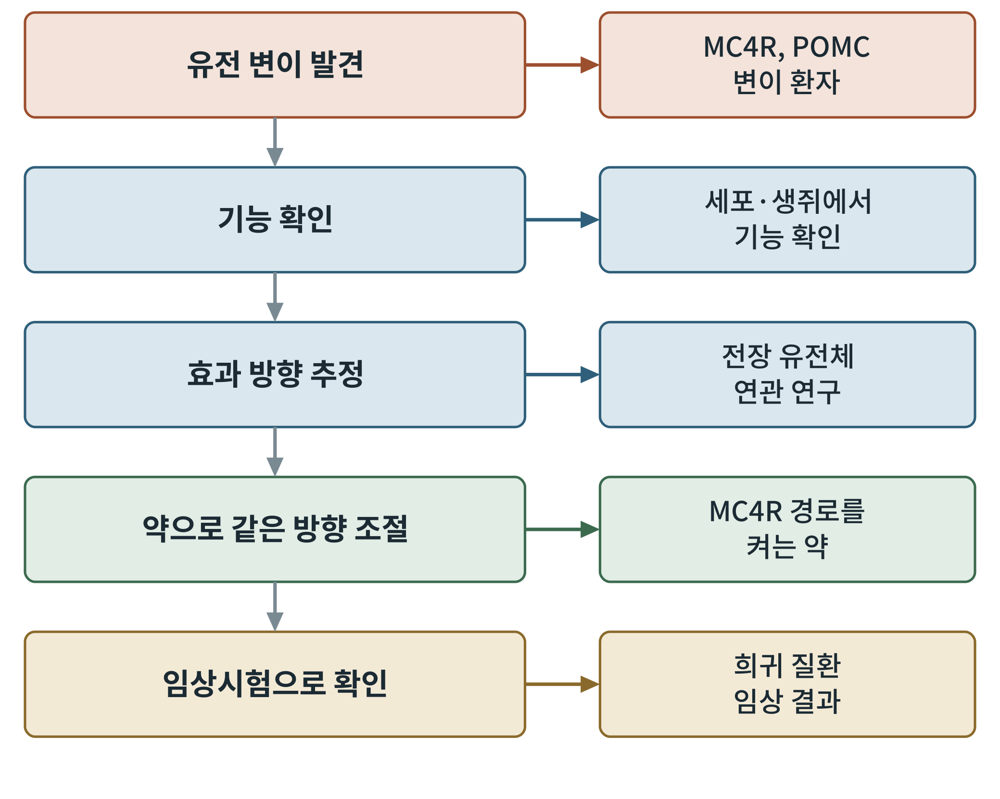

## 제11장 인간 유전학이 가리킨 표적

> **이 장의 출발점** 10장에서 우리는 신호가 유전자 발현으로 이어지는 길을 보았다. 이번에는 거꾸로, 사람의 유전자 변이가 어떤 길이 체중에 중요한지를 먼저 알려 준 사례를 따라간다. 약을 만들 때 가장 믿을 만한 단서 중 하나는 실험실이 아니라 사람 자신의 유전자에서 나온다. (2권 3부 유전자와 에너지 대사와 연결된다.)

### 11.1 왜 사람의 유전학이 표적의 증거가 되는가

생쥐에서 어떤 유전자를 없애면 살이 찐다는 결과는 중요하지만, 그것이 사람에게도 같은지는 별개의 문제다. 반면 사람에서 그 유전자의 기능이 망가진 가족이 실제로 어릴 때부터 심하게 살이 찐다면, 그 유전자는 사람의 체중 조절에 필요하다는 증거가 된다. 이것은 실험이 아니라 자연이 만든 실험이다. 약물 개발에서 표적 후보를 고를 때 사람 유전학의 지지가 있으면 성공 가능성이 높아진다고 흔히 이야기되며, 이 책도 그 방향을 따른다. 다만 이 주장의 정량적 근거는 확인 후에 쓴다(refs/tocheck.md 참조).

### 11.2 단일 유전자 비만: 회로의 고장 난 부품을 찾아내다

한 유전자의 이상만으로 심한 비만이 생기는 경우를 단일 유전자 비만(monogenic obesity)이라 부른다. 이 사례들은 8장에서 본 회로의 부품과 정확히 겹친다.

- **LEP(렙틴)**: 렙틴 유전자 변이를 가진 사람에서 심한 비만이 보고되었다(Montague et al., 1997).
- **LEPR(렙틴 수용체)**: 렙틴 수용체 유전자의 변이로 생기는 심한 비만이 보고되었다(Clément et al., 1998).
- **POMC**: 8장에서 본 것처럼 POMC 돌연변이는 어릴 때 시작되는 비만과 연결되어 보고되었다(Krude et al., 1998).
- **PCSK1**: POMC 같은 전구체를 잘라 활성 펩타이드로 만드는 효소로, 이 효소의 결함도 비만과 연결되어 보고되었다(Jackson et al., 1997).
- **MC4R**: 사람에서 비교적 흔한 단일 유전자성 비만의 원인으로 알려져 있다(Farooqi et al., 2003).

이 다섯 유전자는 따로따로 놓인 것이 아니라 하나의 줄에 놓인다. 렙틴이 수용체에 붙고, POMC가 만들어져 PCSK1이 잘라 α-MSH가 되고, MC4R이 이를 받는다. 8장의 그림 8-2가 유전학에서 그대로 확인된 셈이다.

**그림 11-1. 유전학 증거가 약이 되는 사슬.** 유전 변이의 발견에서 임상시험까지 다섯 단계를 보여 준다. 오른쪽 상자는 각 단계의 예다.

그림 11-1에서 가장 오른쪽 아래가 중요하다. MC4R 경로를 켜는 약인 세트멜라노타이드(setmelanotide)는 POMC나 LEPR 결핍 환자를 대상으로 한 시험에서 체중 감소가 보고되었다(Clément et al., 2020). 즉 유전학이 가리킨 표적에서 약이 나와 같은 방향으로 효과를 낸 사례가 이미 있다. 다만 이 사례는 희귀 질환이고, 일반적인 비만에 그대로 적용되는 것은 아니다.

### 11.3 일반 비만의 유전학: 작은 효과가 많이 모인다

대부분의 비만은 한 유전자가 아니라 여러 유전자의 작은 효과와 환경이 합쳐져 생긴다. 이를 찾기 위해 사람 전체 유전체의 변이와 체중 지표(체질량지수, BMI)의 연관을 보는 전장 유전체 연관 연구(genome-wide association study, GWAS)가 쓰인다. 첫 성과 중 하나가 FTO 유전자 부근의 변이로, 성인의 비만 위험과 연관된다고 보고되었다(Frayling et al., 2007). 또 MC4R 부근의 흔한 변이도 비만 위험과 연관된다고 보고되었다(Loos et al., 2008). 희귀한 큰 효과(MC4R 기능 상실)와 흔한 작은 효과(MC4R 부근 변이)가 같은 유전자에서 만난다는 사실은, 이 회로가 사람의 체중 조절에 실제로 중요하다는 점을 다시 확인시켜 준다.

이 결과를 읽을 때의 주의점이 있다. GWAS에서 찾은 변이는 대개 유전자 자체가 아니라 그 부근의 조절 부위일 수 있어 어느 유전자가 실제 원인인지 정하기 어렵고, 효과의 크기도 작다. 그래서 GWAS의 신호만으로 곧바로 약물 표적을 확정할 수 없다.

### 11.4 멘델 무작위화: 유전자를 자연의 무작위 배정으로 쓰다

관찰 연구에서는 어떤 지표가 병과 연관되어도 원인인지 결과인지 알기 어렵다. 멘델 무작위화(Mendelian randomization)는 유전 변이가 부모에게서 자녀로 무작위에 가깝게 전달된다는 점을 이용해, 변이를 일종의 무작위 배정처럼 써서 인과를 추정하는 방법이다(Davey Smith & Ebrahim, 2003). 예를 들어 어떤 수용체 유전자 변이가 그 수용체의 활동을 조금 높이거나 낮추는 효과를 가진다면, 그 변이를 가진 사람들의 결과를 비교해 그 수용체를 조절하는 약의 방향을 미리 가늠해 볼 수 있다. 다만 이 방법은 변이가 다른 경로로도 영향을 주는 경우(다면발현)에 오류가 생길 수 있어 한계가 있다.

### 11.5 약물 반응 유전체학: 근거와 한계

사람마다 약 반응이 다른 이유를 유전체로 설명하려는 시도, 곧 약물 반응 유전체학이 있다. 그러나 이 책은 이 분야를 과대 해석하지 않기 위해 현재 확정된 근거가 제한적이라는 점을 분명히 해 둔다. 약 반응은 유전자뿐 아니라 식이, 장내 환경, 복용 순응도 등 여러 요인이 함께 정하고, 이 부분은 17장에서 반응자와 비반응자의 기전으로 다시 다룬다.

**표 11-1. 유전자별 표적 근거 요약.**

| 유전자 | 회로에서의 역할 | 사람 유전학 근거 | 약물 근거 | 근거 수준(이 책의 정성적 표기) |
|---|---|---|---|---|
| LEP | 렙틴 | 변이에서 심한 비만 보고 | 렙틴 보충이 해당 환자에서 사용됨(확인 필요) | 강함(희귀) |
| LEPR | 렙틴 수용체 | 변이에서 심한 비만 보고 | 세트멜라노타이드 시험 | 강함(희귀) |
| POMC | α-MSH 전구체 | 변이에서 비만 보고 | 세트멜라노타이드 시험 | 강함(희귀) |
| PCSK1 | 전구체 절단 효소 | 변이에서 비만 보고 | 직접 표적 약 없음 | 중간 |
| MC4R | α-MSH 수용체 | 희귀·흔한 변이 모두 연관 | MC4R 경로 작용제 | 강함 |
| FTO | 기전 불확실 | GWAS 연관 | 표적으로 입증된 약 없음 | 약함(기전 불명확) |

이 표의 "근거 수준"은 점수가 아니라 이 책의 정성적 표기이며, 근거 문헌 확인 후에 조정한다.

### 이 장의 요점

사람의 유전학은 8장의 회로가 실제로 체중 조절에 필요하다는 것을 가장 직접적으로 보여 준다. 렙틴, 수용체, POMC, PCSK1, MC4R이 하나의 줄로 이어지며, MC4R 경로를 겨냥한 약은 희귀 질환에서 이 줄의 효과를 확인했다. 일반 비만의 GWAS는 작은 효과를 보여 줄 뿐 곧바로 표적을 확정하지는 못한다. 다음 12장에서는 이렇게 정해진 표적에 맞는 약을 단백질의 구조에서 어떻게 설계하는지 살펴본다.

#### 참고문헌

Clément, K., van den Akker, E., Argente, J., Bahm, A., Chung, W. K., Connors, H., De Waele, K., Farooqi, I. S., Gonneau-Lejeune, J., Gordon, G., Kohlsdorf, K., Poitou, C., Puder, L., Swain, J., Stewart, M., Yuan, G., Wabitsch, M., & Kühnen, P. (2020). Efficacy and safety of setmelanotide, an MC4R agonist, in individuals with severe obesity due to LEPR or POMC deficiency: Single-arm, open-label, multicentre, phase 3 trials. *The Lancet Diabetes & Endocrinology, 8*(12), 960–970. https://doi.org/10.1016/S2213-8587(20)30364-8

Clément, K., Vaisse, C., Lahlou, N., Cabrol, S., Pelloux, V., Cassuto, D., Gourmelen, M., Dina, C., Chambaz, J., Lacorte, J.-M., Basdevant, A., Bougnères, P., Lebouc, Y., Froguel, P., & Guy-Grand, B. (1998). A mutation in the human leptin receptor gene causes obesity and pituitary dysfunction. *Nature, 392*(6674), 398–401. https://doi.org/10.1038/32911

Davey Smith, G., & Ebrahim, S. (2003). 'Mendelian randomization': Can genetic epidemiology contribute to understanding environmental determinants of disease? *International Journal of Epidemiology, 32*(1), 1–22. https://doi.org/10.1093/ije/dyg070

Farooqi, I. S., Keogh, J. M., Yeo, G. S. H., Lank, E. J., Cheetham, T., & O'Rahilly, S. (2003). Clinical spectrum of obesity and mutations in the melanocortin 4 receptor gene. *New England Journal of Medicine, 348*(12), 1085–1095. https://doi.org/10.1056/NEJMoa022050

Frayling, T. M., Timpson, N. J., Weedon, M. N., Zeggini, E., Freathy, R. M., Lindgren, C. M., Perry, J. R. B., Elliott, K. S., Lango, H., Rayner, N. W., Shields, B., Harries, L. W., Barrett, J. C., Ellard, S., Groves, C. J., Knight, B., Patch, A.-M., Ness, A. R., Ebrahim, S., … McCarthy, M. I. (2007). A common variant in the FTO gene is associated with body mass index and predisposes to childhood and adult obesity. *Science, 316*(5826), 889–894. https://doi.org/10.1126/science.1141634

Jackson, R. S., Creemers, J. W. M., Ohagi, S., Raffin-Sanson, M.-L., Sanders, L., Montague, C. T., Hutton, J. C., & O'Rahilly, S. (1997). Obesity and impaired prohormone processing associated with mutations in the human prohormone convertase 1 gene. *Nature Genetics, 16*(3), 303–306. https://doi.org/10.1038/ng0797-303

Krude, H., Biebermann, H., Luck, W., Horn, R., Brabant, G., & Grüters, A. (1998). Severe early-onset obesity, adrenal insufficiency and red hair pigmentation caused by POMC mutations in humans. *Nature Genetics, 19*(2), 155–157. https://doi.org/10.1038/509

Loos, R. J. F., Lindgren, C. M., Li, S., Wheeler, E., Zhao, J. H., Prokopenko, I., Inouye, M., Freathy, R. M., Attwood, A. P., Beckmann, J. S., Berndt, S. I., Jacobs, K. B., Chanock, S. J., Hayes, R. B., Bergmann, S., Bennett, A. J., Bingham, S. A., Bochud, M., Brown, M., … Wareham, N. J. (2008). Common variants near MC4R are associated with fat mass, weight and risk of obesity. *Nature Genetics, 40*(6), 768–775. https://doi.org/10.1038/ng.140

Montague, C. T., Farooqi, I. S., Whitehead, J. P., Soos, M. A., Rau, H., Wareham, N. J., Sewter, C. P., Digby, J. E., Mohammed, S. N., Hurst, J. A., Cheetham, C. H., Earley, A. R., Barnett, A. H., Prins, J. B., & O'Rahilly, S. (1997). Congenital leptin deficiency is associated with severe early-onset obesity in humans. *Nature, 387*(6636), 903–908. https://doi.org/10.1038/43185
