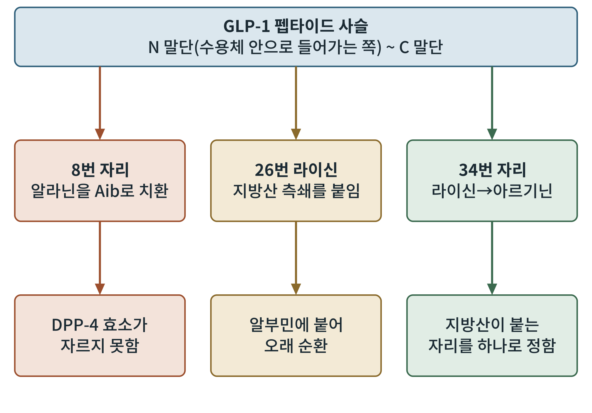
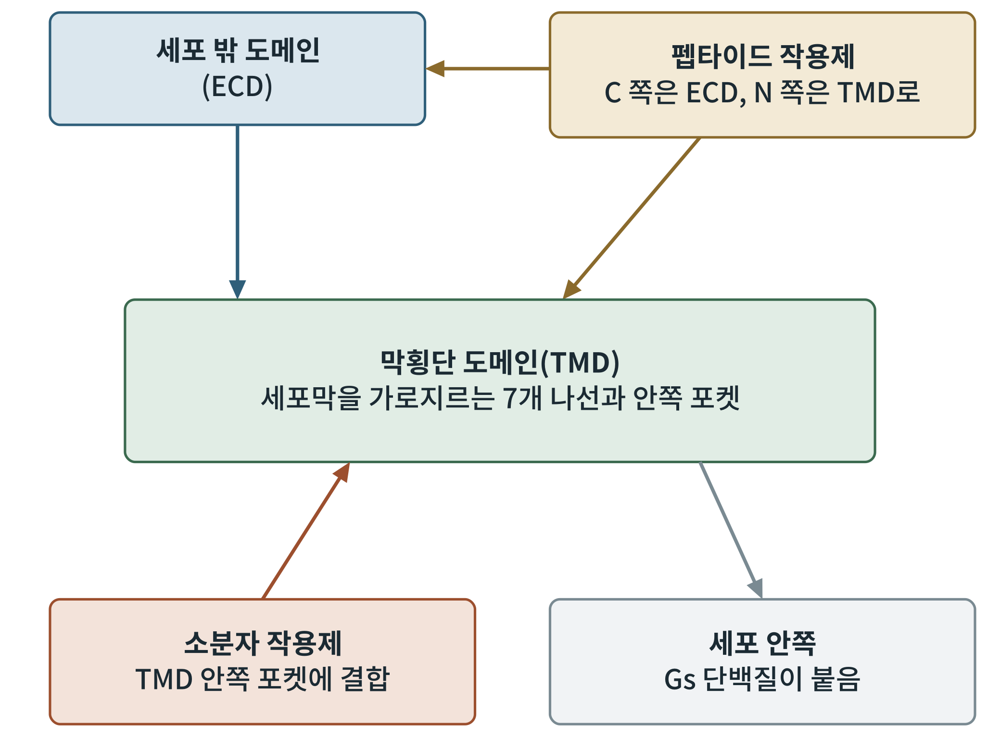

## 제12장 단백질화학과 구조: 펩타이드 설계와 결합 포켓

> **이 장의 출발점** 앞의 장들은 신호가 어디서 오고 어디로 흐르는지를 따라왔다. 이 장은 그 신호를 보내는 분자 자체, 곧 약을 들여다본다. 천연 GLP-1은 혈액 속에서 1~2분 안에 사라지는 분자였다. 그 분자를 일주일에 한 번 맞는 약으로 바꾼 것은 아미노산 몇 개를 바꾸고 지방산 사슬 하나를 붙이는 화학이었다. 이 장은 그 설계의 논리와, 최근 냉동전자현미경이 보여 준 수용체 결합 구조를 정리한다. 약물 개별 설명은 5부(13~17장)에서 이어지고, 제형과 약동학의 세부는 2권 17~19장과 연결된다.

### 12.1 천연 GLP-1의 약점

GLP-1(glucagon-like peptide-1, 글루카곤 유사 펩타이드-1)은 장 L세포가 식사 후 분비하는 30여 개 아미노산의 짧은 펩타이드다. 인슐린 분비를 돕고 식욕을 낮추는 좋은 신호지만, 약으로 쓰기에는 치명적인 약점이 있다. 혈액 속 효소 DPP-4(dipeptidyl peptidase-4, 디펩티딜 펩티다아제-4)가 N 말단에서 두 번째 자리의 알라닌 뒤를 잘라 버리고, 신장이 작은 펩타이드를 빠르게 걸러 낸다. 그래서 천연 GLP-1의 혈중 반감기는 1~2분 안팎으로 알려져 있다(Holst, 2007). 약물 설계의 첫 과제는 이 두 가지, 곧 효소 분해와 신장 여과를 피하는 일이었다.

### 12.2 세 가지 설계 장치

현재 쓰이는 GLP-1 계열 약물의 설계는 세 가지 장치로 요약된다. 그림 12-1이 그 위치를 보여 준다.

**그림 12-1. GLP-1 펩타이드 설계 요소.** 위쪽 상자는 GLP-1 펩타이드 사슬을 나타내고, 아래로 내려가는 세 줄은 대표적인 개조 자리와 그 효과를 나타낸다. 이 그림은 세마글루타이드에서 쓰인 치환을 기준으로 한 개념도이며 원자 수준의 구조도는 아니다.

그림 12-1을 읽는 법은 위에서 아래로 한 줄씩 따라가는 것이다. 왼쪽 줄은 8번 자리의 알라닌을 비천연 아미노산 Aib(aminoisobutyric acid, 아미노이소부티르산)로 바꾸는 개조다. Aib는 곁가지가 메틸기 두 개여서 DPP-4의 절단 자리에 맞지 않는다. 가운데 줄은 26번 라이신에 지방산 측쇄를 붙이는 개조로, 지방산이 혈중 알부민에 느슨하게 붙어 신장 여과와 분해를 늦춘다. 오른쪽 줄은 34번 라이신을 아르기닌으로 바꾸어 지방산이 붙을 라이신을 26번 하나로 정하는 개조다(Lau et al., 2015). 세 장치는 각각 분해 회피, 순환 시간 연장, 부위 선택성이라는 서로 다른 문제를 푼다.

이 설계가 얼마나 효과적이었는지는 반감기로 드러난다. 리라글루타이드는 C16 지방산(팔미토일)을 γ-글루타민산 연결자로 붙여 하루 한 번 주사하는 약이 되었고, 세마글루타이드는 더 긴 C18 이산(diacid) 지방산과 더 긴 연결자를 써서 주 1회 약이 되었다(Knudsen & Lau, 2019). 알부민은 혈액 속에 풍부하고 반감기가 길어서, 지방산이 알부민의 지방산 결합 자리에 붙는 힘을 조절하면 약의 체류 시간을 조절할 수 있다는 것이 이 접근의 핵심이다. 다만 알부민에 너무 세게 붙으면 수용체에 닿는 유리 약물이 줄어들므로, 결합력은 효력과 체류 시간 사이의 타협이다.

### 12.3 먹는 펩타이드: 흡수 촉진제의 설계

펩타이드를 먹으면 위산과 소화효소가 분해하고, 장 상피를 통과하기도 어렵다. 경구 세마글루타이드는 이 문제를 SNAC(sodium N-[8-(2-hydroxybenzoyl)amino]caprylate, 소듐 N-[8-(2-하이드록시벤조일)아미노]카프릴레이트)라는 흡수 촉진제와 함께 정제로 만들어 풀었다. 연구에 따르면 이 정제는 위 안에서 국소적으로 pH를 높여 효소 활성을 낮추고, 약물이 위 상피를 가로질러 흡수되도록 돕는다(Buckley et al., 2018). 흡수율은 여전히 낮아서 주사형보다 훨씬 많은 약물을 넣어야 하고, 공복에 소량의 물과 함께 먹어야 하는 복용 조건이 붙는다. 이 제형의 임상 근거는 13장에서, 약동학의 상세는 2권에서 다룬다.

### 12.4 냉동전자현미경이 보여 준 결합 구조

약 설계가 경험적 개조에서 구조 기반 설계로 넘어간 것은 냉동전자현미경(cryo-EM) 덕분이다. 2017년 이후 GLP-1 수용체가 Gs 단백질과 결합한 활성 상태 구조가 연이어 보고되었다(Zhang et al., 2017). 이 구조들이 보여 준 공통된 그림은 그림 12-2와 같다.

**그림 12-2. 수용체-리간드 결합 구조의 개념도.** 상자는 수용체의 영역과 결합하는 분자를, 화살표는 결합 방향을 나타낸다. 실제 원자 좌표를 그린 것이 아니라 B군 GPCR이 펩타이드와 소분자를 받아들이는 방식을 단순화한 개념도다.

그림 12-2에서 왼쪽 위 상자는 세포 밖 도메인(ECD, extracellular domain)이고, 중앙은 막횡단 도메인(TMD, transmembrane domain)이다. 펩타이드 작용제는 C 말단 쪽이 ECD에 붙고 N 말단 쪽이 TMD 안쪽 깊이 들어가는 두 지점 결합을 한다. 이 N 말단 부분이 수용체를 활성화시키는 부분이다. 그래서 N 말단 8번 자리의 개조는 효소 저항성만이 아니라 수용체 활성화에도 영향을 준다. 이 점에서 설계는 항상 안정성과 활성 사이의 교환을 안고 간다. 아래의 Gs 단백질은 6장에서 본 cAMP 경로의 입구다.

### 12.5 소분자의 길: 알로스테릭 포켓

펩타이드는 주사하거나 특수 제형이 필요하다. 먹는 소분자 작용제는 그 부담을 없앨 수 있지만, 큰 펩타이드가 닿던 넓고 얕은 결합면을 작은 분자로 흉내 내기가 어렵다. 구조 연구는 일부 비펩타이드 작용제가 TMD 안쪽의 포켓에 들어가 수용체를 활성화한다는 것을 보였다(Kawai et al., 2020; Zhang et al., 2020). 오포글리프론 등 후보 약물의 개별 설명은 15장에서 한다. 여기서 기억할 점은, 소분자는 펩타이드와 다른 자리에 붙으면서 같은 Gs 신호를 켤 수 있다는 것, 그래서 신호의 편향(어느 하류 경로를 더 켜는가)이 펩타이드와 다를 수 있다는 점이다. 편향이 효능과 부작용에 어떤 차이를 만드는지는 아직 확립되지 않았다.

### 12.6 약물별 구조 특징

**표 12-1. 약물별 구조 특징 비교.** 아래 표는 주요 개조 요소를 정성적으로 정리한 것이다. 세부 수치는 근거 확인 후 보강한다.

| 약물 | 작용 수용체 | 핵심 구조 요소 | 투여 | 설계 의도 |
|---|---|---|---|---|
| 리라글루타이드 | GLP-1R | 34번 Lys→Arg, 26번 Lys에 C16 지방산(γGlu 연결자) | 주사, 1일 1회 | 알부민 결합으로 반감기 연장 |
| 세마글루타이드 | GLP-1R | 8번 Aib, 34번 Arg, 26번 Lys에 C18 이산 지방산 | 주사 주 1회, 경구(SNAC) | DPP-4 저항성과 더 강한 알부민 결합 |
| 티르제파타이드 | GIPR과 GLP-1R | GIP 서열 기반, Aib 치환, C20 이산 지방산 | 주사, 주 1회 | 두 수용체 동시 작용 |
| 오포글리프론 | GLP-1R | 비펩타이드 소분자 | 경구 | TMD 포켓 결합, 펩타이드 제형 부담 제거 |

표 12-1에서 눈여겨볼 것은 지방산 길이와 투여 간격이 함께 늘었다는 점이다. 같은 설계 문법으로 하루 한 번에서 일주일 한 번으로 간 것이다. 반면 소분자는 문법 자체가 다르다. 티르제파타이드가 GLP-1이 아니라 GIP 서열을 바탕으로 했다는 점은 14장에서 다시 다룬다.

### 이 장의 요점

- 천연 GLP-1은 DPP-4 분해와 신장 여과로 1~2분 안팎에 사라진다.
- 현재 약물은 Aib 치환, 지방산 측쇄, 부위 정리의 세 장치로 분해 회피와 순환 시간 연장을 달성했다.
- 경구 세마글루타이드는 SNAC 흡수 촉진제로 위에서의 흡수를 높였으나 흡수율은 낮다.
- cryo-EM은 펩타이드가 ECD와 TMD에 두 지점으로 결합하고, 일부 소분자는 TMD 안쪽 포켓에 결합함을 보였다.
- 4부 점검 산출물 3(표적 후보표)에는 이 장의 구조 정보를 약물 설계 가능성 열로 넣는다.

#### 참고문헌

Buckley, S. T., Bækdal, T. A., Vegge, A., Maarbjerg, S. J., Pyke, C., Ahnfelt-Rønne, J., Madsen, K. G., Schéele, S. G., Alanentalo, T., Kirk, R. K., Pedersen, B. L., Skyggebjerg, R. B., Benie, A. J., Strauss, H. M., Wahlund, P.-O., Bjerregaard, S., Farkas, E., Fekete, C., Søndergaard, F. L., … Fosgerau, K. (2018). Transcellular stomach absorption of a derivatized glucagon-like peptide-1 receptor agonist. *Science Translational Medicine, 10*(467), eaar7047.

Holst, J. J. (2007). The physiology of glucagon-like peptide 1. *Physiological Reviews, 87*(4), 1409–1439.

Kawai, T., Sun, B., Yoshino, H., Feng, D., Suzuki, Y., Fukazawa, M., Nagao, S., Wainscott, D. B., Showalter, A. D., Droz, B. A., Kobilka, T. S., Coghlan, M. P., Willard, F. S., Kawabe, Y., Kobilka, B. K., & Sloop, K. W. (2020). Structural basis for GLP-1 receptor activation by LY3502970, an orally active nonpeptide agonist. *Proceedings of the National Academy of Sciences, 117*(47), 29959–29967.

Knudsen, L. B., & Lau, J. (2019). The discovery and development of liraglutide and semaglutide. *Frontiers in Endocrinology, 10*, 155.

Lau, J., Bloch, P., Schäffer, L., Pettersson, I., Spetzler, J., Kofoed, J., Madsen, K., Knudsen, L. B., McGuire, J., Steensgaard, D. B., Strauss, H. M., Gram, D. X., Knudsen, S. M., Nielsen, F. S., Thygesen, P., Reedtz-Runge, S., & Kruse, T. (2015). Discovery of the once-weekly glucagon-like peptide-1 (GLP-1) analogue semaglutide. *Journal of Medicinal Chemistry, 58*(18), 7370–7380.

Zhang, X., Belousoff, M. J., Zhao, P., Kooistra, A. J., Truong, T. T., Ang, S. Y., Underwood, C. R., Egebjerg, T., Šenel, P., Stewart, G. D., Liang, Y.-L., Glukhova, A., Venugopal, H., Christopoulos, A., Furness, S. G. B., Miller, L. J., Reedtz-Runge, S., Langmead, C. J., Gloriam, D. E., … Wootten, D. (2020). Differential GLP-1R binding and activation by peptide and non-peptide agonists. *Molecular Cell, 80*(3), 485–500.

Zhang, Y., Sun, B., Feng, D., Hu, H., Chu, M., Qu, Q., Tarrasch, J. T., Li, S., Sun Kobilka, T., Kobilka, B. K., & Skiniotis, G. (2017). Cryo-EM structure of the activated GLP-1 receptor in complex with a G protein. *Nature, 546*(7657), 248–252.
