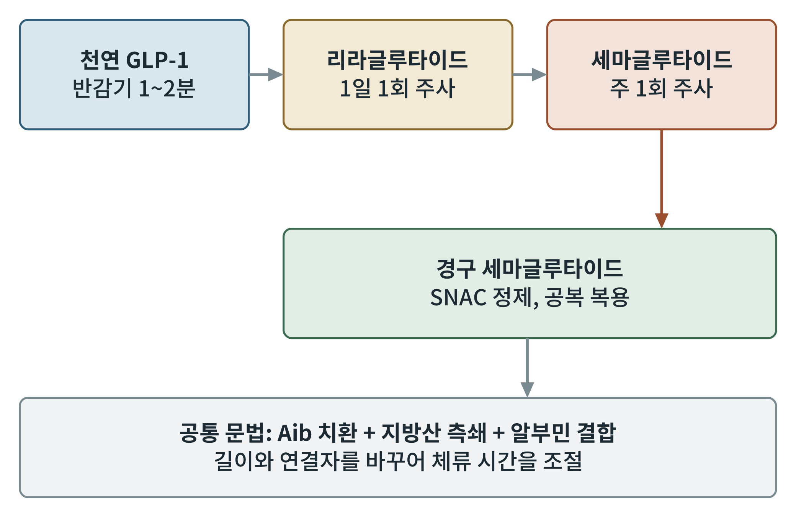
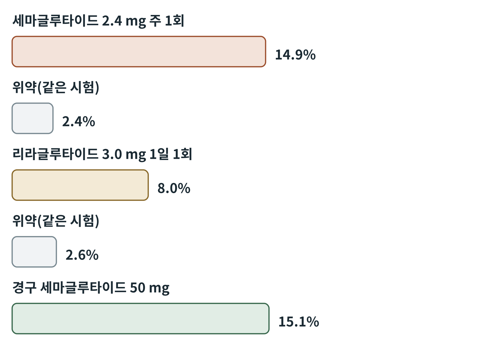

# 제5부 약물 해부

## 제13장 세마글루타이드, 리라글루타이드, 그리고 경구 제형

> **이 장의 출발점** 1~4부는 신호와 수용체, 세포와 유전자, 단백질 구조를 차례로 쌓았다. 5부는 그 지식으로 실제 약물을 하나씩 해부한다. 첫 약물군은 GLP-1 수용체 작용제 가운데 가장 많은 근거가 쌓인 리라글루타이드와 세마글루타이드다. 12장에서 본 설계 장치가 임상에서 어떤 결과로 나타났는지, 그리고 주사를 알약으로 바꾸려는 시도가 어디까지 왔는지를 다룬다. 약동학과 제형의 세부는 2권 17~19장으로 이어진다.

### 13.1 계보: 하루 한 번에서 일주일 한 번으로

리라글루타이드는 먼저 당뇨병 치료제로 쓰였고, 이후 더 높은 용량(3.0 mg)이 비만 치료제로 승인되었다. 세마글루타이드는 같은 설계 문법을 더 밀어붙여 주 1회 주사를 가능하게 했고, 마지막으로 경구 제형이 뒤를 이었다. 그림 13-1이 이 계보를 한눈에 보여 준다.

**그림 13-1. GLP-1 수용체 작용제의 계보.** 상자는 약물과 투여 방식을, 화살표는 개발 순서를 나타낸다. 맨 아래 상자는 세 약물이 공유하는 설계 문법이다.

그림 13-1에서 천연 GLP-1에서 리라글루타이드로, 다시 세마글루타이드로 이어지는 화살표는 모두 반감기를 늘리는 방향이다. 아래 상자가 말하듯 세 약물은 Aib 치환, 지방산 측쇄, 알부민 결합이라는 같은 문법을 공유하고, 지방산의 길이와 연결자만 달라진다. 경구 세마글루타이드는 분자는 같고 전달 방식만 바꾼 것이다.

### 13.2 임상시험이 보여 준 체중 변화

비만 치료제로서의 근거는 대규모 무작위 대조시험에서 나왔다. 리라글루타이드 3.0 mg의 시험(SCALE)에서 56주 평균 체중 감소는 약 8.0%, 위약은 약 2.6%였다(Pi-Sunyer et al., 2015). 세마글루타이드 2.4 mg의 시험(STEP 1)에서는 68주에 평균 14.9%가 줄었고 위약은 2.4%였다(Wilding et al., 2021). 경구 세마글루타이드 50 mg의 시험(OASIS 1)에서는 68주에 평균 15.1%가 줄었다(Knop et al., 2023). 그림 13-2가 이 수치를 나란히 놓았다.

**그림 13-2. 주요 시험의 평균 체중 감소율.** 막대 길이는 각 시험에서 보고된 평균 체중 감소율(%)에 비례한다. 시험마다 대상자, 기간, 생활습관 중재가 달라 시험 간 직접 비교는 할 수 없다. 경구 시험의 위약군은 표시하지 않았다.

그림 13-2를 읽을 때 가장 중요한 것은 같은 시험 안의 약물과 위약의 차이만이 비교 가능하다는 점이다. 리라글루타이드와 세마글루타이드의 막대 길이 차이는 약물의 차이이기도 하지만 시험 설계와 기간의 차이이기도 하다. 그럼에도 한 방향은 분명하다. 설계가 발전할수록 체중 감소가 커졌고, 경구 제형도 충분한 용량에서는 주사형과 비슷한 수준까지 올라왔다.

체중 이외의 근거도 있다. 비만 또는 과체중이며 심혈관질환이 있고 당뇨병이 없는 환자를 대상으로 한 SELECT 시험에서 세마글루타이드는 주요 심혈관 사건을 위약 대비 약 20% 줄였다(Lincoff et al., 2023). 이 결과는 체중 감소를 넘어 약물이 합병증을 줄일 수 있음을 처음 보인 사례로 평가된다.

### 13.3 경구 제형: 위에서 흡수시키는 법

12장에서 본 SNAC은 이 경구 제형의 핵심이다. 정제는 위에서 녹아 약물이 위 상피를 통해 흡수되는데, 이 때문에 복용 조건이 까다롭다. 공복에 소량의 물과 함께 먹고 일정 시간 뒤에 음식을 먹어야 한다. 흡수율이 낮아 주사형보다 훨씬 많은 약물이 들어가고, 이는 원가와 개인차의 문제로 이어진다. 개인차의 기전과 해결 방향은 2권에서 다룬다.

### 13.4 약물별 비교

**표 13-1. 리라글루타이드, 세마글루타이드, 경구 세마글루타이드 비교.** 체중 감소율은 위 시험의 보고값이며 시험 간 직접 비교는 불가능하다.

| 항목 | 리라글루타이드 3.0 mg | 세마글루타이드 2.4 mg | 경구 세마글루타이드 50 mg |
|---|---|---|---|
| 투여 | 1일 1회 주사 | 주 1회 주사 | 매일 경구 |
| 대표 시험 | SCALE | STEP 1 | OASIS 1 |
| 평균 체중 감소 | 약 8.0%(56주) | 약 14.9%(68주) | 약 15.1%(68주) |
| 설계 요소 | C16 지방산 | C18 이산 지방산 | 동일 분자 + SNAC |
| 주요 이점 | 오랜 사용 경험 | 주 1회, 심혈관 근거(SELECT) | 주사 부담 제거 |
| 주요 제약 | 매일 주사 | 주사 | 공복 복용, 높은 용량 필요 |

표 13-1을 보면 투여 편의성과 효과가 서로 다른 축에서 개선되었음을 알 수 있다. 주 1회는 순응도를, 경구는 주사 거부감을 해결한다. 다만 경구의 높은 용량 요구는 비용과 흡수 변동성이라는 새로운 비용을 낳는다.

### 이 장의 요점

- 리라글루타이드, 세마글루타이드, 경구 세마글루타이드는 같은 설계 문법에서 나온 계보다.
- 보고된 평균 체중 감소는 약 8.0%(리라글루타이드 3.0 mg), 약 14.9%(세마글루타이드 2.4 mg), 약 15.1%(경구 50 mg)이며 시험 간 직접 비교는 할 수 없다.
- SELECT 시험은 체중 감소 이상의 심혈관 이점을 보였다.
- 경구 제형은 SNAC에 의존하며 복용 조건과 흡수 변동성이 제약이다.

#### 참고문헌

Knop, F. K., Aroda, V. R., do Vale, R. D., Holst-Hansen, T., Laursen, P. N., Rosenstock, J., Rubino, D. M., & Garvey, W. T. (2023). Oral semaglutide 50 mg taken once per day in adults with overweight or obesity (OASIS 1): A randomised, double-blind, placebo-controlled, phase 3 trial. *The Lancet, 402*(10403), 705–719.

Lincoff, A. M., Brown-Frandsen, K., Colhoun, H. M., Deanfield, J., Emerson, S. S., Esbjerg, S., Hardt-Lindberg, S., Hovingh, G. K., Kahn, S. E., Kushner, R. F., Lingvay, I., Oral, T. K., Michelsen, M. M., Plutzky, J., Tornøe, C. W., & Ryan, D. H. (2023). Semaglutide and cardiovascular outcomes in obesity without diabetes. *The New England Journal of Medicine, 389*(24), 2221–2232.

Pi-Sunyer, X., Astrup, A., Fujioka, K., Greenway, F., Halpern, A., Krempf, M., Lau, D. C. W., le Roux, C. W., Violante Ortiz, R., Jensen, C. B., & Wilding, J. P. H. (2015). A randomized, controlled trial of 3.0 mg of liraglutide in weight management. *The New England Journal of Medicine, 373*(1), 11–22.

Wilding, J. P. H., Batterham, R. L., Calanna, S., Davies, M., Van Gaal, L. F., Lingvay, I., McGowan, B. M., Rosenstock, J., Tran, M. T. D., Wadden, T. A., Wharton, S., Yokote, K., Zeuthen, N., & Kushner, R. F. (2021). Once-weekly semaglutide in adults with overweight or obesity. *The New England Journal of Medicine, 384*(11), 989–1002.
