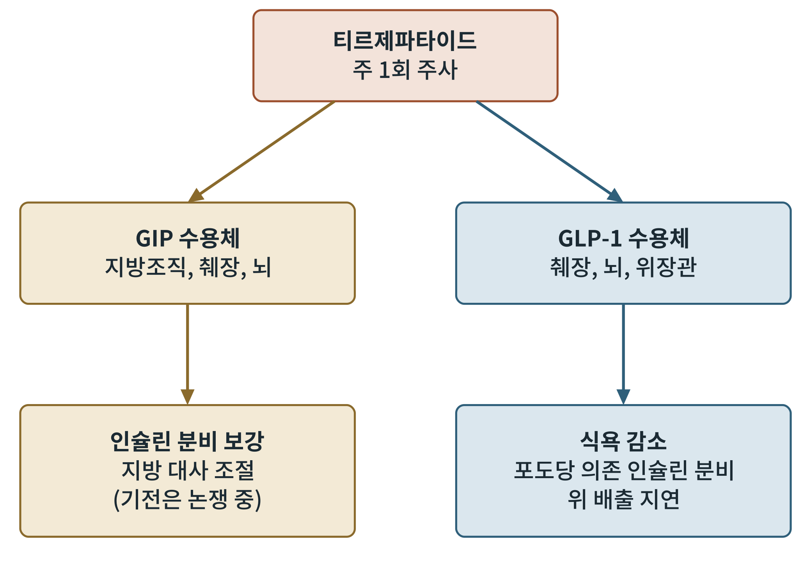
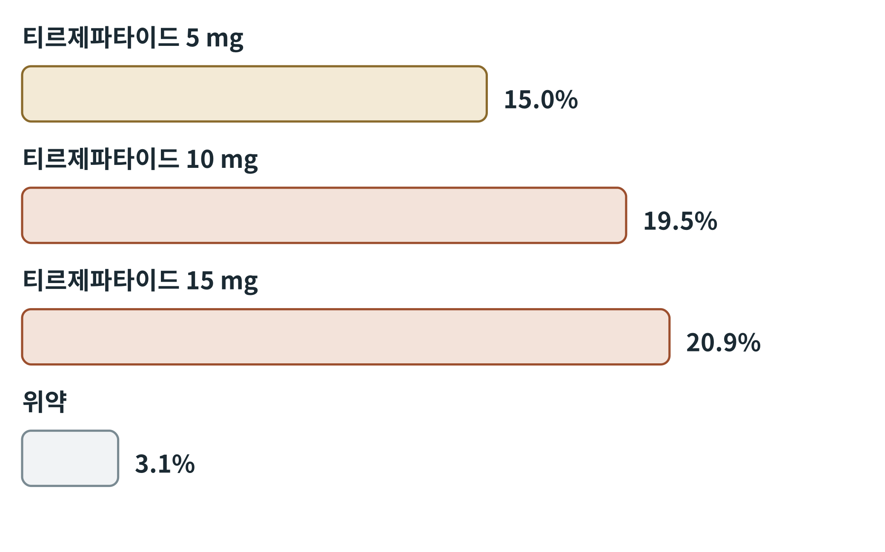

## 제14장 티르제파타이드와 다중 작용제

> **이 장의 출발점** 13장의 약물들은 하나의 수용체, GLP-1 수용체만 겨냥했다. 이 장은 한 분자로 두 개, 세 개의 수용체를 동시에 켜는 약을 다룬다. 4장에서 본 장 호르몬 지도에서 GLP-1 말고도 GIP와 글루카곤이 에너지 대사에 관여한다는 것을 보았다. 다중 작용제는 그 지도 위의 여러 지점을 한 번에 누르려는 시도다. 개별 약물의 약동학과 용량 설계는 2권 20~21장과 이어진다.

### 14.1 왜 두 개를 켜는가

GIP(glucose-dependent insulinotropic polypeptide, 포도당 의존 인슐린 분비 자극 펩타이드)는 GLP-1과 함께 대표적인 인크레틴이다. 2장에서 본 것처럼 인크레틴 효과의 상당 부분이 GIP에서 나온다. 그러나 GIP 단독 작용제는 오랫동안 약으로 개발되지 않았다. 제2형 당뇨병 환자에서는 GIP의 인슐린 분비 효과가 약해져 있다고 알려졌기 때문이다. 티르제파타이드(tirzepatide)는 이 통념을 깨고, GIP 수용체와 GLP-1 수용체를 함께 켜는 단일 분자로 개발되었다(Coskun et al., 2018).

### 14.2 불균형한 이중 작용제

티르제파타이드는 GIP 서열을 바탕으로 설계된 39개 아미노산 펩타이드로, 12장에서 본 Aib 치환과 지방산 측쇄를 갖고 있어 주 1회 주사가 가능하다. 흥미로운 점은 두 수용체에 대한 작용이 균등하지 않다는 것이다. 연구에 따르면 GIP 수용체에는 천연 GIP에 견줄 만큼 강하게 작용하지만, GLP-1 수용체에는 천연 GLP-1보다 약하게 작용하며, GLP-1 수용체에서는 cAMP 생성 쪽으로 치우친 신호(편향)를 보인다(Willard et al., 2020). 그림 14-1은 두 수용체가 어떤 조직에서 어떤 효과를 내는지 개념적으로 정리한 것이다.

**그림 14-1. 티르제파타이드의 이중 작용 개념도.** 위 상자는 약물, 가운데는 표적 수용체와 주요 발현 조직, 아래는 기대되는 효과를 나타낸다. 실제 기전은 아직 논쟁 중이며 그림은 개념적 정리다.

그림 14-1의 왼쪽 줄은 GIP 수용체 경로이고 오른쪽 줄은 GLP-1 수용체 경로다. 오른쪽의 식욕 감소와 위 배출 지연은 13장에서 본 GLP-1 계열의 효과와 같다. 왼쪽의 GIP 경로가 체중 감소에 얼마나 기여하는지는 아직 확립되지 않았다. 흥미롭게도 GIP 수용체를 켜는 접근과 막는 접근이 모두 체중 감소와 연결되어 보고되어 이른바 GIP 역설이라 불리며, 이를 설명하는 가설이 여럿 제시되었으나 결론은 나지 않았다.

### 14.3 임상시험의 결과

비만 환자(당뇨병 없음)를 대상으로 한 SURMOUNT-1 시험에서 티르제파타이드는 72주에 용량에 따라 평균 체중이 15.0%(5 mg), 19.5%(10 mg), 20.9%(15 mg) 감소했고 위약은 3.1%였다(Jastreboff et al., 2022). 세마글루타이드와 직접 비교한 시험에서도 티르제파타이드의 체중 감소가 더 컸다고 보고되었다(Aronne et al., 2025).

**그림 14-2. SURMOUNT-1의 용량별 평균 체중 감소율.** 막대 길이는 72주 평균 체중 감소율(%)에 비례한다.

그림 14-2를 읽으면 용량이 커질수록 체중 감소가 커지지만 10 mg과 15 mg의 차이는 5 mg과 10 mg의 차이보다 작다. 용량-반응 곡선이 위쪽에서 완만해지는 모양이다. 이 모양은 부작용과 효과의 균형으로 용량을 정하는 데 중요한 정보가 된다.

### 14.4 세 번째 수용체: 글루카곤

글루카곤 수용체를 더하면 에너지 소비를 높이고 간 지방을 줄일 수 있다는 가설이 있다. 글루카곤은 혈당을 올리는 호르몬이므로 GLP-1과 함께 쓰면 혈당 상승을 상쇄할 수 있다고 본다. 세 수용체 작용제 레타트루타이드(retatrutide)의 2상 시험에서는 48주에 최고 용량에서 평균 24.2%의 체중 감소가 보고되었다(Jastreboff et al., 2023). GLP-1과 글루카곤을 함께 켜는 서바이두타이드(survodutide)와 마즈두타이드(mazdutide) 등도 개발 중이다. 이들의 임상 결과는 시험이 진행 중이어서 본 책에서는 확정된 수치로 다루지 않는다.

### 14.5 다중 작용제 비교

**표 14-1. 주요 다중 작용제의 표적과 개발 단계.** 개발 단계는 이 책의 집필 시점 기준이며 변동 가능하다.

| 약물 | 표적 수용체 | 투여 | 비고 |
|---|---|---|---|
| 티르제파타이드 | GIPR, GLP-1R | 주 1회 주사 | 비만 치료제로 승인됨, 불균형·편향 작용 |
| 레타트루타이드 | GIPR, GLP-1R, GCGR | 주 1회 주사 | 2상 결과 보고, 3상 진행 |
| 서바이두타이드 | GLP-1R, GCGR | 주 1회 주사 | 개발 중 |
| 마즈두타이드 | GLP-1R, GCGR | 주 1회 주사 | 개발 중 |

표 14-1에서 보이듯 표적 조합은 GLP-1 수용체를 중심에 두고 GIP나 글루카곤 수용체를 더하는 방식으로 정리된다. 어떤 조합이 효과와 안전성에서 가장 좋은지는 아직 열려 있는 질문이다.

### 이 장의 요점

- 티르제파타이드는 GIP와 GLP-1 수용체를 함께 켜며, 두 수용체에 대한 작용이 불균형하고 GLP-1 수용체에서 편향을 보인다.
- SURMOUNT-1에서 72주 평균 체중 감소는 15.0~20.9%(위약 3.1%)였다.
- GIP 경로의 기여는 아직 논쟁 중이다(GIP 역설).
- 글루카곤 수용체를 더한 세 수용체 작용제는 2상에서 더 큰 감소를 보였으나 확정 근거는 3상을 기다린다.

#### 참고문헌

Aronne, L. J., Horn, D. B., le Roux, C. W., Ho, W., Falcon, B. L., Gomez Valderas, E., Das, S., Lee, C. J., Glass, L. C., Senyucel, C., & Bunck, M. C. (2025). Tirzepatide as compared with semaglutide for the treatment of obesity. *The New England Journal of Medicine, 393*(1), 26–36.

Coskun, T., Sloop, K. W., Loghin, C., Alsina-Fernandez, J., Urva, S., Bokvist, K. B., Cui, X., Briere, D. A., Cabrera, O., Roell, W. C., Kuchibhotla, U., Moyers, J. S., Benson, C. T., Gimeno, R. E., D'Alessio, D. A., & Haupt, A. (2018). LY3298176, a novel dual GIP and GLP-1 receptor agonist for the treatment of type 2 diabetes mellitus. *Molecular Metabolism, 18*, 3–14.

Jastreboff, A. M., Aronne, L. J., Ahmad, N. N., Wharton, S., Connery, L., Alves, B., Kiyosue, A., Zhang, S., Liu, B., Bunck, M. C., & Stefanski, A. (2022). Tirzepatide once weekly for the treatment of obesity. *The New England Journal of Medicine, 387*(3), 205–216.

Jastreboff, A. M., Kaplan, L. M., Frías, J. P., Wu, Q., Du, Y., Gurbuz, S., Coskun, T., Haupt, A., Milicevic, Z., & Hartman, M. L. (2023). Triple-hormone-receptor agonist retatrutide for obesity: A phase 2 trial. *The New England Journal of Medicine, 389*(6), 514–526.

Willard, F. S., Douros, J. D., Gabe, M. B. N., Showalter, A. D., Wainscott, D. B., Suter, T. M., Capozzi, M. E., van der Velden, W. J. C., Stutsman, C., Cardona, G. R., Urva, S., Emmerson, P. J., Coskun, T., Campbell, J. E., Sloop, K. W., & Rosenstock, J. (2020). Tirzepatide is an imbalanced and biased dual GIP and GLP-1 receptor agonist. *JCI Insight, 5*(17), e140532.
