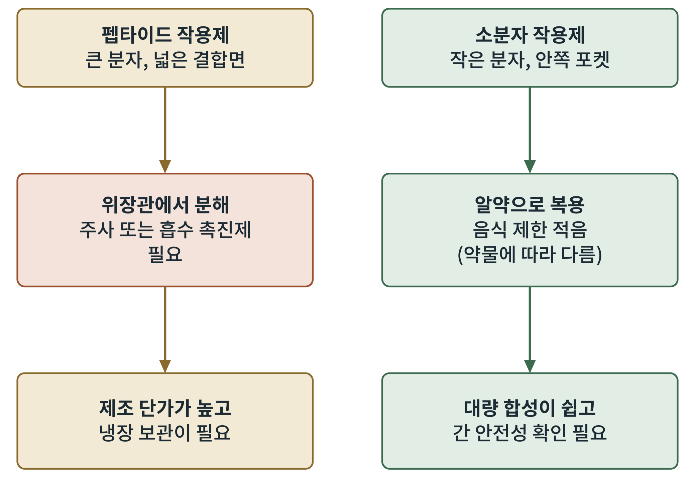
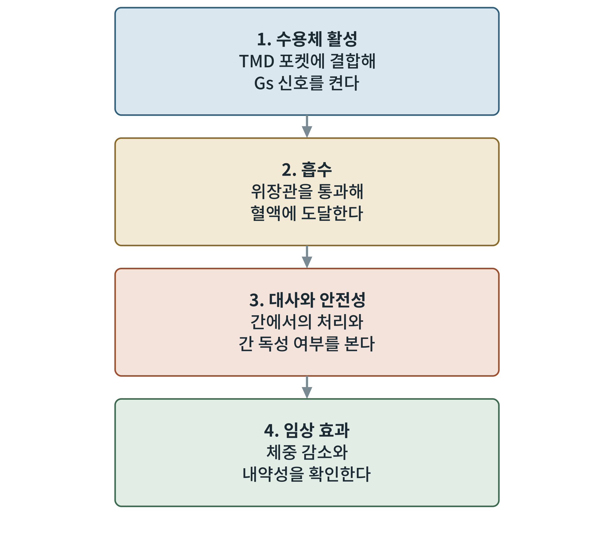

## 제15장 경구 소분자: 오포글리프론과 그 이웃들

> **이 장의 출발점** 13장의 경구 세마글루타이드는 펩타이드를 알약에 밀어 넣은 약이었다. 이 장의 약은 처음부터 알약이 되도록 설계된 작은 분자다. 12장에서 본 TMD 안쪽 포켓이 여기서 표적이 된다. 소분자 약은 제조와 보관, 복용 편의성에서 큰 이점이 있지만, 펩타이드와는 다른 종류의 난관을 통과해야 한다. 흡수와 대사의 세부는 2권 22장과 연결된다.

### 15.1 펩타이드와 소분자는 무엇이 다른가

펩타이드 작용제는 큰 분자여서 수용체의 넓고 얕은 결합면을 덮으며 붙는다. 반면 소분자는 수용체의 안쪽 포켓에 들어간다. 12장에서 본 구조 연구들은 일부 비펩타이드 작용제가 GLP-1 수용체의 막횡단 도메인 안쪽 포켓에 결합해 Gs 신호를 켠다는 것을 보였다(Kawai et al., 2020; Zhang et al., 2020). 이 차이는 약의 성격 전체에 영향을 준다. 그림 15-1이 그 차이를 정리한다.

**그림 15-1. 펩타이드 작용제와 소분자 작용제의 비교.** 왼쪽은 펩타이드, 오른쪽은 소분자이며, 위에서 아래로 분자의 특성, 복용 방식, 제조와 안전성의 고려 사항을 나타낸다. 약물에 따라 달라지는 항목이 있는 개념적 정리다.

그림 15-1을 읽으면 두 계열이 서로 다른 문제를 안고 있음을 알 수 있다. 펩타이드는 분해와 흡수의 문제를 제형으로 풀어야 하고 제조 단가가 높다. 소분자는 알약으로 먹기 쉽고 대량 합성이 가능하지만, 간에서의 처리와 간 안전성이라는 새로운 질문을 통과해야 한다. 작은 분자일수록 수용체 이외의 단백질에 의도하지 않게 작용할 가능성도 커진다.

### 15.2 오포글리프론

오포글리프론(orforglipron)은 일라이 릴리가 개발한 비펩타이드 GLP-1 수용체 작용제로, 하루 한 번 먹는다. 12장의 구조 연구에서 LY3502970이라는 이름으로 등장한 물질로 알려져 있다(Kawai et al., 2020). 비만 환자를 대상으로 한 2상 시험에서 용량에 따라 체중이 유의하게 감소했고 부작용은 GLP-1 계열에서 흔한 위장관 증상이 중심이었다(Wharton et al., 2023). 3상 시험의 결과도 보고되었으나, 본 책에서는 근거 문헌 확인 후 수치를 보강한다.

경구 세마글루타이드와 달리 오포글리프론은 공복과 소량의 물 같은 엄격한 복용 조건이 필요하지 않다고 보고되었다. 이것은 소분자의 설계 방향이 펩타이드의 한계를 우회하려는 것임을 보여 주는 사례다.

### 15.3 소분자 개발의 관문

소분자 약이 통과해야 하는 관문은 그림 15-2의 순서로 요약된다.

**그림 15-2. 경구 소분자 작용제의 개발 관문.** 위에서 아래로 수용체 활성, 흡수, 대사와 안전성, 임상 효과의 순서를 나타낸다. 어느 한 관문에서 탈락하면 그다음 단계로 갈 수 없다.

그림 15-2에서 세 번째 관문인 대사와 안전성은 실제로 여러 후보가 탈락한 지점이다. 일부 경구 GLP-1 소분자 후보는 간 안전성 신호 때문에 개발이 중단된 것으로 알려져 있다. 그래서 새 후보를 평가할 때는 효력과 함께 간 효소 수치와 약물 상호작용을 일찍부터 살펴야 한다. 이 내용은 3권에서 데이터와 도구로 구체화한다.

### 15.4 비교

**표 15-1. 경구 펩타이드와 경구 소분자의 비교.** 정성적 비교이며 개별 약물의 수치는 근거 확인 후 보강한다.

| 항목 | 경구 세마글루타이드 | 오포글리프론 |
|---|---|---|
| 분자 종류 | 펩타이드 + SNAC | 비펩타이드 소분자 |
| 결합 부위 | ECD와 TMD(두 지점) | TMD 안쪽 포켓 |
| 복용 조건 | 공복, 소량의 물 | 제한이 적다고 보고됨 |
| 제조 | 복잡, 단가 높음 | 화학 합성, 대량 생산 유리 |
| 주요 위험 | 흡수 변동성 | 간 안전성 확인 필요 |

표 15-1에서 두 약의 이점과 위험이 거의 대칭을 이룬다는 점이 눈에 띈다. 한쪽의 약점이 다른 쪽의 강점이 되는 구조다.

### 이 장의 요점

- 소분자 작용제는 TMD 안쪽 포켓에 결합해 Gs 신호를 켜며, 펩타이드와 다른 자리에 붙는다.
- 오포글리프론은 하루 한 번 먹는 비펩타이드 GLP-1 수용체 작용제로, 2상에서 체중 감소를 보였다.
- 경구 소분자의 가장 큰 관문은 흡수보다 간 안전성이다.
- 펩타이드와 소분자는 이점과 위험이 서로 반대편에 있다.

#### 참고문헌

Kawai, T., Sun, B., Yoshino, H., Feng, D., Suzuki, Y., Fukazawa, M., Nagao, S., Wainscott, D. B., Showalter, A. D., Droz, B. A., Kobilka, T. S., Coghlan, M. P., Willard, F. S., Kawabe, Y., Kobilka, B. K., & Sloop, K. W. (2020). Structural basis for GLP-1 receptor activation by LY3502970, an orally active nonpeptide agonist. *Proceedings of the National Academy of Sciences, 117*(47), 29959–29967.

Wharton, S., Blevins, T., Connery, L., Rosenstock, J., Raha, S., Liu, R., Ma, X., Mather, K. J., Haupt, A., Robins, D., Pratt, E., Kazda, C., & Konig, M. (2023). Daily oral GLP-1 receptor agonist orforglipron for adults with obesity. *The New England Journal of Medicine, 389*(10), 877–888.

Zhang, X., Belousoff, M. J., Zhao, P., Kooistra, A. J., Truong, T. T., Ang, S. Y., Underwood, C. R., Egebjerg, T., Šenel, P., Stewart, G. D., Liang, Y.-L., Glukhova, A., Venugopal, H., Christopoulos, A., Furness, S. G. B., Miller, L. J., Reedtz-Runge, S., Langmead, C. J., Gloriam, D. E., … Wootten, D. (2020). Differential GLP-1R binding and activation by peptide and non-peptide agonists. *Molecular Cell, 80*(3), 485–500.
