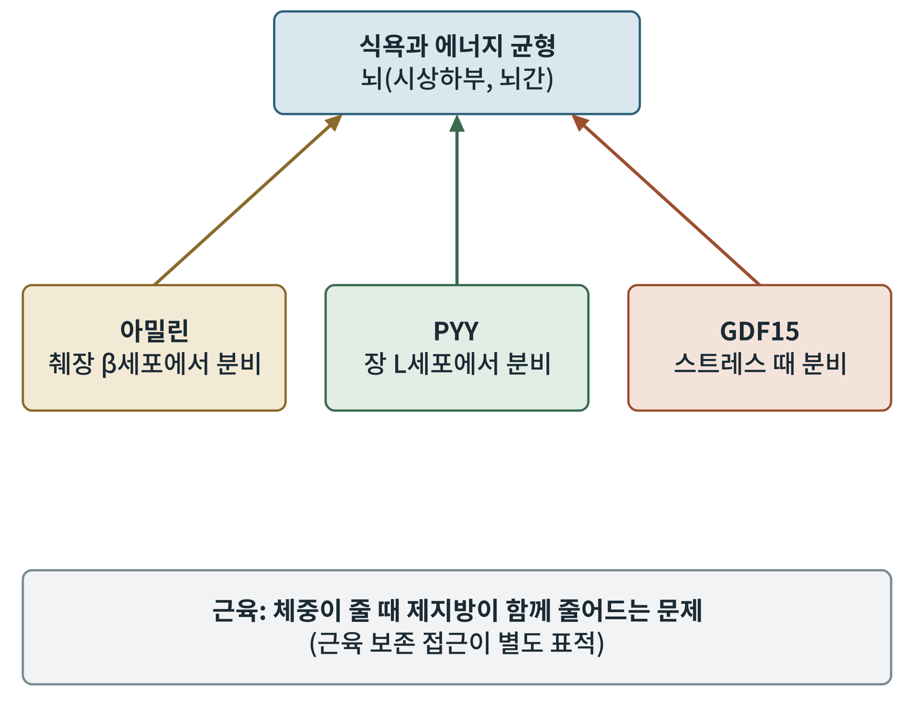
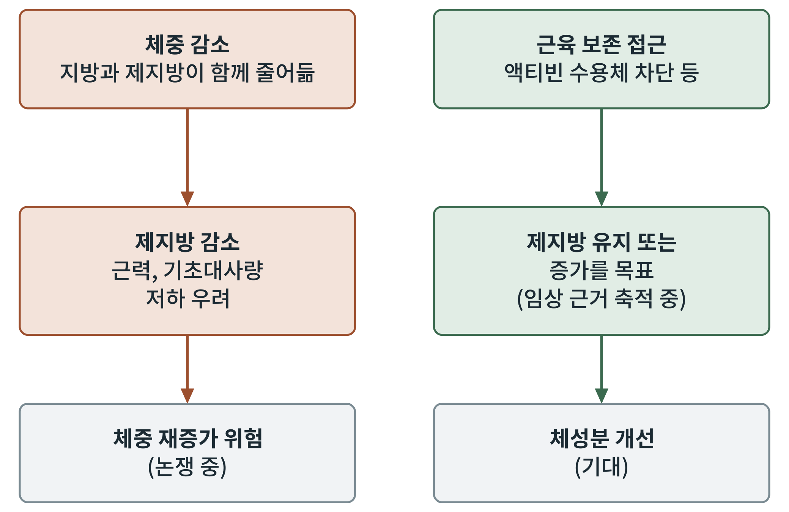

## 제16장 차세대 표적: 아밀린, GDF15, PYY, MC4R, 근육 보존

> **이 장의 출발점** 13~15장의 약물은 모두 GLP-1 수용체를 중심에 두었다. 그러나 4장의 호르몬 지도에는 아직 약으로 완성되지 않은 신호가 여럿 남아 있다. 이 장은 그 가운데 개발이 앞선 표적들을 차례로 훑고, 체중 감소의 부작용으로 떠오른 제지방 감소 문제를 함께 다룬다. 병용 요법의 약동학은 2권 26~27장과 이어진다.

### 16.1 아밀린

아밀린(amylin)은 췌장 β세포가 인슐린과 함께 분비하는 호르몬으로, 식후에 포만감을 높이고 위 배출을 늦춘다. 뇌간의 수용체를 통해 작용한다고 알려져 있다. 아밀린 유사체 카그릴린타이드(cagrilintide)는 주 1회 주사 형태로 개발되어 2상 시험에서 체중 감소 효과를 보였다(Lau et al., 2021). 가장 주목받는 전략은 카그릴린타이드를 세마글루타이드와 함께 쓰는 복합제로, GLP-1과 아밀린이라는 서로 다른 경로를 동시에 겨냥한다. 이 복합제의 3상 결과는 보고되었으나 본 책에서는 원문 확인 후 수치를 보강한다.

### 16.2 GDF15

GDF15(growth differentiation factor 15, 성장 분화 인자 15)는 세포 스트레스에 반응해 분비되는 단백질이다. 2017년 여러 연구팀이 이 단백질의 수용체가 뇌간 후구역에 있는 GFRAL이라는 것을 밝혔고, GDF15가 식욕을 줄이고 체중을 감소시킨다는 것을 동물에서 보였다(Mullican et al., 2017). 그러나 GDF15는 오심과 구토 같은 불쾌 반응과도 연결되어 있어, 식욕 감소 효과와 불쾌감을 분리할 수 있는지가 핵심 쟁점이다. 임신 중 오심과 GDF15의 관계가 보고된 것도 이 우려를 뒷받침한다.

### 16.3 PYY

PYY(peptide YY)는 장 L세포가 GLP-1과 함께 분비하는 호르몬으로, Y2 수용체를 통해 식욕을 낮춘다. 4장에서 본 것처럼 PYY는 식후 포만 신호의 한 축이다. PYY 유사체는 단독으로 쓰이기보다 GLP-1 계열과의 병용 가능성이 연구되고 있다. 이 접근의 임상 근거는 아직 제한적이다.

### 16.4 MC4R

11장에서 본 것처럼 MC4R 경로의 결함은 중증 비만을 일으킨다. MC4R 작용제 세트멜라노타이드는 이 경로의 유전적 결함이 있는 환자에서 사용된다. 일반 비만에 이 경로를 켜는 약을 쓰려면 혈압 상승과 같은 심혈관 부작용을 피하는 선택적 작용제가 필요하다. 그림 16-1이 이 표적들의 위치를 정리한다.

**그림 16-1. 차세대 표적의 위치.** 위 상자는 뇌의 식욕 조절 영역이고, 아래 세 상자는 그곳으로 신호를 보내는 호르몬이다. 맨 아래 상자는 신호와 별개로 제기되는 근육 문제를 나타낸다. 개념도이며 호르몬 사이의 용량 관계를 나타내지 않는다.

그림 16-1을 읽으면 세 호르몬이 서로 다른 장기에서 나와 같은 뇌 영역으로 수렴한다는 점이 보인다. 이 수렴 구조가 병용 요법의 근거가 된다. 서로 다른 경로를 겹쳐 누르면 한 경로만 누를 때보다 효과가 커질 수 있다는 기대다. 맨 아래 상자는 신호의 문제가 아니라 몸의 구성 문제를 가리킨다.

### 16.5 근육 보존

체중이 줄 때 지방뿐 아니라 제지방(lean mass, 지방을 제외한 몸무게)도 함께 줄어든다는 점이 GLP-1 계열 약의 사용 경험에서 주목받고 있다. 제지방 감소가 근력과 대사에 미치는 영향은 아직 논쟁 중이다. 이를 겨냥한 접근으로 액티빈 수용체를 차단해 근육 성장을 억제하는 신호를 푸는 항체(bimagrumab)가 연구되었다. 제2형 당뇨병이 있는 과체중 성인에서 이 항체는 지방량을 줄이고 제지방량을 늘렸다고 보고되었다(Heymsfield et al., 2021).

**그림 16-2. 근육 보존 접근의 개념도.** 왼쪽은 일반적인 체중 감소 경로, 오른쪽은 근육 보존 접근이 목표로 하는 경로다. 오른쪽의 효과는 기대이며 임상 근거는 축적 중이다.

그림 16-2에서 왼쪽 경로의 마지막 상자 "체중 재증가 위험"에 물음표가 달린 이유는, 제지방 감소와 체중 재증가 사이의 인과가 아직 확립되지 않았기 때문이다. 이 책은 그 관계를 단정하지 않고 열린 질문으로 둔다.

### 16.6 표적 비교

**표 16-1. 차세대 표적의 요약.** 정성적 요약이며 개발 단계는 집필 시점 기준이다.

| 표적 | 주요 작용 부위 | 기대 효과 | 핵심 쟁점 |
|---|---|---|---|
| 아밀린 | 뇌간 | 포만 증가, 위 배출 지연 | GLP-1과의 병용 효과 |
| GDF15 | 뇌간(GFRAL) | 식욕 감소 | 오심·불쾌 반응과의 분리 |
| PYY | 시상하부, 뇌간 | 식후 포만 | 임상 근거 제한적 |
| MC4R | 시상하부 | 에너지 균형 회복 | 심혈관 부작용, 선택성 |
| 액티빈 수용체 | 근육 | 제지방 보존 | 장기 안전성, 기능적 이점 |

표 16-1에서 보이듯 이 표적들은 서로 다른 약점을 갖고 있다. 어느 것이 GLP-1 계열의 뒤를 잇는 주력이 될지는 아직 알 수 없다. 그래서 5부 마무리의 미충족 요구 목록이 필요하다.

### 이 장의 요점

- 아밀린 유사체는 GLP-1과 다른 경로로 포만을 높이며 병용 요법으로 개발되고 있다.
- GDF15는 뇌간 GFRAL을 통해 작용하지만 오심과의 분리가 과제다.
- PYY와 MC4R은 각각 병용 가능성과 선택성 문제를 안고 있다.
- 체중 감소 중 제지방 감소는 별도의 표적(근육 보존)으로 다뤄진다.

#### 참고문헌

Heymsfield, S. B., Coleman, L. A., Miller, R., Rooks, D. S., Laurent, D., Petricoul, O., Praestgaard, J., Swan, T., Wade, T., Perry, R. G., & Hughes, E. (2021). Effect of bimagrumab vs placebo on body fat mass among adults with type 2 diabetes and obesity: A phase 2 randomized clinical trial. *JAMA Network Open, 4*(1), e2033457.

Lau, D. C. W., Erichsen, L., Francisco, A. M., Satylganova, A., le Roux, C. W., McGowan, B., Pedersen, S. D., Pietiläinen, K. H., Rubino, D., & Batterham, R. L. (2021). Once-weekly cagrilintide for weight management in people with overweight and obesity: A multicentre, randomised, double-blind, placebo-controlled and active-controlled, dose-finding phase 2 trial. *The Lancet, 398*(10317), 2160–2172.

Mullican, S. E., Lin-Schmidt, X., Chin, C.-N., Chavez, J. A., Furman, J. L., Armstrong, A. A., Beck, S. C., South, V. J., Dinh, T. Q., Cash-Mason, T. D., Cavanaugh, C. R., Nelson, S., Huang, C., Hunter, M. J., & Rangwala, S. M. (2017). GFRAL is the receptor for GDF15 and the ligand promotes weight loss in mice and nonhuman primates. *Nature Medicine, 23*(10), 1150–1157.
