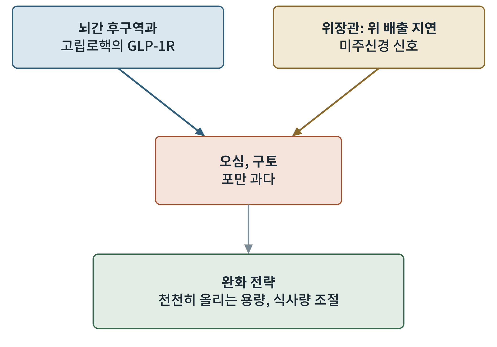
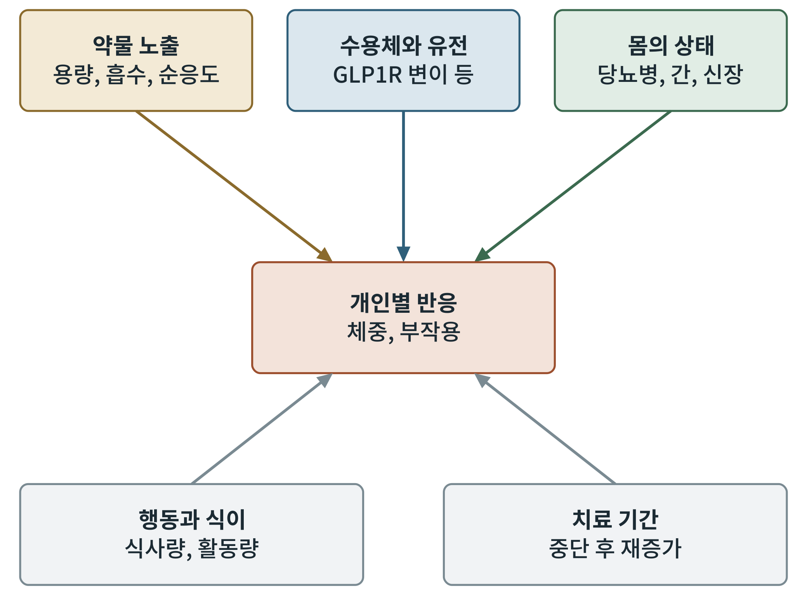

## 제17장 부작용과 반응 차이의 기전

> **이 장의 출발점** 13~16장은 약이 무엇을 하는지를 다루었다. 이 장은 약이 왜 사람마다 다르게 작용하고, 어떤 대가가 따르는지를 다룬다. 같은 용량을 써도 어떤 사람은 체중이 크게 줄고 어떤 사람은 거의 줄지 않으며, 또 어떤 사람은 심한 오심으로 약을 끊는다. 이 차이를 설명하는 기전은 일부만 알려져 있다. 약동학의 개인차는 2권 37장, 수용체 신호의 세포 수준 차이는 2권 21장과 이어진다. 이 장은 5부의 마지막 장이므로 끝에 5부 점검(약물 비교표와 미충족 요구 목록)을 둔다.

### 17.1 가장 흔한 부작용: 위장관

GLP-1 계열 약물에서 가장 흔한 부작용은 오심, 구토, 설사, 변비 같은 위장관 증상이다. 이 증상은 용량을 올리는 시기에 두드러지고 시간이 지나면 줄어드는 경향이 있다. 기전은 두 갈래로 이해된다. 하나는 뇌간 후구역과 고립로핵에 있는 GLP-1 수용체가 오심 신호를 직접 만든다는 것이고, 다른 하나는 위 배출 지연과 미주신경 신호가 포만 과다와 불편감을 만든다는 것이다. 그림 17-1이 이 구조를 정리한다.

**그림 17-1. 위장관 부작용의 두 경로와 완화 전략.** 위 두 상자는 부작용을 만드는 경로이고, 가운데는 증상, 아래는 임상에서 쓰는 완화 방법이다. 기전은 동물과 인간 연구에 근거한 개념적 정리다.

그림 17-1에서 두 경로가 하나의 증상으로 모인다는 점이 중요하다. 이 때문에 용량을 천천히 올리는 전략이 효과가 있다. 수용체가 점차 적응하고 위 배출 지연에도 내성이 생기기 때문이다. 반대로 같은 뇌간 수용체를 통해 식욕이 줄고 오심도 생긴다는 점에서, 효과와 부작용을 완전히 분리하기 어렵다는 문제가 남는다. 16장에서 본 GDF15가 같은 쟁점을 안고 있었다.

### 17.2 그 밖의 안전성 쟁점

위장관 이외에도 여러 안전성 쟁점이 보고되었다. 담낭과 담도 질환의 위험이 증가한다는 메타분석 결과가 있고(He et al., 2022), 급성 췌장염과의 관련성은 근거가 엇갈려 지속적으로 검토되고 있다. 설치류에서는 갑상선 C세포 종양이 관찰되어 경고가 붙었지만, 인간 C세포에서는 GLP-1 수용체 발현이 낮아 인간에서의 의미는 불확실하다. 이 밖에 심박수 증가, 비동맥염성 허혈성 시신경병증 신호의 평가가 진행 중이다. 표 17-1에 정리한다.

**표 17-1. GLP-1 계열 약물의 주요 안전성 쟁점.** 근거 수준은 정성적 표기이며 개별 수치는 근거 확인 후 보강한다.

| 쟁점 | 제안된 기전 | 근거 수준 | 임상적 대응 |
|---|---|---|---|
| 오심, 구토, 설사 | 뇌간 수용체, 위 배출 지연 | 높음(임상시험 일관) | 천천히 올리는 용량, 식사 조절 |
| 담낭·담도 질환 | 체중 감소와 담즙 정체 | 중간(메타분석) | 증상 모니터링 |
| 급성 췌장염 | 불명확 | 엇갈림 | 증상 시 중단 평가 |
| 갑상선 C세포 종양 | 설치류에서 관찰 | 인간 의미 불확실 | 경고 문구, 개인력 확인 |
| 심박수 증가 | 심장 GLP-1R 또는 자율신경 | 중간 | 모니터링 |
| 시신경병증 | 불명확 | 신호 평가 중 | 증상 시 안과 평가 |

표 17-1에서 근거 수준이 높은 쟁점은 위장관 증상뿐이고 나머지는 불확실성이 크다. 이 불확실성은 약의 사용 기간이 길어지고 대상 인구가 넓어질수록 근거가 쌓이며 정리될 것이다.

### 17.3 반응의 개인차

체중 감소의 크기는 사람마다 크게 다르다. 임상시험의 평균값 뒤에는 거의 줄지 않는 사람과 크게 줄어드는 사람이 함께 있다. 이 차이는 한 가지 원인으로 설명되지 않고 그림 17-2의 여러 요인이 겹쳐 만들어진다.

**그림 17-2. 개인별 반응의 요인.** 위쪽은 약물과 몸의 요인, 아래쪽은 행동과 시간의 요인이 가운데의 개인별 반응으로 모이는 구조를 나타낸다. 각 요인의 기여도를 나타내는 그림이 아니다.

그림 17-2의 요인 가운데 수용체와 유전의 영역은 11장에서 본 유전학이 이어지는 곳이다. 이 영역에서 약물 반응을 예측하는 유전 표지는 아직 확립되지 않았다. 반면 약물 노출은 용량과 순응도로 직접 조절할 수 있는 요인이며, 임상에서 가장 먼저 점검하는 부분이다.

### 17.4 중단 후의 문제

약을 중단하면 체중이 다시 늘어나는 경향이 보고되었다. 세마글루타이드 시험의 연장 연구에서 약을 끊은 사람들이 1년 안에 줄였던 체중의 상당 부분을 되찾았다는 결과가 있다(Wilding et al., 2022). 이는 비만이 약으로 한 번 고치는 병이 아니라 만성적으로 관리해야 하는 병이라는 관점을 뒷받침한다. 동시에 장기 복용의 안전성과 비용이 중요한 문제가 된다.

### 17.5 5부 점검: 약물 비교와 미충족 요구

5부에서 다룬 약물을 한 표로 모으면 각 약이 어디까지 왔고 어디가 비어 있는지가 드러난다.

**표 17-2. 5부 약물 비교표(산출물 4).** 정성적 정리이며 수치는 각 장의 표와 참고문헌을 따른다.

| 약물군 | 표적 | 투여 | 강점 | 남은 과제 |
|---|---|---|---|---|
| 리라글루타이드 | GLP-1R | 1일 1회 주사 | 오랜 사용 경험 | 효과 크기 |
| 세마글루타이드 | GLP-1R | 주 1회 주사, 경구 | 심혈관 근거 | 위장관 부작용, 제지방 감소 |
| 티르제파타이드 | GIPR, GLP-1R | 주 1회 주사 | 큰 체중 감소 | GIP 기전 불명확 |
| 오포글리프론 | GLP-1R(소분자) | 경구 | 제조·복용 편의 | 간 안전성 확인 |
| 아밀린·PYY·GDF15 | 뇌간·시상하부 | 개발 중 | 병용 가능성 | 오심 분리, 근거 부족 |
| 근육 보존 접근 | 액티빈 수용체 | 개발 중 | 제지방 보존 | 장기 안전성 |

**표 17-3. 미충족 요구 목록.** 각 항목은 표적 후보표(산출물 3)와 연결해 3권의 신약 설계 사례에서 다룬다.

| 번호 | 미충족 요구 | 관련 장 |
|---|---|---|
| 1 | 효과와 오심을 분리하는 뇌간 신호 설계 | 16, 17 |
| 2 | 제지방 보존과 체성분 개선 | 16 |
| 3 | 반응을 미리 예측하는 표지 | 11, 17 |
| 4 | 중단 후 재증가를 막는 유지 요법 | 17 |
| 5 | 간 안전성이 확보된 경구 소분자 | 15 |
| 6 | 장기 복용 안전성과 비용 | 13~17 |

표 17-3의 여섯 항목은 5부의 결론이자 6부 이후 신약 설계의 출발점이다. 어떤 항목은 구조 설계로, 어떤 항목은 유전학과 데이터로 풀어야 한다.

### 이 장의 요점

- 위장관 부작용은 뇌간 수용체와 위 배출 지연의 두 경로로 생기며, 용량을 천천히 올리면 줄어드는 경향이 있다.
- 담도 질환, 췌장염, 갑상선, 시신경 등의 쟁점은 근거 수준이 다르다.
- 반응의 개인차는 약물 노출, 수용체와 유전, 몸의 상태, 행동, 치료 기간이 겹쳐 만든다.
- 중단 후 재증가는 비만을 만성 질환으로 보는 관점을 뒷받침한다.
- 5부 점검 결과 여섯 가지 미충족 요구가 남는다.

#### 참고문헌

He, L., Wang, J., Ping, F., Yang, N., Huang, J., Li, Y., Xu, L., Li, W., & Zhang, H. (2022). Association of glucagon-like peptide-1 receptor agonist use with risk of gallbladder and biliary diseases: A systematic review and meta-analysis of randomized clinical trials. *JAMA Internal Medicine, 182*(5), 513–519.

Wilding, J. P. H., Batterham, R. L., Davies, M., Van Gaal, L. F., Kandler, K., Konakli, K., Lingvay, I., McGowan, B. M., Oral, T. K., Rosenstock, J., Wadden, T. A., Wharton, S., Yokote, K., & Kushner, R. F. (2022). Weight regain and cardiometabolic effects after withdrawal of semaglutide: The STEP 1 trial extension. *Diabetes, Obesity and Metabolism, 24*(8), 1553–1564.
