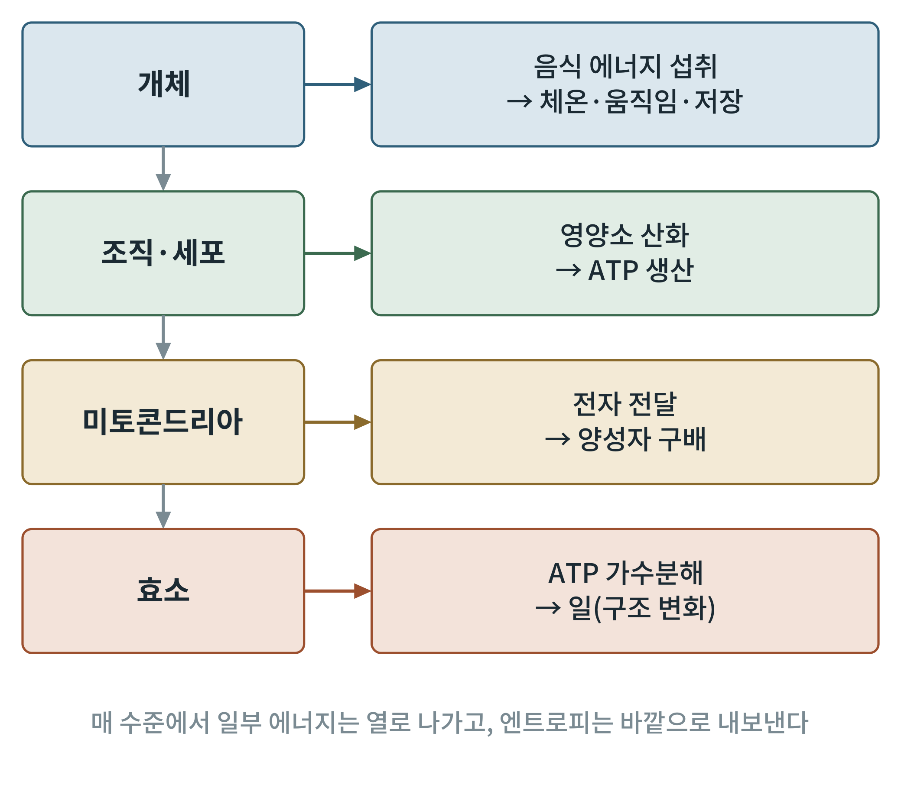

# 제1부 에너지의 기초

## 제1장 에너지란 무엇인가: 열역학과 생명

> **이 장의 출발점** 1780년대 파리에서 앙투안 라부아지에(Antoine Lavoisier)와 피에르 시몽 라플라스(Pierre-Simon Laplace)는 얼음으로 둘러싼 통 안에 기니피그를 넣고, 녹아 흘러내린 물의 양으로 동물이 내는 열을 쟀다. 같은 양의 탄소를 태울 때 나오는 열과 견주어 보니, 숨 쉬는 일은 천천히 타는 불과 같았다. 먹은 것이 몸에서 타서 열과 일이 된다는 생각은 여기서 시작된다. 이 책 2권 전체는 그 "천천히 타는 불"이 세포 안에서 어떻게 조절되는지를 따라간다.

### 1.1 에너지는 사라지지 않고 모양만 바뀐다

열역학 제1법칙(first law of thermodynamics)은 고립된 계의 에너지 총량이 변하지 않는다고 말한다. 몸에 적용하면 간단한 장부가 된다. 먹은 음식의 화학에너지는 열, 일, 저장 에너지로 나뉘고, 나뉜 양의 합은 들어온 양과 같다. 하루 에너지 섭취와 소비가 같으면 체중은 유지되고, 섭취가 크면 남는 몫이 지방과 글리코겐의 화학에너지로 저장된다.

에너지 단위는 킬로칼로리(kcal)와 킬로줄(kJ)이 함께 쓰인다. 1 kcal는 4.184 kJ이다. 영양 표시의 "칼로리"는 대개 킬로칼로리를 뜻한다. 이 책은 분자 수준의 값에는 kJ/mol을, 개체 수준의 값에는 kcal를 쓰고, 처음 나올 때 환산을 함께 적는다.

### 1.2 엔트로피와 자유에너지: 어디로 흐르는가

제1법칙은 에너지의 양을 말할 뿐, 반응이 어느 쪽으로 진행하는지는 말하지 않는다. 방향을 정하는 것은 열역학 제2법칙(second law of thermodynamics)이다. 고립된 계의 엔트로피(entropy), 곧 흩어진 정도는 저절로 줄어들지 않는다. 루트비히 볼츠만(Ludwig Boltzmann)은 엔트로피를 한 거시 상태에 대응하는 미시 상태의 수로 풀이했다.

생체 반응은 온도와 압력이 일정한 조건에서 일어나므로, 조슈아 윌러드 기브스(Josiah Willard Gibbs)가 정리한 자유에너지(Gibbs free energy, G)가 방향의 기준이 된다.

ΔG = ΔH − TΔS

여기서 ΔH는 엔탈피 변화(열), T는 절대온도, ΔS는 엔트로피 변화이다. ΔG가 음수이면 반응은 저절로 진행할 수 있고(발에르곤, exergonic), 양수이면 바깥에서 에너지를 넣어 주어야 한다(흡에르곤, endergonic). 실제 세포 안의 ΔG는 반응물과 생성물의 농도에 따라 달라진다.

ΔG = ΔG°′ + RT ln Q

ΔG°′는 pH 7, 25°C, 모든 성분 1 M이라는 표준 조건의 값이고, Q는 생성물 농도와 반응물 농도의 비이다. R은 기체 상수(8.314 J/mol·K)이다. 체온 37°C(310 K)에서 RT는 약 2.58 kJ/mol이다. 이 값 덕분에 농도비가 10배 달라질 때 ΔG가 약 5.9 kJ/mol(RT ln 10) 움직인다는 어림이 가능하다.

**그림 1-1. 개체에서 효소까지 에너지가 내려가는 길.** 개체가 먹은 음식의 에너지는 조직과 세포의 산화를 거쳐 ATP로 모이고, 미토콘드리아의 양성자 구배를 통해 만들어진 ATP가 마지막으로 효소 한 분자의 구조 변화, 곧 일을 한다. 개념도이며 수치는 넣지 않았다.

그림 1-1은 이 책 2권의 짜임과 같은 순서로 읽힌다. 1부에서 기본 법칙을, 2부에서 연료별 경로를, 3부에서 미토콘드리아를 다룬 뒤, 5부와 6부에서 개체 수준의 식후·공복 에너지 수지로 되돌아온다. 오른쪽 상자의 화살표 문구는 각 수준에서 무엇이 "받아서 쓰이는" 형태인지를 보여 준다. 각 단계에서 에너지의 일부는 열로 빠져나가며, 이 열이 체온을 유지하는 데에도 쓰인다.

### 1.3 평형, 정상 상태, 그리고 생명

닫힌 용기 안의 반응은 결국 평형(equilibrium)에 이르고, 평형에서는 ΔG가 0이어서 더 할 일이 없다. 살아 있는 세포가 평형에 이르면 죽은 것이다. 세포는 평형에서 먼 정상 상태(steady state)를 유지한다. 영양소가 들어오고 노폐물이 나가는 흐름 속에서 성분의 농도가 거의 일정하게 유지되는 상태이다.

에르빈 슈뢰딩거(Erwin Schrödinger)는 1944년 『생명이란 무엇인가』에서 생명이 "음의 엔트로피를 먹고 산다"고 썼다. 오늘의 표현으로는, 생명체는 질서를 유지하며 그 대가로 바깥에 더 큰 엔트로피를 내보낸다. 사람이 내는 열과 이산화탄소와 물이 그 엔트로피의 배출구이다. 몸의 질서를 유지하는 데는 제2법칙을 어기는 일이 없다. 계 전체, 곧 몸과 주변을 합치면 엔트로피는 증가한다.

이 장의 핵심 개념은 짝지음(coupling)이다. 흡에르곤 반응(ΔG > 0)은 ATP 가수분해 같은 발에르곤 반응(ΔG < 0)과 같은 효소 위에서 묶여, 합산한 ΔG가 음수일 때 진행한다. 세포의 모든 합성과 수송과 수축은 이 방식으로 이루어진다.

### 1.4 자유에너지 변화 기준값

**표 1-1. 생화학 반응의 표준 자유에너지 변화(ΔG°′) 기준값.** pH 7, 25°C 기준. 인산기 전달 가능성이 큰 화합물일수록 ΔG°′가 더 크게 음수이다.

| 반응 | ΔG°′ (kJ/mol) | 의미 |
|---|---|---|
| 포스포엔올피루브산 가수분해 | −61.9 | 해당과정 끝에서 ATP를 만드는 강한 인산 공여체 |
| 1,3-비스포스포글리세르산 가수분해 | −49.4 | 해당과정 중간에서 ATP를 만듦 |
| 포스포크레아틴 가수분해 | −43.1 | 근육의 빠른 ATP 완충 |
| ATP → ADP + 인산 | −30.5 | 세포 에너지 화폐 |
| 포도당 6-인산 가수분해 | −13.8 | ATP보다 인산 전달 능력이 낮음 |

표 1-1에서 ATP가 인산 공여체 서열의 중간쯤에 놓인 점이 중요하다. 더 위쪽의 화합물에서 인산을 받아 ATP를 만들고, ATP가 아래쪽 화합물에 인산을 전달하며 합성에 쓰인다. 세포 안에서는 ATP, ADP, 인산의 농도가 표준 조건과 크게 달라 실제 ATP 가수분해의 ΔG는 약 −50 kJ/mol 안팎으로 더 큰 음수가 되는 것으로 알려져 있다(다음 장에서 다룬다).

### 이 장의 요점

- 에너지는 보존되며, 몸의 체중 변화는 섭취와 소비의 장부이다.
- 반응의 방향은 자유에너지 변화 ΔG로 정해지며, 실제 값은 농도에 따라 ΔG°′에서 달라진다.
- 세포는 평형에서 먼 정상 상태를 유지하고, 엔트로피를 바깥으로 내보내 질서를 지킨다.
- 흡에르곤 반응은 ATP 가수분해와의 짝지음으로 진행한다.

#### 참고문헌

Berg, J. M., Tymoczko, J. L., Gatto, G. J., Jr., & Stryer, L. (2019). *Biochemistry* (9th ed.). W. H. Freeman.

Lavoisier, A.-L., & Laplace, P.-S. (1783). Mémoire sur la chaleur. *Histoire de l'Académie Royale des Sciences* (1780), 355–408.

Nelson, D. L., & Cox, M. M. (2021). *Lehninger principles of biochemistry* (8th ed.). W. H. Freeman.

Schrödinger, E. (1944). *What is life? The physical aspect of the living cell*. Cambridge University Press.
