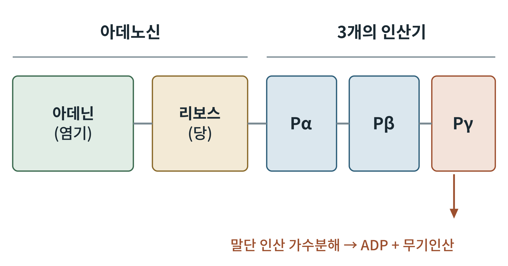
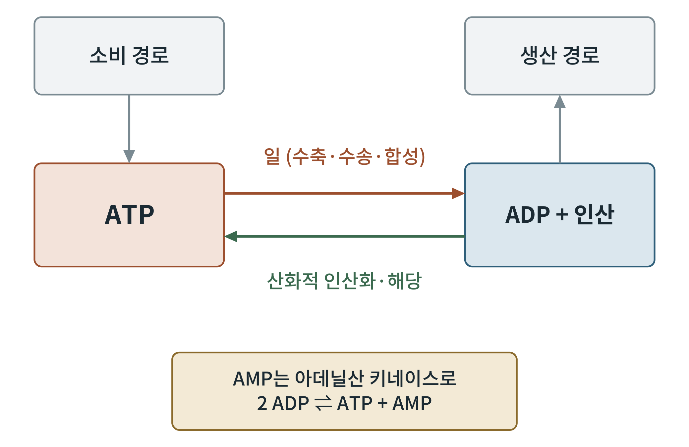

## 제2장 ATP와 에너지 전하

> **이 장의 출발점** 1929년 독일의 카를 로만(Karl Lohmann)은 근육 추출물에서 인산 화합물 하나를 분리했다. 이 물질이 아데노신 삼인산(adenosine triphosphate, ATP)이다. 12년 뒤 프리츠 리프만(Fritz Lipmann)은 ATP가 세포 안에서 에너지를 한 곳에서 다른 곳으로 옮기는 "화폐" 구실을 한다고 정리했다. 이 장은 그 화폐의 구조, 값어치, 그리고 세포가 화폐 잔고를 얼마나 알뜰하게 지키는지를 다룬다.

### 2.1 ATP의 구조

ATP는 아데닌(adenine)이라는 염기, 리보스(ribose)라는 오탄당, 그리고 세 개의 인산기로 이루어진다. 아데닌과 리보스가 합쳐진 부분을 아데노신(adenosine)이라 하고, 리보스에 가까운 쪽부터 알파(α), 베타(β), 감마(γ) 인산기라 부른다.

**그림 2-1. ATP의 구조.** 아데닌과 리보스로 이루어진 아데노신에 세 개의 인산기(Pα, Pβ, Pγ)가 한 줄로 붙어 있다. 효소는 가장 바깥의 Pγ를 떼어 내어 ADP와 무기인산을 만들고, 이때 에너지가 나온다. 개념도이다.

그림 2-1에서 눈여겨볼 곳은 인산기 사이의 결합이다. 이 결합은 흔히 "고에너지 결합"이라 불리지만, 결합 자체에 에너지가 담겨 있다는 뜻은 아니다. 가수분해 뒤의 생성물이 더 안정하기 때문에, 가수분해 반응의 자유에너지 변화가 큰 음수가 되는 것이다. 인산기들의 음전하끼리의 반발, 생성물인 무기인산의 공명 안정화, 용매화가 그 이유로 꼽힌다.

### 2.2 ATP의 값어치: 표준 조건과 세포 안

1장 표 1-1에서 ATP 가수분해의 표준 자유에너지 변화는 −30.5 kJ/mol이었다. 그러나 세포 안의 ATP, ADP, 인산 농도는 표준 조건(1 M)과 아주 다르다. 세포는 ATP를 ADP보다 훨씬 높게 유지하므로 Q가 작아지고, 1장의 식 ΔG = ΔG°′ + RT ln Q에 따라 실제 ΔG는 더 큰 음수가 된다. 문헌에서는 세포 안 값을 대체로 −50 kJ/mol 안팎으로 본다. 세포가 ATP를 평형 농도보다 훨씬 높게 지킨다는 사실이 이 값의 핵심이다. ATP는 평형에서 먼 곳에 놓인 "충전된 전지"인 셈이다.

### 2.3 ATP는 쓰이는 즉시 다시 만들어진다

몸에 한 번에 들어 있는 ATP의 양은 많지 않지만, 하루에 쓰이는 ATP의 총량은 체중에 맞먹을 만큼 크다고 흔히 설명한다. 어느 한 순간의 ATP는 몇 분 안에 다시 쓰이고 다시 만들어진다. 따라서 ATP는 저장 물질이 아니라 순환하는 중간 물질이다.

**그림 2-2. ATP-ADP 순환.** ATP는 근수축, 이온 수송, 생합성 같은 일에 쓰여 ADP와 무기인산이 되고, 해당과 산화적 인산화가 이를 다시 ATP로 되돌린다. 순환이 한쪽으로 쏠리면 ADP와 AMP가 늘어나며, AMP는 아데닐산 키네이스(adenylate kinase) 반응으로 만들어진다.

그림 2-2의 아래쪽 상자는 이 장의 둘째 주제를 예고한다. 두 분자의 ADP가 ATP와 AMP로 바뀌는 평형 반응(2 ADP ⇌ ATP + AMP)은 ATP가 조금만 줄어도 AMP를 크게 늘린다. ATP 농도가 약간 변할 때 AMP 농도는 훨씬 큰 비율로 변하므로, AMP는 에너지 부족을 알리는 예민한 신호가 된다. 4부 14장의 AMPK(AMP-activated protein kinase)가 바로 이 신호를 읽는다.

### 2.4 에너지 전하

대니얼 앳킨슨(Daniel Atkinson)은 1960년대에 세포의 에너지 상태를 한 숫자로 나타내는 방법을 제안했다. 에너지 전하(energy charge)는 아데닌 뉴클레오타이드 총량 중에서 에너지가 충전된 정도를 나타낸다.

에너지 전하 = ([ATP] + 0.5 × [ADP]) / ([ATP] + [ADP] + [AMP])

ATP만 있으면 1, ADP만 있으면 0.5, AMP만 있으면 0이다. ADP는 인산 고에너지 결합이 하나이므로 절반으로 센다. 앳킨슨은 에너지를 생산하는 경로는 에너지 전하가 낮을 때 활발해지고, 소비하는 합성 경로는 높을 때 활발해진다고 보았다. 정상 세포의 에너지 전하는 대체로 0.8~0.95 범위에서 유지된다고 알려져 있다.

**표 2-1. 에너지 전하의 해석.** 값은 위 정의식으로 계산한 이론 값이며, 실제 세포의 해석 범위는 조직과 조건에 따라 다르다.

| 아데닌 뉴클레오타이드 구성 | 에너지 전하 | 해석 |
|---|---|---|
| ATP 100% | 1.00 | 완전 충전 |
| ATP 80%, ADP 20% (AMP 없음) | 0.90 | 정상 범위의 예 |
| ATP 70%, ADP 20%, AMP 10% | 0.80 | 정상 범위 하한의 예 |
| ATP 40%, ADP 40%, AMP 20% | 0.60 | 에너지 부족 신호 |
| ADP 100% | 0.50 | 전체가 한 단계 방전 |
| AMP 100% | 0.00 | 완전 방전 |

표 2-1을 읽을 때 주의할 점이 있다. 에너지 전하가 0.90에서 0.80으로 내려가는 것은 겉보기에 작은 변화이지만, 표의 세 번째 줄처럼 AMP가 10%나 차지하는 상태이다. 앞에서 본 아데닐산 키네이스 증폭 때문에 이 정도의 변화에도 AMPK가 켜진다. 2권 5부와 6부에서 식후와 공복의 세포가 다른 에너지 전하의 영역을 오간다는 이야기가 나올 때 이 점을 다시 쓴다.

### 이 장의 요점

- ATP는 아데노신에 세 인산기가 붙은 분자이며, 말단 인산의 가수분해가 에너지를 낸다.
- 세포 안의 ATP는 평형보다 훨씬 높게 유지되어, 실제 가수분해 ΔG는 표준 값보다 크다.
- ATP는 쓰이는 대로 되살려지는 순환 물질이다.
- 에너지 전하는 아데닌 뉴클레오타이드의 충전 정도이고, AMP는 그 변화의 예민한 신호이다.

#### 참고문헌

Atkinson, D. E. (1977). *Cellular energy metabolism and its regulation*. Academic Press.

Lipmann, F. (1941). Metabolic generation and utilization of phosphate bond energy. *Advances in Enzymology, 1*, 99–162.

Lohmann, K. (1929). Über die Pyrophosphatfraktion im Muskel. *Naturwissenschaften, 17*(31), 624–625.

Nelson, D. L., & Cox, M. M. (2021). *Lehninger principles of biochemistry* (8th ed.). W. H. Freeman.
