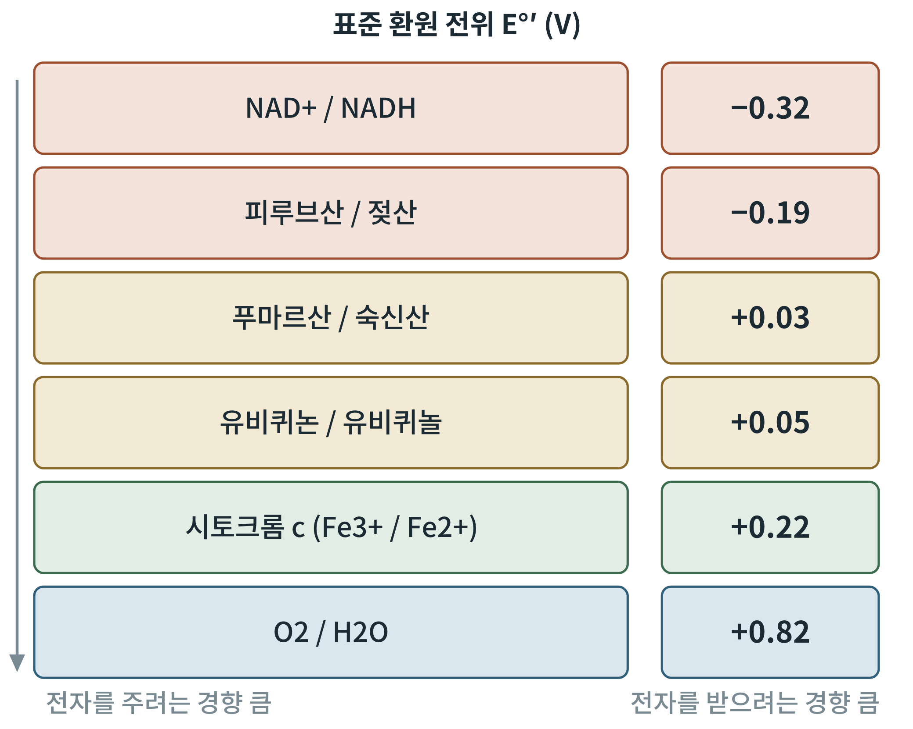

## 제3장 산화환원: NAD, FAD, NADPH

> **이 장의 출발점** 1906년 아서 하든(Arthur Harden)과 윌리엄 영(William Young)은 효모 즙에서 발효를 돕는, 끓여도 살아남는 작은 분자를 찾아냈다. 코엔자임(조효소)이라 불리게 된 이 물질은 훗날 오토 바르부르크(Otto Warburg)가 수소를 나르는 역할을 밝히면서 정체가 드러났다. 이것이 니코틴아마이드 아데닌 다이뉴클레오타이드, NAD이다. 세포의 연료 분해는 결국 전자를 NAD와 그 사촌들에게 맡기는 일이며, 이 장은 그 전자 운반의 규칙을 정리한다.

### 3.1 산화와 환원: 전자를 주고받는 일

산화(oxidation)는 전자를 잃는 일, 환원(reduction)은 전자를 얻는 일이다. 둘은 항상 짝으로 일어난다. 영양소의 분해는 연료 분자가 산화되고 전자 운반체가 환원되는 반응이며, 마지막에는 산소가 전자를 받아 물이 된다. 생체 반응에서는 전자가 수소 원자(양성자 하나와 전자 하나) 또는 수소화 이온(양성자 하나와 전자 둘)의 형태로 옮겨지는 경우가 많다.

전자를 받으려는 경향은 표준 환원 전위(standard reduction potential, E°′)로 나타낸다. 값이 더 음수인 쌍은 전자를 내놓기 쉽고, 더 양수인 쌍은 전자를 받기 쉽다. 전자는 음수 쪽에서 양수 쪽으로 흘러내려 가며, 흐른 전위차 ΔE°′에서 자유에너지가 얻어진다.

ΔG°′ = −n F ΔE°′

n은 옮겨진 전자의 수, F는 패러데이 상수(96.485 kJ/V·mol)이다.

**그림 3-1. 산화환원 쌍의 전위 사다리.** 위쪽의 NAD+/NADH(−0.32 V)에서 아래쪽의 산소/물(+0.82 V)로 갈수록 전자를 받으려는 경향이 커진다. 전자는 사다리를 따라 내려가며 에너지를 내놓는다. 값은 교과서 표준 값이다.

그림 3-1은 3부의 전자전달계를 미리 보여 주는 지도이다. NADH에서 산소까지의 전위차는 0.82 − (−0.32) = 1.14 V이다. 전자 둘이 옮겨가는 반응이므로 ΔG°′ = −2 × 96.485 × 1.14 ≈ −220 kJ/mol로, 포도당 한 분자의 완전 산화 에너지에서 NADH 하나가 차지하는 몫이 얼마나 큰지를 한눈에 보여 준다. 이 큰 낙차를 한꺼번에 쓰지 않고 여러 단계로 쪼개 ATP 합성에 이용하는 장치가 전자전달계이다.

### 3.2 NAD, FAD: 분해의 전자 운반체

니코틴아마이드 아데닌 다이뉴클레오타이드(nicotinamide adenine dinucleotide, NAD)는 산화형 NAD+와 환원형 NADH로 존재한다. 탈수소효소(dehydrogenase)가 기질에서 수소화 이온을 떼어 NAD+에 건네면 NADH가 된다. 비타민 B3인 니아신(niacin)이 NAD의 재료이다.

플라빈 아데닌 다이뉴클레오타이드(flavin adenine dinucleotide, FAD)는 비타민 B2인 리보플래빈(riboflavin)에서 만들어진다. FAD는 보통 효소에 단단히 붙어 있으면서 전자 둘을 받아 FADH2가 된다. TCA 회로의 숙신산 탈수소효소와 지방산 β산화의 첫 효소가 FAD를 쓴다.

### 3.3 NADPH: 합성의 환원력

NADPH는 NADH에 인산기 하나가 더 붙은 분자이다. 구조는 거의 같지만 세포는 둘을 다른 용도로 쓴다. NADH는 연료를 분해하면서 얻은 전자를 전자전달계에 보내는 "분해의 운반체"이고, NADPH는 지방산과 콜레스테롤 합성, 항산화 방어(글루타티온 환원)에 전자를 공급하는 "합성과 방어의 운반체"이다.

역할이 나뉘는 비결은 비율에 있다. 세포질에서 NAD+는 NADH보다 훨씬 많은 산화형으로 유지되어 분해 반응이 끌려가고, NADP+는 NADPH보다 훨씬 적은 형태로 유지되어 합성 반응에 쓸 환원력이 늘 충전되어 있다. 문헌에서는 간 세포질의 NAD+/NADH 비를 수백 대 1 수준, NADP+/NADPH 비를 1보다 훨씬 작은 값으로 본다. 같은 효소 모양에서 인산 하나 차이로 서로 다른 효소 집단이 구별해 쓰는 것이다. NADPH의 주요 공급원은 오탄당 인산 경로와 사이토솔 NADP 의존 효소들이다.

### 3.4 NAD+/NADH 비가 방향을 정한다

반응이 어느 쪽으로 진행하는지는 ΔG에 달렸고, ΔG는 농도비 Q에 의해 움직인다(1장). 따라서 세포 안의 NAD+/NADH 비가 크면 NAD+를 쓰는 산화 반응(예: 젖산 → 피루브산)이 유리하고, 비가 작으면 반대 방향(피루브산 → 젖산)이 유리하다. 산소가 부족해 전자전달계가 NADH를 다 비우지 못하면 NAD+/NADH 비가 떨어지고, 세포는 젖산 생성으로 NAD+를 재생한다. 이 원리는 5부의 식후·공복 전환에서 반복해 쓰인다. 식사 뒤에 미토콘드리아 안 NADH가 늘면 TCA 회로와 지방산 산화의 속도가 떨어지고, 공복에는 반대가 된다. 4부에서 다룰 시르투인(sirtuin)은 NAD+ 농도 자체를 신호로 읽는 효소이다.

**표 3-1. 주요 산화환원 조효소 요약.**

| 조효소 | 비타민 재료 | 주된 역할 | 대표 반응 |
|---|---|---|---|
| NAD+/NADH | 니아신(B3) | 분해 경로의 전자 운반, 전자전달계 입력 | 해당 과정의 글리세르알데하이드 3-인산 탈수소효소, TCA 회로 탈수소효소 |
| NADP+/NADPH | 니아신(B3) | 합성과 항산화에 환원력 공급 | 지방산 합성, 콜레스테롤 합성, 글루타티온 환원 |
| FAD/FADH2 | 리보플래빈(B2) | 효소에 결합한 전자 운반 | 숙신산 탈수소효소, 아실-CoA 탈수소효소 |
| FMN/FMNH2 | 리보플래빈(B2) | 복합체 I의 전자 수용 | 복합체 I(NADH 탈수소효소) |
| 유비퀴논(CoQ) | 세포 내 합성 | 막 안에서 전자 이동 | 복합체 I·II에서 III로 전자 전달 |

표 3-1을 읽는 요령은 두 가지이다. 첫째, 같은 비타민(니아신)에서 만들어진 NAD와 NADP가 "분해"와 "합성"으로 나뉘어 쓰인다는 점이다. 둘째, FAD와 FMN이 효소에 단단히 붙어 있는 데 비해 NAD는 효소 사이를 오가는 운반체라는 점이다. 이 차이가 3부와 6부에서 NADH와 FADH2가 전자전달계의 서로 다른 입구로 들어가는 이유를 이해하는 단서가 된다.

### 이 장의 요점

- 산화환원 반응은 전자의 이동이며, 전위가 낮은 쪽에서 높은 쪽으로 흐르며 에너지를 낸다.
- NADH에서 산소까지의 전위차는 1.14 V로, 전자 둘 기준 약 220 kJ/mol의 자유에너지에 해당한다.
- NAD+/NADH는 분해, NADP+/NADPH는 합성과 항산화를 맡는다.
- NAD+/NADH 비는 대사 반응의 방향과 신호 효소(시르투인)를 좌우한다.

#### 참고문헌

Berg, J. M., Tymoczko, J. L., Gatto, G. J., Jr., & Stryer, L. (2019). *Biochemistry* (9th ed.). W. H. Freeman.

Nelson, D. L., & Cox, M. M. (2021). *Lehninger principles of biochemistry* (8th ed.). W. H. Freeman.

Williamson, D. H., Lund, P., & Krebs, H. A. (1967). The redox state of free nicotinamide-adenine dinucleotide in the cytoplasm and mitochondria of rat liver. *Biochemical Journal, 103*(2), 514–527.
