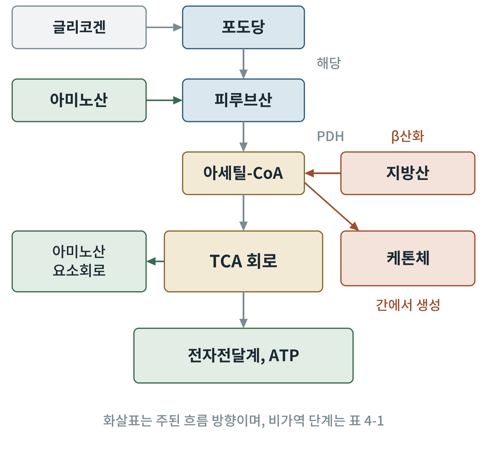

## 제4장 대사 지도 읽기

> **이 장의 출발점** 1930년대 한스 크렙스(Hans Krebs)는 간 조직 조각이 여러 유기산을 태우는 속도를 하나하나 재면서, 물질들이 줄줄이 이어진 하나의 고리를 이룬다는 것을 알아냈다. 낱낱의 반응이 지도 위의 길로 합쳐진 순간이다. 대사 지도는 처음 보면 화살표 덩어리지만, 읽는 요령이 몇 가지 있다. 이 장은 그 요령을 정리한다. 이 요령을 알면 이후 38개 장의 경로 그림이 같은 문법으로 읽힌다.

### 4.1 경로, 효소, 대사물질

대사(metabolism)는 세포 안의 모든 화학 반응의 총합이다. 분해 쪽을 이화(catabolism), 합성 쪽을 동화(anabolism)라 한다. 반응 하나하나는 효소(enzyme)가 촉매하며, 한 효소의 생성물이 다음 효소의 기질이 되어 이어진 연쇄를 경로(pathway)라 한다. 지도에서 물질은 점(노드), 효소는 선(화살표)이고, 선 옆에 효소 이름이 적힌다.

**그림 4-1. 중심 대사 지도.** 포도당은 해당을 거쳐 피루브산이 되고, 피루브산 탈수소효소(PDH)를 거쳐 아세틸-CoA가 된다. 지방산은 β산화로 아세틸-CoA가 되며, 아미노산은 피루브산 등으로 들어온다. 아세틸-CoA는 TCA 회로와 전자전달계로 흘러 ATP를 만들고, 간에서는 케톤체로도 쓰인다. 개념도이다.

그림 4-1에서 가장 중요한 점은 아세틸-CoA가 모든 연료의 합류점이라는 사실이다. 탄수화물, 지방, 단백질이 서로 다른 입구로 들어와 아세틸-CoA라는 공통 통로를 거친다. 이후의 장들에서 반복되는 "한 병목, 여러 입구" 구조이다. 이 지도의 모든 화살표를 처음부터 외울 필요는 없다. 각 장은 이 지도의 한 구역을 확대한다.

### 4.2 가역 단계와 비가역 단계

대사 경로의 반응 대부분은 평형에 가까워, 반응물과 생성물의 농도 비에 따라 양방향으로 움직인다. 이런 가역 단계는 경로의 속도를 정하지 않는다. 경로의 속도를 정하는 것은 평형에서 멀리 떨어진, 곧 ΔG가 큰 음수인 단계이다. 이 단계는 한쪽 방향으로만 진행하므로 비가역 단계라 한다.

비가역 단계가 중요한 이유는 두 가지이다. 첫째, 이 단계가 경로의 "수도꼭지"이므로 조절이 여기에 모인다. 둘째, 역방향 경로(예: 포도당 신생)는 같은 단계를 다른 효소로 우회해야 한다. 분해와 합성이 같은 길을 되돌아가지 않고 서로 다른 길을 쓰는 것은 대사 조절의 보편 원리이다.

### 4.3 조절 지점: 어디를 누르는가

효소의 활성을 바꾸는 방법은 크게 세 가지이다. 첫째는 알로스테릭 조절로, 기질이나 생성물, ATP, AMP 같은 신호 물질이 효소에 붙어 활성을 바꾼다. 둘째는 공유 결합 변형으로, 인산화·탈인산화로 효소를 켜고 끈다. 셋째는 효소의 양을 바꾸는 유전자 발현 조절이다. 앞의 둘은 초 단위, 셋째는 시간 단위로 작동한다. 식후와 공복처럼 몇 시간 단위로 바뀌는 상태에서는 세 방법이 모두 쓰인다.

**표 4-1. 핵심 조절 효소 목록.** 이후 장에서 자세히 다룬다. 방향은 일반적인 교과서 서술이다.

| 경로 | 조절 효소 | 주요 조절자 | 이후 장 |
|---|---|---|---|
| 해당 | 헥소키네이스, 포스포프럭토키네이스-1(PFK-1), 피루브산 키네이스 | ATP·시트르산이 억제, AMP·프럭토스 2,6-이인산이 활성화 | 5장 |
| 연결 반응 | 피루브산 탈수소효소(PDH) | 아세틸-CoA·NADH가 억제, 인슐린 신호가 활성화 | 6장 |
| TCA 회로 | 시트르산 합성효소, 이소시트르산 탈수소효소, α-케토글루타르산 탈수소효소 | ATP·NADH가 억제, ADP·칼슘이 활성화 | 6장 |
| 글리코겐 | 글리코겐 합성효소, 글리코겐 포스포릴레이스 | 인슐린과 글루카곤·에피네프린이 인산화로 반대로 조절 | 5장 |
| 지방산 | 아세틸-CoA 카르복실화효소(ACC), 카르니틴 팔미토일기 전이효소 1(CPT1) | 말로닐-CoA가 CPT1을 억제 | 7장 |
| 포도당 신생 | 프럭토스 1,6-이인산 가수분해효소, PEP 카르복시키네이스(PEPCK) | 글루카곤·코르티솔이 증가, 인슐린이 감소 | 23장 |
| 케톤 생성 | HMG-CoA 합성효소(미토콘드리아) | 인슐린이 억제, 공복에서 증가 | 8장 |

표 4-1에서 눈여겨볼 점은 같은 대사물질이 여러 경로를 한꺼번에 조절한다는 점이다. 시트르산이 해당(PFK-1)을 억제하는 것은 TCA 회로가 막혔을 때 입구를 닫는 되먹임이다. 말로닐-CoA는 지방산 합성의 재료이면서 지방산 산화의 입구(CPT1)를 막아, 합성과 분해가 동시에 돌아가는 낭비를 막는 스위치가 된다. 이 스위치는 7장에서, 식후와 공복의 전환은 29장에서 다시 만난다.

### 4.4 분기점에서 길을 고르는 법

지도 위의 분기점에서 물질이 어느 길로 가는지는 세 요소가 정한다. 하나는 효소의 친화도(Km)로, 기질이 낮은 농도에서도 효소와 결합하는 정도이다. 둘은 기질의 농도이며, 셋은 최종 산물의 되먹임 신호이다. 예를 들어 포도당 6-인산은 해당, 글리코겐 합성, 오탄당 인산 경로로 갈라지는데, 어느 쪽이 우세한지는 세포의 에너지 상태(2장)와 환원력 요구량(3장)이 정한다. 이 책이 에너지 전하와 NADPH를 앞에서 먼저 다룬 이유이다.

### 이 장의 요점

- 대사 지도는 물질(점)과 효소(선)로 이루어지고, 아세틸-CoA가 연료의 합류점이다.
- 경로의 속도는 비가역 단계가 정하며, 조절은 이 단계에 모인다.
- 효소 조절에는 알로스테릭, 공유 결합 변형, 발현량 조절의 세 가지가 있다.
- 분해와 합성은 비가역 단계를 서로 다른 효소로 우회한다.

#### 참고문헌

Berg, J. M., Tymoczko, J. L., Gatto, G. J., Jr., & Stryer, L. (2019). *Biochemistry* (9th ed.). W. H. Freeman.

Krebs, H. A., & Johnson, W. A. (1937). The role of citric acid in intermediate metabolism in animal tissues. *Enzymologia, 4*, 148–156.

Nelson, D. L., & Cox, M. M. (2021). *Lehninger principles of biochemistry* (8th ed.). W. H. Freeman.
