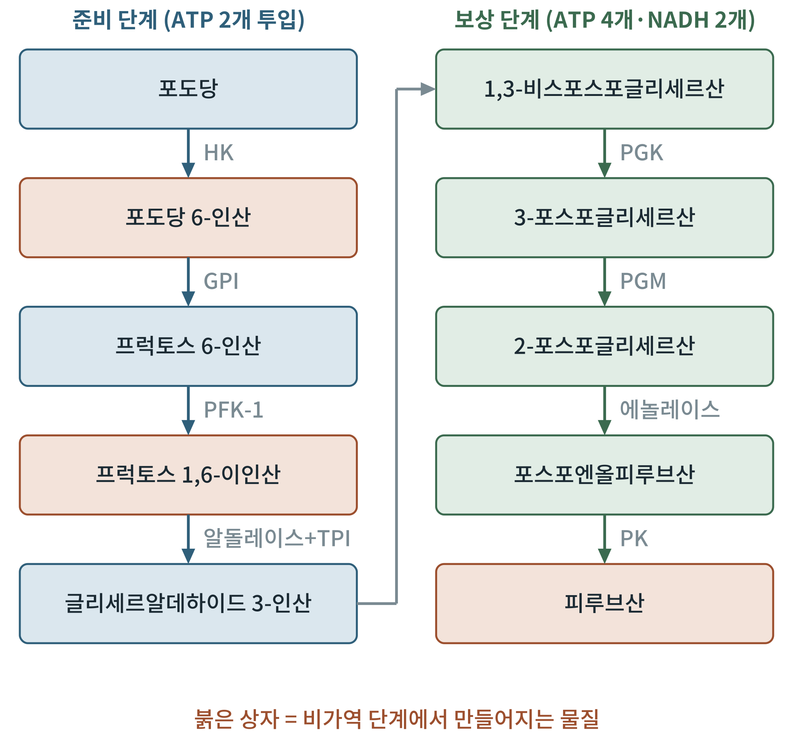
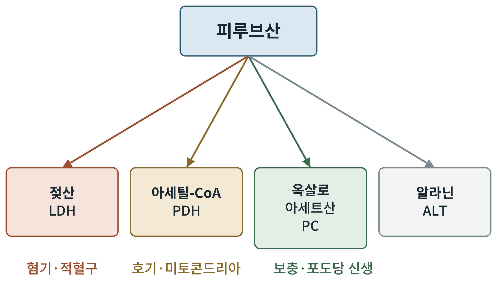

# 제2부 연료의 분해와 합성

## 제5장 포도당: 해당, 피루브산의 운명, 글리코겐

> **이 장의 출발점** 1897년 독일의 에두아르트 부흐너(Eduard Buchner)는 효모를 갈아 짜낸 즙에 설탕을 넣으면 살아 있는 세포가 없는데도 발효가 일어난다는 것을 보았다. 발효는 "생명의 힘"이 아니라 화학 반응의 연쇄라는 사실이 처음 확인된 순간이다. 이후 수십 년에 걸쳐 그 연쇄의 열 단계가 하나씩 밝혀졌고, 이를 해당(glycolysis)이라 부른다. 해당은 모든 생물이 가진 가장 오래된 에너지 경로이며, 사람 세포에서는 포도당이 거의 모든 경로로 들어가는 출입구이다.

### 5.1 해당: 열 단계로 보는 포도당 분해

해당은 세포질에서 일어나는 포도당(glucose) 한 분자를 피루브산(pyruvate) 두 분자로 쪼개는 열 단계 반응이다. 산소가 필요 없다. 앞의 다섯 단계를 준비 단계, 뒤의 다섯 단계를 보상 단계라 부른다. 준비 단계에서 ATP 두 분자를 투입해 포도당을 인산화하고 둘로 쪼개고, 보상 단계에서 쪼개진 조각 둘이 각각 ATP 둘과 NADH 하나를 만든다.

**그림 5-1. 해당의 열 단계.** 왼쪽은 준비 단계(포도당에서 글리세르알데하이드 3-인산까지), 오른쪽은 보상 단계(1,3-비스포스포글리세르산에서 피루브산까지)이다. 글리세르알데하이드 3-인산에서 1,3-비스포스포글리세르산으로 넘어가는 단계는 글리세르알데하이드 3-인산 탈수소효소(GAPDH)가 맡아 NADH를 만든다. 붉은 상자는 비가역 단계(헥소키네이스, PFK-1, 피루브산 키네이스)에서 만들어지는 물질이다. 약어: HK 헥소키네이스, GPI 포도당 6-인산 이성질화효소, PFK-1 포스포프럭토키네이스-1, TPI 삼탄당 인산 이성질화효소, PGK 포스포글리세르산 키네이스, PGM 포스포글리세르산 뮤테이스, PK 피루브산 키네이스.

그림 5-1에서 "한 줄"로 읽히는 단계가 사실은 두 줄이라는 점에 주의해야 한다. 프럭토스 1,6-이인산은 알돌레이스에 의해 삼탄당 둘로 쪼개지고, 그중 디하이드록시아세톤 인산은 삼탄당 인산 이성질화효소를 거쳐 글리세르알데하이드 3-인산으로 바뀐다. 이후 보상 단계는 포도당 한 분자당 두 번 돌아간다. 따라서 포도당 한 분자의 해당 총수지는 ATP 순증 2, NADH 2, 피루브산 2이다. 준비 단계에서 ATP를 2 썼고 보상 단계에서 4를 만들었으므로 순이익은 2이다.

### 5.2 해당의 조절: 세 개의 비가역 단계

4장에서 배운 대로, 경로의 속도는 비가역 단계가 정한다. 해당에서는 헥소키네이스, PFK-1, 피루브산 키네이스가 그 자리에 있다.

헥소키네이스(hexokinase)는 포도당에 인산을 붙여 포도당 6-인산을 만든다. 근육 등 대부분의 조직에서 이 효소는 생성물인 포도당 6-인산에 의해 억제된다. 인산화된 포도당이 쌓이면 입구가 닫히는 되먹임이다. 간과 췌장 β세포에는 글루코키네이스(glucokinase)라는 다른 형태가 있다. 글루코키네이스는 포도당에 대한 친화도가 낮아(Km이 높아) 혈당이 높을 때만 활발히 작동하고, 포도당 6-인산으로 억제되지 않는다. 그래서 식사 후 혈당이 오르면 간이 포도당을 대량으로 받아들이고, 췌장 β세포는 혈당을 "읽는" 센서로 쓴다. 글루코키네이스가 β세포에서 하는 역할은 34장에서, 식후의 간에서 하는 일은 18장에서 다룬다.

PFK-1은 해당의 가장 중요한 조절점이다. ATP와 시트르산이 PFK-1을 억제하고, AMP와 프럭토스 2,6-이인산이 활성화한다. 에너지 전하(2장)가 낮아 AMP가 늘면 해당이 빨라지고, ATP가 충분하면 느려진다. 프럭토스 2,6-이인산은 간에서 인슐린과 글루카곤이 조절하는 신호 분자이다. 인슐린이 있으면 이 분자가 늘어 해당이 촉진되고, 글루카곤이 있으면 줄어들어 해당이 억제된다. 이 점은 15장과 27장에서 다시 만난다.

피루브산 키네이스(pyruvate kinase)는 마지막 단계에서 ATP를 만든다. 간에서는 글루카곤 신호가 이 효소를 인산화해 억제하므로, 공복에는 포도당이 해당으로 흘러가지 않고 다른 조직을 위해 남는다.

**표 5-1. 해당 열 단계 요약.**

| 단계 | 효소 | 반응 | 특징 |
|---|---|---|---|
| 1 | 헥소키네이스 / 글루코키네이스 | 포도당 → 포도당 6-인산 | ATP 소모, 비가역 |
| 2 | 포도당 6-인산 이성질화효소 | → 프럭토스 6-인산 | 가역 |
| 3 | PFK-1 | → 프럭토스 1,6-이인산 | ATP 소모, 비가역, 주 조절점 |
| 4 | 알돌레이스 | → 디하이드록시아세톤 인산 + 글리세르알데하이드 3-인산 | 가역 |
| 5 | 삼탄당 인산 이성질화효소 | 두 삼탄당 인산을 상호 전환 | 가역 |
| 6 | GAPDH | 글리세르알데하이드 3-인산 → 1,3-비스포스포글리세르산 | NADH 생성 |
| 7 | 포스포글리세르산 키네이스 | → 3-포스포글리세르산 | ATP 생성(기질 수준 인산화) |
| 8 | 포스포글리세르산 뮤테이스 | → 2-포스포글리세르산 | 가역 |
| 9 | 에놀레이스 | → 포스포엔올피루브산 | 가역 |
| 10 | 피루브산 키네이스 | → 피루브산 | ATP 생성, 비가역 |

표 5-1의 "기질 수준 인산화"는 산소와 전자전달계 없이 효소 반응만으로 ADP에 인산을 붙이는 방식을 말한다. 1장 표 1-1에서 본 대로 1,3-비스포스포글리세르산과 포스포엔올피루브산은 ATP보다 인산 전달 능력이 커서 ATP를 만들 수 있다.

### 5.3 피루브산의 운명

해당이 끝나면 피루브산이 세포의 "교차로"에 선다. 어느 길로 가는지는 산소, 에너지 상태, 호르몬이 정한다.

**그림 5-2. 피루브산의 네 갈래 길.** 산소가 부족하거나 미토콘드리아가 없는 세포(적혈구)에서는 젖산 탈수소효소(LDH)가 피루브산을 젖산으로 바꾼다. 산소가 충분하면 피루브산 탈수소효소(PDH)가 아세틸-CoA로 바꾸어 TCA 회로에 들여보낸다. 피루브산 카르복실화효소(PC)는 옥살로아세트산을 만들어 TCA 회로를 채우거나 포도당 신생으로 이어 주고, 알라닌 아미노기 전달효소(ALT)는 알라닌을 만든다.

그림 5-2의 젖산 경로는 단순한 "막다른 길"이 아니다. 젖산을 만들 때 NADH가 NAD+로 되돌아가므로, 해당의 6단계가 계속 돌아갈 NAD+가 공급된다(3장). 젖산은 혈액을 타고 간으로 가서 포도당으로 재합성되는데, 이를 코리 회로(Cori cycle)라 한다. 칼 코리(Carl Cori)와 게르티 코리(Gerty Cori) 부부가 1930년대에 밝혔다. 이 회로는 근육의 "임시 연료 정산"을 간에 맡기는 구조이며, 간은 이 과정에서 ATP를 소비한다. 아세틸-CoA로 가는 길과 PDH의 조절은 6장에서, 옥살로아세트산으로 가는 길과 포도당 신생은 23장에서 다룬다.

### 5.4 글리코겐: 포도당의 단기 저장고

포도당은 혈액에서 항상 일정한 농도로 유지되어야 하므로, 몸은 남는 포도당을 글리코겐(glycogen)이라는 가지 달린 중합체로 저장한다. 클로드 베르나르(Claude Bernard)는 1857년 간에서 이 물질을 발견하고, 간이 혈당을 조절한다는 개념을 처음 제시했다. 글리코겐은 간과 골격근에 주로 저장된다. 일반적으로 간에는 100 g 안팎, 근육에는 400 g 안팎이 있다고 하나 개인차가 크다.

합성은 글리코겐 합성효소(glycogen synthase)가 UDP-포도당에서 포도당 단위를 사슬 끝에 붙여 길게 늘이는 방식이고, 가지는 가지 형성 효소가 만든다. 분해는 글리코겐 포스포릴레이스(glycogen phosphorylase)가 사슬 끝에서 포도당 1-인산을 하나씩 떼어 내고, 가지 부위는 탈가지 효소가 처리한다. 합성과 분해가 서로 다른 효소로 이루어지는 점은 4장에서 설명한 "서로 다른 길" 원리의 전형이다.

**표 5-2. 글리코겐 대사 효소와 호르몬 조절.**

| 효소 | 방향 | 인슐린 신호 | 글루카곤·에피네프린 신호 | 주 조직 |
|---|---|---|---|---|
| 글리코겐 합성효소 | 합성 | 탈인산화로 활성화 | 인산화로 억제 | 간, 근육 |
| 글리코겐 포스포릴레이스 | 분해 | 탈인산화로 억제 | 인산화(포스포릴레이스 키네이스)로 활성화 | 간, 근육 |

표 5-2의 핵심은 두 호르몬이 같은 단백질 키네이스·포스파테이스 장치를 통해 두 효소를 반대 방향으로 동시에 조절한다는 것이다. 합성과 분해가 동시에 돌아 에너지를 낭비하는 일을 막는다. 간 글리코겐은 혈당을 지키는 공급원으로, 근육 글리코겐은 근육 자신의 운동 연료로 쓰인다. 근육에는 포도당 6-인산을 포도당으로 바꾸는 효소(포도당 6-인산 가수분해효소)가 없어 근육 글리코겐은 혈당으로 나가지 못한다. 이 차이는 17~18장과 22~23장에서 식후와 공복의 에너지 수지를 계산할 때 쓰인다.

### 이 장의 요점

- 해당은 세포질의 열 단계 경로로, 포도당 1분자당 ATP 순증 2, NADH 2, 피루브산 2를 낸다.
- 해당의 속도는 헥소키네이스, PFK-1, 피루브산 키네이스가 정하며, 이 중 PFK-1이 주 조절점이다.
- 간의 글루코키네이스는 친화도가 낮아 식후의 높은 혈당에서 활발해지고, 포도당 6-인산으로 억제되지 않는다.
- 피루브산은 젖산, 아세틸-CoA, 옥살로아세트산, 알라닌의 네 갈래로 갈린다.
- 글리코겐은 합성과 분해가 서로 다른 효소로 이루어지며, 인슐린과 글루카곤이 반대로 조절한다.

#### 참고문헌

Berg, J. M., Tymoczko, J. L., Gatto, G. J., Jr., & Stryer, L. (2019). *Biochemistry* (9th ed.). W. H. Freeman.

Bernard, C. (1857). Sur le mécanisme physiologique de la formation du sucre dans le foie. *Comptes Rendus de l'Académie des Sciences, 44*, 578–586.

Buchner, E. (1897). Alkoholische Gärung ohne Hefezellen. *Berichte der Deutschen Chemischen Gesellschaft, 30*(1), 117–124.

Nelson, D. L., & Cox, M. M. (2021). *Lehninger principles of biochemistry* (8th ed.). W. H. Freeman.
