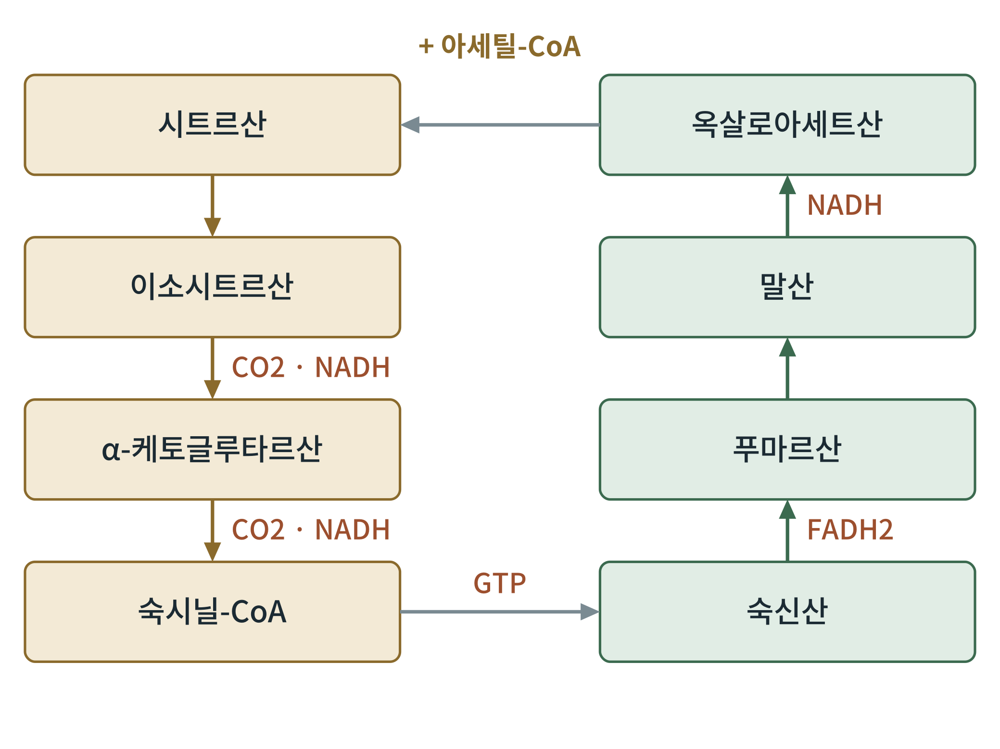
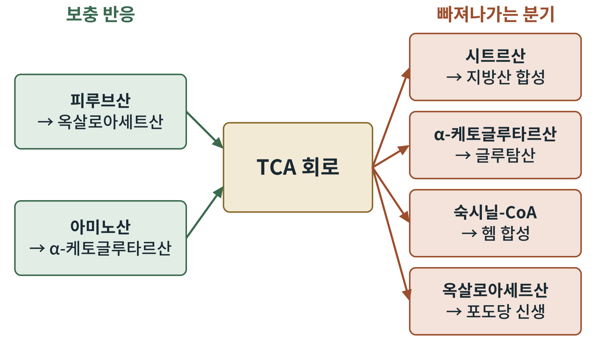

## 제6장 TCA 회로와 연결 반응

> **이 장의 출발점** 1937년 영국 셰필드의 한스 크렙스(Hans Krebs)는 비둘기 가슴 근육 조각에 시트르산을 넣으면 산소 소비가 오히려 크게 늘어난다는 사실을 보았다. 시트르산이 닳지 않고 촉매처럼 작용했다는 뜻이다. 그는 이 관찰로 산화 경로가 직선이 아니라 닫힌 고리라는 결론에 이르렀다. 이 고리는 시트르산 회로, 크렙스 회로, 또는 트라이카복실산(tricarboxylic acid) 회로의 약자를 따라 TCA 회로라 불린다. 크렙스는 이 업적으로 1953년 프리츠 리프만(Fritz Lipmann)과 함께 노벨 생리의학상을 받았다.

### 6.1 연결 반응: 피루브산 탈수소효소 복합체

해당에서 나온 피루브산은 세포질에서 미토콘드리아 기질로 들어가 피루브산 탈수소효소 복합체(pyruvate dehydrogenase complex, PDH)를 만난다. PDH는 세 종류의 효소(E1, E2, E3)가 여러 사본으로 모인 거대 복합체이며, 다섯 가지 보조 인자가 필요하다. 티아민 파이로인산(비타민 B1), 리포산, 코엔자임 A(비타민 B5), FAD(비타민 B2), NAD+(비타민 B3)가 그것이다. 이 중 하나라도 부족하면 복합체가 느려져 피루브산과 젖산이 쌓인다.

반응은 피루브산 + CoA + NAD+ → 아세틸-CoA + CO2 + NADH이다. 이 반응은 사실상 되돌릴 수 없다. 동물은 아세틸-CoA를 다시 피루브산이나 포도당으로 만들 수 없다는 뜻이며, 지방이 포도당으로 바뀌지 않는 이유의 핵심이기도 하다(23장).

PDH는 정교하게 조절된다. PDH 키네이스가 복합체를 인산화해 끄고, PDH 포스파테이스가 탈인산화해 켠다. 아세틸-CoA, NADH, ATP는 키네이스를 활성화해 PDH를 끄고, 피루브산과 ADP는 키네이스를 억제해 PDH를 켠다. 미토콘드리아 안의 칼슘은 포스파테이스를 켠다. 식후에는 인슐린 신호가 PDH를 활성화하고, 공복에는 지방산 산화가 아세틸-CoA와 NADH를 늘려 PDH를 끈다. 이 전환은 16장의 Randle 회로와 29장의 대사 유연성에서 핵심을 이룬다.

### 6.2 TCA 회로: 여덟 단계

TCA 회로는 미토콘드리아 기질에서 아세틸-CoA(탄소 2개)와 옥살로아세트산(탄소 4개)이 만나 시트르산(탄소 6개)이 되면서 시작된다. 이후 두 번의 탈카복실화로 탄소 둘이 CO2로 나가고, 한 바퀴를 돌아 다시 옥살로아세트산이 재생된다.

**그림 6-1. TCA 회로의 여덟 중간체.** 왼쪽 열은 시트르산에서 숙시닐-CoA까지 내려가며 CO2 두 개와 NADH 두 개를 낸다. 아래쪽에서 GTP(또는 ATP)가 만들어진 뒤 오른쪽 열은 숙신산에서 옥살로아세트산까지 올라가며 FADH2와 NADH 각각 하나를 낸다. 한 바퀴를 돌아 만들어진 옥살로아세트산이 새 아세틸-CoA와 다시 만난다. 개념도이다.

그림 6-1에서 중요한 점은 회로 안에서 산소가 직접 쓰이지 않는다는 것이다. 아세틸-CoA의 에너지는 NADH 3개, FADH2 1개, GTP 1개에 담기고, 이 전자 운반체들이 3부의 전자전달계에서 산소로 전자를 넘기며 ATP를 만든다. 회로가 호기 상태에서만 지속되는 이유는 NADH를 비워 NAD+를 재생할 곳이 전자전달계뿐이기 때문이다.

**표 6-1. TCA 회로 여덟 단계 요약.**

| 단계 | 효소 | 반응 | 생성물 |
|---|---|---|---|
| 1 | 시트르산 합성효소 | 아세틸-CoA + 옥살로아세트산 → 시트르산 | 비가역, 조절 |
| 2 | 아코니테이스 | 시트르산 → 이소시트르산 | |
| 3 | 이소시트르산 탈수소효소 | 이소시트르산 → α-케토글루타르산 | CO2, NADH, 조절 |
| 4 | α-케토글루타르산 탈수소효소 복합체 | α-케토글루타르산 → 숙시닐-CoA | CO2, NADH, 조절 |
| 5 | 숙시닐-CoA 합성효소 | 숙시닐-CoA → 숙신산 | GTP(또는 ATP) |
| 6 | 숙신산 탈수소효소 | 숙신산 → 푸마르산 | FADH2 |
| 7 | 푸마레이스 | 푸마르산 → 말산 | |
| 8 | 말산 탈수소효소 | 말산 → 옥살로아세트산 | NADH |

표 6-1에서 조절은 대부분 에너지 신호로 이루어진다. 시트르산 합성효소는 ATP와 숙시닐-CoA로 억제되고, 이소시트르산 탈수소효소는 ADP와 칼슘으로 활성화되고 ATP와 NADH로 억제된다. α-케토글루타르산 탈수소효소 복합체는 구조가 PDH와 비슷하며, 숙시닐-CoA와 NADH로 억제된다. 이렇게 에너지가 충분하면 회로가 느려지고 부족하면 빨라진다. 한 바퀴에서 얻는 양은 아세틸-CoA 1분자당 NADH 3, FADH2 1, GTP 1이다. 포도당 한 분자는 아세틸-CoA 둘을 만들므로 회로를 두 바퀴 돌린다.

### 6.3 보충 반응과 분기: 회로는 교차로이다

TCA 회로의 중간체는 회로 안에서만 쓰이지 않는다. 시트르산은 세포질로 나가 지방산 합성의 재료가 되고, α-케토글루타르산은 글루탐산으로, 숙시닐-CoA는 헴 합성으로, 옥살로아세트산은 포도당 신생과 아스파르트산 합성으로 빠져나간다. 이렇게 중간체가 빠져나가는 일을 분기(cataplerosis)라 한다. 중간체가 빠져나가기만 하면 회로가 멈추므로, 보충 반응(anaplerosis)이 필요하다. 가장 중요한 보충 반응은 피루브산 카르복실화효소(비오틴 필요)가 피루브산을 옥살로아세트산으로 바꾸는 반응이다. 이 효소는 아세틸-CoA가 많을 때 활성화된다. 지방산 산화로 아세틸-CoA가 넘치는 공복에는 이 효소가 간에서 포도당 신생을 돕는다. 아미노산도 α-케토글루타르산, 숙시닐-CoA, 푸마르산, 옥살로아세트산의 형태로 회로에 들어온다(9장).

**그림 6-2. TCA 회로의 보충 반응과 분기.** 왼쪽은 회로의 중간체를 채우는 반응(피루브산 카르복실화, 아미노산 유입), 오른쪽은 중간체가 빠져나가는 분기(지방산·글루탐산·헴·포도당 신생)이다. 개념도이다.

그림 6-2는 아세틸-CoA의 행방을 가르는 지도이기도 하다. 식후에는 시트르산이 회로 밖으로 나가 지방산 합성의 재료가 되고(7장, 18장), 공복에는 옥살로아세트산이 포도당 신생으로 빠져나간다(23장). 같은 회로가 시간표에 따라 다른 방향으로 열린다.

### 이 장의 요점

- 피루브산 탈수소효소 복합체는 피루브산을 아세틸-CoA로 바꾸는 비가역 반응이며, 비타민 B군 다섯 가지 보조 인자가 필요하다.
- PDH는 인산화로 꺼지고 탈인산화로 켜지며, 아세틸-CoA·NADH는 끄고 피루브산·ADP·칼슘·인슐린 신호는 켠다.
- TCA 회로 한 바퀴는 아세틸-CoA 1분자당 CO2 2, NADH 3, FADH2 1, GTP 1을 낸다.
- 중간체는 지방산·아미노산·헴·포도당 합성으로 빠져나가며, 피루브산 카르복실화효소가 이를 채운다.

#### 참고문헌

Berg, J. M., Tymoczko, J. L., Gatto, G. J., Jr., & Stryer, L. (2019). *Biochemistry* (9th ed.). W. H. Freeman.

Krebs, H. A., & Johnson, W. A. (1937). The role of citric acid in intermediate metabolism in animal tissues. *Enzymologia, 4*, 148–156.

Nelson, D. L., & Cox, M. M. (2021). *Lehninger principles of biochemistry* (8th ed.). W. H. Freeman.
