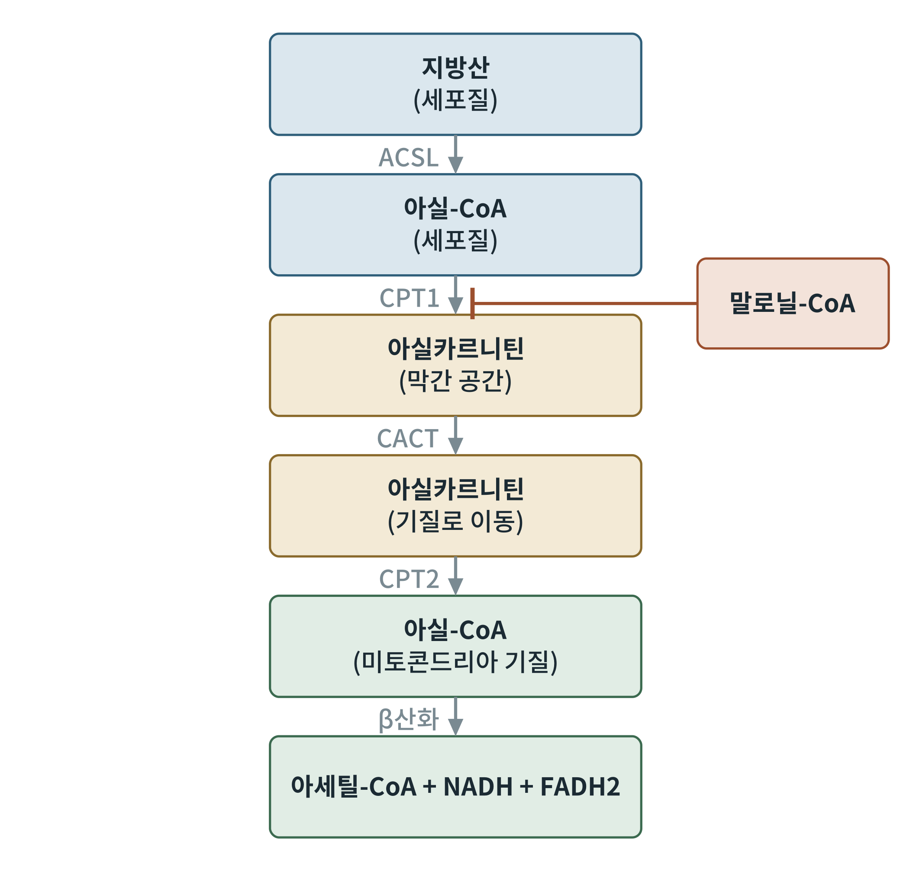
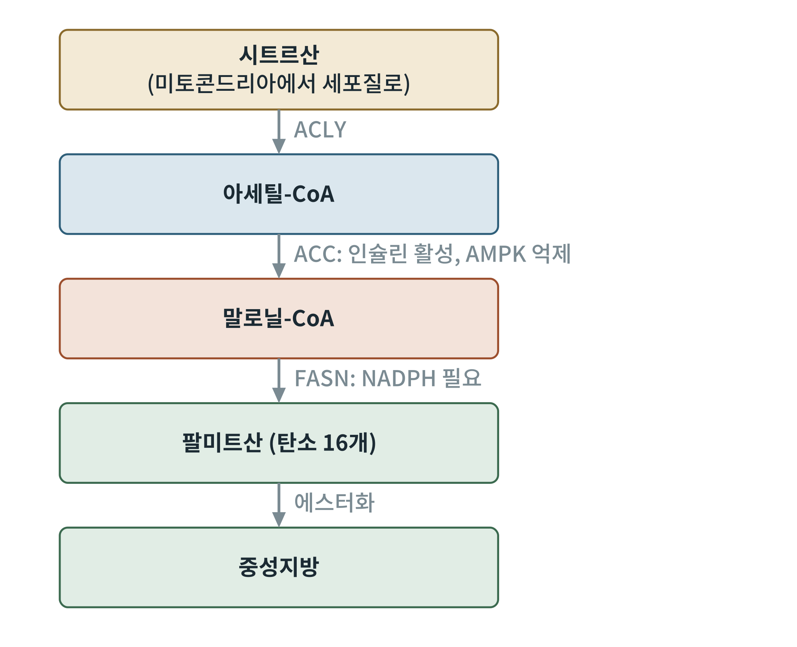

## 제7장 지방산: 산화와 합성

> **이 장의 출발점** 1904년 독일의 프란츠 크노프(Franz Knoop)는 개에게 말단에 벤젠 고리를 붙인 지방산을 먹이고 소변을 분석했다. 탄소 사슬이 홀수 개인 지방산에서는 벤조산 유도체가, 짝수 개인 지방산에서는 페닐아세트산 유도체가 나왔다. 사슬이 탄소 두 개씩 잘려 나간다는 증거였다. 사슬의 β 위치(카르복실기에서 두 번째 탄소)가 산화된다는 뜻으로 이 경로는 β산화라 불리게 되었다. 이 장은 크노프가 처음 본 그 과정과, 그 반대인 지방산 합성, 그리고 두 경로를 한 스위치로 묶는 말로닐-CoA의 이야기이다.

### 7.1 지방산이 미토콘드리아에 들어가는 길

지방산은 연료로 쓰이기 전에 먼저 활성화되어야 한다. 세포질에서 긴사슬 아실-CoA 합성효소(ACSL)가 ATP를 AMP와 파이로인산으로 쪼개면서 지방산을 코엔자임 A와 결합시켜 아실-CoA를 만든다. 이 활성화에는 ATP의 고에너지 인산 결합 두 개가 쓰인다.

그러나 아실-CoA는 미토콘드리아 내막을 통과하지 못한다. 카르니틴(carnitine)이 운반체 역할을 한다. 외막의 카르니틴 팔미토일기 전이효소 1(CPT1)이 아실기를 카르니틴으로 옮겨 아실카르니틴을 만들고, 내막의 카르니틴 아실카르니틴 전위효소(CACT)가 이를 기질로 들여보내며, 내막 안쪽의 CPT2가 다시 아실-CoA로 되돌린다. 이 단계들이 지방산 산화의 입구이다.

**그림 7-1. 카르니틴 셔틀과 말로닐-CoA 스위치.** 세포질의 지방산은 아실-CoA가 된 뒤 CPT1, CACT, CPT2를 거쳐 미토콘드리아 기질에서 다시 아실-CoA가 되어 β산화에 들어간다. 지방산 합성의 중간체인 말로닐-CoA는 CPT1을 억제해, 합성과 산화가 동시에 돌아가는 일을 막는다. 개념도이다.

그림 7-1의 말로닐-CoA 억제는 이 장의 핵심이다. 지방산 합성이 활발한 식후에는 말로닐-CoA가 늘어 CPT1이 닫히고, 갓 합성한 지방산이 곧바로 산화되지 않는다. 공복에는 말로닐-CoA가 줄어 CPT1이 열리고, 지방산이 미토콘드리아로 흘러간다. 이 스위치를 알아낸 것은 제임스 맥개리(J. Denis McGarry)와 대니얼 포스터(Daniel Foster)의 연구였다. 29장에서 식후-공복 전환의 스위치로 다시 다룬다.

### 7.2 β산화: 네 단계의 반복

기질 안에서 아실-CoA는 네 단계의 반응으로 한 번에 탄소 두 개씩 잘려 아세틸-CoA가 된다. 첫째, 아실-CoA 탈수소효소가 FAD를 이용해 두 번째와 세 번째 탄소 사이에 이중 결합을 만들며 FADH2를 낸다. 둘째, 수화효소가 물을 붙인다. 셋째, 3-하이드록시아실-CoA 탈수소효소가 NAD+로 산화해 NADH를 낸다. 넷째, 티올레이스가 CoA로 사슬을 잘라 아세틸-CoA와 두 탄소 짧아진 아실-CoA를 만든다. 이 과정을 사슬이 끝날 때까지 되풀이한다.

**표 7-1. β산화 한 바퀴의 네 단계.**

| 단계 | 효소 | 변화 | 얻는 것 |
|---|---|---|---|
| 1 | 아실-CoA 탈수소효소 | 이중 결합 생성 | FADH2 1 |
| 2 | 에노일-CoA 수화효소 | 물 첨가 | 없음 |
| 3 | 3-하이드록시아실-CoA 탈수소효소 | 하이드록시기 산화 | NADH 1 |
| 4 | 티올레이스(3-케토아실-CoA 티올레이스) | CoA로 절단 | 아세틸-CoA 1 |

표 7-1의 한 바퀴는 아세틸-CoA 1, FADH2 1, NADH 1을 낸다. 탄소 16개의 팔미트산(palmitic acid)은 7번 돌아 아세틸-CoA 8, FADH2 7, NADH 7을 낸다. 아세틸-CoA 8분자는 TCA 회로에서 다시 NADH, FADH2, GTP를 낸다. 포도당 한 분자의 에너지 산출과 비교하면 팔미트산 한 분자의 산출량이 훨씬 크다. 이것이 지방이 에너지 저장의 주 형태가 된 이유이다.

**표 7-2. 팔미트산 한 분자의 ATP 수지(P/O 비 NADH 2.5, FADH2 1.5 가정).**

| 항목 | 개수 | 환산 ATP |
|---|---|---|
| β산화 FADH2 | 7 | 10.5 |
| β산화 NADH | 7 | 17.5 |
| 아세틸-CoA 8분자의 TCA 회로 (각 10 ATP) | 8 | 80 |
| 합계(총) | | 108 |
| 활성화에 쓰인 ATP 2분자 상당 | | −2 |
| 순 | | 106 |

표 7-2의 숫자는 3부(11장)에서 설명할 P/O 비의 가정에 달려 있다. 과거 교과서의 129 ATP는 NADH 3, FADH2 2를 가정한 값이다. 최근 교과서는 2.5와 1.5를 쓰며, 이 책도 이를 따른다. 불포화 지방산과 홀수 사슬 지방산은 추가 효소가 필요해 값이 달라진다.

### 7.3 지방산 합성: 반대 방향이 아니라 다른 길

지방산 합성은 β산화의 역반응이 아니다. 위치(세포질)와 효소와 환원력(NADPH)이 모두 다르다. 시작은 미토콘드리아의 시트르산이 세포질로 나오는 것이다. ATP 시트르산 분해효소(ACLY)가 시트르산을 세포질의 아세틸-CoA와 옥살로아세트산으로 쪼갠다(6장). 아세틸-CoA 카르복실화효소(ACC)가 아세틸-CoA에 이산화탄소(탄산수소 이온)를 붙여 말로닐-CoA를 만든다. 이 단계가 합성의 속도를 정한다. 지방산 합성효소(fatty acid synthase, FASN)가 말로닐-CoA 단위로 사슬을 탄소 둘씩 늘이며 팔미트산을 만든다. 이 효소의 구조와 반응 기전은 1950년대 페오도르 리넨(Feodor Lynen) 등이 밝혔다. 팔미트산 한 분자에는 아세틸-CoA 1과 말로닐-CoA 7이 쓰이며, NADPH가 14개 필요하다(3장).

**그림 7-2. 지방산 합성의 흐름.** 시트르산이 세포질로 나와 아세틸-CoA가 되고, ACC가 말로닐-CoA를 만들며, FASN이 팔미트산을 만든다. 팔미트산은 글리세롤과 에스터화해 중성지방이 된다. ACC는 인슐린으로 활성화되고 AMPK로 억제된다. 개념도이다.

그림 7-2에서 ACC의 두 조절자를 눈여겨보아야 한다. 인슐린은 ACC를 탈인산화해 켜고 식후의 합성을 촉진하며, 에너지 부족을 알리는 AMPK(14장)는 ACC를 인산화해 끈다. 사람의 ACC는 두 가지가 있다. 간과 지방조직의 세포질에 있는 ACC1이 합성에, 근육과 심장의 미토콘드리아 외막에 있는 ACC2가 CPT1을 막는 말로닐-CoA를 만드는 데 쓰인다. 사람 간에서 포도당과 과당에서 지방산을 새로 만드는 일(새 지방 생성, de novo lipogenesis)은 18장과 36장의 지방간 이야기에서 다시 중요해진다.

### 이 장의 요점

- 지방산은 아실-CoA로 활성화된 뒤 카르니틴 셔틀(CPT1, CACT, CPT2)로 미토콘드리아에 들어간다.
- β산화는 FAD, NAD+, CoA를 쓰는 네 단계의 반복이며 한 바퀴마다 아세틸-CoA, FADH2, NADH를 하나씩 낸다.
- 팔미트산 한 분자의 순 ATP 산출은 약 106이다(P/O 비 2.5, 1.5 가정).
- 지방산 합성은 세포질에서 NADPH를 쓰는 별도의 경로이며, 속도는 ACC가 정한다.
- 말로닐-CoA는 합성의 재료이면서 CPT1을 막는 스위치이다.

#### 참고문헌

Berg, J. M., Tymoczko, J. L., Gatto, G. J., Jr., & Stryer, L. (2019). *Biochemistry* (9th ed.). W. H. Freeman.

Knoop, F. (1904). Der Abbau aromatischer Fettsäuren im Tierkörper. *Beiträge zur Chemischen Physiologie und Pathologie, 6*, 150–162.

McGarry, J. D., & Foster, D. W. (1980). Regulation of hepatic fatty acid oxidation and ketone body production. *Annual Review of Biochemistry, 49*, 395–420.

Nelson, D. L., & Cox, M. M. (2021). *Lehninger principles of biochemistry* (8th ed.). W. H. Freeman.
