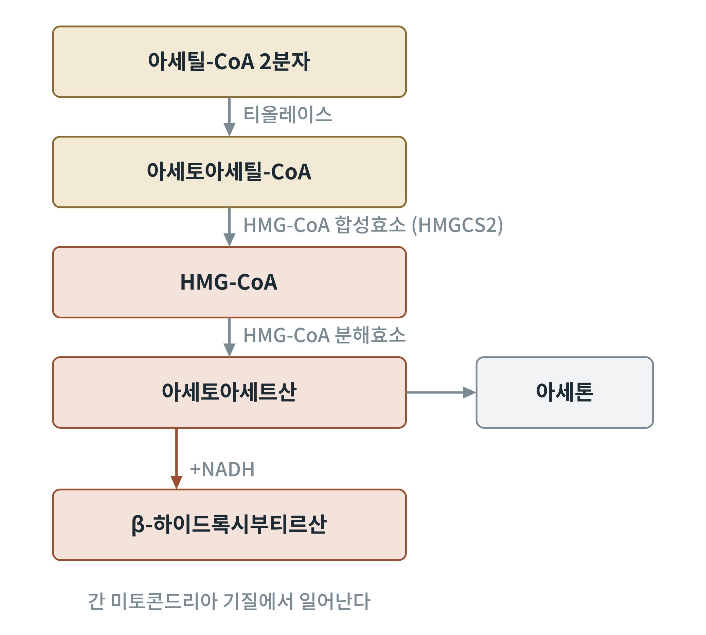
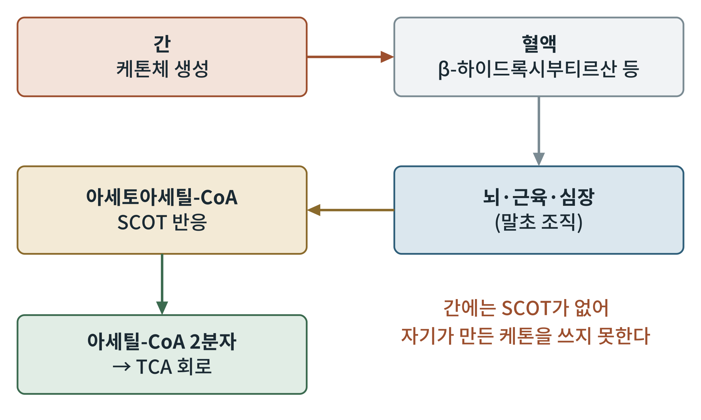

## 제8장 케톤체: 생성과 이용

> **이 장의 출발점** 1921년 미국 메이요 클리닉의 러셀 와일더(Russell Wilder)는 간질 환자를 위해 단식과 같은 대사 상태를 음식으로 만들어 내는 방법을 제안했다. 지방을 많이 먹고 탄수화물을 거의 먹지 않으면, 굶을 때처럼 혈액에 케톤체가 늘어나 발작이 줄어드는 환자가 있었다. 와일더는 이를 케톤 생성 식이(ketogenic diet)라 이름 붙였다. 케톤체는 처음에는 당뇨병의 위험 신호로만 알려졌지만, 지금은 뇌의 비상 연료이자 신호 분자로 이해된다. 이 장은 케톤체가 어디서 어떻게 만들어지고 쓰이는지를 분자 수준에서 정리한다.

### 8.1 케톤체란 무엇인가

케톤체(ketone bodies)는 아세토아세트산(acetoacetate), β-하이드록시부티르산(β-hydroxybutyrate), 아세톤(acetone)의 세 물질을 묶어 부르는 말이다. 엄밀하게 보면 β-하이드록시부티르산은 케톤기가 없는 하이드록시산이지만, 아세토아세트산과 서로 쉽게 바뀌므로 관습적으로 함께 센다. 아세톤은 아세토아세트산이 저절로 탈카복실화해 생기는 부산물이며, 숨으로 배출되어 특유의 냄새를 낸다.

**표 8-1. 케톤체 세 가지.**

| 물질 | 화학적 성격 | 역할 |
|---|---|---|
| β-하이드록시부티르산 | 하이드록시산 | 혈중 주된 형태, 에너지·신호 |
| 아세토아세트산 | 케토산 | 에너지원, β-하이드록시부티르산과 상호 전환 |
| 아세톤 | 케톤 | 부산물, 호흡으로 배출 |

### 8.2 간에서의 생성

케톤체는 간의 미토콘드리아 기질에서 만들어진다. 재료는 지방산 β산화(7장)에서 넘쳐 나온 아세틸-CoA이다. 아세틸-CoA 두 분자가 티올레이스로 결합해 아세토아세틸-CoA가 되고, 여기에 아세틸-CoA 한 분자가 더 붙어 HMG-CoA(3-하이드록시-3-메틸글루타릴-CoA)가 된다. 이 단계를 맡는 HMG-CoA 합성효소(미토콘드리아형 HMGCS2)가 케톤 생성의 속도를 정한다. 이어 HMG-CoA 분해효소가 아세틸-CoA를 떼어 내고 아세토아세트산을 만든다. 아세토아세트산의 일부는 β-하이드록시부티르산 탈수소효소(BDH1)가 NADH로 환원해 β-하이드록시부티르산으로 바꾼다.

**그림 8-1. 간의 케톤체 생성 경로.** 아세틸-CoA 두 분자가 합쳐져 아세토아세틸-CoA, HMG-CoA를 거쳐 아세토아세트산이 만들어지고, 일부는 NADH를 쓰는 환원으로 β-하이드록시부티르산이 되며 일부는 아세톤이 된다. 개념도이다.

그림 8-1을 읽는 순서와 조절은 이렇다. 공복에는 인슐린이 낮고 글루카곤이 높아 지방조직에서 지방산이 풀려 나오고, 간의 ACC가 꺼져 말로닐-CoA가 줄어든다. CPT1이 열려 지방산이 미토콘드리아로 들어가 β산화가 빨라진다. 그러나 TCA 회로로 들어갈 옥살로아세트산이 포도당 신생에 불려 나가 부족해지면(6장), 쏟아져 나오는 아세틸-CoA가 케톤 생성 쪽으로 흘러간다. 이 경로는 아세틸-CoA가 많을 때 켜지는 "넘침 배출구"인 셈이다. 22~25장에서 공복의 시간표와 함께 자세히 다룬다.

### 8.3 말초 조직에서의 이용

케톤체는 혈액을 타고 뇌, 근육, 심장 같은 조직으로 가서 연료로 쓰인다. β-하이드록시부티르산은 아세토아세트산으로 되돌려진 뒤, 숙시닐-CoA:3-케토산 CoA 전이효소(SCOT, 유전자 이름은 OXCT1)가 숙시닐-CoA의 CoA를 받아 아세토아세틸-CoA를 만든다. 티올레이스가 이를 아세틸-CoA 두 분자로 쪼개 TCA 회로에 넣는다.

**그림 8-2. 케톤체의 생성에서 이용까지.** 간이 만든 케톤체는 혈액을 거쳐 말초 조직으로 가서 아세토아세틸-CoA를 거쳐 아세틸-CoA 두 분자가 된다. 간에는 SCOT가 없어서 자기가 만든 케톤체를 쓰지 못하고 다른 조직에 내보내기만 한다. 개념도이다.

그림 8-2의 마지막 문장이 케톤체 대사의 구조적 특징이다. 간은 케톤체를 만드는 데 집중하고 쓰지는 못하므로, 만든 만큼이 몸의 다른 조직으로 흘러간다. 이 점은 간이 "연료 공급 공장"이라는 31장의 그림과도 이어진다. 뇌는 포도당 외에는 지방산을 거의 쓰지 못하지만(혈액-뇌 장벽을 지방산이 쉽게 넘지 못함), 케톤체는 운반체를 통해 뇌로 들어가 연료가 된다. 오랜 공복에 뇌가 쓰는 연료 중 케톤체의 비율이 크게 오른다는 연구는 조지 캐힐(George Cahill) 등의 1960년대 연구에서 나왔고, 25장에서 상세히 다룬다.

### 8.4 혈중 케톤 수준의 범위

**표 8-2. 상태별 혈중 β-하이드록시부티르산의 대략적 범위.** 문헌에 따라 범위가 다르므로 어림값으로 읽는다. 개인차와 측정법의 차이가 크다.

| 상태 | 혈중 β-하이드록시부티르산(mmol/L) | 비고 |
|---|---|---|
| 식후 | 0.1 미만 | 인슐린 높음 |
| 하룻밤 공복 | 0.1~0.3 | 간 글리코겐 소진 시작 |
| 2~3일 단식 | 약 1~3 | 케톤 생성 본격화 |
| 장기 단식 | 약 5~8 | 뇌의 케톤 이용 증가 |
| 제1형 당뇨병 케톤산증 | 대개 3 이상, 수십 mmol/L까지 | 인슐린 결핍, pH 저하(위험) |

표 8-2에서 주의할 점은 영양학적 케톤증(nutritional ketosis)과 케톤산증(ketoacidosis)의 구별이다. 인슐린이 있는 한 케톤 생성은 일정 수준 이하로 억제되고 혈액 pH는 유지된다. 인슐린이 거의 없는 제1형 당뇨병에서는 이 제동이 풀려 케톤체가 폭증하고 혈액이 산성이 된다. 두 상태는 수치도 원인도 다르다.

### 8.5 에너지원을 넘어서: 신호로서의 β-하이드록시부티르산

β-하이드록시부티르산은 연료일 뿐 아니라 신호 분자이다. 2013년 마르시아 시무(Shimazu)와 에릭 베르딘(Eric Verdin) 등은 이 물질이 히스톤 탈아세틸화효소(HDAC)를 억제해 산화 스트레스 방어 유전자의 발현을 높인다고 보고했다. 또 세포 표면의 수용체 HCAR2(GPR109A)를 활성화하고, 염증소체(NLRP3) 활성을 낮춘다는 보고도 있다. 이들 연구는 케톤체의 효과가 단순한 에너지 공급을 넘는다는 가설의 근거가 되고 있으나, 사람에서의 재현과 생리적 농도에서의 효과는 아직 논쟁 중이다. 14장과 28장에서 공복 신호로서 다시 정리한다.

### 이 장의 요점

- 케톤체는 아세토아세트산, β-하이드록시부티르산, 아세톤이며, 간 미토콘드리아에서 아세틸-CoA로부터 만들어진다.
- 케톤 생성의 속도는 HMG-CoA 합성효소(HMGCS2)가 정하며, 지방산 β산화가 많고 옥살로아세트산이 부족할 때 활발해진다.
- 말초 조직은 SCOT로 케톤체를 아세틸-CoA로 바꿔 쓰며, 간에는 SCOT가 없다.
- 영양학적 케톤증(인슐린 존재)과 케톤산증(인슐린 결핍)은 구별된다.
- β-하이드록시부티르산은 HDAC 억제 등의 신호 기능이 보고되어 있으나 사람에서의 의미는 논쟁 중이다.

#### 참고문헌

Cahill, G. F., Jr. (2006). Fuel metabolism in starvation. *Annual Review of Nutrition, 26*, 1–22. https://doi.org/10.1146/annurev.nutr.26.061505.111258

Nelson, D. L., & Cox, M. M. (2021). *Lehninger principles of biochemistry* (8th ed.). W. H. Freeman.

Shimazu, T., Hirschey, M. D., Newman, J., He, W., Shirakawa, K., Le Moan, N., Grueter, C. A., Lim, H., Saunders, L. R., Stevens, R. D., Newgard, C. B., Farese, R. V., Jr., de Cabo, R., Ulrich, S., Akassoglou, K., & Verdin, E. (2013). Suppression of oxidative stress by β-hydroxybutyrate, an endogenous histone deacetylase inhibitor. *Science, 339*(6116), 211–214. https://doi.org/10.1126/science.1227166

Wilder, R. M. (1921). The effects of ketonemia on the course of epilepsy. *Mayo Clinic Bulletin, 2*, 307–308.

Youm, Y.-H., Nguyen, K. Y., Grant, R. W., Goldberg, E. L., Bodogai, M., Kim, D., D'Agostino, D., Planavsky, N., Lupfer, C., Kanneganti, T. D., Kang, S., Horvath, T. L., Fahmy, T. M., Crawford, P. A., Biragyn, A., Alnemri, E., & Dixit, V. D. (2015). The ketone metabolite β-hydroxybutyrate blocks NLRP3 inflammasome–mediated inflammatory disease. *Nature Medicine, 21*(3), 263–269. https://doi.org/10.1038/nm.3804
