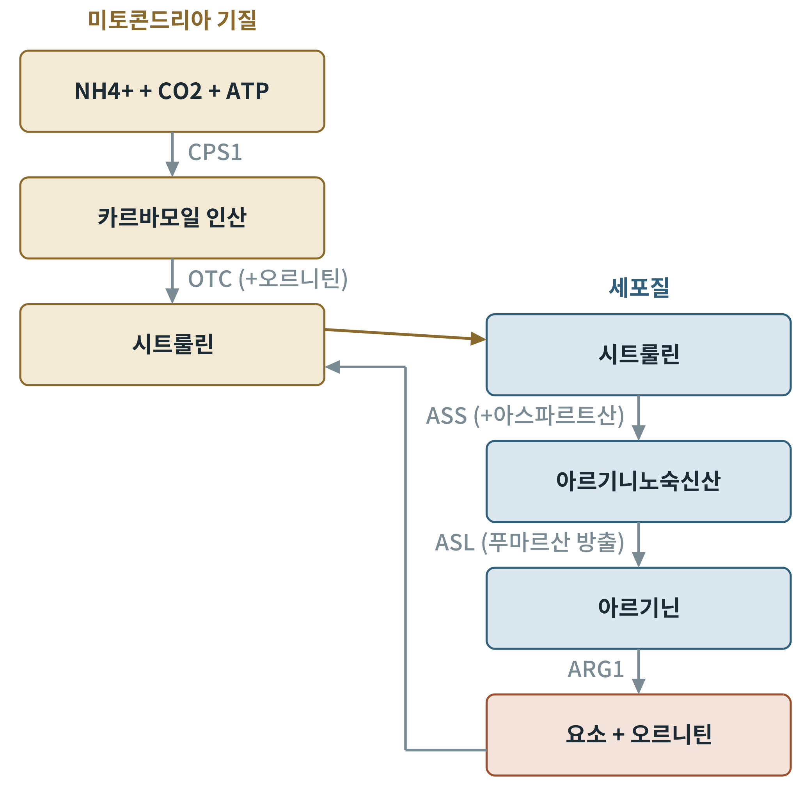
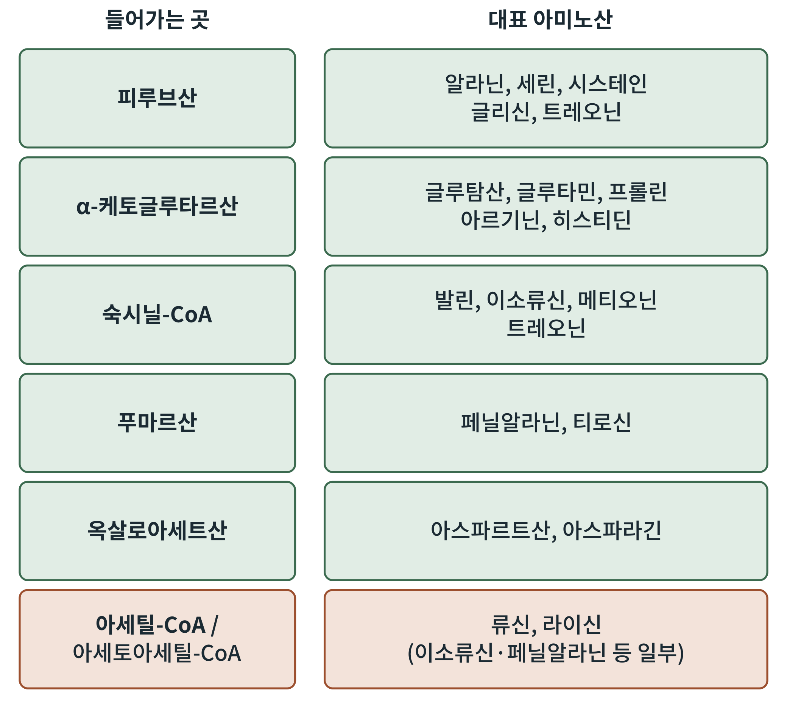

## 제9장 아미노산과 요소회로

> **이 장의 출발점** 1932년 한스 크렙스는 제자 쿠르트 헨젤라이트(Kurt Henseleit)와 함께 간 조직 조각에 암모니아와 아르기닌을 넣고 요소(urea)가 만들어지는 속도를 쟀다. 오르니틴이나 시트룰린, 아르기닌을 조금 넣으면 요소 생성이 크게 늘었는데, 이 물질들이 닳지 않고 촉매처럼 작용했다. 5년 뒤 TCA 회로를 밝힐 때 쓴 바로 그 논리를 그가 먼저 요소회로에서 쓴 것이다. 이 장은 단백질의 구성 단위인 아미노산이 어떻게 에너지가 되고, 그때 나오는 질소가 어떻게 안전하게 버려지는지를 다룬다.

### 9.1 아미노기를 옮기는 효소: 아미노기 전이

아미노산을 연료로 쓰려면 먼저 아미노기(-NH2)를 떼어 내야 한다. 아미노기 전이효소(aminotransferase, 트랜스아미네이스)는 아미노산의 아미노기를 α-케토글루타르산에 건네 글루탐산(glutamate)으로 만들고, 아미노산은 탄소 골격만 남은 α-케토산이 된다. 이 반응은 비타민 B6의 활성형인 피리독살 인산(PLP)을 보조 인자로 쓰며 가역적이다. 대표적인 효소가 알라닌 아미노기 전이효소(ALT)와 아스파르트산 아미노기 전이효소(AST)이다. 건강검진에서 혈중 ALT·AST를 재는 것은 이 효소가 간세포에 많아, 간 손상 때 혈액으로 새어 나오기 때문이다.

글루탐산의 아미노기는 글루탐산 탈수소효소(glutamate dehydrogenase)에 의해 NAD(P)+가 환원되면서 암모니아(NH4+)로 떨어진다. 암모니아는 독성이 커서 그대로 둘 수 없다. 조직마다 암모니아를 무독한 형태로 간에 보내는 운반체가 있다.

**표 9-1. 질소를 간으로 보내는 두 운반체.**

| 운반체 | 만들어지는 곳 | 운반 방식 | 간에서의 처리 |
|---|---|---|---|
| 글루타민 | 대부분의 조직, 근육 | 글루타민 합성효소가 NH4+를 글루탐산에 붙여 만듦 | 글루타미네이스가 NH4+를 되떼어 요소회로로 |
| 알라닌 | 근육 | 피루브산에 아미노기를 줌(ALT) | 간에서 피루브산으로 되돌려 포도당 신생에 쓰고 아미노기는 요소회로로(포도당-알라닌 회로) |

표 9-1의 포도당-알라닌 회로는 5장 코리 회로의 질소 버전이다. 근육이 피루브산을 알라닌으로 보내면 근육의 질소도 함께 간으로 가고, 간은 이를 포도당으로 바꿔 근육에 돌려준다. 22~27장의 공복 이야기에서 "근육-간 아미노산 회로"로 중심 역할을 한다.

### 9.2 요소회로: 암모니아를 요소로

간에서 암모니아는 요소회로(urea cycle)를 거쳐 요소로 바뀐다. 요소회로는 미토콘드리아와 세포질에 걸쳐 있다. 미토콘드리아에서 카르바모일 인산 합성효소 1(CPS1)이 NH4+, 이산화탄소, ATP 두 분자로 카르바모일 인산을 만들며, 이 효소는 N-아세틸글루탐산이라는 활성화 인자가 있어야 작동한다. 오르니틴 카르바모일기 전이효소(OTC)가 이를 오르니틴에 붙여 시트룰린을 만든다. 시트룰린이 세포질로 나가 아스파르트산과 결합해 아르기니노숙신산이 되고(ASS), 푸마르산을 떼어 내 아르기닌이 되며(ASL), 아르기닌분해효소(ARG1)가 아르기닌을 요소와 오르니틴으로 가른다. 오르니틴은 다시 미토콘드리아로 돌아가 회로가 닫힌다.

**그림 9-1. 요소회로.** 왼쪽 미토콘드리아에서 카르바모일 인산을 거쳐 시트룰린이 만들어지고, 오른쪽 세포질에서 아르기니노숙신산, 아르기닌을 거쳐 요소가 만들어진다. 오르니틴이 미토콘드리아로 되돌아가 회로가 이어진다. 두 번째 질소는 아스파르트산이, 첫 번째 질소는 NH4+가 제공한다. 개념도이다.

그림 9-1에서 요소 한 분자의 두 질소 중 하나는 암모니아에서, 다른 하나는 아스파르트산에서 온다. 아스파르트산은 푸마르산이 되어 TCA 회로로 들어간다. 이처럼 요소회로와 TCA 회로는 푸마르산과 옥살로아세트산을 통해 연결되어 있다(6장). 요소 한 분자를 만드는 데 4개의 고에너지 인산 결합이 쓰인다고 흔히 계산한다. 단백질을 많이 먹는 식사나 오랜 공복에는 요소 생성이 늘어나며, 이 질소 배설량을 재어 단백질 분해 정도를 추정할 수 있다.

### 9.3 탄소 골격의 운명: 포도당 생성 아미노산과 케톤 생성 아미노산

아미노기를 뗀 탄소 골격은 TCA 회로의 중간체나 아세틸-CoA로 들어간다. 피루브산, α-케토글루타르산, 숙시닐-CoA, 푸마르산, 옥살로아세트산으로 들어가는 골격은 결국 옥살로아세트산을 거쳐 포도당 신생에 쓰일 수 있으므로 포도당 생성 아미노산(glucogenic amino acids)이라 한다. 아세틸-CoA나 아세토아세틸-CoA로만 분해되는 골격은 포도당으로 바뀔 수 없고 케톤체나 지방산의 재료가 되므로 케톤 생성 아미노산(ketogenic amino acids)이라 한다.

**그림 9-2. 아미노산의 탄소 골격이 TCA 회로로 들어가는 곳.** 위의 다섯 줄(초록)은 포도당 생성 아미노산이 들어가는 곳이며, 맨 아래 줄(붉은색)은 아세틸-CoA와 아세토아세틸-CoA로 들어가는 케톤 생성 경로이다. 이소류신, 페닐알라닌, 티로신, 트립토판, 트레오닌은 두 경로로 모두 들어가는 아미노산으로 분류한다. 개념도이다.

그림 9-2에서 순수한 케톤 생성 아미노산은 류신(leucine)과 라이신(lysine) 둘뿐이다. 이 점은 공복 단백질 보존(26장)과 식물성 식사에서 아미노산 구성을 평가할 때(30장) 다시 쓰인다.

### 9.4 분지쇄 아미노산

류신, 이소류신, 발린은 곁사슬이 가지 친 모양이어서 분지쇄 아미노산(branched-chain amino acids, BCAA)이라 부른다. 다른 아미노산이 간에서 주로 분해되는 것과 달리 BCAA는 근육 등 간 밖에서도 아미노기 전이를 받는다. 이어 분지쇄 α-케토산 탈수소효소 복합체(BCKDH)가 PDH와 비슷한 방식으로 탈카복실화한다. 2009년 크리스토퍼 뉴가드(Christopher Newgard) 등은 비만과 인슐린 저항이 있는 사람의 혈중 BCAA와 관련 대사물질 농도가 높다고 보고했고, BCAA를 인슐린 저항의 지표이자 가능한 원인으로 보는 연구가 이어졌다. 인과관계는 아직 논쟁 중이며, 21장과 36장에서 인슐린 저항 맥락으로 다시 다룬다.

### 이 장의 요점

- 아미노기 전이효소는 PLP를 쓰며 아미노기를 α-케토글루타르산에 옮겨 글루탐산을 만든다.
- 글루타민과 알라닌은 근육 등에서 질소를 간으로 운반하는 무독성 운반체이다.
- 요소회로는 간에서 미토콘드리아와 세포질에 걸쳐 암모니아를 요소로 바꾸며, TCA 회로와 푸마르산·아스파르트산으로 연결된다.
- 탄소 골격은 TCA 회로 중간체(포도당 생성)나 아세틸-CoA(케톤 생성)로 들어간다. 순수 케톤 생성 아미노산은 류신과 라이신이다.
- 분지쇄 아미노산은 간 밖(근육)에서도 분해되며, 인슐린 저항과의 관련이 보고되어 있다.

#### 참고문헌

Krebs, H. A., & Henseleit, K. (1932). Untersuchungen über die Harnstoffbildung im Tierkörper. *Hoppe-Seyler's Zeitschrift für Physiologische Chemie, 210*(1–2), 33–66.

Nelson, D. L., & Cox, M. M. (2021). *Lehninger principles of biochemistry* (8th ed.). W. H. Freeman.

Newgard, C. B., An, J., Bain, J. R., Muehlbauer, M. J., Stevens, R. D., Lien, L. F., Haqq, A. M., Shah, S. H., Arlotto, M., Slentz, C. A., Rochon, J., Gallup, D., Ilkayeva, O., Wenner, B. R., Yancy, W. S., Jr., Eisenson, H., Musante, G., Surwit, R. S., Millington, D. S., Butler, M. D., & Svetkey, L. P. (2009). A branched-chain amino acid-related metabolic signature that differentiates obese and lean humans and contributes to insulin resistance. *Cell Metabolism, 9*(4), 311–326. https://doi.org/10.1016/j.cmet.2009.02.002
