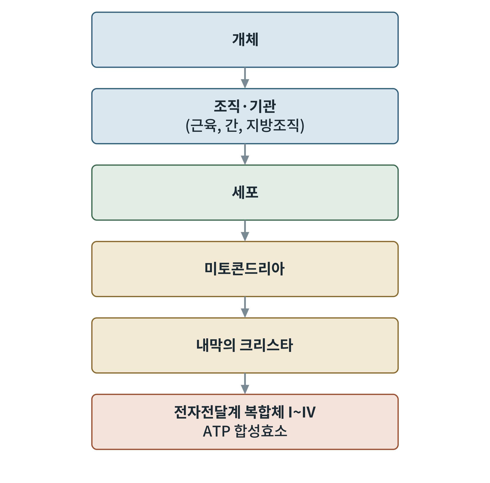
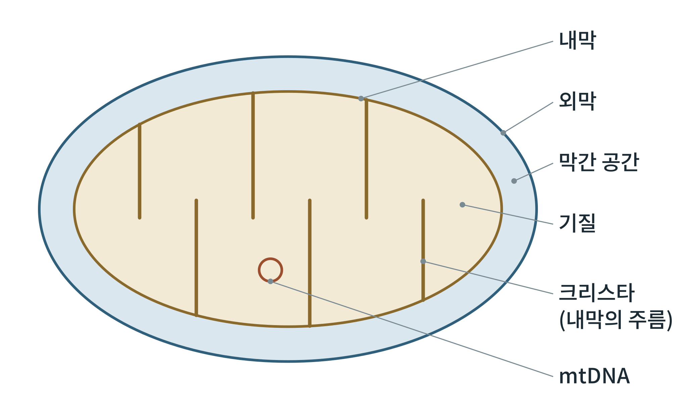

# 제3부 미토콘드리아의 에너지 전환

## 제10장 미토콘드리아의 구조와 역학

> **이 장의 출발점** 1949년 유진 케네디(Eugene Kennedy)와 앨버트 레닝거(Albert Lehninger)는 쥐의 간을 갈아 원심분리로 분획한 뒤, 산소를 쓰고 ATP를 만드는 능력이 오직 한 가지 입자 분획에만 있다는 것을 보였다. 그 입자가 미토콘드리아였다. 4년 뒤 조지 팔라디(George Palade)는 전자현미경으로 이 입자의 속을 찍어, 안쪽 막이 주름져 있다는 것을 보였다. 이 주름, 크리스타(cristae)가 곧 에너지 공장의 작업대였다. 이 장은 크기가 마이크로미터에 못 미치는 그 작은 구조물을 개체에서부터 차례로 들어가며 본다.

### 10.1 개체에서 미토콘드리아까지

에너지 대사는 눈에 보이는 몸의 일에서 시작해 분자 기계에서 끝난다. 개체가 먹고 움직이는 에너지는 근육, 간, 지방조직 같은 조직이 쓰고, 조직의 에너지는 세포가 쓰며, 세포 안에서 ATP를 만드는 주된 곳이 미토콘드리아이다. 미토콘드리아 안에서도 일은 내막의 크리스타 위에 박힌 전자전달계 복합체와 ATP 합성효소가 한다.

**그림 10-1. 개체에서 전자전달계까지.** 개체, 조직(근육·간·지방조직), 세포, 미토콘드리아, 내막의 크리스타, 전자전달계 복합체 순으로 규모가 작아진다. 개념도이며 상자 크기는 실제 비례가 아니다.

그림 10-1은 이 책의 시선이 어디로 내려가는지를 보여 준다. 1부에서 에너지 법칙, 2부에서 연료별 경로를 배웠고, 3부는 마지막 두 단계, 곧 미토콘드리아와 크리스타 위의 단백질 기계를 다룬다. 한 세포에 들어 있는 미토콘드리아의 수는 세포 종류에 따라 수십 개에서 수천 개까지 차이가 크다. 에너지 수요가 큰 심근, 근육, 간 세포, 갈색지방 세포에 특히 많다.

### 10.2 이중막 구조

미토콘드리아는 두 겹의 막으로 둘러싸여 있다. 바깥쪽 막(외막)은 포린(porin)이라 불리는 큰 통로 단백질(VDAC)을 가져 작은 분자를 비교적 자유롭게 통과시킨다. 안쪽 막(내막)은 이온과 대부분의 분자를 통과시키지 않는다. 그래서 내막이 양성자(수소 이온) 구배를 만들고 유지할 수 있다. 내막에는 카디오리핀(cardiolipin)이라는 특이한 인지질이 많고, 안쪽으로 접혀 크리스타를 이룬다. 두 막 사이는 막간 공간이고, 내막으로 둘러싸인 안쪽이 기질(matrix)이다.

**그림 10-2. 미토콘드리아의 구조.** 바깥은 외막, 그 안쪽 틈이 막간 공간이다. 내막은 안쪽으로 접혀 크리스타를 만들고, 내막 안쪽의 기질에는 TCA 회로와 β산화 효소, 미토콘드리아 DNA(mtDNA)가 있다. 개념도이다.

그림 10-2에서 구획을 기억하는 방법은 "무엇이 어디서 일하는가"이다. 기질에는 TCA 회로(6장), β산화(7장), 요소회로의 일부(9장)가 있고, 내막에는 전자전달계(11장)와 ATP 합성효소가 있으며, 막간 공간은 양성자가 쌓이는 곳이다. 이 구획 짓기가 화학삼투의 전제 조건이다.

**표 10-1. 미토콘드리아의 구획과 주요 기능.**

| 구획 | 주요 구성 | 주요 기능 |
|---|---|---|
| 외막 | VDAC(포린), 지방산 활성화 효소(ACSL) | 작은 분자 통과, 지방산 활성화 |
| 막간 공간 | 시토크롬 c, 양성자 | 양성자 저장, 세포 사멸 신호 |
| 내막 | 전자전달계 복합체 I~IV, ATP 합성효소, 운반체(ANT 등), 카디오리핀 | 양성자 구배 형성, ATP 합성 |
| 기질 | TCA 회로, β산화, 피루브산 탈수소효소, mtDNA, 리보솜 | 연료 산화, 자체 단백질 합성 |

### 10.3 미토콘드리아 DNA와 세포 내 공생

미토콘드리아는 세포핵과 별도의 유전체를 가진다. 사람의 미토콘드리아 DNA(mtDNA)는 약 16,569 염기쌍의 원형 DNA이고 37개의 유전자를 가진다. 이 가운데 13개가 전자전달계와 ATP 합성효소의 단백질 소단위이며, 나머지는 이를 번역하는 데 필요한 리보솜 RNA 2개와 운반 RNA 22개이다. 미토콘드리아 단백질의 대부분(1천 개 이상)은 핵 유전자가 만들어 안으로 수입한다. mtDNA는 어머니로부터만 전해지고, 한 세포 안에 정상 mtDNA와 변이 mtDNA가 섞여 있는 상태(이형질성)가 흔하다.

이런 구조는 린 마굴리스(Lynn Margulis)가 1967년 정리한 세포 내 공생설과 맞는다. 산소를 쓰는 세균이 원시 진핵세포 안에 들어가 살게 되었고, 세월이 지나며 유전자의 많은 부분을 핵으로 넘기고 세포소기관이 되었다는 설명이다. 이중막, 원형 DNA, 자체 리보솜이 그 흔적으로 꼽힌다.

### 10.4 융합, 분열, 품질 관리

미토콘드리아는 고정된 구조물이 아니라 끊임없이 합쳐지고 쪼개지고 이동하는 관계망이다. 융합은 외막의 미토푸신(MFN1, MFN2)과 내막의 OPA1이, 분열은 세포질의 DRP1이 FIS1·MFF 등 수용체를 통해 미토콘드리아를 조여 자르는 방식으로 일어난다. 융합은 손상된 단백질과 mtDNA를 이웃과 섞어 희석하고, 분열은 손상된 조각을 떼어 내 제거하게 한다. 손상된 조각은 PINK1과 Parkin이 표지하여 세포의 청소 장치(자가포식, 이 경우 미토파지)로 처리된다.

새 미토콘드리아의 생성(미토콘드리아 생합성)은 PGC-1α라는 전사 보조 인자가 지휘한다. 운동이나 추위는 PGC-1α를 늘려 근육과 갈색지방의 미토콘드리아 수를 늘린다. 이 신호는 14장과 12장에서 다시 만난다.

**표 10-2. 미토콘드리아 역학의 주요 단백질.**

| 과정 | 주요 단백질 | 위치 | 기능 |
|---|---|---|---|
| 융합 | MFN1, MFN2 | 외막 | 외막 융합 |
| 융합 | OPA1 | 내막 | 내막 융합, 크리스타 유지 |
| 분열 | DRP1, FIS1, MFF | 세포질에서 외막으로 | 미토콘드리아 절단 |
| 제거 | PINK1, Parkin | 손상 조각 | 미토파지 표지 |
| 생합성 | PGC-1α | 핵 | 미토콘드리아 유전자 발현 증가 |

표 10-2를 읽을 때 비만과의 연결을 하나 짚어 둔다. 인슐린 저항이 있는 사람의 골격근에서 미토콘드리아 유전자의 발현과 ATP 합성 속도가 낮다는 보고가 2000년대 초에 나왔다. 그러나 이것이 인슐린 저항의 원인인지 결과인지는 논쟁이 계속된다. 21장과 36장에서 이를 다시 정리한다.

### 이 장의 요점

- 미토콘드리아는 외막, 막간 공간, 내막(크리스타), 기질의 네 구획으로 나뉜다.
- 내막은 이온을 통과시키지 않아 양성자 구배를 유지할 수 있다.
- 사람 mtDNA는 약 16,569 염기쌍, 37개 유전자이며, 13개 단백질은 전자전달계와 ATP 합성효소의 소단위이다.
- 미토콘드리아는 융합, 분열, 미토파지로 끊임없이 품질을 관리하고, PGC-1α가 새로 만드는 일을 지휘한다.

#### 참고문헌

Kennedy, E. P., & Lehninger, A. L. (1949). Oxidation of fatty acids and tricarboxylic acid cycle intermediates by isolated rat liver mitochondria. *Journal of Biological Chemistry, 179*(2), 957–972.

Margulis, L. (Sagan, L.). (1967). On the origin of mitosing cells. *Journal of Theoretical Biology, 14*(3), 225–274. https://doi.org/10.1016/0022-5193(67)90079-3

Nelson, D. L., & Cox, M. M. (2021). *Lehninger principles of biochemistry* (8th ed.). W. H. Freeman.

Palade, G. E. (1953). An electron microscope study of the mitochondrial structure. *Journal of Histochemistry and Cytochemistry, 1*(4), 188–211.
