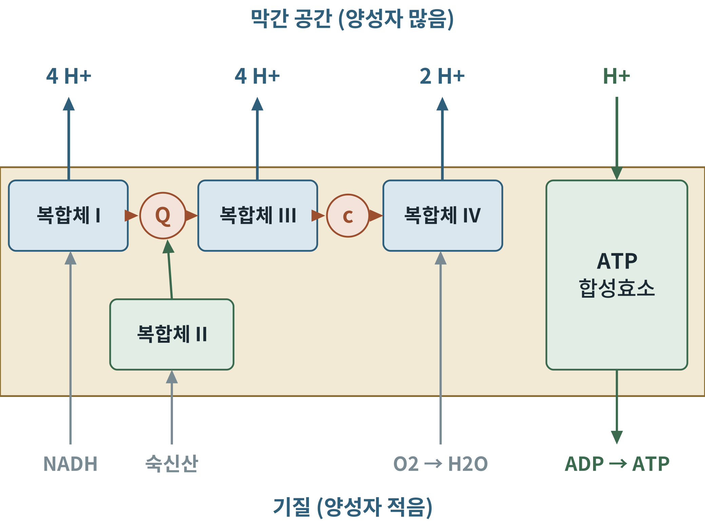
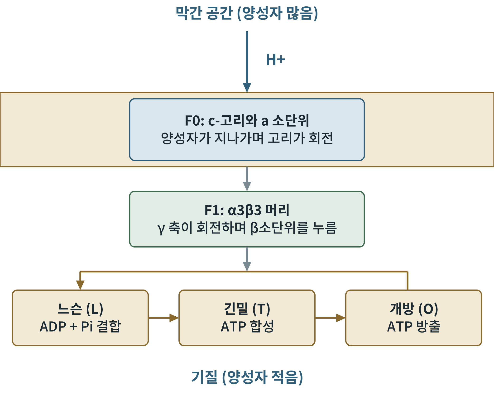

## 제11장 전자전달계와 화학삼투

> **이 장의 출발점** 1961년 영국 에든버러 근교의 외딴 연구소에서 피터 미첼(Peter Mitchell)은 학계가 받아들이기 어려운 가설을 《네이처》에 실었다. ATP는 효소 사이의 화학 중간체가 아니라, 막 양쪽의 양성자 농도 차이가 만든 힘으로 합성된다는 것이다. 그때까지 20년 가까이 찾아도 나오지 않던 "고에너지 중간체"가 없다는 주장이었다. 반론은 거셌지만, 1974년 에프라임 래커(Efraim Racker)와 발터 슈토케니우스(Walther Stoeckenius)가 빛으로 양성자를 퍼 올리는 세균 단백질과 ATP 합성효소를 인공 막 주머니에 함께 넣어 ATP가 만들어지는 것을 보인 뒤 가설은 자리를 잡았다. 미첼은 1978년 노벨 화학상을 받았다.

### 11.1 전자전달계: 네 복합체와 두 운반체

미토콘드리아 내막에는 네 개의 큰 단백질 복합체와 두 개의 이동 운반체가 전자를 NADH와 FADH2에서 산소까지 나른다. 복합체 I(NADH-유비퀴논 산화환원효소)은 NADH의 전자를 받아 유비퀴논(Q, 코엔자임 Q10)에 넘기고, 복합체 II(숙신산 탈수소효소, TCA 회로의 효소와 같은 것)는 FADH2의 전자를 Q에 넘긴다. 복합체 III(시토크롬 bc1)은 Q의 전자를 시토크롬 c에 넘기고, 복합체 IV(시토크롬 c 산화효소)는 시토크롬 c의 전자를 산소에 넘겨 물을 만든다.

**그림 11-1. 전자전달계.** 복합체 I, III, IV는 전자가 지나갈 때마다 양성자를 기질에서 막간 공간으로 퍼 올린다. 복합체 II는 양성자를 퍼 올리지 않고 전자만 Q에 보탠다. 퍼 올려진 양성자는 ATP 합성효소를 통해 기질로 되돌아오며 ATP를 만든다. 전자 한 쌍당 양성자 수는 교과서 값이다.

그림 11-1에서 눈에 띄는 비대칭은 복합체 II이다. FADH2에서 시작한 전자는 복합체 I을 건너뛰고 Q에 합류하므로, NADH보다 양성자를 덜 퍼 올린다. 3장 그림 3-1의 전위차와 연결하면, 전자의 낙차가 클수록 한 번에 퍼 올릴 수 있는 양성자가 많아진다.

**표 11-1. 전자전달계 복합체 요약.** 전자 한 쌍당 양성자 수는 교과서 값이다.

| 복합체 | 이름 | 전자 공급 | 퍼 올리는 양성자 | 대표 억제제 |
|---|---|---|---|---|
| I | NADH-유비퀴논 산화환원효소 | NADH | 4 | 로테논(rotenone) |
| II | 숙신산 탈수소효소 | FADH2 | 0 | 말론산 등 |
| III | 시토크롬 bc1 | 유비퀴놀(QH2) | 4 | 안티마이신 A |
| IV | 시토크롬 c 산화효소 | 시토크롬 c | 2 | 시안화물, 일산화탄소 |
| V | ATP 합성효소 | 양성자 구배 | (양성자가 되돌아옴) | 올리고마이신 |

표 11-1의 억제제는 연구 도구이자 독이다. 시안화물과 일산화탄소는 복합체 IV를 막아 세포 호흡을 멈추게 하므로 치명적이다. 올리고마이신은 ATP 합성효소를 막으면 전자전달도 멈춘다는 사실에서, 두 과정이 양성자 구배로 엄격히 이어져 있음을 보여 준다(공역).

### 11.2 화학삼투: 양성자가 일하는 방법

퍼 올려진 양성자는 내막 양쪽에 양성자 구배를 만든다. 이 구배에는 두 요소가 있다. 하나는 전기적 차이(막전위, Δψ)로 막간 공간 쪽이 +, 기질 쪽이 −이다. 다른 하나는 농도 차이(ΔpH)로 막간 공간 쪽이 더 산성이다. 둘을 합쳐 양성자 구동력(proton-motive force, Δp)이라 한다. 교과서에서는 약 200 mV로 소개한다. 양성자 1몰이 이 구배를 따라 되돌아올 때 얻는 자유에너지는 3장의 식을 응용해 F × Δp ≈ 96.485 × 0.2 ≈ 19 kJ/mol로 어림할 수 있다.

### 11.3 ATP 합성효소: 분자 회전기

ATP 합성효소(ATP synthase, 복합체 V)는 막에 박힌 F0와 기질 쪽으로 튀어나온 F1의 두 부분으로 이루어진다. 양성자가 F0의 c-고리를 통과하면 고리가 회전하고, 고리에 붙은 γ 축이 F1 안에서 같이 돈다. F1의 β소단위 세 개는 γ 축의 위치에 따라 느슨, 긴밀, 개방의 세 상태를 차례로 오간다. 폴 보이어(Paul Boyer)가 1970~80년대에 제안한 이 결합 변화 기전(binding change mechanism)은 존 워커(John Walker)가 1994년 F1의 구조를 밝혀 눈에 보이는 증거를 얻었다. 두 사람은 1997년 노벨 화학상을 공동 수상했다.

**그림 11-2. ATP 합성효소의 작동 원리.** 막간 공간의 양성자가 F0의 c-고리를 지나며 고리를 돌리면 γ 축이 F1 안에서 회전하고, F1의 β소단위 세 개가 느슨(ADP와 인산 결합), 긴밀(ATP 합성), 개방(ATP 방출)의 세 상태를 차례로 거치며 ATP를 만든다. 개념도이다.

그림 11-2를 한 줄로 읽으면 "양성자의 흐름이 회전으로, 회전이 구조 변화로, 구조 변화가 ATP로" 바뀐다. 한 바퀴(360도)를 돌 때마다 ATP 3분자가 만들어진다. 사람의 c-고리는 c 소단위가 8개로 이루어져 있다고 알려져 있어, ATP 1분자를 만드는 데 양성자 약 2.7개가 쓰이고, 인산과 ADP를 기질로 들여오는 데 양성자 1개가 더 쓰인다. 합쳐 ATP 1분자당 대략 4개의 양성자로 어림한다.

### 11.4 산출량: P/O 비의 계산

NADH 한 분자가 복합체 I, III, IV를 거치면 양성자 4 + 4 + 2 = 10개가 퍼 올려진다. ATP 1분자당 양성자 약 4개가 필요하므로 NADH 하나는 ATP 약 2.5분자를 만든다. 복합체 II를 거치는 FADH2는 4 + 2 = 6개의 양성자를 퍼 올려 약 1.5분자의 ATP를 만든다. 이 값이 7장에서 쓴 2.5와 1.5이다. 전자를 산소 원자 하나에 보낼 때(NADH 하나당) 만들어지는 ATP 수를 P/O 비라 한다.

**표 11-2. 전자 운반체 하나당 ATP 산출 어림(양성자 4개당 ATP 1분자 가정).**

| 전자 운반체 | 거치는 복합체 | 퍼 올려진 양성자 | ATP 산출 |
|---|---|---|---|
| NADH | I, III, IV | 10 | 약 2.5 |
| FADH2 | II, III, IV | 6 | 약 1.5 |

표 11-2의 값은 고정된 상수가 아니라 추정치이다. 양성자가 ATP 합성 외의 경로로 새거나(12장의 양성자 누출), 막전위가 다른 일에 쓰이면 실제 산출은 달라진다. 이 때문에 "포도당 한 분자에서 ATP 30~32분자"라는 최근 값이 과거의 36~38보다 낮아졌다. 이 수치를 12장 탈공역과 31~34장의 조직별 대사에서 다시 쓴다.

### 이 장의 요점

- 복합체 I~IV와 이동 운반체(Q, 시토크롬 c)가 전자를 NADH, FADH2에서 산소로 나르며, I·III·IV가 양성자를 퍼 올린다.
- 양성자 구배(막전위 + pH 차이)가 ATP 합성의 힘이 되며, 이것이 미첼의 화학삼투 가설이다.
- ATP 합성효소는 양성자 흐름으로 회전하는 분자 기계이며 한 바퀴에 ATP 3분자를 만든다.
- NADH는 약 2.5, FADH2는 약 1.5 ATP를 낸다. 이 값은 추정치이다.

#### 참고문헌

Abrahams, J. P., Leslie, A. G., Lutter, R., & Walker, J. E. (1994). Structure at 2.8 Å resolution of F1-ATPase from bovine heart mitochondria. *Nature, 370*(6491), 621–628. https://doi.org/10.1038/370621a0

Mitchell, P. (1961). Coupling of phosphorylation to electron and hydrogen transfer by a chemi-osmotic type of mechanism. *Nature, 191*(4784), 144–148. https://doi.org/10.1038/191144a0

Nelson, D. L., & Cox, M. M. (2021). *Lehninger principles of biochemistry* (8th ed.). W. H. Freeman.

Racker, E., & Stoeckenius, W. (1974). Reconstitution of purple membrane vesicles catalyzing light-driven proton uptake and adenosine triphosphate formation. *Journal of Biological Chemistry, 249*(2), 662–663.
