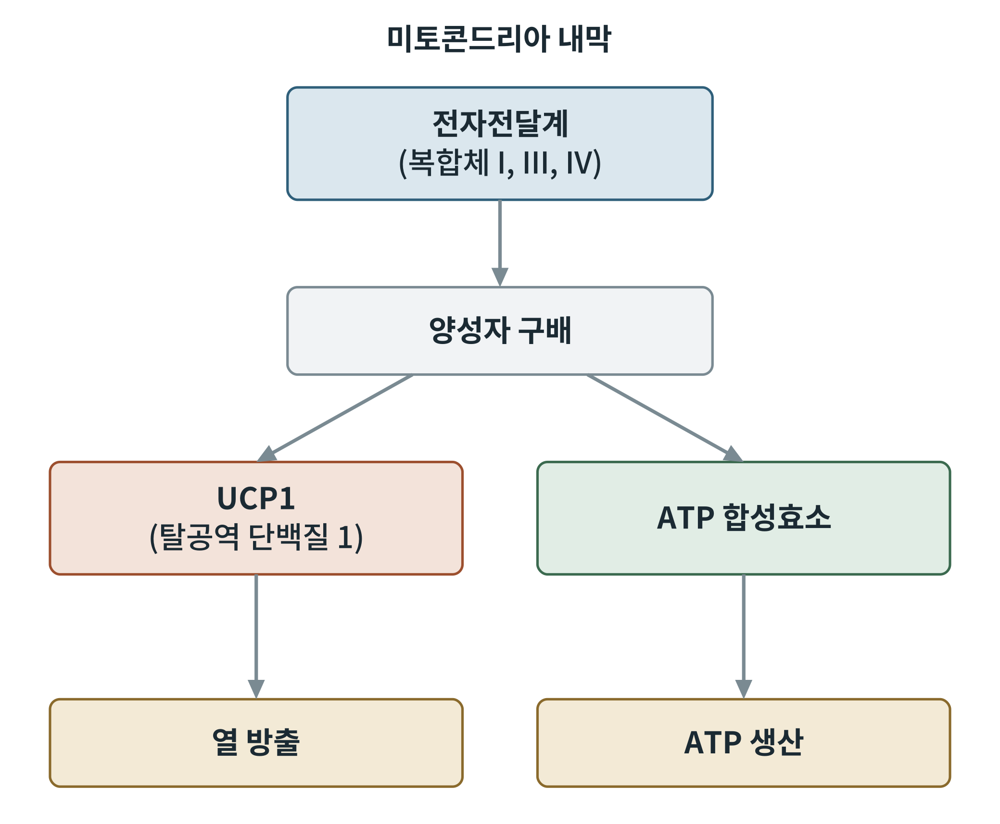

## 제12장 탈공역과 열발생

> **이 장의 출발점** 1950년대 말, 갈색지방은 동면하는 동물의 "동면샘"이라 불리며 정체를 알 수 없는 조직이었다. 이 조직의 미토콘드리아가 산소를 맹렬히 쓰면서도 ATP는 거의 만들지 않고 열만 낸다는 사실이 밝혀진 것은 1970년대이다. 데이비드 니콜스(David Nicholls)와 그 동료들은 갈색지방 미토콘드리아의 내막이 양성자를 새게 하는 통로를 가지고 있고, 퓨린 뉴클레오티드(ATP, GDP 등)가 이 통로를 막는다는 것을 보였다. 이후 이 통로 단백질이 분리되어 탈공역 단백질 1(uncoupling protein 1, UCP1)이라는 이름을 얻었다. 오랫동안 성인에게는 갈색지방이 없다고 여겨졌으나, 2009년 양전자 단층촬영 연구들이 성인의 목과 쇄골 주변에서 활성 있는 갈색지방을 확인했다. 이후 열발생은 비만 치료의 표적으로 주목받고 있다.

### 12.1 공역과 탈공역

11장에서 전자전달과 ATP 합성은 양성자 구배로 이어져 있다고 했다. 이를 공역(coupling)이라 한다. 탈공역(uncoupling)은 양성자가 ATP 합성효소를 거치지 않고 내막을 되돌아 건너는 현상으로, 구배에 저장된 에너지가 ATP 대신 열로 흩어진다. 탈공역 상태에서는 구배가 낮아지므로 전자전달이 빨라져 산소 소비가 늘지만 ATP 생산은 늘지 않는다.

**그림 12-1. 공역과 탈공역.** 전자전달계가 만든 양성자 구배는 두 경로로 소비된다. ATP 합성효소를 거치면 ATP가 만들어지고, UCP1을 거치면 열이 난다. 개념도이다.

그림 12-1은 같은 구배를 두 소비처가 나누어 쓴다는 점을 보여 준다. 따라서 UCP1이 활성화되면 세포는 같은 양의 연료를 태워도 ATP를 덜 얻고 열을 더 얻는다. 이것이 열발생을 비만과 연결짓는 이유이다.

### 12.2 양성자 누출의 두 종류

내막의 양성자 누출은 기초 누출(basal leak)과 유도 누출(inducible leak)로 나뉜다. 기초 누출은 지질 이중층 자체와 아데닌 뉴클레오티드 운반체 등을 통해 항상 일어나는 누출이다. 유도 누출은 UCP1처럼 신호에 의해 조절되는 누출이다. 기초 누출이 정상 조직에서 산소 소비의 상당 부분을 차지한다는 보고가 있으나, 비율은 조직과 조건에 따라 다르므로 수치는 확인이 필요하다(tocheck).

### 12.3 UCP1과 갈색지방

UCP1은 갈색지방세포의 미토콘드리아 내막에 많이 있는 단백질이다. 평상시에는 퓨린 뉴클레오티드가 결합해 활성을 억제한다. 추위에 노출되면 교감신경이 노르에피네프린을 분비하고, 이것이 갈색지방세포의 β3 아드레날린 수용체를 통해 지방분해를 일으킨다. 풀려난 지방산이 UCP1을 활성화하는 동시에 산화 연료가 된다. 지방산이 UCP1의 양성자 수송을 돕는다는 것이 널리 받아들여진 모형이지만 정확한 분자 기전에는 논의가 남아 있다. 이 과정으로 몸은 떨지 않고 열을 내는데, 이를 비떨림 열발생(non-shivering thermogenesis)이라 한다.

**표 12-1. 지방조직의 종류와 열발생 특성.**

| 종류 | 미토콘드리아 | UCP1 | 주된 기능 |
|---|---|---|---|
| 백색지방 | 적음 | 거의 없음 | 에너지 저장 |
| 갈색지방 | 많음 | 많음 | 열발생 |
| 베이지색지방 | 자극 시 늘어남 | 유도됨 | 저장과 열발생 사이 |

표 12-1에서 베이지색지방(beige adipose tissue, 갈색 유사지방)은 백색지방 속에 있다가 추위나 β아드레날린 자극을 받으면 UCP1을 발현하는 세포를 가리킨다. 이 현상을 백색지방의 갈색화(browning)라 부른다. 성인 사람의 열발생 지방이 전형적 갈색지방인지 베이지색인지에 대해서는 연구마다 결론이 다르다.

### 12.4 UCP1을 거치지 않는 열발생

UCP1 없이도 열을 내는 경로가 보고되어 있다. 크레아틴을 이용한 기질 순환(creatine substrate cycling)과 근소포체의 칼슘 순환(SERCA의 칼슘 펌프와 사르콜리핀)이 그 예이다. 이들은 ATP를 쓰고 되돌리는 순환으로 열을 내므로, 열발생의 개념은 UCP1 하나로 닫히지 않는다.

**표 12-2. 열발생 경로의 비교.**

| 경로 | 조직 | 열이 나는 방식 |
|---|---|---|
| UCP1 탈공역 | 갈색·베이지색지방 | 양성자 누출 |
| 크레아틴 순환 | 베이지색지방 등 | ATP 소비 순환 |
| 칼슘 순환 | 골격근 등 | ATP 소비 순환 |
| 떨림 | 골격근 | 근수축의 ATP 소비 |

표 12-2의 앞 세 행은 떨림 없이 열을 낸다. 비만 치료의 관점에서는 각 경로의 에너지 소비 기여도와 약물로 조절 가능한지가 핵심이며, 이는 38장에서 다시 다룬다.

### 12.5 약리적 탈공역의 교훈

화학적 탈공역제 2,4-다이나이트로페놀(DNP)은 1930년대에 체중 감량약으로 쓰였다. 그러나 열이 지나치게 나는 부작용으로 사망 사례가 이어져 퇴출되었다. 이 역사는 두 가지를 알려 준다. 탈공역은 실제로 에너지 소비를 늘리지만, 조직 선택성과 용량 안전역이 없는 전신 탈공역은 위험하다는 것이다. 현대의 시도는 간 미토콘드리아에 선택적으로 작용하는 약물이나 갈색지방 표적 약물처럼 선택성을 높이는 방향이다.

### 이 장의 요점

- 탈공역은 양성자가 ATP 합성효소를 거치지 않고 새어 구배의 에너지를 열로 바꾸는 것이다.
- UCP1은 갈색·베이지색지방의 조절되는 양성자 통로이며, 노르에피네프린과 지방산으로 활성화된다.
- UCP1 외에도 ATP를 쓰고 되돌리는 순환으로 열을 내는 경로가 있다.
- 전신 탈공역제(DNP)는 안전역이 좁아 퇴출되었고, 선택성이 현대 표적 설계의 핵심이다.

#### 참고문헌

Cannon, B., & Nedergaard, J. (2004). Brown adipose tissue: Function and physiological significance. *Physiological Reviews, 84*(1), 277–359. https://doi.org/10.1152/physrev.00015.2003

Nicholls, D. G., & Locke, R. M. (1984). Thermogenic mechanisms in brown fat. *Physiological Reviews, 64*(1), 1–64. https://doi.org/10.1152/physrev.1984.64.1.1

van Marken Lichtenbelt, W. D., Vanhommerig, J. W., Smulders, N. M., Drossaerts, J. M. A. F. L., Kemerink, G. J., Bouvy, N. D., Schrauwen, P., & Teule, G. J. J. (2009). Cold-activated brown adipose tissue in healthy men. *New England Journal of Medicine, 360*(15), 1500–1508. https://doi.org/10.1056/NEJMoa0808718
