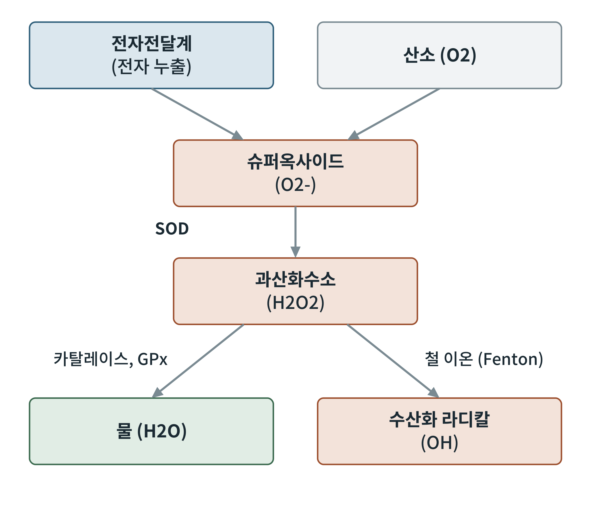

## 제13장 활성산소와 산화 스트레스

> **이 장의 출발점** 1954년 레베카 거슈먼(Rebeca Gerschman)은 산소의 독성과 방사선의 독성이 비슷하다는 점에 주목해, 산소가 생명에 해로운 이유를 산소에서 생기는 자유 라디칼에서 찾자는 가설을 제안했다. 같은 해 호흡 연구자들은 미토콘드리아에서 과산화수소가 만들어진다는 단서를 얻었다. 이 가설은 한동안 주변부 이론이었으나, 1969년 어윈 프리도비치(Irwin Fridovich)와 조 맥코드(Joe McCord)가 슈퍼옥사이드를 제거하는 효소 SOD(superoxide dismutase)를 찾아내면서 달라졌다. 세포에 슈퍼옥사이드를 없애는 전용 효소가 있다는 것은 슈퍼옥사이드가 실제로 만들어지고 있다는 뜻이기 때문이다. 미토콘드리아는 산소를 써서 에너지를 얻는 대가로 활성산소를 피할 수 없는 부산물로 만든다.

### 13.1 활성산소의 종류

활성산소종(reactive oxygen species, ROS)은 산소에서 생겨 다른 분자와 반응성이 높은 물질을 통틀어 부르는 말이다. 대표 세 가지는 슈퍼옥사이드(O2-), 과산화수소(H2O2), 수산화 라디칼(OH)이다. 슈퍼옥사이드는 산소에 전자 하나가 더해진 것으로, 전자전달계에서 새어 나온 전자가 산소와 만나 생긴다. 과산화수소는 슈퍼옥사이드가 SOD에 의해 바뀐 것이며 전하가 없어 막을 비교적 잘 통과하고 신호 물질로도 쓰인다. 수산화 라디칼은 과산화수소가 철 이온(Fe2+)과 반응하는 펜톤 반응(Fenton reaction)에서 생기며 반응성이 매우 커서 생긴 자리에서 곧바로 주변 분자를 공격한다.

**그림 13-1. 활성산소의 생성과 제거.** 전자전달계에서 새어 나온 전자가 산소와 만나 슈퍼옥사이드가 된다. SOD가 이를 과산화수소로 바꾸고, 카탈레이스와 글루타티온 과산화효소(GPx)가 과산화수소를 물로 바꾼다. 철 이온이 있으면 과산화수소는 수산화 라디칼이 될 수 있다. 개념도이며 전자 균형은 생략했다.

그림 13-1의 흐름에서 중요한 점은 갈림길이다. 과산화수소는 효소에 의해 물로 안전하게 처리될 수도, 철 이온을 만나 가장 위험한 수산화 라디칼이 될 수도 있다. 세포가 철을 단백질에 묶어 두는 것도 이 갈림길을 막으려는 방어이다.

### 13.2 미토콘드리아의 ROS 생성 지점

전자전달계에서 ROS가 만들어지는 곳은 여러 지점이며, 대표적으로 복합체 I과 복합체 III가 알려져 있다. 생성량은 전자전달계가 얼마나 환원된 상태인지에 크게 좌우된다. 연료가 넉넉해 NADH와 유비퀴놀이 많이 쌓이고 ATP 수요가 적어 구배가 높게 유지되면 전자가 새기 쉽다. 반대로 12장의 약한 탈공역으로 구배를 낮추면 ROS 생성이 줄어드는 경향이 있다. 이를 "약한 탈공역이 산화 스트레스를 덜어 준다"는 가설(mild uncoupling hypothesis)이라 하며, 비만과 노화 연구에서 자주 인용된다. 정확한 기여도는 조건에 따라 다르므로 수치는 인용하지 않는다.

### 13.3 항산화 방어계

세포의 방어는 효소계와 소분자계로 나뉜다.

**표 13-1. 세포의 항산화 방어계.**

| 구분 | 이름 | 작용 | 위치 |
|---|---|---|---|
| 효소 | SOD | 슈퍼옥사이드를 과산화수소로 | 세포질(SOD1), 미토콘드리아 기질(SOD2) |
| 효소 | 카탈레이스 | 과산화수소를 물과 산소로 | 퍼옥시좀 |
| 효소 | 글루타티온 과산화효소(GPx) | 환원 글루타티온을 쓰며 과산화물 제거 | 세포질, 미토콘드리아 |
| 효소 | 퍼옥시레독신(Prx) | 티오레독신을 쓰며 과산화수소 제거 | 세포질, 미토콘드리아 |
| 소분자 | 글루타티온(GSH) | 환원력 공급 | 세포 전반 |
| 소분자 | 비타민 E, 비타민 C | 라디칼 소거 | 막(E), 수용액(C) |

표 13-1에서 효소 방어가 GSH와 티오레독신의 환원력에 기대고 있음을 볼 수 있다. 이 환원력은 3장에서 본 NADPH가 공급한다. 따라서 NADPH를 만드는 오탄당 인산 경로와 같은 NADPH 공급 경로가 막히면 항산화 방어도 약해진다. 방어계 전체가 대사 상태와 묶여 있다는 점이 이 장의 핵심 연결고리이다.

### 13.4 산화 스트레스와 신호 기능

산화 스트레스(oxidative stress)는 ROS 생성이 방어 능력을 넘어 균형이 깨진 상태이다. ROS는 지질(지질 과산화), 단백질(시스테인 산화), DNA(염기 손상)를 손상시킨다. 그러나 ROS가 오직 해로운 물질만은 아니다. 낮은 농도의 과산화수소는 단백질의 특정 시스테인을 가역적으로 산화시켜 신호로 작동한다. 이 때문에 항산화제를 많이 먹으면 무조건 좋다는 생각은 맞지 않는다. 운동이 ROS를 일시적으로 늘리면서도 이후 방어계를 강화한다는 설명이 이런 이중성의 예로 제시되지만, 항산화 보충제가 운동 적응을 약화시킨다는 연구 결과의 크기와 일관성은 논쟁이 있다.

### 13.5 비만에서의 산화 스트레스

비만 상태에서는 지방조직과 간에서 영양 과잉으로 전자전달계가 환원된 상태가 길어지고 ROS가 늘어난다는 보고가 있다. 늘어난 ROS는 인슐린 신호를 방해해 인슐린 저항성을 악화시키는 방향으로 작용할 수 있다. 다만 산화 스트레스가 인슐린 저항성의 원인인지 결과인지는 아직 정리되지 않았다. 항산화제 임상시험이 대사 지표를 일관되게 개선하지 못한 점도 이 불확실성을 보여 준다. 신약 설계의 관점에서는 ROS를 일괄적으로 줄이는 것보다 원천(전자 누출 지점)이나 방어 경로(NRF2 등)를 선택적으로 조절하는 접근이 논의된다.

**표 13-2. ROS 조절 전략의 비교.**

| 전략 | 예 | 장점 | 한계 |
|---|---|---|---|
| 원천 감소 | 약한 탈공역, 과영양 완화 | 근본 원인에 접근 | 안전역이 좁을 수 있음 |
| 소거제 보충 | 비타민 E, C | 간단함 | 임상 효과 일관성 부족 |
| 방어 유전자 유도 | NRF2 활성화 | 내인성 방어 강화 | 장기 영향 불확실 |
| 환원력 공급 | NADPH 경로 지원 | 대사와 연결 | 표적 선택성 필요 |

표 13-2에서 보듯 정답은 하나가 아니며, 전략마다 위험이 다르다. 4부에서 다룰 AMPK와 시르투인 같은 에너지 센서가 방어 유전자와 연결되는 점을 다음 장에서 이어서 본다.

### 이 장의 요점

- 활성산소는 전자전달계에서 새어 나온 전자가 산소와 만나 생기며, 슈퍼옥사이드, 과산화수소, 수산화 라디칼 순으로 이어진다.
- 연료가 많고 ATP 수요가 적어 구배가 높으면 ROS가 늘고, 약한 탈공역은 ROS를 줄이는 경향이 있다.
- 방어는 SOD, 카탈레이스, GPx, 퍼옥시레독신과 GSH가 맡고, 환원력은 NADPH에 의존한다.
- ROS는 해로울 뿐 아니라 신호이기도 하므로 항산화제의 무차별 보충은 근거가 약하다.

#### 참고문헌

Gerschman, R., Gilbert, D. L., Nye, S. W., Dwyer, P., & Fenn, W. O. (1954). Oxygen poisoning and x-irradiation: A mechanism in common. *Science, 119*(3097), 623–626. https://doi.org/10.1126/science.119.3097.623

McCord, J. M., & Fridovich, I. (1969). Superoxide dismutase: An enzymic function for erythrocuprein (hemocuprein). *Journal of Biological Chemistry, 244*(22), 6049–6055.

Sies, H., Berndt, C., & Jones, D. P. (2017). Oxidative stress. *Annual Review of Biochemistry, 86*, 715–748. https://doi.org/10.1146/annurev-biochem-061516-045037

Murphy, M. P. (2009). How mitochondria produce reactive oxygen species. *Biochemical Journal, 417*(1), 1–13. https://doi.org/10.1042/BJ20081386
