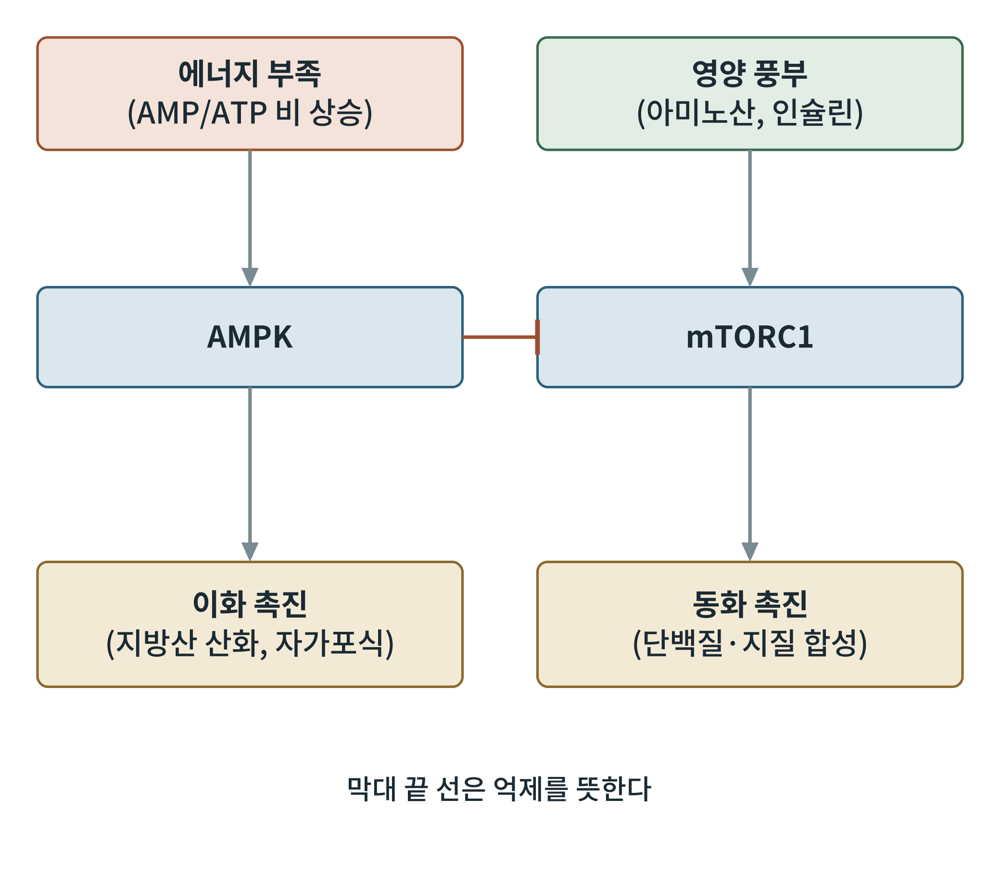

# 제4부 에너지 감지와 조절 신호

## 제14장 AMPK, mTOR, 시르투인: 세포의 에너지 센서

> **이 장의 출발점** 1973년 영국과 미국의 연구자들은 서로 독립적으로 간에서 콜레스테롤 합성과 지방산 합성의 핵심 효소를 꺼 버리는 단백질 인산화효소를 발견했다. 한쪽은 HMG-CoA 환원효소를, 다른 쪽은 아세틸-CoA 카르복실화효소를 끄는 효소를 추적하고 있었다. 오랫동안 서로 다른 효소로 여겨졌으나, 1980년대 후반에 데이비드 하디(D. Grahame Hardie) 연구진이 이 둘이 같은 효소임을 밝혔고, AMP로 활성화된다는 점에서 AMP 활성화 단백질 인산화효소(AMP-activated protein kinase, AMPK)라는 이름이 붙었다. 한편 1960년대 이스터섬(라파누이)의 토양에서 분리된 균이 만든 라파마이신이 곰팡이 증식을 막는다는 사실은, 훗날 이 약물이 막는 표적이 영양 풍부 신호를 읽는 중심 효소(mTOR)로 밝혀지면서 대사 연구의 중심이 되었다. 세포에는 에너지가 모자랄 때 쓰는 센서와 풍부할 때 쓰는 센서가 따로 있다.

### 14.1 AMPK: 에너지 부족 센서

2장에서 에너지 전하와 아데닐산 키나아제 반응(2 ADP ⇌ ATP + AMP)을 다루었다. 이 반응 덕분에 ATP가 조금만 줄어도 AMP는 비율로 크게 늘어난다. AMPK는 이 변화를 읽는다. AMPK는 α(촉매), β, γ(AMP·ADP·ATP 결합) 세 소단위로 이루어진 복합체이며, γ소단위에 AMP나 ADP가 결합하고, 상위 인산화효소 LKB1이 α소단위의 트레오닌 172번을 인산화하면 활성이 크게 오른다. 칼슘이 올라갈 때는 CaMKK2도 같은 자리를 인산화한다.

활성화된 AMPK는 에너지를 쓰는 동화 경로를 끄고 에너지를 만드는 이화 경로를 켠다. 대표 표적은 아세틸-CoA 카르복실화효소(ACC)로, 이를 인산화해 억제하면 지방산 합성이 줄고 말로닐-CoA가 감소해 7장에서 본 CPT1의 억제가 풀려 지방산 산화가 늘어난다. 또 포도당 수송체 GLUT4를 세포막으로 옮겨 근육의 포도당 흡수를 늘리고, 자가포식을 시작하는 ULK1을 인산화하며, 미토콘드리아 생합성의 마스터 조절자 PGC-1α의 활성을 높인다.

### 14.2 mTORC1: 영양 풍부 센서

mTOR(mechanistic target of rapamycin)는 인산화효소이며, 두 복합체 mTORC1과 mTORC2를 이룬다. mTORC1은 아미노산(특히 류신), 인슐린과 성장인자 신호, 충분한 에너지가 있을 때 켜져 단백질 합성, 지질 합성, 핵산 합성을 촉진하고 자가포식을 억제한다. 아미노산은 리소좀 표면의 Rag GTPase를 통해 mTORC1을 리소좀으로 모으고, 인슐린 신호는 AKT와 TSC 복합체를 거쳐 mTORC1을 활성화한다. 라파마이신은 mTORC1을 선택적으로 억제한다.

**그림 14-1. AMPK와 mTORC1의 대칭 구조.** 에너지가 부족하면(AMP/ATP 비 상승) AMPK가 켜져 이화 경로(지방산 산화, 자가포식)를 촉진한다. 영양이 풍부하면(아미노산, 인슐린) mTORC1이 켜져 동화 경로(단백질·지질 합성)를 촉진한다. AMPK는 mTORC1을 억제해 에너지가 부족할 때 합성을 줄인다. 개념도이다.

그림 14-1은 한 세포 안에 "아껴 쓰라"와 "만들어 쌓아라"를 말하는 두 신호가 서로를 견제하며 공존한다는 뜻이다. 비만은 영양이 풍부한 상태가 만성적으로 이어져 mTORC1 쪽이 계속 켜지는 상태로 볼 수 있다. 한편 mTORC1이 과활성이면 인슐린 신호의 되먹임 억제(S6K1을 통한 IRS1 억제)가 일어난다는 보고가 있어 인슐린 저항성과 이어진다.

### 14.3 시르투인: NAD+ 감지 센서

시르투인(sirtuin)은 NAD+를 보조인자로 쓰는 탈아세틸화효소이다. 효모의 수명 연구에서 출발한 이름 Sir2의 포유류 상동 단백질이며, 포유류에는 SIRT1~SIRT7이 있다. SIRT1은 핵과 세포질에, SIRT3은 미토콘드리아에 주로 있다. 3장에서 본 NAD+/NADH 비가 높을 때, 곧 공복이나 운동으로 NAD+가 늘어난 때 시르투인이 활성화된다. SIRT1은 PGC-1α를 탈아세틸화해 활성화하고, SIRT3은 미토콘드리아 단백질(지방산 산화 효소 등)을 탈아세틸화해 활성화한다. 즉 시르투인은 "NAD+가 풍부하다 = 에너지원이 연소되고 있다"는 신호를 읽어 산화 능력을 키운다.

AMPK와 시르투인은 서로를 돕는다. AMPK가 NAD+ 합성 경로(NAMPT)를 늘려 SIRT1을 활성화하고, SIRT1은 LKB1을 탈아세틸화해 AMPK를 더 켠다는 양방향 모형이 제안되어 있다.

**표 14-1. 세 가지 에너지 센서의 비교.**

| 센서 | 감지하는 신호 | 켜지는 조건 | 주된 결과 |
|---|---|---|---|
| AMPK | AMP, ADP (에너지 전하 하락) | 공복, 운동, 저산소 | 이화 촉진, 동화 억제 |
| mTORC1 | 아미노산, 인슐린, 에너지 | 식후, 영양 과잉 | 동화 촉진, 자가포식 억제 |
| 시르투인 | NAD+ | 공복, 운동 | 산화 능력 증가, 미토콘드리아 생합성 |

표 14-1에서 AMPK와 시르투인은 공복 쪽, mTORC1은 식후 쪽에 놓인다. 5부(식후)와 6부(공복)는 이 대립 구도를 조직 수준으로 옮긴 것이다.

### 14.4 약물 표적으로서의 센서

AMPK 활성화제로 메트포르민이 널리 알려져 있다. 메트포르민은 복합체 I을 약하게 억제해 AMP를 높이고 AMPK를 활성화한다고 설명되는 경우가 많으나, AMPK 비의존적 효과도 보고되어 있어 기전은 단일하지 않다. 직접 활성화제(A-769662 등)는 연구 도구로 쓰인다. mTOR 억제제 라파마이신과 그 유도체는 이식 면역억제와 일부 암에 임상 사용되지만, 만성 투여 시 고혈당과 이상지질혈증이 생기는 점이 대사 질환 적용의 한계이다. NAD+ 전구체(니코틴아미드 리보사이드 등)는 시르투인 활성을 높일 목적으로 연구되었으나 인체에서 대사 개선 효과는 일관되지 않다. 이상의 내용은 38장에서 신약 설계 관점으로 다시 다룬다.

**표 14-2. 센서 표적 약물과 한계.**

| 표적 | 대표 약물·후보 | 기대 효과 | 한계 |
|---|---|---|---|
| AMPK 활성화 | 메트포르민 | 포도당 생성 억제, 인슐린 감수성 | 기전이 단일하지 않음 |
| mTORC1 억제 | 라파마이신 | 합성 억제, 자가포식 | 고혈당, 이상지질혈증 |
| NAD+ 증가 | NAD+ 전구체 | 시르투인 활성 | 인체 효과 일관되지 않음 |

표 14-2의 한계는 센서가 한 조직에서만 일하지 않는다는 데서 온다. 같은 AMPK도 근육, 간, 시상하부에서 다른 결과를 내므로 조직 선택성이 설계의 관건이다.

### 이 장의 요점

- AMPK는 AMP/ADP로 에너지 부족을 감지해 이화를 켜고 동화를 끄며, ACC 억제로 지방산 산화를 늘린다.
- mTORC1은 아미노산과 인슐린으로 영양 풍부를 감지해 동화를 켜고 자가포식을 끈다.
- 시르투인은 NAD+를 감지해 PGC-1α와 미토콘드리아 단백질을 탈아세틸화함으로써 산화 능력을 높인다.
- 세 센서는 식후와 공복의 대사 전환을 세포 수준에서 이끄는 축이며, 약물 표적의 조직 선택성이 핵심 과제이다.

#### 참고문헌

Hardie, D. G. (2007). AMP-activated/SNF1 protein kinases: Conserved guardians of cellular energy. *Nature Reviews Molecular Cell Biology, 8*(10), 774–785. https://doi.org/10.1038/nrm2249

Herzig, S., & Shaw, R. J. (2018). AMPK: Guardian of metabolism and mitochondrial homeostasis. *Nature Reviews Molecular Cell Biology, 19*(2), 121–135. https://doi.org/10.1038/nrm.2017.95

Saxton, R. A., & Sabatini, D. M. (2017). mTOR signaling in growth, metabolism, and disease. *Cell, 168*(6), 960–976. https://doi.org/10.1016/j.cell.2017.02.004

Houtkooper, R. H., Pirinen, E., & Auwerx, J. (2012). Sirtuins as regulators of metabolism and healthspan. *Nature Reviews Molecular Cell Biology, 13*(4), 225–238. https://doi.org/10.1038/nrm3293
