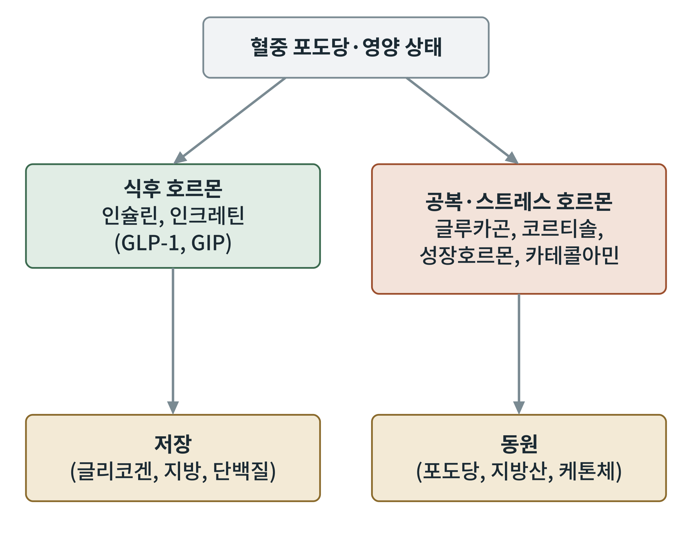

## 제15장 호르몬 신호: 인슐린, 글루카곤, 인크레틴, 코르티솔, 성장호르몬, 카테콜아민

> **이 장의 출발점** 1921년 여름 토론토 대학의 프레더릭 밴팅(Frederick Banting)과 학생 연구보조 찰스 베스트(Charles Best)는 개의 췌장에서 뽑은 추출물로 당뇨병에 걸린 개의 혈당을 떨어뜨렸다. 이듬해 1월 열네 살 소년 레너드 톰슨이 처음으로 사람에게 인슐린 주사를 맞았다. 이 추출물이 당뇨병을 치료한다는 소식은 곧 퍼졌고, 밴팅과 존 매클라우드(John Macleod)는 1923년 노벨 생리의학상을 받았다. 이후 한 세기 동안 인슐린은 대사 호르몬의 기준점이 되었다. 인슐린이 "먹었다"는 신호라면, 같은 혈액에는 "굶었다"는 신호를 보내는 호르몬들도 흐르고 있다. 이 장은 그 호르몬들을 한 지도 위에 놓는다.

### 15.1 식후와 공복의 호르몬 지도

몸은 혈중 포도당과 영양 상태를 감지해 호르몬 두 묶음을 번갈아 내보낸다. 식후에는 인슐린과 인크레틴이 우세해 영양을 저장하는 쪽으로 대사를 돌리고, 공복이나 스트레스 상황에서는 글루카곤, 코르티솔, 성장호르몬, 카테콜아민이 우세해 저장분을 동원하는 쪽으로 돌린다. 1권 4장의 장 호르몬 지도가 먹이를 먹는 시점의 신호를 다루었다면, 이 장은 그 신호가 전신 대사로 이어지는 단계를 다룬다.

**그림 15-1. 식후와 공복 호르몬의 두 묶음.** 혈중 포도당과 영양 상태에 따라 식후 호르몬(인슐린, 인크레틴)은 저장을, 공복·스트레스 호르몬(글루카곤, 코르티솔, 성장호르몬, 카테콜아민)은 동원을 이끈다. 개념도이다.

그림 15-1은 호르몬을 기능별로 두 묶음으로 나눈 것이지 서로 완전히 배타적이라는 뜻은 아니다. 예를 들어 성장호르몬은 지방 분해를 촉진하는 동시에 간에서 IGF-1 합성을 늘려 단백질 동화를 돕는다.

### 15.2 인슐린

인슐린은 췌장 β세포가 분비하는 51개 아미노산의 호르몬이다. 혈중 포도당이 올라가면 β세포 안에서 포도당 대사로 ATP가 늘고, ATP 민감성 칼륨 통로가 닫혀 세포막이 탈분극되며, 전압 의존성 칼슘 통로가 열려 칼슘이 들어와 인슐린 소포가 분비된다. 이 경로는 5장의 해당과 2장의 ATP가 호르몬 분비로 이어지는 예이다.

표적 조직에서 인슐린은 수용체 티로신 인산화효소를 활성화하고 IRS, PI3K, AKT 경로를 거쳐 다음을 일으킨다. 근육과 지방조직에서는 GLUT4를 세포막으로 옮겨 포도당 흡수를 늘리고, 간과 근육에서는 글리코겐 합성효소를 활성화한다. 간에서는 포도당 신생을 억제하고 지방산 합성을 촉진하며, 지방조직에서는 호르몬 민감성 리파아제를 억제해 지방 분해를 막는다. 인슐린 저항성은 이 경로의 신호 전달이 약해져 같은 양의 인슐린으로 효과를 내지 못하는 상태이다.

### 15.3 글루카곤

글루카곤은 췌장 α세포가 분비하는 29개 아미노산의 호르몬으로, 혈당이 낮아질 때 분비된다. 간 세포의 G단백질 연결 수용체에 결합해 cAMP를 올리고 PKA를 활성화한다. 그 결과 글리코겐 분해가 늘고, 포도당 신생이 켜지며, 지방산 산화와 케톤체 생성이 촉진된다. 글루카곤은 인슐린의 반대편 호르몬으로 여겨지지만, 최근에는 글루카곤이 아미노산 대사와 간 지방 대사에도 작용해 에너지 소비를 늘린다는 점이 비만 신약 설계(삼중 작용제)의 근거가 된다.

### 15.4 인크레틴

인크레틴(incretin)은 음식이 장에 닿으면 장 내분비세포가 분비해 식후 인슐린 분비를 늘리는 호르몬이다. 대표는 GLP-1(glucagon-like peptide-1)과 GIP(glucose-dependent insulinotropic polypeptide)이다. 같은 양의 포도당을 정맥으로 주는 것보다 먹을 때 인슐린이 더 많이 나오는 현상을 인크레틴 효과라 한다. GLP-1은 포도당 의존적으로 인슐린 분비를 늘리고 글루카곤 분비를 줄이며, 위 배출을 늦추고, 시상하부에서 식욕을 낮춘다. 혈중에서 DPP-4 효소에 의해 빠르게 분해되므로, 약물로는 분해에 저항하게 개조한 작용제(1권 13~15장)나 DPP-4 억제제가 쓰인다. 인크레틴을 표적으로 한 약물의 식후 효과는 17~19장에서 자세히 다룬다.

### 15.5 코르티솔, 성장호르몬, 카테콜아민

코르티솔은 부신 피질이 분비하는 스테로이드 호르몬으로, 시상하부-뇌하수체-부신(HPA) 축의 조절을 받는다. 공복과 스트레스에서 올라 간의 포도당 신생을 촉진하고, 근육 단백질 분해로 아미노산을 공급하며, 지방조직의 지방 분해에 관여한다. 만성적으로 높으면 복부 지방 축적과 인슐린 저항성이 나타나는데, 쿠싱 증후군이 극단적인 예이다. 성장호르몬은 뇌하수체 전엽이 분비하며, 공복과 수면 중에 분비가 늘어 지방 분해를 촉진하고, 간에서 IGF-1을 만들어 성장과 단백질 동화를 이끈다. 카테콜아민(에피네프린, 노르에피네프린)은 부신 수질과 교감신경이 내보내며, β아드레날린 수용체를 통해 간 글리코겐 분해와 지방조직 지방 분해를 일으키고 12장의 갈색지방 열발생도 켠다.

**표 15-1. 주요 대사 호르몬의 분비 조건, 수용체, 작용.**

| 호르몬 | 분비 기관 | 주된 분비 조건 | 대표 작용 |
|---|---|---|---|
| 인슐린 | 췌장 β세포 | 식후 고혈당 | 포도당 흡수, 글리코겐·지방 합성, 지방 분해 억제 |
| 글루카곤 | 췌장 α세포 | 저혈당, 공복 | 글리코겐 분해, 포도당 신생, 케톤체 생성 |
| GLP-1 | 장 L세포 | 식사 | 인슐린 분비 촉진, 글루카곤 억제, 포만 |
| GIP | 장 K세포 | 식사 | 인슐린 분비 촉진 |
| 코르티솔 | 부신 피질 | 스트레스, 공복 | 포도당 신생, 단백질 분해 |
| 성장호르몬 | 뇌하수체 | 공복, 수면, 운동 | 지방 분해, IGF-1 생성 |
| 카테콜아민 | 부신 수질, 교감신경 | 스트레스, 운동, 추위 | 글리코겐 분해, 지방 분해, 열발생 |

표 15-1을 가로로 읽으면 인슐린만이 저장 쪽이고 나머지가 동원 쪽이라는 비대칭이 보인다. 한 가지 저장 신호가 여러 동원 신호를 상대하는 구조이므로, 인슐린 신호가 약해지면 균형이 쉽게 동원 쪽으로 기운다.

### 15.6 호르몬의 시간 규모와 수용체 유형

호르몬 신호는 속도로도 구분된다. 카테콜아민은 수 초에서 수 분 안에 작용하고, 인슐린과 글루카곤은 분 단위, 코르티솔과 성장호르몬은 수 시간에 걸친 작용으로 유전자 발현을 바꾼다. 수용체 유형도 다르다. 인슐린 수용체는 티로신 인산화효소이고, 글루카곤, GLP-1, 카테콜아민은 G단백질 연결 수용체이며, 코르티솔은 세포 안 핵수용체이다. 이 차이는 신약 설계에서 표적 유형 선택(펩타이드 작용제인지, 저분자인지)과 직결된다.

**표 15-2. 호르몬 수용체의 유형과 약물 설계 함의.**

| 수용체 유형 | 예 | 신호 시간 | 약물 설계 함의 |
|---|---|---|---|
| 수용체 티로신 인산화효소 | 인슐린, IGF-1 | 분~시간 | 단백질·펩타이드 제제가 주류 |
| G단백질 연결 수용체 | 글루카곤, GLP-1, 아드레날린 | 초~분 | 펩타이드 및 저분자 모두 가능 |
| 핵수용체 | 코르티솔 | 시간 | 저분자 지용성 약물 |

표 15-2에서 비만 신약의 주 표적이 G단백질 연결 수용체(GLP-1, GIP, 글루카곤 수용체)에 몰려 있는 이유가 드러난다. 펩타이드 작용제로도 저분자로도 접근할 수 있고, 신호가 빠르며 조직 특이성이 높기 때문이다.

### 이 장의 요점

- 인슐린과 인크레틴은 식후 저장 신호이고, 글루카곤, 코르티솔, 성장호르몬, 카테콜아민은 공복·스트레스 동원 신호이다.
- 인슐린 분비는 포도당 대사로 늘어난 ATP가 칼륨 통로를 닫는 경로로 이어지며, 표적 조직에서 PI3K-AKT 경로를 통해 작용한다.
- 글루카곤은 간에서 cAMP를 통해 글리코겐 분해, 포도당 신생, 케톤체 생성을 촉진하며 에너지 소비 증가 가능성이 신약 근거가 된다.
- GLP-1은 인슐린 분비 촉진, 글루카곤 억제, 위 배출 지연, 식욕 감소의 네 가지 효과를 가진다.
- 비만 신약의 주 표적은 G단백질 연결 수용체이다.

#### 참고문헌

Banting, F. G., Best, C. H., Collip, J. B., Campbell, W. R., & Fletcher, A. A. (1922). Pancreatic extracts in the treatment of diabetes mellitus. *Canadian Medical Association Journal, 12*(3), 141–146.

Drucker, D. J. (2018). Mechanisms of action and therapeutic application of glucagon-like peptide-1. *Cell Metabolism, 27*(4), 740–756. https://doi.org/10.1016/j.cmet.2018.03.001

Petersen, M. C., & Shulman, G. I. (2018). Mechanisms of insulin action and insulin resistance. *Physiological Reviews, 98*(4), 2133–2223. https://doi.org/10.1152/physrev.00063.2017

Müller, T. D., Finan, B., Clemmensen, C., DiMarchi, R. D., & Tschöp, M. H. (2017). The new biology and pharmacology of glucagon. *Physiological Reviews, 97*(2), 721–766. https://doi.org/10.1152/physrev.00025.2016
