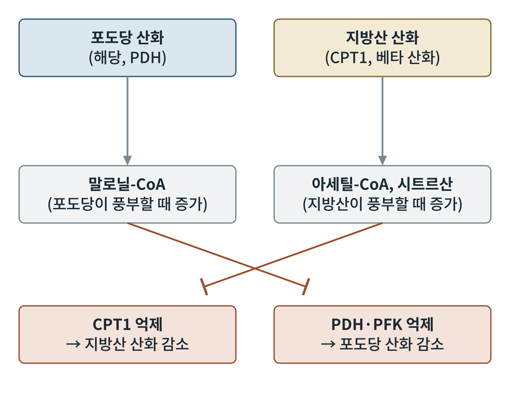

## 제16장 포도당-지방산 회로와 대사 유연성

> **이 장의 출발점** 1963년 영국 케임브리지의 필립 랜들(Philip Randle)과 동료들은 쥐의 심장과 횡격막 근육에 지방산이나 케톤체를 주면 포도당 산화가 줄어든다는 실험 결과를 《랜싯》에 실었다. 그때까지 당뇨병의 인슐린 부족은 포도당 이용 장애로만 설명되었는데, 이 논문은 연료끼리 서로를 밀어내는 경쟁이 몸 안에 있다고 보았다. 연구진은 이 현상을 포도당-지방산 회로(glucose-fatty acid cycle)라 불렀고, 훗날 랜들 회로(Randle cycle)로 널리 알려졌다. 이 회로는 비만과 제2형 당뇨병에서 인슐린 저항성이 왜 생기는지를 설명하는 오랜 가설의 출발점이 되었다. 그러나 이 회로의 방향과 강도는 이후 수십 년 동안 수정을 거듭해 왔다.

### 16.1 연료 경쟁의 원리

랜들 회로의 핵심은 지방산 산화가 늘면 포도당 산화가 줄고, 포도당 이용이 늘면 지방산 산화가 줄어드는 양방향 억제이다. 지방산이 풍부하면 β산화로 아세틸-CoA와 NADH가 늘고, 이는 5장과 6장에서 본 피루브산 탈수소효소(PDH)를 억제한다. 시트르산이 늘면 해당의 조절 효소 PFK1이 억제되고, 이로 인해 포도당-6-인산이 쌓여 헥소키나아제가 억제되는 연쇄가 설명되었다. 반대로 포도당이 풍부하면 간과 근육에서 ACC가 활성화되어 말로닐-CoA가 늘고, 말로닐-CoA는 7장에서 본 CPT1을 억제해 지방산이 미토콘드리아로 들어가는 것을 막는다.

**그림 16-1. 포도당과 지방산 산화의 상호 억제.** 포도당 산화가 활발하면 말로닐-CoA가 늘어 CPT1을 억제하고, 지방산 산화가 활발하면 아세틸-CoA와 시트르산이 늘어 PDH와 PFK를 억제한다. 선이 교차하는 것은 서로가 상대를 억제하기 때문이다. 개념도이다.

그림 16-1의 두 억제 경로는 서로 다른 조절점이므로, 한쪽이 켜지면 다른 쪽이 꺼지는 스위치처럼 작동한다. 이 스위치 덕분에 건강한 사람의 몸은 식후에는 포도당, 공복에는 지방산을 주연료로 선택한다.

### 16.2 대사 유연성

대사 유연성(metabolic flexibility)은 연료의 가용성에 따라 포도당 산화와 지방산 산화 사이를 신속하게 전환하는 능력이다. 공복에서 식후로 넘어갈 때는 지방산 산화에서 포도당 산화로, 식후에서 공복으로 가거나 운동을 시작할 때는 그 반대로 바뀐다. 이 전환은 호흡 교환율(RER, 이산화탄소 배출량을 산소 소비량으로 나눈 값)로 추정한다. 순수하게 탄수화물만 산화하면 RER은 1.0에 가깝고, 순수하게 지방만 산화하면 약 0.7이다. 이는 각 연료의 산화 화학량론에서 나오는 값이다. 건강한 사람은 공복에서 낮은 RER, 인슐린 자극이나 식후에서 높은 RER을 보여 전환 폭이 크다.

**표 16-1. 연료 선택과 호흡 교환율.**

| 상태 | 주 연료 | RER 방향 | 지배 신호 |
|---|---|---|---|
| 공복 | 지방산(케톤체 포함) | 낮음 (0.7에 가까움) | 낮은 인슐린, 높은 글루카곤 |
| 식후 | 포도당 | 높음 (1.0에 가까움) | 높은 인슐린 |
| 운동(저강도) | 지방산 | 낮음 | 카테콜아민, AMPK |
| 운동(고강도) | 포도당·글리코겐 | 높음 | 카테콜아민 |

표 16-1에서 RER은 연료 비율을 알려 주는 지표이지만, 단백질 산화와 지방 합성이 섞이면 해석이 달라진다는 한계가 있다.

### 16.3 대사 유연성의 소실

2000년대 초 연구자들은 비만과 제2형 당뇨병 환자에서 이 전환 능력이 떨어진다는 점을 보고했다. 대표적인 연구에서 인슐린 저항성 환자는 공복에서 지방산 산화가 충분히 높아지지 않고, 인슐린 자극에서 포도당 산화로 충분히 전환하지 못했다. 이를 대사 유연성 소실(metabolic inflexibility)이라 한다. 원인으로는 근육의 미토콘드리아 기능 저하, 지방산의 불완전 산화에서 쌓이는 중간 대사물, 지질 축적(디아실글리세롤, 세라마이드)에 의한 인슐린 신호 방해가 제안되었다. 다만 이 연구들은 대부분 소규모 관찰이며, 원인과 결과의 선후 관계는 확정되지 않았다.

**표 16-2. 대사 유연성 소실의 가설 비교.**

| 가설 | 핵심 주장 | 근거 | 한계 |
|---|---|---|---|
| 랜들 회로 | 지방산이 포도당 산화를 억제 | 초기 동물·조직 실험 | 사람 근육에서 방향 논쟁 |
| 지질 축적 | 디아실글리세롤·세라마이드가 인슐린 신호 방해 | 근육 생검 연구 | 운동선수 역설 |
| 미토콘드리아 기능 저하 | 산화 능력 부족으로 연료 전환 실패 | 일부 영상·생검 연구 | 원인인지 결과인지 불명 |
| 과영양 가설 | 지나친 에너지 공급이 전자전달계를 환원시킴 | 13장 활성산소와 연결 | 직접 검증 어려움 |

표 16-2는 하나의 가설이 모든 현상을 설명하지 못함을 보여 준다. 특히 지구력 운동선수의 근육에는 지질이 많이 쌓여 있어도 인슐린 감수성이 높다는 "운동선수 역설"이 있어, 지질의 양보다 종류와 위치, 미토콘드리아의 처리 능력이 중요하다는 해석이 나왔다.

### 16.4 신약 설계의 시사점

연료 전환 스위치는 약물이 개입하기 좋은 곳이다. ACC 억제제는 말로닐-CoA를 낮춰 지방산 산화를 늘리려는 시도이고, PDH 키나아제 억제제는 PDH를 풀어 포도당 산화를 키우려는 시도이다. 두 접근 모두 어느 연료를 더 태우게 할지 정하는 일이므로, 대사 유연성을 회복시키는 방향인지, 한쪽 연료로 고정시키는 방향인지에 따라 결과가 달라진다. 비만 약물이 체중 감량 과정에서 연료 선택을 어떻게 바꾸는지는 26장과 27장에서, 약물 표적의 설계 원칙은 38장에서 이어서 다룬다.

### 이 장의 요점

- 포도당-지방산 회로는 지방산 산화가 PDH·PFK를, 포도당 산화(말로닐-CoA)가 CPT1을 억제하는 양방향 연료 경쟁이다.
- 대사 유연성은 식후의 포도당 산화와 공복의 지방산 산화 사이를 신속히 전환하는 능력이며, 호흡 교환율로 추정한다.
- 비만과 제2형 당뇨병에서 이 능력이 떨어진다는 보고가 있으나 원인과 결과의 순서는 확정되지 않았다.
- 연료 선택 스위치(ACC, PDH 키나아제 등)는 약물 표적이 될 수 있으나 방향 설계가 중요하다.

#### 참고문헌

Randle, P. J., Garland, P. B., Hales, C. N., & Newsholme, E. A. (1963). The glucose fatty-acid cycle: Its role in insulin sensitivity and the metabolic disturbances of diabetes mellitus. *The Lancet, 281*(7285), 785–789. https://doi.org/10.1016/S0140-6736(63)91500-9

Kelley, D. E., & Mandarino, L. J. (2000). Fuel selection in human skeletal muscle in insulin resistance: A reexamination. *Diabetes, 49*(5), 677–683. https://doi.org/10.2337/diabetes.49.5.677

Hue, L., & Taegtmeyer, H. (2009). The Randle cycle revisited: A new head for an old hat. *American Journal of Physiology-Endocrinology and Metabolism, 297*(3), E578–E591. https://doi.org/10.1152/ajpendo.00093.2009

Goodpaster, B. H., & Sparks, L. M. (2017). Metabolic flexibility in health and disease. *Cell Metabolism, 25*(5), 1027–1036. https://doi.org/10.1016/j.cmet.2017.04.015
