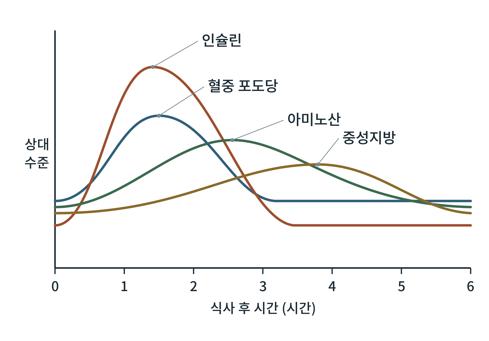

# 제5부 식후 대사 에너지

## 제17장 식후의 시간표

> **이 장의 출발점** 1822년 6월 미국 미시간 주의 모피 교역소에서 총기 사고로 스물몇 살의 캐나다인 알렉시스 생 마르탱(Alexis St. Martin)이 왼쪽 가슴과 복부에 큰 상처를 입었다. 군의관 윌리엄 보먼트(William Beaumont)가 목숨을 건졌지만, 상처는 위벽과 이어진 채 아물어 위 안을 들여다볼 수 있는 작은 구멍(누공)이 남았다. 보먼트는 이 구멍으로 음식 조각을 넣고 꺼내며 위 안에서 음식이 어떻게 변하는지 수백 차례 관찰했고, 1833년에 그 기록을 책으로 냈다. 사람의 몸속에서 한 끼가 어떻게 처리되는지를 시간 순서로 본 최초의 체계적 관찰이었다. 이 장은 같은 질문을 혈액의 관점에서 다시 묻는다. 한 끼를 먹으면 포도당, 인슐린, 아미노산, 중성지방은 시간에 따라 어떤 순서로 오르고 내리는가.

### 17.1 식후의 네 단계

한 끼를 먹은 뒤 몸은 대체로 네 단계를 거친다. 먼저 입과 위에서 음식이 부서지고 섞이는 단계, 다음으로 위 배출을 거쳐 소장에서 영양소가 분해되고 흡수되는 단계, 다음으로 흡수된 영양소가 혈액으로 들어가 조직에 분배되는 단계, 마지막으로 혈중 수준이 다시 공복 수준으로 돌아가는 단계이다. 이 장에서는 세 영양소의 흡수 경로와 혈중 곡선의 순서에 초점을 둔다.

### 17.2 위 배출: 흡수 속도를 정하는 문

음식이 소장으로 넘어가는 속도는 위 배출(gastric emptying)이 정한다. 위는 음식을 소량씩 십이지장으로 내보내고, 십이지장에 도달한 지방, 산, 삼투압 신호가 위 배출을 늦춘다. 액체는 고체보다 빠르게 빠져나가고, 지방이 많은 식사는 늦게 빠져나간다. 이 지연이 식후 혈중 곡선이 낮고 길게 퍼지도록 만든다. 19장에서 볼 GLP-1이 위 배출을 늦추는 것은 이 생리를 약물로 강화한 것이다.

### 17.3 세 영양소의 흡수 경로

**탄수화물**은 입의 침 아밀레이스와 소장의 췌장 아밀레이스, 소장 점막의 이당류 분해효소로 단당류로 분해된다. 포도당과 갈락토스는 나트륨 의존성 수송체(SGLT1)로, 과당은 GLUT5로 장세포에 들어가고, GLUT2를 통해 문맥(간문맥)으로 나간다. 그래서 흡수된 포도당은 먼저 간을 거친다.

**단백질**은 위의 펩신과 췌장의 단백질 분해효소로 펩타이드와 아미노산이 되고, 장세포에서 흡수되어 대부분 문맥을 통해 간으로 간다. 일부 분지사슬 아미노산(류신, 이소류신, 발린)은 간에서 거의 분해되지 않고 근육 등 말초 조직으로 간다.

**지방**은 담즙산이 유화하고 췌장 리파아제가 분해해 지방산과 모노아실글리세롤이 되어 장세포로 들어간다. 장세포 안에서 중성지방으로 재합성되어 카일로미크론(chylomicron)이라는 지단백질에 실려 림프관을 거쳐 흉관으로 혈액에 합류한다. 따라서 식이 지방은 간문맥이 아니라 림프를 통해 전신에 먼저 퍼진다.

**표 17-1. 영양소별 흡수 경로와 혈중 반응의 특징.**

| 영양소 | 장 흡수 형태 | 혈액으로 가는 길 | 식후 혈중 반응의 특징 |
|---|---|---|---|
| 탄수화물 | 단당류 (포도당, 과당, 갈락토스) | 문맥 → 간 | 빠르게 오르고 인슐린이 곡선을 이끔 |
| 단백질 | 아미노산, 짧은 펩타이드 | 문맥 → 간 | 완만히 오르고 인슐린·글루카곤 둘 다 자극 |
| 지방 | 지방산, 모노아실글리세롤 → 카일로미크론 | 림프 → 흉관 → 혈액 | 늦게 오르고 길게 지속 |

표 17-1에서 포도당과 아미노산은 간이 먼저 걸러 내고 지방은 간을 건너뛰어 전신으로 간다는 차이를 읽을 수 있다. 이 차이가 다음 장에서 볼 영양소별 저장 장소의 차이로 이어진다.

### 17.4 식후 혈중 곡선의 순서

**그림 17-1. 식후 혈중 수준의 시간 변화(개념도).** 한 끼를 먹은 뒤 혈중 포도당과 인슐린이 먼저 오르고, 아미노산이 뒤따르며, 중성지방이 가장 늦게 정점에 이른다. 세로축은 각 곡선의 공복값 대비 상대 수준이며 실제 수치가 아니다. 정점 시각은 식사의 구성과 개인에 따라 달라지므로 순서를 보이기 위한 모식이다.

그림 17-1에서 중요한 것은 정점의 높이가 아니라 순서이다. 포도당은 위 배출과 흡수가 빠른 만큼 일찍 오르고, 이를 감지한 인슐린이 곧바로 뒤따라 포도당을 낮춘다. 아미노산은 소화와 흡수에 시간이 더 걸려 늦게 정점에 이르고, 지방은 카일로미크론 형성과 림프 이동 때문에 가장 늦게 오른다. 포도당이 공복 수준으로 돌아온 뒤에도 중성지방은 오랫동안 높게 남을 수 있어, 한 끼의 영향이 혈액에서 끝나는 시각은 영양소마다 다르다.

### 17.5 식사 구성에 따른 차이

식사의 구성은 곡선의 모양을 바꾼다. 탄수화물이 많으면 포도당과 인슐린 정점이 높고 빠르다. 같은 탄수화물이라도 식이섬유가 많거나 지방과 단백질이 함께 있으면 위 배출과 흡수가 늦어져 곡선이 낮고 넓어진다. 단백질은 인슐린과 글루카곤을 함께 자극하므로 혈당을 크게 올리지 않으면서 인슐린을 올린다. 지방은 혈당 곡선보다는 중성지방 곡선을 늦게 키운다. 정확한 시간과 크기는 식사의 양, 형태, 개인의 인슐린 반응에 따라 크게 다르므로 이 책은 일반적 방향만 제시한다.

**표 17-2. 식사 구성이 식후 곡선에 주는 영향의 방향.**

| 식사 요소 | 위 배출 | 혈당 곡선 | 인슐린 곡선 | 중성지방 곡선 |
|---|---|---|---|---|
| 탄수화물 위주 | 비교적 빠름 | 빠르고 높게 | 빠르고 높게 | 영향 작음 |
| 식이섬유 추가 | 늦어짐 | 낮고 넓게 | 낮고 넓게 | 영향 작음 |
| 단백질 추가 | 늦어짐 | 낮아질 수 있음 | 오히려 높아질 수 있음 | 영향 작음 |
| 지방 추가 | 늦어짐 | 낮고 넓게 | 지연될 수 있음 | 늦고 길게 상승 |

표 17-2는 방향을 나타낸 것이며, 여러 요소가 섞이면 효과가 단순히 더해지지 않는다. 비만 약물이 위 배출과 식욕을 바꾸면 이 표의 모든 행이 함께 움직이므로, 약물 임상시험에서 식후 곡선을 해석할 때는 식사 구성을 고정해야 한다는 점이 핵심이다.

### 17.6 곡선이 말해 주는 것: 식후 대사의 지표

식후 곡선은 임상에서 지표로 쓰인다. 식후 혈당과 인슐린 곡선은 인슐린 분비와 감수성을, 식후 중성지방 곡선은 지방 처리 능력(카일로미크론과 VLDL 제거)을 반영한다. 식후 중성지방이 오래 높게 남는 현상은 심혈관 질환 위험과 연관된 것으로 보고되어 있으며, 비만과 인슐린 저항성에서 흔히 관찰된다. 이 지표들을 정량적으로 읽는 방법은 9부의 모델링 장에서 다룬다.

### 이 장의 요점

- 식후 혈중 포도당과 인슐린이 가장 먼저 오르고, 아미노산이 뒤따르며, 중성지방이 가장 늦게 정점에 이른다.
- 위 배출이 흡수 속도의 문이며, 지방과 식이섬유는 이를 늦춘다.
- 포도당과 아미노산은 문맥을 거쳐 간으로, 식이 지방은 카일로미크론으로 림프를 거쳐 전신으로 간다.
- 식사 구성이 곡선의 높이와 폭을 바꾸므로 약물 효과를 읽을 때 식사 조건을 고정해야 한다.

#### 참고문헌

Beaumont, W. (1833). *Experiments and observations on the gastric juice, and the physiology of digestion*. F. P. Allen.

Hall, J. E., & Hall, M. E. (2021). *Guyton and Hall textbook of medical physiology* (14th ed.). Elsevier.

Nelson, D. L., & Cox, M. M. (2021). *Lehninger principles of biochemistry* (8th ed.). W. H. Freeman.

Nordestgaard, B. G. (2017). A test in context: Lipid profile, fasting versus nonfasting. *Journal of the American College of Cardiology, 70*(13), 1637–1646. https://doi.org/10.1016/j.jacc.2017.08.006
