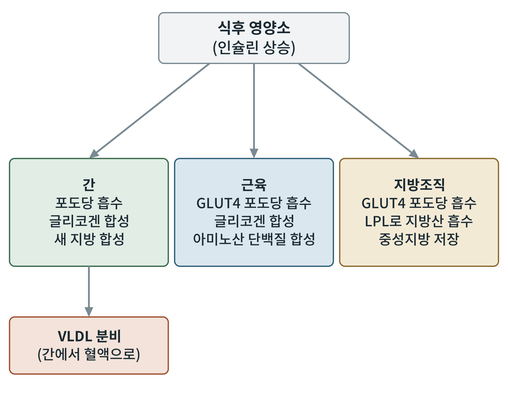

## 제18장 식후의 저장: 간, 근육, 지방조직

> **이 장의 출발점** 1850년대 파리에서 클로드 베르나르(Claude Bernard)는 개의 간을 씻어 내고도 간 조직에서 포도당이 계속 나온다는 사실에 놀랐다. 혈액을 완전히 씻어 낸 간이 당을 만들고 있다면, 간 자체에 당의 원료가 쌓여 있다는 뜻이었다. 그는 1857년 이 물질을 분리해 글리코겐(glycogène)이라 이름 붙이고, 간이 혈당을 일정하게 유지하는 저장 창고라는 개념, 곧 "내부 환경의 항상성"의 한 축을 제안했다. 이 장은 한 끼로 들어온 영양소가 간, 근육, 지방조직 세 창고에 어떻게 나뉘어 쌓이는지를 따라간다.

### 18.1 세 창고의 분업

식후에 오른 인슐린은 세 조직에 서로 다른 저장 명령을 내린다. 간은 문맥으로 오는 포도당을 먼저 받아 글리코겐으로 저장하고, 남는 것은 지방산으로 바꿔 중성지방으로 포장한다. 근육은 혈액의 포도당을 GLUT4로 받아 글리코겐으로 저장하고 아미노산으로 단백질을 합성한다. 지방조직은 포도당을 받아 글리세롤 뼈대를 만들고, 혈액의 중성지방에서 지방산을 받아 다시 중성지방으로 저장한다.

**그림 18-1. 식후 저장의 분업.** 식후 영양소와 인슐린 상승이 간, 근육, 지방조직에 서로 다른 저장 명령을 내린다. 간은 글리코겐 합성과 새 지방 합성을 하고 VLDL을 혈액으로 내보낸다. 근육은 GLUT4로 포도당을 받아 글리코겐과 단백질을 만든다. 지방조직은 GLUT4와 지단백질 지방분해효소(LPL)로 영양소를 받아 중성지방으로 저장한다. 개념도이다.

그림 18-1에서 간만 저장고이자 공급자라는 점이 눈에 띈다. 간은 글리코겐과 지방을 모두 저장하지만 VLDL을 통해 혈액으로 지방을 내보내기도 한다. 이 이중 역할이 간의 지방 축적이 곧 전신 대사 이상으로 이어지는 이유이다.

### 18.2 간: 글리코겐과 새 지방 합성

간으로 들어온 포도당은 글루코키나아제(헥소키나아제 IV)가 인산화한다. 이 효소는 높은 포도당 농도에서 작동하고 포도당-6-인산으로 억제되지 않아, 식후의 포도당 유입이 클수록 처리량이 비례해 늘어난다. 인슐린은 글리코겐 합성효소를 활성화하고 글리코겐 포스포릴레이스를 억제해 글리코겐 저장을 늘린다.

간의 글리코겐 저장이 가득 차면 남는 탄수화물은 새 지방 합성(de novo lipogenesis, DNL)으로 간다. 포도당이 해당과 PDH를 거쳐 아세틸-CoA가 되고, 시트르산 수송으로 세포질에 나온 뒤 ACC와 지방산 합성효소(FAS)가 지방산을 만든다. 이 경로는 인슐린이 SREBP-1c를, 포도당이 ChREBP를 켜서 효소 유전자 발현을 높인다. 사람에서 정상 식사 때 DNL의 기여는 비교적 작고, 탄수화물 과잉 섭취나 간 지방증, 인슐린 저항성에서 커진다는 보고가 있다. 합성된 중성지방은 VLDL로 포장되어 혈액으로 나간다.

### 18.3 근육: 포도당과 아미노산

근육은 식후에 가장 큰 포도당 소비처이다. 인슐린이 수용체를 켜면 PI3K-AKT 경로를 거쳐 GLUT4 소포가 세포막으로 옮겨져 포도당 유입이 급격히 늘고, 유입된 포도당은 글리코겐 합성효소로 저장된다. 근육 글리코겐은 근육 자체의 연료이며 포도당-6-포스파타아제가 없어 혈당으로 내보낼 수 없다. 근육은 또 식후 아미노산 증가와 인슐린, mTORC1 활성화로 단백질 합성을 늘린다. 단백질 합성의 자극은 식후에 높아지고 공복에 분해가 우세해지는 순환을 이룬다.

### 18.4 지방조직: 카일로미크론, VLDL, LPL

혈액 속 중성지방은 그 자체로 조직에 들어갈 수 없다. 모세혈관 내피에 붙은 지단백질 지방분해효소(lipoprotein lipase, LPL)가 카일로미크론과 VLDL의 중성지방을 지방산과 글리세롤로 분해하고, 지방산이 지방세포로 들어간다. 지방세포 안에서는 포도당에서 만든 글리세롤-3-인산과 지방산이 결합해 중성지방으로 재합성되어 하나의 큰 지질 방울로 쌓인다. 인슐린은 지방조직의 LPL 활성을 높이는 동시에 호르몬 민감성 리파아제를 억제해 저장은 키우고 분해는 막는다. 이 일을 마친 카일로미크론 잔여물은 간이 받아들인다.

**표 18-1. 세 저장 조직의 식후 역할.**

| 조직 | 주된 수송체·효소 | 주된 저장 형태 | 인슐린 효과 |
|---|---|---|---|
| 간 | GLUT2, 글루코키나아제, 글리코겐 합성효소, ACC, FAS | 글리코겐, 중성지방(VLDL로 수출) | 글리코겐·지방 합성 촉진, 포도당 신생 억제 |
| 근육 | GLUT4, 글리코겐 합성효소 | 글리코겐, 단백질 | 포도당 흡수·글리코겐 합성 촉진, 단백질 합성 촉진 |
| 지방조직 | GLUT4, LPL | 중성지방 | 포도당·지방산 흡수 촉진, 지방 분해 억제 |

표 18-1은 인슐린이라는 하나의 신호가 세 조직에서 서로 다른 효소 세트를 켠다는 점을 정리한 것이다. 이는 인슐린 저항성이 한 조직에서 시작되어도 증상이 조직마다 다르게 나타나는 이유이기도 하다.

### 18.5 저장 형태의 에너지 효율

저장 형태에 따라 에너지 효율이 크게 다르다. 글리코겐은 친수성이어서 물과 함께 저장되므로 무게당 에너지가 낮고, 중성지방은 소수성이어서 물 없이 저장되므로 무게당 에너지가 높다. 1장에서 본 에너지 밀도의 차이가 그대로 저장 전략에 반영된다. 그래서 몸은 단기 저장고로 글리코겐을, 장기 저장고로 지방을 쓴다. 글리코겐 용량은 간에 대략 100 g 안팎, 근육에 수백 g으로 알려져 있어 하루 이틀 분량에 그치지만, 지방조직의 용량은 이론상 거의 제한이 없다(tocheck).

**표 18-2. 글리코겐과 중성지방의 저장 비교.**

| 항목 | 글리코겐 | 중성지방 |
|---|---|---|
| 저장 형태 | 수화된 다당 | 무수 지질 방울 |
| 무게당 에너지 | 낮음 | 높음 |
| 용량 | 제한적 (간·근육) | 사실상 확장 가능 (지방조직) |
| 동원 속도 | 빠름 | 느림 |
| 주된 역할 | 단기 완충 | 장기 저장 |

표 18-2에서 비만이 왜 지방 저장고의 확장 문제인지가 드러난다. 용량이 제한적인 글리코겐 창고가 차면, 남는 에너지는 용량이 확장되는 지방 창고로 흘러간다. 21장에서는 이 창고가 한계에 이를 때 일어나는 일을 다룬다.

### 이 장의 요점

- 간은 글리코겐 합성과 새 지방 합성을 하고 VLDL을 혈액으로 내보낸다.
- 근육은 GLUT4로 포도당을 받아 글리코겐을 만들고 아미노산으로 단백질을 합성한다.
- 지방조직은 LPL로 혈액 중성지방의 지방산을 받아 중성지방으로 재저장한다.
- 글리코겐은 단기 창고, 지방은 장기 창고이며, 글리코겐이 차면 남는 에너지는 지방으로 간다.

#### 참고문헌

Bernard, C. (1857). Sur le mécanisme physiologique de la formation du sucre dans le foie. *Comptes Rendus de l'Académie des Sciences, 44*, 578–586.

Petersen, M. C., & Shulman, G. I. (2018). Mechanisms of insulin action and insulin resistance. *Physiological Reviews, 98*(4), 2133–2223. https://doi.org/10.1152/physrev.00063.2017

Wang, H., & Eckel, R. H. (2009). Lipoprotein lipase: From gene to obesity. *American Journal of Physiology-Endocrinology and Metabolism, 297*(2), E271–E288. https://doi.org/10.1152/ajpendo.90920.2008

Lambert, J. E., Ramos-Roman, M. A., Browning, J. D., & Parks, E. J. (2014). Increased de novo lipogenesis is a distinct characteristic of individuals with nonalcoholic fatty liver disease. *Gastroenterology, 146*(3), 726–735. https://doi.org/10.1053/j.gastro.2013.11.049
