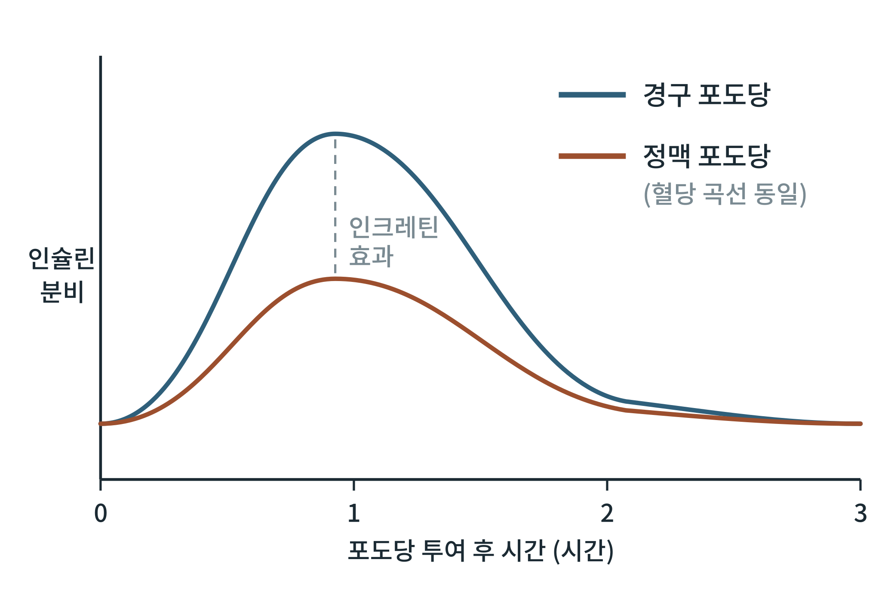

## 제19장 식후 호르몬과 인크레틴 효과

> **이 장의 출발점** 1906년 영국의 생리학자 벤자민 무어(Benjamin Moore)는 장 점막에서 뽑은 추출물이 이자의 분비를 일으킬 것이라 보고, 이를 당뇨병 환자에게 먹였다. 환자의 소변 당이 줄었다는 기록은 있지만 효과는 일정하지 않았다. 1932년 벨기에의 장 라 바르(Jean La Barre)는 장에서 나와 이자 내분비를 조절하는 물질을 인크레틴(incrétine)이라 불렀다. 이 개념이 실제로 확인된 것은 1964년이다. 두 연구진이 같은 양의 포도당을 입으로 먹일 때와 정맥으로 주사할 때 인슐린 반응이 다르다는 것을 독립적으로 보고했다. 포도당 수치는 비슷한데 먹을 때가 인슐린이 훨씬 많이 나왔다. 장이 식사를 알리는 별도의 신호를 이자에 보낸다는 증거였다. 이후 그 신호가 GIP와 GLP-1이라는 두 호르몬임이 밝혀졌다.

### 19.1 인슐린 분비의 두 단계

포도당이 오르면 이자 β세포는 인슐린을 두 단계로 분비한다. 첫 단계(제1기)는 포도당이 오른 직후 수 분 안에 일어나는 짧고 빠른 분비이며, 세포 안에 미리 모여 있던 소포가 즉시 방출되는 것이다. 다음 단계(제2기)는 그 뒤로 포도당이 높은 동안 이어지는 느리고 지속적인 분비이며, 새로 합성되고 이동한 소포가 방출되는 것이다. 제1기는 식후 초기에 간의 포도당 생성을 빠르게 억제해 혈당의 급등을 막는 역할을 하며, 제2형 당뇨병에서 가장 먼저 사라지는 반응으로 알려져 있다.

### 19.2 인크레틴 효과

**그림 19-1. 인크레틴 효과(개념도).** 같은 혈당 곡선을 만들도록 포도당을 정맥으로 주면(주황) 인슐린 분비가 작고, 입으로 먹으면(파랑) 더 크다. 두 곡선의 차이가 장에서 오는 인크레틴 신호가 더한 인슐린 분비이다. 세로축은 상대 수준이며 실제 수치가 아니다.

그림 19-1에서 중요한 점은 두 실험의 혈당이 같다는 조건이다. 혈당만으로는 설명되지 않는 추가 인슐린 분비가 장에서 왔다는 뜻이며, 건강한 사람에서 이 몫이 식후 인슐린 반응의 상당 부분(절반 이상이라는 보고가 흔하다)을 차지한다고 알려져 있다. 제2형 당뇨병에서는 이 효과가 줄어 있다.

### 19.3 GLP-1과 GIP

인크레틴 효과를 만드는 두 호르몬은 소장의 서로 다른 세포에서 나온다. GIP(포도당 의존 인슐린 분비 자극 폴리펩타이드)는 소장 상부(십이지장, 공장)의 K세포가, GLP-1(글루카곤 유사 펩타이드-1)은 소장 하부(회장)와 대장의 L세포가 포도당과 지방산 등 영양소에 반응해 분비한다. 두 호르몬 모두 β세포의 G단백질 연결 수용체에 결합해 cAMP를 올리고, 포도당이 높을 때에 한해 인슐린 분비를 증폭한다. 이 포도당 의존성이 저혈당 위험을 낮추는 핵심이다.

GLP-1은 이 밖에도 알파 세포의 글루카곤 분비를 억제하고, 위 배출을 늦추며, 시상하부에서 식욕을 줄이는 작용을 한다. GIP는 포도당 의존 인슐린 분비를 키우는 점은 같지만 글루카곤에 대한 작용과 식욕·지방조직에서의 역할은 아직 논의가 활발하다. 두 호르몬은 DPP-4 효소에 의해 N-말단 두 아미노산이 떨어져 나가 활성을 잃으므로 혈중 반감기가 매우 짧다(분 단위). 이 때문에 약물은 DPP-4에 분해되지 않도록 개조된 작용제이거나 DPP-4 자체의 억제제이다.

**표 19-1. GLP-1과 GIP의 비교.**

| 항목 | GLP-1 | GIP |
|---|---|---|
| 분비 세포 | L세포 (소장 하부, 대장) | K세포 (소장 상부) |
| 주요 자극 | 포도당, 지방산, 아미노산 | 포도당, 지방산 |
| 인슐린 분비 | 포도당 의존적 증가 | 포도당 의존적 증가 |
| 글루카곤 | 억제 | 상황에 따라 다르다는 보고 |
| 위 배출 | 지연 | 뚜렷한 영향 없음으로 알려짐 |
| 식욕 | 감소 | 연구 중 |
| 분해 효소 | DPP-4 | DPP-4 |

표 19-1의 마지막 두 열이 같은 이유로 DPP-4가 두 호르몬 모두에 약물 표적이 된다. 1권 13~15장의 이중, 삼중 작용제는 이 차이를 한 분자에 모아 쓰는 설계이다.

### 19.4 글루카곤과 위 배출의 협응

식후에는 인슐린만 오르는 것이 아니라 글루카곤이 억제된다. 포도당이 올라 알파 세포의 분비가 줄고, 인슐린과 GLP-1이 이를 거든다. 간은 인슐린은 올라가고 글루카곤은 내려간 환경에서 포도당 생성을 끄고 저장 모드로 간다. 한편 GLP-1이 위 배출을 늦추면 포도당이 장에서 혈액으로 들어가는 속도가 완만해져 인슐린 분비의 부담이 줄어든다. 따라서 GLP-1 작용제의 식후 혈당 효과는 인슐린 증폭, 글루카곤 억제, 위 배출 지연 세 경로의 합이다.

**표 19-2. GLP-1 신호의 식후 경로.**

| 경로 | 표적 | 결과 | 식후 시기 |
|---|---|---|---|
| 인슐린 분비 증폭 | β세포 | 포도당 의존적 인슐린 증가 | 식후 초기부터 |
| 글루카곤 억제 | α세포 | 간 포도당 생성 감소 | 식후 전반 |
| 위 배출 지연 | 위, 미주신경 | 포도당 유입 속도 완만 | 식후 초~중반 |
| 식욕 억제 | 시상하부 등 | 섭취량 감소 | 식전·식후 |

표 19-2는 하나의 호르몬이 시간대마다 다른 경로로 일한다는 것을 보여 준다. 신약 임상시험에서 식후 혈당 곡선이 낮아지는 이유를 이 경로별로 나눠 해석하는 방법은 9부에서 다룬다.

### 이 장의 요점

- 인슐린 분비는 빠른 제1기와 지속적인 제2기로 이루어지며 제1기가 제2형 당뇨병에서 먼저 사라진다.
- 같은 혈당이라도 경구 포도당이 정맥 포도당보다 인슐린을 더 많이 분비시키는 현상이 인크레틴 효과이다.
- 인크레틴은 GIP(K세포)와 GLP-1(L세포)이며 둘 다 포도당 의존적으로 인슐린 분비를 증폭하고 DPP-4에 분해된다.
- GLP-1의 식후 효과는 인슐린 증폭, 글루카곤 억제, 위 배출 지연의 합이다.

#### 참고문헌

Drucker, D. J. (2018). Mechanisms of action and therapeutic application of glucagon-like peptide-1. *Cell Metabolism, 27*(4), 740–756. https://doi.org/10.1016/j.cmet.2018.03.001

Elrick, H., Stimmler, L., Hlad, C. J., Jr., & Arai, Y. (1964). Plasma insulin response to oral and intravenous glucose administration. *The Journal of Clinical Endocrinology & Metabolism, 24*(10), 1076–1082. https://doi.org/10.1210/jcem-24-10-1076

Nauck, M. A., Homberger, E., Siegel, E. G., Allen, R. C., Eaton, R. P., Ebert, R., & Creutzfeldt, W. (1986). Incretin effects of increasing glucose loads in man calculated from venous insulin and C-peptide responses. *The Journal of Clinical Endocrinology & Metabolism, 63*(2), 492–498. https://doi.org/10.1210/jcem-63-2-492

Nauck, M. A., & Meier, J. J. (2018). Incretin hormones: Their role in health and disease. *Diabetes, Obesity and Metabolism, 20*(S1), 5–21. https://doi.org/10.1111/dom.13129
