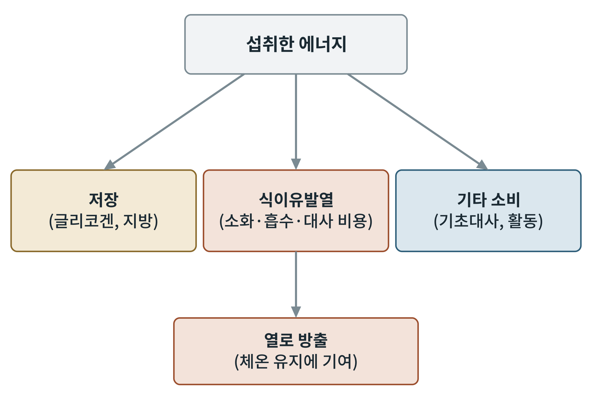

## 제20장 식후 열발생과 에너지 소비

> **이 장의 출발점** 1902년 독일의 막스 루브너(Max Rubner)는 개를 열량계에 넣고, 같은 양의 에너지를 지방, 탄수화물, 단백질로 먹였을 때 몸이 내는 열이 서로 다르다는 것을 관찰했다. 특히 고기를 먹이면 먹은 직후 체열 발생이 눈에 띄게 늘었다. 그는 이를 "특이 동적 작용(specific dynamic action)"이라 이름 붙였다. 먹은 에너지가 모두 몸의 일에 쓰이는 것이 아니라 먹는 행위 자체의 비용이 있다는 뜻이다. 한 세기가 지난 지금 이 현상은 식이유발열(diet-induced thermogenesis)이라 불리며, 비만 연구에서는 식후 열발생이 낮을수록 체중이 늘기 쉬운지를 두고 논쟁이 이어지고 있다.

### 20.1 식이유발열의 구성

하루 에너지 소비는 크게 기초대사, 신체 활동, 식이유발열 세 부분으로 나뉜다. 식이유발열은 보통 하루 소비의 작은 부분(대략 10퍼센트 안팎이라는 서술이 일반적이다)을 차지한다. 이 열은 두 요소로 나뉜다. 하나는 영양소를 소화하고 흡수하고 저장 형태로 바꾸는 데 드는 ATP 비용인 의무적 열발생(obligatory thermogenesis)이다. 다른 하나는 식사 후 교감신경과 갈색지방이 켜져서 더해지는 조절성 열발생(facultative thermogenesis)이다.

**그림 20-1. 섭취 에너지의 갈림길.** 섭취한 에너지는 저장, 식이유발열, 기타 소비(기초대사와 활동)로 나뉜다. 식이유발열에서 나온 열은 체온 유지에 기여한 뒤 방출된다. 개념도이며 각 몫의 비율은 식사와 개인에 따라 다르다.

그림 20-1에서 저장 쪽 화살표와 열 쪽 화살표는 같은 섭취 에너지를 나누는 두 경쟁자이다. 식이유발열이 클수록 같은 섭취량에서 저장되는 에너지는 줄어든다.

### 20.2 영양소별 열발생 비율

영양소마다 이 비용이 다르다. 영양소를 저장 또는 이용 형태로 바꾸는 데 드는 ATP 비용이 서로 다르기 때문이다. 단백질은 아미노산을 분해해 요소회로(9장)로 질소를 처리하는 비용이 커서 열발생이 가장 크다. 탄수화물은 포도당을 글리코겐으로 저장하는 비용이 중간이고, 지방은 장세포 흡수와 지방조직 재합성의 비용이 가장 작다. 교과서 값은 섭취 에너지의 단백질 약 20~30퍼센트, 탄수화물 약 5~10퍼센트, 지방 약 0~3퍼센트이다(출처 확인 필요).

**표 20-1. 영양소별 식이유발열의 상대 크기.**

| 영양소 | 상대 크기 | 주된 비용 요인 |
|---|---|---|
| 단백질 | 가장 큼 | 아미노산 분해, 요소회로, 단백질 합성 |
| 탄수화물 | 중간 | 글리코겐 합성, (과식 시) 새 지방 합성 |
| 지방 | 가장 작음 | 흡수와 중성지방 재합성 |
| 알코올 | 비교적 큼 | 간 대사 |

표 20-1은 같은 열량이라도 식사 구성에 따라 몸에 남는 에너지가 달라질 수 있음을 뜻한다. 이 때문에 단백질이 많은 식사가 체중 조절에 유리하다는 주장이 나오지만, 식이유발열의 차이는 하루 소비의 소수점 단위 비중이라 그 자체만으로 체중 변화를 설명하기에는 한계가 있다는 반론이 있다.

### 20.3 교감신경과 갈색지방의 기여

식이유발열에는 신경과 호르몬이 더하는 몫이 있다. 1979년 닐 로스웰(Nancy Rothwell)과 마이클 스톡(Michael Stock)은 쥐에게 기름지고 맛있는 먹이(카페테리아 식이)를 주면 먹은 에너지의 일부가 갈색지방에서 열로 바뀌어 체중 증가가 예상보다 작다는 실험 결과를 내놓았다. 이 관찰은 12장의 갈색지방 열발생이 추위뿐 아니라 먹는 행위에도 켜진다는 아이디어의 출발점이 되었다. 식후 인슐린과 렙틴이 시상하부를 거쳐 교감신경을 켜고, 노르에피네프린이 갈색지방의 β3 수용체를 자극해 UCP1을 켠다는 모형이 제안되어 있다. 다만 성인 사람에서 이 경로가 식후 열발생에 기여하는 정도는 확정되지 않았고, 동물 결과를 그대로 옮기기 어렵다는 의견이 많다.

**표 20-2. 의무적 열발생과 조절성 열발생.**

| 구분 | 원인 | 조절 | 비만과의 연관 |
|---|---|---|---|
| 의무적 열발생 | 흡수·저장·대사의 ATP 비용 | 영양소 종류와 양에 비례 | 식사 구성으로 조절 가능 |
| 조절성 열발생 | 교감신경, 갈색지방 UCP1 | 신경·호르몬 신호(인슐린, 렙틴 등) | 낮으면 체중 증가 위험이라는 가설 |

표 20-2의 아래 행이 약물 표적으로 매력적인 이유는 이것이 조절 가능하다는 점이다. 그러나 앞서 말했듯 사람에서의 기여도는 작을 수 있어, 표적으로서의 가치는 임상 근거로 검증되어야 한다.

### 20.4 식후 열발생의 측정

식이유발열은 간접열량측정으로 잰다. 호흡 가스(산소 소비량과 이산화탄소 생성량)를 식전과 식후 수 시간 동안 측정해 식후의 증가분을 합산한다. 측정은 안정 상태에서 해야 하고, 식사의 양과 구성, 측정 시간, 개인의 인슐린 감수성에 따라 값이 달라져 연구 간 비교가 어렵다. 이 한계는 비만 약물이 식후 에너지 소비를 늘리는지 판단할 때 그대로 적용되며, 이 점은 9부 모델링 장에서 다시 다룬다.

### 이 장의 요점

- 식이유발열은 영양소를 처리하는 ATP 비용(의무적)과 교감신경·갈색지방이 더하는 몫(조절성)으로 이루어지며, 하루 소비의 작은 부분을 차지한다.
- 영양소별로 단백질이 가장 크고 탄수화물이 중간, 지방이 가장 작다.
- 갈색지방의 식후 열발생 기여는 동물에서는 확인되었으나 성인 사람에서는 확정되지 않았다.
- 식이유발열은 간접열량측정으로 재며 조건에 따라 값이 크게 달라져 연구 간 비교가 어렵다.

#### 참고문헌

Rubner, M. (1902). *Die Gesetze des Energieverbrauchs bei der Ernährung*. Franz Deuticke.

Rothwell, N. J., & Stock, M. J. (1979). A role for brown adipose tissue in diet-induced thermogenesis. *Nature, 281*(5726), 31–35. https://doi.org/10.1038/281031a0

Westerterp, K. R. (2004). Diet induced thermogenesis. *Nutrition & Metabolism, 1*, Article 5. https://doi.org/10.1186/1743-7075-1-5

Tappy, L. (1996). Thermic effect of food and sympathetic nervous system activity in humans. *Reproduction Nutrition Development, 36*(4), 391–397. https://doi.org/10.1051/rnd:19960405
