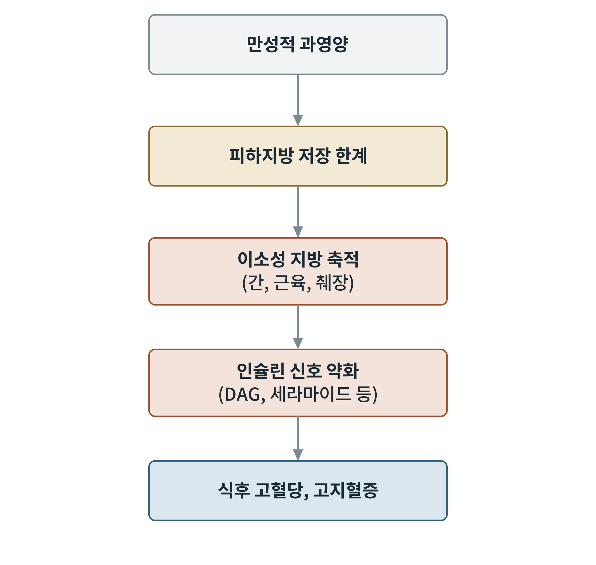

## 제21장 식후 대사의 한계: 저장 용량과 인슐린 저항

> **이 장의 출발점** 1936년 영국의 해럴드 힘스워스(Harold Himsworth)는 당뇨병 환자에게 인슐린과 포도당을 함께 주사해 혈당이 얼마나 떨어지는지를 비교했다. 어떤 환자는 소량의 인슐린에도 혈당이 뚝 떨어졌지만, 어떤 환자는 같은 양에서 거의 반응이 없었다. 그는 당뇨병에 인슐린이 부족한 형과 인슐린이 있는데도 듣지 않는 형이 있다고 보고, 후자를 "인슐린 비감수성"이라 불렀다. 훗날 1960년 로절린 얄로(Rosalyn Yalow)와 솔로몬 버슨(Solomon Berson)이 방사면역측정법으로 혈중 인슐린을 직접 재자, 성인 발병 당뇨병 환자의 인슐린이 오히려 정상보다 높은 경우가 많다는 사실이 확인되었다. 인슐린이 충분한데도 몸이 반응하지 못하는 상태, 곧 인슐린 저항성이 식후 대사의 한계를 가장 잘 보여 준다.

### 21.1 저장 용량의 한계

18장에서 글리코겐은 단기 창고이고 지방은 장기 창고라고 했다. 글리코겐 창고는 용량이 제한적이라 식사가 반복되면 쉽게 가득 찬다. 그러면 남는 탄수화물은 새 지방 합성을 거쳐 지방으로 가고, 식이 지방도 지방조직으로 간다. 지방조직의 용량은 확장될 수 있지만 무한하지 않다. 피하지방이 충분히 확장하지 못하거나, 확장된 지방세포가 염증과 섬유화로 기능을 잃으면 남는 지방이 간, 근육, 췌장, 심장 같은 지방조직 밖에 쌓이는데 이를 이소성 지방 축적(ectopic fat accumulation)이라 한다. 이 관점을 "지방조직 확장성 가설(adipose tissue expandability hypothesis)"이라 부른다.

**그림 21-1. 저장 한계에서 인슐린 저항으로.** 만성적 과영양이 피하지방의 저장 한계에 이르면 지방이 간, 근육, 췌장에 이소성으로 쌓이고, 지질 중간 대사물이 인슐린 신호를 약화시켜 식후 고혈당과 고지혈증으로 이어진다는 가설적 경로이다. 개념도이며 각 단계의 기여도는 개인과 조직에 따라 다르다.

그림 21-1의 흐름은 인과 사슬로 제시되지만, 각 단계가 원인인지 결과인지에 대해서는 논쟁이 있다. 인슐린 저항성이 먼저 와서 지방 저장을 방해한다는 반대 방향의 해석도 있으므로, 이 그림은 가설의 구조를 보여 주는 것으로 읽어야 한다.

### 21.2 인슐린 저항성의 분자 기전

인슐린 저항성은 인슐린 신호 경로 어딘가에서 신호가 약해지는 것이다. 15장의 경로를 되짚으면 인슐린 수용체, IRS, PI3K, AKT, GLUT4 이동 순서이며, 약해지는 지점으로 다음 가설이 제시되어 있다.

**표 21-1. 인슐린 저항성의 분자 기전 가설.**

| 가설 | 핵심 | 약해지는 지점 | 근거와 한계 |
|---|---|---|---|
| 지질 중간대사물 | 디아실글리세롤(DAG)이 PKC를 켜 IRS를 잘못 인산화 | 수용체 하류 (IRS) | 근육·간 생검 연구, 인과는 논쟁 |
| 세라마이드 | 세라마이드가 AKT를 억제 | AKT | 동물·세포 연구 중심 |
| 염증 | 비만 지방조직의 대식세포가 TNF-α, IL-6를 분비 | 전신 신호 | 사람 임상시험 결과는 일관되지 않음 |
| 소포체 스트레스·산화 스트레스 | 과영양이 소포체와 미토콘드리아에 부담 | 여러 지점 | 13장 ROS와 연결, 인과 불명 |
| 고인슐린혈증 자체 | 높은 인슐린이 수용체를 하향 조절 | 수용체 | 자기 강화 고리 가능성 |

표 21-1에서 어느 가설도 단독으로 충분히 설명하지 못한다는 점이 읽힌다. 인슐린 저항성은 조직(간, 근육, 지방)마다 먼저 나타나는 순서와 기전이 다르다는 의견이 우세하다.

### 21.3 조직별 인슐린 저항의 결과

저항성의 결과는 조직마다 다르게 나타난다. 근육에서는 GLUT4 이동이 줄어 식후 포도당 흡수가 줄고 혈당이 오래 높아진다. 간에서는 인슐린이 포도당 신생을 충분히 억제하지 못해 공복 혈당이 오르면서도 새 지방 합성은 계속 켜져 있는 선택적 저항이 나타난다(포도당 생성은 저항이지만 지방 합성 경로는 여전히 인슐린에 반응). 지방조직에서는 인슐린이 지방 분해를 억제하지 못해 유리지방산이 늘고, 이것이 다시 간과 근육의 지질 축적과 저항성을 악화시킨다.

**표 21-2. 인슐린 저항성의 조직별 결과.**

| 조직 | 식후에 나타나는 이상 | 파급 효과 |
|---|---|---|
| 근육 | 포도당 흡수 감소 | 식후 고혈당 지속 |
| 간 | 포도당 신생 억제 실패, 지방 합성은 지속 | 공복 고혈당, 지방간, VLDL 증가 |
| 지방조직 | 지방 분해 억제 실패 | 유리지방산 증가, 이소성 지방 가속 |
| 췌장 | 인슐린 분비 보상 후 소진 가능 | 제1기 분비 소실, 고혈당 고착 |

표 21-2는 서로 다른 조직의 이상이 연쇄적으로 맞물려 악순환을 이룬다는 점을 정리한 것이다. 이 악순환이 6부(공복)에서 다시 나타나는 현상(공복 고혈당, 높은 유리지방산)의 뿌리이다.

### 21.4 한계에서 약물 설계로

식후 대사의 한계를 풀려는 접근은 세 갈래로 요약된다. 입력을 줄이는 접근(식욕 억제, 위 배출 지연: GLP-1 작용제)은 저장 용량 압박을 줄인다. 저장 효율을 바꾸는 접근(지방조직 확장성 개선, 이소성 지방 감소)은 지방 창고의 기능을 회복시키려 한다. 신호를 복원하는 접근(인슐린 감수성 개선제)은 인슐린 경로 자체를 되살린다. 어느 접근이 식후 대사의 한계를 가장 효과적으로 푸는지는 37장의 질환별 정리와 38장의 설계 원칙에서 다룬다.

### 이 장의 요점

- 글리코겐 창고는 용량이 제한적이고, 지방조직이 확장성의 한계에 이르면 지방이 간·근육·췌장에 이소성으로 쌓인다.
- 인슐린 저항성은 인슐린 신호 경로(IRS, AKT, GLUT4) 어딘가에서 신호가 약해진 상태이며, 지질 중간대사물, 염증, 소포체·산화 스트레스, 고인슐린혈증 등이 가설로 제시된다.
- 간의 선택적 저항은 포도당 신생은 억제되지 않고 지방 합성은 계속 켜져 있는 현상이다.
- 약물 접근은 입력 감소, 저장 효율 변화, 신호 복원의 세 갈래이다.

### 5부 점검: 식후 에너지 수지표

5부(17~21장)의 내용을 한 끼의 에너지 흐름으로 정리한다. 들어온 에너지는 소화 흡수 뒤 열(식이유발열), 즉시 산화, 저장으로 나뉜다. 각 몫의 크기는 식사 구성, 인슐린 감수성, 저장 용량에 따라 달라지므로 이 표는 값이 아니라 구조를 보여 준다. 예시로 600 kcal 식사에서 식이유발열을 10퍼센트로 가정하면 열로 나가는 몫은 600 × 0.10 = 60 kcal이고, 나머지 540 kcal는 산화되거나 저장된다. 이 10퍼센트는 20장의 일반적 서술을 가정으로 쓴 것이며 개인값이 아니다.

**표 21-3. 식후 에너지 수지표(구조).**

| 갈래 | 내용 | 결정 요인 | 해당 장 |
|---|---|---|---|
| 열(식이유발열) | 소화·흡수·대사 비용과 교감·갈색지방의 몫 | 영양소 종류, 교감신경 | 20장 |
| 즉시 산화 | 식후 포도당·지방산·아미노산의 연료 이용 | 연료 경쟁, 대사 유연성 | 16장 |
| 글리코겐 저장 | 간·근육 글리코겐 합성 | 인슐린, 창고 용량 | 18장 |
| 지방 저장 | 새 지방 합성, 지방조직 재합성 | 인슐린, LPL, 지방조직 확장성 | 18장, 21장 |
| 단백질 합성 | 근육·장기 단백질 | 아미노산, mTORC1 | 14장, 18장 |
| 잔류(한계 초과) | 이소성 지방, 고혈당·고지혈증 | 저장 한계, 인슐린 저항 | 21장 |

표 21-3의 마지막 행이 이 부의 결론이다. 저장의 한계를 넘은 에너지는 사라지지 않고 이소성 지방과 혈중 잔류로 남아 인슐린 저항성을 키운다. 6부는 이 상태에서 시작해, 식사가 끝난 뒤 몸이 저장분을 어떻게 꺼내 쓰는지를 다룬다.

#### 참고문헌

Himsworth, H. P. (1936). Diabetes mellitus: Its differentiation into insulin-sensitive and insulin-insensitive types. *The Lancet, 227*(5864), 127–130. https://doi.org/10.1016/S0140-6736(01)36134-2

Yalow, R. S., & Berson, S. A. (1960). Immunoassay of endogenous plasma insulin in man. *Journal of Clinical Investigation, 39*(7), 1157–1175. https://doi.org/10.1172/JCI104130

Petersen, M. C., & Shulman, G. I. (2018). Mechanisms of insulin action and insulin resistance. *Physiological Reviews, 98*(4), 2133–2223. https://doi.org/10.1152/physrev.00063.2017

Samuel, V. T., & Shulman, G. I. (2016). The pathogenesis of insulin resistance: Integrating signaling pathways and substrate flux. *Journal of Clinical Investigation, 126*(1), 12–22. https://doi.org/10.1172/JCI77812

Virtue, S., & Vidal-Puig, A. (2010). Adipose tissue expandability, lipotoxicity and the metabolic syndrome: An allostatic perspective. *Biochimica et Biophysica Acta, 1801*(3), 338–349. https://doi.org/10.1016/j.bbalip.2009.12.006
