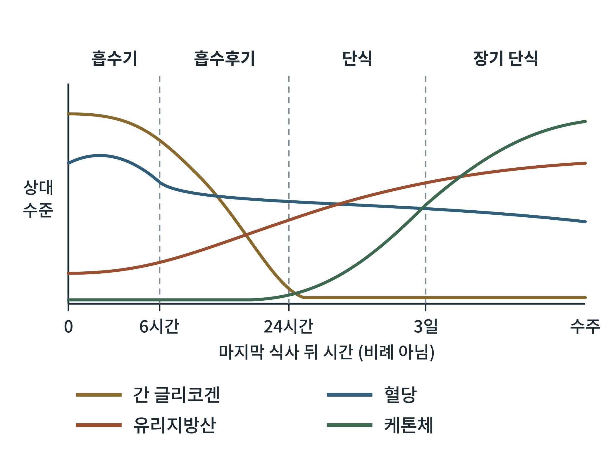

# 제6부 공복 대사 에너지

## 제22장 공복의 시간표

> **이 장의 출발점** 1960년대 후반 미국 보스턴의 병원에서는 조지 케이힐(George Cahill)과 오언(Oliver Owen) 등이 비만 환자를 입원시켜 몇 주 동안 물만 마시게 하는 연구를 했다. 이들이 알고 싶었던 것은 먹지 않는 몸이 무엇을 태워 살아가느냐였다. 뇌는 하루에 포도당을 많이 쓰는 기관인데, 포도당을 만들 재료는 한정되어 있다. 그런데 며칠이 지나도 환자의 뇌는 멈추지 않았다. 1967년 이들은 장기 단식 환자의 뇌가 포도당 대신 케톤체를 연료로 쓰고 있다는 측정 결과를 보고했다(Owen et al., 1967). 몸은 굶는 동안 연료를 바꾸는 계획표를 따르고 있었던 것이다. 이 장은 그 계획표를 시간 순서로 읽는다.

### 22.1 공복은 하나의 완결된 대사 상태이다

5부에서는 식후 몇 시간 동안 들어온 에너지가 어디로 가는지를 따라갔다. 6부는 그 반대편, 마지막 식사 뒤에 시간이 흐르면서 몸이 저장 에너지를 어떻게 꺼내 쓰는지를 다룬다. 공복을 식후의 단순한 반대로 보면 놓치는 것이 많다. 공복은 저장 에너지를 꺼내 쓰기 위한 조직적인 프로그램이며, 호르몬 환경, 장기별 역할, 주 연료가 단계마다 바뀐다. 이 프로그램이 제대로 돌아가야 뇌와 적혈구처럼 연료를 가리는 조직이 살아남는다.

공복 연구에서 가장 흔히 쓰이는 틀은 네 단계이다. 흡수기(식후 약 4~6시간), 흡수후기(약 6~24시간), 단식기(약 1~3일), 장기 단식기(약 3일 이후 수 주)이다. 단계의 경계는 개인의 영양 상태, 마지막 식사의 양, 활동량에 따라 이동하는 흐름이며, 문헌마다 시간 값이 조금씩 다르다. 이 책에서는 경계의 시간을 대략적인 값으로만 제시한다.

### 22.2 네 단계의 연료와 호르몬

**그림 22-1. 마지막 식사 뒤 시간에 따른 연료 수준의 변화.** 간 글리코겐은 흡수후기에 줄어 약 하루 안에 거의 바닥나고, 혈당은 좁은 범위에서 완만히 낮아지며, 유리지방산은 점차 오르고, 케톤체는 단식기 이후 크게 오른다. 가로축은 시간에 비례하지 않으며, 세로축은 각 연료의 상대 수준을 나타내는 개념도이다.

그림 22-1에서 읽을 점은 두 가지이다. 첫째, 혈당선이 가장 평탄하다. 몸은 다른 연료가 크게 변하는 동안에도 혈당을 좁은 범위에 붙잡아 둔다. 이것이 뇌와 적혈구를 지키는 조절의 결과이다. 둘째, 연료의 교대가 차례로 일어난다. 먼저 글리코겐이 줄고, 그 뒤에 유리지방산이 오르며, 마지막에 케톤체가 오른다. 곡선의 모양은 설명용이며, 실제 값은 표 22-1에서 대략적인 범위로 제시한다.

각 단계를 풀어 보면 다음과 같다. 흡수기에는 식사로 들어온 포도당이 혈액으로 들어오고 인슐린이 높아, 간과 근육은 글리코겐을 쌓고 지방조직은 지방을 합성한다(18장). 식사가 끝나고 흡수가 줄면 흡수후기가 시작된다. 인슐린은 내려가고 글루카곤은 오르며, 간이 글리코겐을 분해해 혈당을 유지한다(23장). 글리코겐 창고는 약 하루 안에 거의 소진되고, 이때부터 포도당 신생(아미노산, 젖산, 글리세롤에서 포도당을 새로 만드는 과정)의 비중이 커진다. 단식기에는 지방조직의 지방 분해가 크게 늘어 유리지방산이 혈액에 많아지고(24장), 간은 유리지방산 일부를 케톤체로 바꾸기 시작한다(25장). 장기 단식기에는 케톤체가 뇌의 주 연료 가운데 하나가 되어, 뇌가 필요로 하는 포도당의 양이 줄고, 그만큼 근육 단백질을 분해해 포도당 재료를 만들 필요가 줄어든다(26장).

**표 22-1. 공복 단계별 주 연료와 호르몬 환경.**

| 단계 | 대략의 시간 | 혈중 연료의 경향 | 주 에너지 공급 | 호르몬 환경 |
|---|---|---|---|---|
| 흡수기 | 식후 약 4~6시간 | 혈당 높음, 케톤체 거의 없음 | 식사 유래 포도당 | 인슐린 높음 |
| 흡수후기 | 약 6~24시간 | 혈당 유지, 유리지방산 증가 시작 | 간 글리코겐 분해, 지방산 산화 증가 | 인슐린 감소, 글루카곤 증가 |
| 단식기 | 약 1~3일 | 유리지방산 증가, 케톤체 증가 시작 | 포도당 신생, 지방 분해 | 인슐린 낮음, 글루카곤·코르티솔 증가 |
| 장기 단식기 | 약 3일 이후 수 주 | 케톤체 높음, 혈당 약간 낮음 | 지방산과 케톤체 중심 | 인슐린 매우 낮음, 갑상선 호르몬 감소 |

표 22-1은 단계를 어느 한 시각에서 끊어지는 것으로 읽지 말고 연속적으로 이동하는 것으로 읽어야 한다는 점을 보여 준다. 또 이 표는 인슐린과 글루카곤의 비율이 연료 교대를 이끄는 가장 큰 변수임을 드러낸다. 이 비율이 29장에서 말하는 전환 스위치의 한 축이다.

### 22.3 장기별 분업

공복에서 연료를 바꾸는 일은 한 장기가 아니라 여러 장기가 나누어 한다. 간은 글리코겐 분해와 포도당 신생으로 혈당을 만들고, 지방산을 케톤체로 바꾼다. 지방조직은 중성지방을 분해해 유리지방산과 글리세롤을 내보낸다. 근육은 유리지방산을 직접 태우고, 아미노산을 내놓아 간의 포도당 신생을 돕는다. 신장도 장기 단식에서는 포도당 신생에 참여한다. 뇌는 처음에는 포도당을 쓰고, 단식이 길어지면 케톤체를 쓰는 비중이 커진다(25장). 이 분업은 5부의 식후 분업과 같은 장기들이 호르몬 신호에 따라 맡은 일을 바꾸는 구조이다.

### 22.4 약물 설계의 관점

공복의 시간표는 비만 치료약물이 몸의 어느 단계에 개입하는지를 가늠하는 지도가 된다. GLP-1 작용제는 식사량을 줄여 몸이 공복 쪽 시간표에 더 오래 머물게 하는 효과가 있다고 해석할 수 있다. 다만 이 해석은 약물 투여가 단식과 같은 대사 상태를 만든다는 뜻이 아니다. 약물군마다 호르몬 환경이 다르므로, 공복에 가까운 상태가 되는지는 약물별로 확인해야 한다. 공복 대사의 각 단계는 인슐린, 글루카곤, 지방 분해 효소, 케톤 생성 같은 분자 표적을 가지며, 이 표적들은 23~29장에서 하나씩 다룬다.

### 이 장의 요점

- 공복은 식후의 반대가 아니라 저장 에너지를 꺼내 쓰는 조직적 프로그램이며, 흡수기, 흡수후기, 단식기, 장기 단식기의 네 단계로 나눈다.
- 단계의 경계 시간은 개인과 조건에 따라 이동하며, 대략적인 값으로만 쓸 수 있다.
- 혈당은 좁은 범위에 유지되고, 그 사이에 글리코겐, 유리지방산, 케톤체의 순서로 연료가 교대한다.
- 연료 교대의 큰 변수는 인슐린과 글루카곤의 비율이다.
- 간, 지방조직, 근육, 신장, 뇌가 분업하며, 장기 단식에서는 뇌가 케톤체를 쓰는 비중이 커진다.

#### 참고문헌

Cahill, G. F., Jr. (2006). Fuel metabolism in starvation. *Annual Review of Nutrition, 26*, 1–22. https://doi.org/10.1146/annurev.nutr.26.061505.111258

Cahill, G. F., Jr. (1970). Starvation in man. *New England Journal of Medicine, 282*(12), 668–675. https://doi.org/10.1056/NEJM197003192821209

Owen, O. E., Morgan, A. P., Kemp, H. G., Sullivan, J. M., Herrera, M. G., & Cahill, G. F., Jr. (1967). Brain metabolism during fasting. *Journal of Clinical Investigation, 46*(10), 1589–1595. https://doi.org/10.1172/JCI105650
