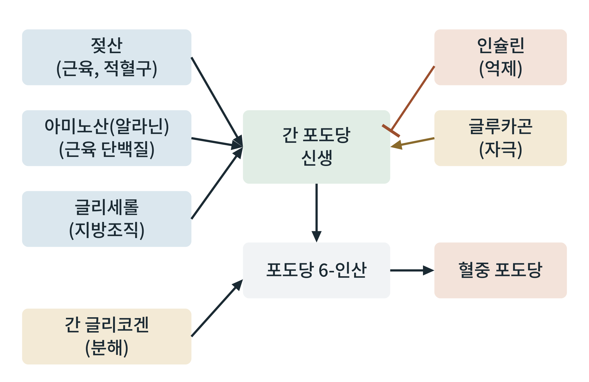

## 제23장 간 글리코겐 분해와 포도당 신생

> **이 장의 출발점** 1920년대 말 카를 코리(Carl Cori)와 게르티 코리(Gerty Cori) 부부는 미국 뉴욕 주의 연구소에서 근육이 운동하면 젖산이 혈액으로 나오고, 간이 이 젖산을 받아 다시 포도당으로 되돌린다는 순환을 추적했다(Cori & Cori, 1929). 근육이 포도당을 젖산으로 태워 만든 부산물이 간에서 포도당으로 되돌아가 다시 근육으로 간다는 이 순환은 코리 회로라는 이름으로 남았다. 이 부부는 글리코겐 대사의 기전을 밝힌 공로로 1947년 노벨 생리학·의학상을 받았다. 이 장의 주제는 이 순환의 일부가 공복의 간에서 어떻게 혈당을 만들어 내는가이다.

### 23.1 공복의 첫 번째 대응: 간 글리코겐 분해

식사가 끝나고 흡수가 줄면 인슐린은 내려가고 글루카곤은 오른다. 글루카곤은 간세포의 G단백질 연결 수용체에 결합해 cAMP를 올리고, 그 아래의 PKA가 글리코겐 포스포릴라아제를 켠다. 글리코겐 포스포릴라아제는 글리코겐의 포도당 사슬 끝에서 포도당 1-인산을 하나씩 떼어 내고, 이것이 포도당 6-인산으로 바뀐다. 간에는 글루코스-6-포스파타아제라는 효소가 있어 포도당 6-인산에서 인산을 떼어 내므로, 포도당이 혈액으로 나갈 수 있다. 근육에는 이 효소가 없어 근육 글리코겐은 혈당으로 보내지 못하고 근육 자신의 연료로만 쓰인다. 이 차이는 18장에서 본 두 창고의 역할 차이와 같다.

간 글리코겐은 용량이 한정되어 있어 공복 초기 몇 시간 동안의 혈당 유지에 쓰이고, 약 하루 안에 거의 소진된다. 그 뒤에는 새로 포도당을 만드는 경로가 혈당 공급의 중심이 된다.

### 23.2 포도당 신생: 포도당이 아닌 재료로 포도당을 만든다

포도당 신생(gluconeogenesis)은 젖산, 아미노산, 글리세롤처럼 탄수화물이 아닌 재료로 포도당을 새로 만드는 경로이다. 주 장소는 간이고, 장기 단식에서는 신장도 일부를 맡는다. 해당과정의 거의 역방향이지만, 해당과정에서 되돌릴 수 없는 세 단계는 다른 효소가 대신 우회한다. 피루브산에서 포스포엔올피루브산으로 가는 단계(피루브산 카르복실라아제, PEPCK), 과당 1,6-이인산에서 과당 6-인산으로 가는 단계(과당-1,6-이인산가수분해효소), 포도당 6-인산에서 포도당으로 가는 단계(글루코스-6-포스파타아제)가 그것이다. 이 효소들의 발현과 활성이 호르몬 신호에 따라 조절된다.

**그림 23-1. 공복 간의 혈당 공급 경로.** 간은 글리코겐 분해와 포도당 신생이라는 두 경로로 포도당 6-인산을 만들고, 이를 혈중 포도당으로 내보낸다. 포도당 신생의 재료는 근육과 적혈구의 젖산, 근육 단백질에서 나온 아미노산(주로 알라닌), 지방조직의 글리세롤이다. 글루카곤은 두 경로를 자극하고 인슐린은 포도당 신생을 억제한다.

그림 23-1에서 읽을 점은 두 가지이다. 첫째, 포도당 6-인산이 두 경로가 합쳐지는 지점이므로, 혈당의 출구 효소(글루코스-6-포스파타아제)가 두 경로 모두에 공통 병목이 된다. 둘째, 재료가 세 갈래인데 각각 다른 조직에서 온다. 즉 포도당 신생은 간 혼자 하는 일이 아니라 근육, 적혈구, 지방조직이 재료를 대는 장기 사이의 협업이다. 이 협업 때문에 지방 분해(24장)와 근육 단백질 보존(26장)이 모두 포도당 신생과 연결된다.

### 23.3 재료별 경로와 두 가지 회로

**표 23-1. 포도당 신생의 재료와 공급 경로.**

| 재료 | 공급 조직 | 경로 | 포도당 순생산 여부 |
|---|---|---|---|
| 젖산 | 근육, 적혈구 | 코리 회로: 포도당 → 젖산 → 간 → 포도당 | 순생산 없음(원래 포도당의 재활용) |
| 알라닌 | 근육 | 알라닌 회로: 근육 단백질 아미노산 → 간 | 순생산(단백질에서 유래) |
| 글리세롤 | 지방조직 | 지방 분해로 방출 → 간에서 포도당 신생 | 순생산(지방에서 유래) |
| 기타 아미노산 | 근육, 장기 단백질 | 단백질 분해 후 간으로 | 순생산(단백질에서 유래) |

표 23-1에서 중요한 구분은 순생산 여부이다. 코리 회로는 이미 있던 포도당을 재활용하는 것이어서 몸의 포도당 총량을 늘리지 못하고, 에너지는 간이 쓰는 비용으로 지불된다. 알라닌과 글리세롤은 단백질과 지방이라는 다른 저장 에너지를 포도당으로 바꾸는 경로이다. 반면 지방산은 사람에서 순포도당으로 바뀌지 못한다. 지방산이 분해되어 생기는 아세틸-CoA가 포도당 신생의 재료인 옥살아세트산으로 되돌아가지 못하기 때문이다. 이것이 공복에서 뇌가 지방을 직접 연료로 쓰지 못하고, 간이 지방산을 케톤체로 바꾸어 뇌에 보내야 하는 이유이다(25장).

### 23.4 조절: 글루카곤과 인슐린

글루카곤은 PKA를 통해 간의 포도당 신생 효소 유전자 발현을 올리고(PEPCK 등), 피루브산 키나아제를 억제해 해당 경로를 줄이며, 글리코겐 분해를 켠다. 인슐린은 반대로 이 유전자들의 발현을 억제하고 글리코겐 합성을 켠다. 코르티솔과 카테콜아민도 포도당 신생을 돕는다(27장). 21장에서 본 것처럼 간의 인슐린 저항에서는 이 억제가 제대로 걸리지 않아 공복 고혈당이 나타난다. 즉 포도당 신생의 조절 실패는 제2형 당뇨병의 공복 고혈당과 직접 이어진다.

### 23.5 약물 설계의 관점

포도당 신생은 당뇨병 치료약물의 표적이 되어 왔다. 메트포르민은 간의 포도당 생산을 줄이는 약물로 널리 쓰이며, 작용 기전에는 AMPK 경로와 미토콘드리아 호흡 억제가 거론되지만 어느 기전이 주된 것인지는 여전히 논의되고 있다. 글루카곤 수용체 길항제도 개발되었으나, 지방간과 지질 변화 같은 부작용이 문제가 되었다. 한편 GLP-1과 글루카곤 수용체를 함께 작용하게 하는 이중 작용제는 글루카곤의 에너지 소비 증가 효과를 이용하려는 시도이다. 이 약물군의 설계는 3권에서 다시 다룬다. 공통 과제는 포도당 신생을 지나치게 줄이면 저혈당이 올 수 있다는 점과, 간 지방과의 연결을 함께 관리해야 한다는 점이다.

### 이 장의 요점

- 공복 초기에는 글루카곤-cAMP-PKA 경로가 간 글리코겐 분해를 켜서 혈당을 유지한다. 간은 글루코스-6-포스파타아제가 있어 포도당을 혈액으로 내보내지만, 근육은 그렇지 못하다.
- 간 글리코겐은 약 하루 안에 거의 소진되고, 이후 포도당 신생이 혈당 공급의 중심이 된다.
- 포도당 신생의 재료는 젖산, 아미노산, 글리세롤이며, 젖산(코리 회로)은 순생산이 아니고 알라닌과 글리세롤은 순생산이다.
- 지방산은 사람에서 순포도당이 되지 못하며, 이것이 케톤체 생성이 필요한 이유이다.
- 글루카곤은 포도당 신생과 글리코겐 분해를 촉진하고 인슐린은 억제하며, 간 인슐린 저항에서는 이 억제가 약해져 공복 고혈당이 나타난다.

#### 참고문헌

Cori, C. F., & Cori, G. T. (1929). Glycogen formation in the liver from d- and l-lactic acid. *Journal of Biological Chemistry, 81*(2), 389–403. https://doi.org/10.1016/S0021-9258(18)83822-2

Petersen, M. C., Vatner, D. F., & Shulman, G. I. (2017). Regulation of hepatic glucose metabolism in health and disease. *Nature Reviews Endocrinology, 13*(10), 572–587. https://doi.org/10.1038/nrendo.2017.80

Rui, L. (2014). Energy metabolism in the liver. *Comprehensive Physiology, 4*(1), 177–197. https://doi.org/10.1002/cphy.c130024
