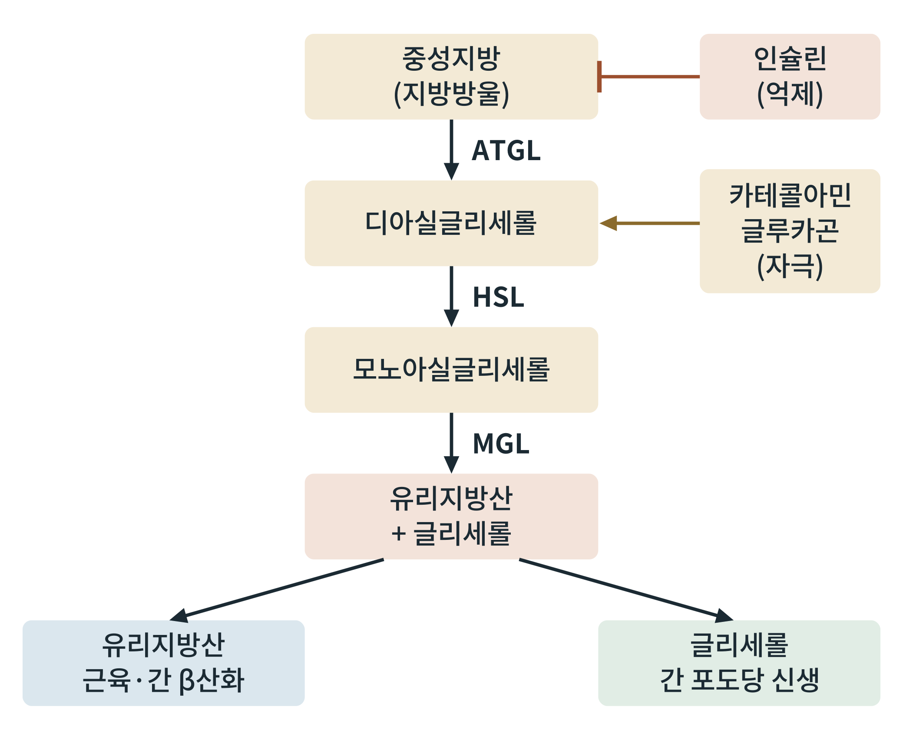

## 제24장 지방분해와 연료 전환

> **이 장의 출발점** 1956년 미국의 빈센트 돌(Vincent Dole)은 혈액 속에 지방산이 알부민에 붙어 떠다니며, 그 농도가 포도당 대사와 함께 움직인다는 측정 결과를 발표했다(Dole, 1956). 같은 해 고든과 체르케스도 혈장의 유리지방산이 알부민과 결합해 운반된다는 결과를 냈다. 그전까지 혈액 속 지방은 식사 직후에 지방방울로만 보이는 것으로 여겨졌지만, 이 연구들은 굶는 동안에도 지방이 혈액을 타고 이동하는 연료임을 보여 주었다. 이 장은 지방조직의 저장 지방이 어떤 효소를 거쳐 혈액으로 나오고, 누가 이를 연료로 쓰는지를 다룬다.

### 24.1 중성지방에서 유리지방산까지: 세 단계의 가수분해

지방조직의 지방방울 속 중성지방은 세 단계로 분해된다. 지방조직 중성지방 리파아제(adipose triglyceride lipase, ATGL)가 중성지방을 디아실글리세롤로 바꾸고, 호르몬 민감성 리파아제(hormone-sensitive lipase, HSL)가 디아실글리세롤을 모노아실글리세롤로 바꾸며, 모노아실글리세롤 리파아제(monoacylglycerol lipase, MGL)가 마지막으로 유리지방산과 글리세롤을 내놓는다. ATGL은 2004년에 보고되어(Zimmermann et al., 2004) 그전까지 HSL이 중성지방 분해의 주 효소로 여겨지던 이해를 바꾸었다. 현재는 ATGL이 첫 단계의 속도를 정하고 HSL이 디아실글리세롤 단계에서 주된 역할을 한다고 정리된다.

**그림 24-1. 지방조직의 지방 분해 경로.** 중성지방은 ATGL, HSL, MGL을 차례로 거쳐 유리지방산과 글리세롤이 된다. 인슐린은 이 과정을 억제하고, 카테콜아민과 글루카곤은 자극한다. 유리지방산은 근육과 간의 β산화로, 글리세롤은 간의 포도당 신생으로 간다.

그림 24-1에서 읽을 점은 두 가지이다. 첫째, 분해는 한 번에 일어나지 않고 세 효소가 차례로 맡으므로, 약물이나 호르몬이 개입할 수 있는 지점이 여러 곳이다. 둘째, 산물이 두 갈래로 나뉜다. 유리지방산은 대부분의 조직에서 연료가 되고, 글리세롤은 23장에서 본 것처럼 간 포도당 신생의 재료가 된다. 즉 지방 분해는 에너지원을 내놓는 동시에 혈당 유지에도 기여한다.

### 24.2 조절: 인슐린의 억제와 카테콜아민의 자극

인슐린은 지방조직에서 HSL과 ATGL의 작용을 약하게 하고(PI3K-AKT 경로와 PDE3B를 거쳐 cAMP를 낮춘다), 지방 분해를 강하게 억제한다. 식후에는 이 억제가 걸려 지방이 저장되고, 공복에는 인슐린이 내려가 억제가 풀린다. 카테콜아민(교감신경의 노르에피네프린과 부신의 에피네프린)은 지방세포의 β-아드레날린 수용체를 통해 cAMP와 PKA를 올려 HSL을 인산화하고 지방방울 표면 단백질(페릴리핀)을 인산화해 분해를 촉진한다. 글루카곤도 사람 지방조직에서 어느 정도 역할을 하는지는 논의가 있다. 성장호르몬과 코르티솔은 시간이 지나며 지방 분해를 돕는다(27장).

### 24.3 유리지방산의 운반과 이용

유리지방산은 물에 잘 녹지 않아 혈액에서 알부민에 붙어 운반된다. 조직에 도착하면 지방산 수송 단백질을 통해 세포로 들어가고, 미토콘드리아에서 β산화로 아세틸-CoA를 내며 이것이 TCA 회로와 전자전달계로 들어가 ATP를 만든다(2권 앞부분). 이때 지방산이 미토콘드리아로 들어가는 문턱이 카르니틴 팔미토일전달효소 1(CPT1)이다. 식후에는 인슐린이 아세틸-CoA 카르복실라아제를 켜서 말로닐-CoA를 올리고, 말로닐-CoA가 CPT1을 억제해 지방산 산화를 막는다. 공복에는 인슐린이 내려가고 AMPK가 이 효소를 꺼서 말로닐-CoA가 줄어, CPT1이 풀리고 β산화가 늘어난다. 이 장치가 연료 전환의 핵심 분자 스위치 가운데 하나이다.

**표 24-1. 조직별 공복 연료 이용.**

| 조직 | 공복 초기 | 장기 단식 | 지방산 이용 |
|---|---|---|---|
| 근육 | 지방산과 포도당 | 지방산(포도당 사용 줄어듦) | 직접 β산화 |
| 간 | 지방산(포도당 신생 에너지 공급) | 지방산, 케톤체 생성 | β산화와 케톤 생성 |
| 심장 | 지방산 중심 | 지방산과 케톤체 | β산화가 주 연료 |
| 뇌 | 포도당 | 포도당과 케톤체 | 직접 이용하지 못함 |
| 적혈구 | 포도당(해당과정) | 포도당 | 미토콘드리아가 없어 이용 못 함 |

표 24-1은 지방산이 모든 조직의 연료는 아니라는 점을 보여 준다. 뇌와 적혈구는 지방산을 직접 쓰지 못한다. 뇌는 혈액뇌장벽과 에너지 요구량의 특성 때문이고, 적혈구는 미토콘드리아가 없기 때문이다. 그래서 공복에는 지방산이 근육, 심장, 간 같은 조직의 연료를 대신하고, 이로써 절약된 포도당이 뇌와 적혈구로 돌아간다. 이것이 공복 연료 전환의 목적이다.

### 24.4 약물 설계의 관점

지방 분해 경로는 여러 약물 표적을 가진다. 니코틴산과 그 유사체는 지방세포의 수용체(HCA2)를 통해 지방 분해를 억제해 혈중 유리지방산을 낮추지만, 홍조와 지속 효과의 한계로 쓰임이 제한되었다. ATGL의 활성인자와 억제제도 연구 중이다. 한편 지방 분해를 지나치게 억제하면 지방 연료의 공급이 줄고, 지나치게 높이면 유리지방산이 간과 근육에 이소성으로 쌓여 21장의 인슐린 저항을 키울 수 있다. 약물 설계에서는 분해의 크기와 조직 균형을 함께 보아야 한다는 점이 이 장의 시사점이다.

### 이 장의 요점

- 중성지방은 ATGL, HSL, MGL의 세 효소가 차례로 분해해 유리지방산과 글리세롤을 내놓는다.
- 인슐린은 지방 분해를 억제하고 카테콜아민은 촉진하므로, 식후와 공복의 전환은 이 두 신호의 균형이다.
- 유리지방산은 알부민에 붙어 운반되고, 근육, 심장, 간에서 β산화로 쓰인다. 뇌와 적혈구는 지방산을 직접 쓰지 못한다.
- 말로닐-CoA와 CPT1이 식후와 공복의 지방산 산화를 가르는 분자 스위치이다.
- 글리세롤은 간 포도당 신생의 재료가 되어 지방 분해가 혈당 유지에도 기여한다.

#### 참고문헌

Dole, V. P. (1956). A relation between non-esterified fatty acids in plasma and the metabolism of glucose. *Journal of Clinical Investigation, 35*(2), 150–154. https://doi.org/10.1172/JCI103259

Zimmermann, R., Strauss, J. G., Haemmerle, G., Schoiswohl, G., Birner-Gruenberger, R., Riederer, M., Lass, A., Neuberger, G., Eisenhaber, F., Hermetter, A., & Zechner, R. (2004). Fat mobilization in adipose tissue is promoted by adipose triglyceride lipase. *Science, 306*(5700), 1383–1386. https://doi.org/10.1126/science.1100747

Lafontan, M., & Langin, D. (2009). Lipolysis and lipid mobilization in human adipose tissue. *Progress in Lipid Research, 48*(5), 275–297. https://doi.org/10.1016/j.plipres.2009.05.001
