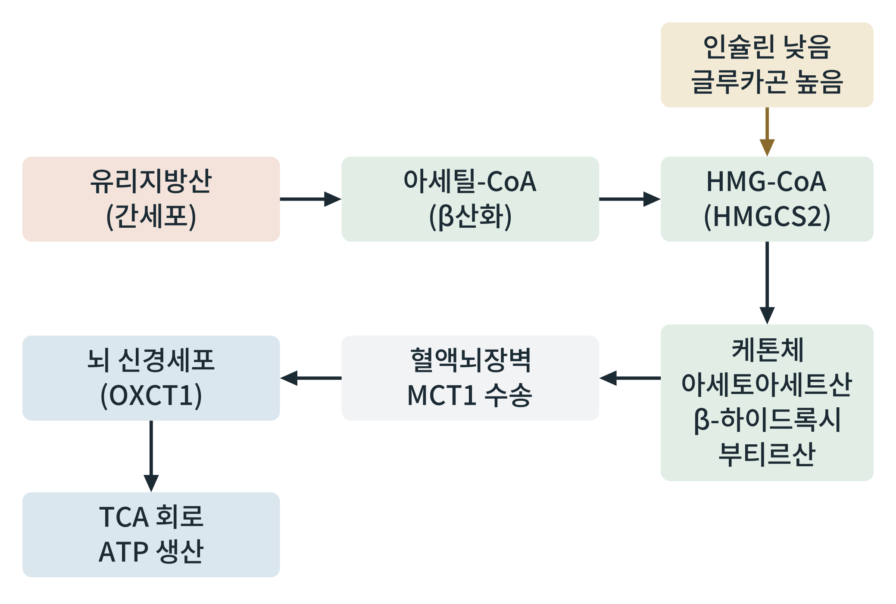

## 제25장 케톤 생성과 뇌의 연료 전환

> **이 장의 출발점** 1921년 미국 메이요 클리닉의 러셀 와일더(Russell Wilder)는 간질 환자에게 단식과 비슷한 대사 상태를 만들면 발작이 줄 수 있다고 보고, 지방을 많이 먹고 탄수화물을 적게 먹는 식사를 제안했다. 이 식사가 케톤식(ketogenic diet)이라는 이름을 얻었고, 그 근거는 단식 중 혈액에 늘어나는 케톤체였다(Wilder, 1921). 이어서 1960년대에 장기 단식 환자의 뇌가 케톤체를 연료로 쓴다는 사실이 확인되었다(Owen et al., 1967, 22장). 이 장은 케톤체가 간에서 어떻게 만들어져 뇌로 가는지를 분자 수준에서 따라간다.

### 25.1 케톤체는 무엇이며 왜 필요한가

케톤체(ketone bodies)는 아세토아세트산, β-하이드록시부티르산(β-hydroxybutyrate), 아세톤의 세 가지를 말한다. 24장에서 본 것처럼 뇌는 지방산을 직접 연료로 쓰지 못하고, 23장에서 본 것처럼 지방산은 사람에서 순포도당으로 바뀌지 못한다. 그러면 공복이 길어질 때 뇌가 포도당에만 의존해야 하고, 그 포도당을 대려면 근육 단백질을 계속 분해해야 한다. 케톤체는 이 문제를 푸는 연료이다. 간이 지방산에서 만든 에너지를 뇌가 쓸 수 있는 수용성 분자로 바꾸어 혈액에 내보내는 장치이며, 그 덕에 뇌가 필요로 하는 포도당 양이 줄고 근육 단백질이 보존된다(26장).

### 25.2 간에서의 케톤 생성

**그림 25-1. 간의 케톤 생성과 뇌의 이용.** 인슐린이 낮고 글루카곤이 높으면 간에서 지방산이 β산화로 아세틸-CoA가 되고, 이것이 HMG-CoA 합성효소(HMGCS2)를 거쳐 케톤체가 된다. 케톤체는 혈액뇌장벽의 모노카르복실산 수송체(MCT1)로 뇌에 들어가, 뇌 신경세포에서 숙신일-CoA:3-케토산 CoA 전이효소(OXCT1)를 거쳐 아세틸-CoA가 되고 TCA 회로로 들어간다.

그림 25-1에서 읽을 점은 두 가지이다. 첫째, 케톤 생성의 신호는 인슐린 감소와 글루카곤 증가이고, 속도를 정하는 지점은 HMG-CoA를 만드는 HMGCS2이다. 둘째, 생성 장소(간)와 이용 장소(뇌 등)가 분리되어 있다. 간은 케톤체를 만들 수 있지만 OXCT1이 거의 없어 스스로 쓰지 못한다. 이 분리는 24장의 지방산 분업과 같은 구조로, 간은 연료 공급자이고 말초 조직은 이용자이다.

케톤 생성이 일어나려면 간에 지방산이 충분히 들어와 β산화가 높아야 하고, 말로닐-CoA가 낮아 CPT1이 열려 있어야 하며, 아세틸-CoA가 TCA 회로로 다 들어가지 못해 남아야 한다. 인슐린이 높은 식후에는 지방산 산화가 막히고 지방 합성이 켜져 있어 케톤 생성이 거의 일어나지 않는다. 즉 케톤 생성은 공복에서 인슐린이 낮아졌다는 신호를 간이 읽는 결과이다. 간 안에서 아세틸-CoA가 케톤체로 가는 비중이 커지는 데에 옥살아세트산이 포도당 신생에 쓰여 TCA 회로 입구가 좁아지는 점이 기여한다는 설명이 오래 쓰였으나, 이 설명이 단독 기전으로 충분하지는 않다는 지적도 있다.

### 25.3 뇌의 케톤 이용

케톤체는 혈액뇌장벽을 MCT1이 옮긴다. 혈중 케톤 농도가 높을수록 뇌로 들어가는 양이 늘어나, 장기 단식에서는 뇌가 쓰는 에너지의 상당 부분을 케톤체가 맡는다. 뇌 세포 안에서는 β-하이드록시부티르산이 아세토아세트산으로 바뀌고, OXCT1이 이를 아세토아세틸-CoA로, 이어 아세틸-CoA 두 분자로 바꾸어 TCA 회로로 보낸다. 이 경로는 간에서 만들어진 케톤체를 말초에서 연료로 되돌리는 마지막 단계이다.

**표 25-1. 케톤체의 생성, 운반, 이용.**

| 단계 | 장소 | 핵심 효소 또는 수송체 | 조절 신호 |
|---|---|---|---|
| 생성 | 간(미토콘드리아) | HMGCS2, HMG-CoA 분해효소, BDH1 | 인슐린 낮음, 글루카곤 높음 |
| 혈액 운반 | 혈장 | 수용성이라 알부민 불필요 | 혈중 농도에 따라 |
| 장벽 통과 | 혈액뇌장벽, 세포막 | MCT1(MCT2) | 농도 구배 |
| 이용 | 뇌, 심장, 골격근, 신장 | OXCT1, 아세틸-CoA 아세틸전이효소 | 혈중 케톤 농도 |
| 배출 | 호흡(아세톤), 소변 | 해당 없음 | 농도에 따라 |

표 25-1은 케톤체가 지방산과 달리 알부민 없이 혈액을 타고, 간이 만들고 간 밖이 쓴다는 점을 정리한다. 또 이용 장소에서 OXCT1이 거치는 관문이므로, 이 효소가 없는 조직(간, 적혈구)은 케톤체를 연료로 쓰지 못한다.

### 25.4 케톤체의 신호 기능과 한계

케톤체는 연료일 뿐 아니라 신호 분자이기도 하다. β-하이드록시부티르산은 히스톤 탈아세틸화효소를 억제하는 것으로 보고되었고, 일부 수용체(HCA2)를 통해 지방 분해를 되먹임으로 억제한다는 보고도 있다. 이 신호 기능이 사람에서 어느 정도의 생리적 의미를 가지는지는 아직 연구 중이다. 한편 케톤체는 산성이므로 당뇨병성 케톤산증처럼 인슐린이 극단적으로 부족한 상태에서 과잉 생산되면 위험하다. 정상 공복의 케톤 농도는 인슐린이 남아 있는 한 일정 범위에서 억제되지만, 1형 당뇨병이나 SGLT2 억제제 사용 때처럼 인슐린이 부족한 상황에서는 이 되먹임이 깨질 수 있다. 약물 설계에서 케톤 경로는 식욕 억제와 체중 감소의 부수 효과를 설명하는 후보로 다루어지지만, 약물이 만드는 케톤 상승의 크기와 의미는 약물군별로 확인해야 한다.

### 이 장의 요점

- 케톤체(아세토아세트산, β-하이드록시부티르산, 아세톤)는 간이 지방산에서 만들어 뇌 등이 쓰는 수용성 연료이다.
- 케톤 생성은 인슐린 감소와 글루카곤 증가라는 신호를 간이 읽어 HMGCS2가 속도를 정하는 경로로 일어난다.
- 간은 OXCT1이 없어 케톤체를 만들되 쓰지 못한다.
- 케톤체는 MCT1으로 혈액뇌장벽을 건너 뇌 신경세포에서 OXCT1을 거쳐 아세틸-CoA가 된다.
- 케톤체가 뇌의 연료가 되므로 포도당 신생에 필요한 근육 단백질 분해가 줄어든다(26장).
- 케톤체는 신호 기능을 갖는다는 보고가 있으나 사람에서의 의미는 연구 중이며, 인슐린이 극단적으로 부족하면 케톤산증이 위험하다.

#### 참고문헌

Wilder, R. M. (1921). The effects of ketonemia on the course of epilepsy. *Mayo Clinic Bulletin, 2*, 307–308.

Owen, O. E., Morgan, A. P., Kemp, H. G., Sullivan, J. M., Herrera, M. G., & Cahill, G. F., Jr. (1967). Brain metabolism during fasting. *Journal of Clinical Investigation, 46*(10), 1589–1595. https://doi.org/10.1172/JCI105650

Puchalska, P., & Crawford, P. A. (2017). Multi-dimensional roles of ketone bodies in fuel metabolism, signaling, and therapeutics. *Cell Metabolism, 25*(2), 262–284. https://doi.org/10.1016/j.cmet.2016.12.022

Newman, J. C., & Verdin, E. (2017). β-Hydroxybutyrate: A signaling metabolite. *Annual Review of Nutrition, 37*, 51–76. https://doi.org/10.1146/annurev-nutr-071816-064916
