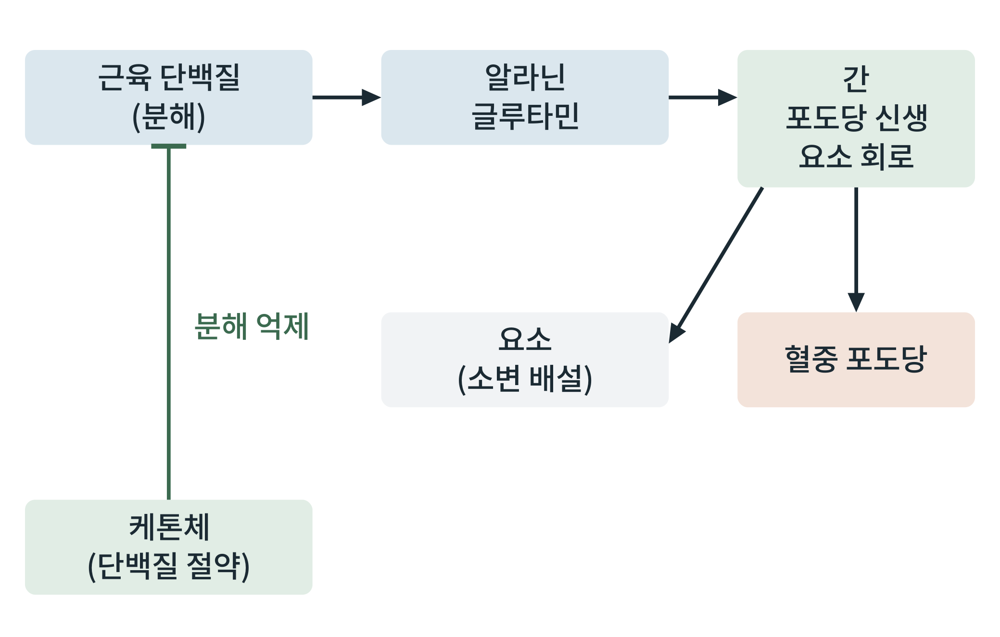

## 제26장 단백질 보존과 근육-간 아미노산 회로

> **이 장의 출발점** 1970년 필립 펠리그(Philip Felig)와 조지 케이힐 등은 사람의 팔 정맥혈과 동맥혈을 비교해 근육이 내보내는 아미노산을 측정했다. 단식 중 근육에서 나오는 아미노산 가운데 알라닌과 글루타민이 근육 단백질에서 기대되는 양보다 훨씬 많은 비율을 차지했고, 이 알라닌이 간에서 포도당의 재료가 된다는 결과가 보고되었다(Felig et al., 1970). 근육이 단백질을 분해해 아미노산을 곧바로 내보내는 것이 아니라 일부를 알라닌과 글루타민으로 바꾸어 내보낸다는 것이다. 이 장은 단식에서 근육 단백질이 포도당의 재료로 쓰이는 경로와, 그 소모를 줄이는 몸의 장치를 다룬다.

### 26.1 단식 초기의 근육 단백질 분해

23장에서 포도당 신생이 간 글리코겐이 바닥난 뒤의 혈당을 지킨다고 했다. 그 재료 가운데 단백질 유래 아미노산이 큰 몫이다. 단식 초기에는 뇌의 포도당 요구량이 크지만 케톤체는 아직 적어, 포도당 신생에 필요한 아미노산을 근육 단백질에서 얻는다. 이때 근육은 분해한 아미노산의 탄소 골격 일부를 알라닌과 글루타민으로 바꾸어 혈액에 내보낸다. 알라닌은 간으로 가서 포도당 신생의 재료가 되고, 이때 아미노기는 요소 회로를 거쳐 요소로 배설된다. 글루타민은 장과 신장으로 가서 암모니아와 포도당 신생의 재료를 공급한다.

**그림 26-1. 공복의 근육-간 아미노산 회로.** 근육 단백질에서 나온 알라닌과 글루타민이 간으로 가서 포도당 신생과 요소 회로를 거치고, 그 결과 혈중 포도당이 만들어지고 요소가 소변으로 배설된다. 장기 단식에서 늘어나는 케톤체는 근육 단백질 분해를 억제한다.

그림 26-1에서 읽을 점은 두 가지이다. 첫째, 이 회로가 계속되면 근육 질량이 줄어들고 요소 배설이 늘어난다. 둘째, 케톤체가 근육 단백질 분해를 억제하는 되먹임이 있다. 이 되먹임이 장기 단식에서 단백질 소모를 크게 줄이는 장치로 해석된다. 이 되먹임의 정확한 기전은 사람에서 아직 모두 밝혀지지 않았다.

### 26.2 단식이 길어질 때의 적응

단식이 며칠을 넘기면 간의 케톤 생성이 늘고(25장), 뇌가 케톤체를 쓰는 비중이 커져 뇌의 포도당 요구량이 줄어든다. 그 결과 포도당 신생에 필요한 아미노산이 줄고, 근육 단백질 분해 속도와 요소 배설량이 단식 초기보다 낮아진다. 소변의 질소 배설이 줄어드는 것이 이 적응의 관찰 지표로 쓰여 왔다. 이 적응은 단식 기간에 몸이 가진 단백질을 아끼는 쪽으로 대사가 재배치된다는 뜻이다. 다만 아낀다는 말이 단백질 손실이 없다는 뜻은 아니다. 장기 단식에서도 근육과 장기 단백질은 계속 줄어들며, 이 손실이 단식의 위험의 하나이다.

**표 26-1. 단식 단계별 단백질 대사의 경향.**

| 단식 단계 | 단백질 분해 | 아미노산의 주 쓰임 | 요소 배설 | 케톤체의 영향 |
|---|---|---|---|---|
| 흡수후기 | 낮음 | 단백질 합성 유지 | 낮음 | 거의 없음 |
| 단식 초기(1~3일) | 증가 | 포도당 신생 재료 | 증가 | 늘기 시작 |
| 장기 단식 | 감소 | 일부 포도당 신생 | 초기보다 감소 | 뇌가 케톤 이용, 분해 억제에 기여 |

표 26-1은 단백질 대사가 단식 중 단일 방향으로 가지 않고 초기에 증가했다가 장기에 줄어드는 곡선임을 보여 준다. 이 흐름은 22장의 연료 곡선과 같은 시간표 위에 놓인다.

### 26.3 근육 보존과 약물 설계

이 장의 내용은 체중 감량 약물의 설계에서 직접적인 의미를 가진다. 식사량이 줄어드는 약물 치료에서는 체중 감소 가운데 일부가 제지방량(근육 포함)에서 나온다. 단식 상태와 정확히 같은 상황은 아니지만, 에너지 섭취가 줄면 근육 단백질이 연료원으로 일부 쓰이는 방향의 압력이 생긴다. 이 때문에 지방은 줄이면서 근육을 지키려는 접근이 약물 개발의 주제가 되었다. 미오스타틴/액티빈 경로를 막아 근육 성장을 돕는 약물, 단백질 섭취와 저항 운동의 병행이 그 예이다. 16장에서 본 근육 보존 주제가 여기서 대사 근거를 얻는다. 어느 접근이 사람에서 효과와 안전성을 함께 보이는지는 임상시험 결과를 확인해야 한다.

### 이 장의 요점

- 단식 초기에는 뇌의 포도당 요구를 채우기 위해 근육 단백질이 분해되어 알라닌과 글루타민이 간과 신장으로 간다.
- 알라닌의 탄소는 포도당 신생의 재료가 되고, 아미노기는 요소 회로로 요소가 되어 소변으로 배설된다.
- 장기 단식에서는 케톤체가 뇌의 연료가 되고 근육 단백질 분해를 억제해 단백질 소모와 요소 배설이 줄어든다.
- 단백질 보존은 손실이 없다는 뜻이 아니며, 장기 단식에서도 근육과 장기 단백질은 줄어든다.
- 체중 감량 약물에서 제지방량 보존은 약물 설계의 주요 과제이다.

#### 참고문헌

Felig, P., Pozefsky, T., Marliss, E., & Cahill, G. F., Jr. (1970). Alanine: Key role in gluconeogenesis. *Science, 167*(3920), 1003–1004. https://doi.org/10.1126/science.167.3920.1003

Cahill, G. F., Jr. (2006). Fuel metabolism in starvation. *Annual Review of Nutrition, 26*, 1–22. https://doi.org/10.1146/annurev.nutr.26.061505.111258

Wolfe, R. R. (2006). The underappreciated role of muscle in health and disease. *American Journal of Clinical Nutrition, 84*(3), 475–482. https://doi.org/10.1093/ajcn/84.3.475
