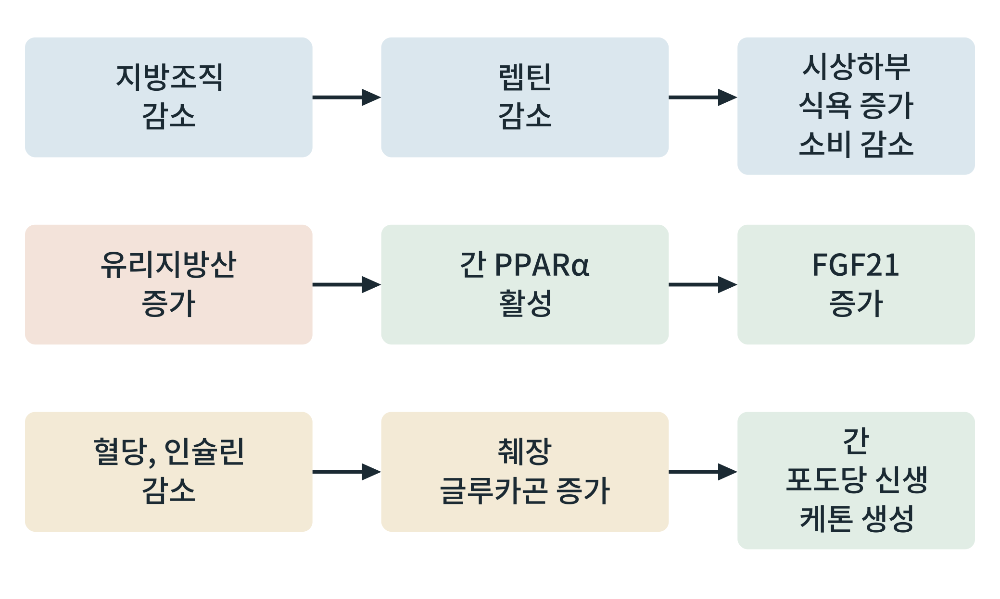

## 제27장 공복 호르몬과 적응

> **이 장의 출발점** 1996년 렙틴(leptin)을 지방 호르몬으로 막 알아낸 연구자들은 쥐를 이틀 동안 굶기면 혈중 렙틴이 크게 줄고, 같이 갑상선 호르몬과 생식 호르몬 등이 내려가며 스트레스 호르몬은 오른다는 것을 관찰했다. 굶는 쥐에게 렙틴을 주사하면 이 신경내분비 변화의 상당 부분이 막혔다(Ahima et al., 1996). 렙틴이 지방량의 신호를 넘어 몸이 굶고 있다는 신호로 작동한다는 것이다. 그로부터 10여 년 뒤인 2007년에는 간에서 분비되는 FGF21이 공복 반응의 내분비 신호로 보고되었다(Inagaki et al., 2007). 이 장은 공복의 호르몬들이 어떤 순서와 목적으로 움직이는지를 정리한다.

### 27.1 공복에서 달라지는 호르몬의 큰 그림

공복은 한 호르몬이 아니라 여러 호르몬이 동시에 바뀌는 상태이다. 크게 보면 에너지를 꺼내 쓰게 하는 호르몬(글루카곤, 카테콜아민, 코르티솔, 성장호르몬)은 오르고, 에너지를 저장하고 쓰게 하는 호르몬(인슐린, 갑상선 호르몬 T3, 렙틴)은 내려간다. 그 사이에 FGF21처럼 공복에 새로 오르는 신호가 더해진다. 이 변화들은 서로 다른 시간 규모로 일어나며, 공복 초기에는 인슐린과 글루카곤이 먼저, 이후 렙틴과 갑상선 호르몬이 천천히 바뀐다.

**그림 27-1. 공복 신호의 세 줄기.** 위쪽 줄은 지방조직이 줄어 렙틴이 감소하고 시상하부가 식욕을 높이고 에너지 소비를 줄이는 경로이다. 가운데 줄은 유리지방산 증가가 간의 PPARα를 활성화해 FGF21을 늘리는 경로이다. 아래쪽 줄은 혈당과 인슐린이 내려 글루카곤이 오르고 간이 포도당 신생과 케톤 생성을 늘리는 경로이다.

그림 27-1은 공복 신호가 서로 독립적인 세 경로로 읽을 수 있음을 보여 준다. 첫째 경로는 뇌에 에너지 부족을 알리고, 둘째 경로는 간이 지방산을 쓰는 상태를 전신에 알리며, 셋째 경로는 간이 연료를 만들게 한다. 세 경로는 하나의 호르몬만 건드리는 약물이 공복 반응의 일부분만 바꿀 수 있다는 점을 함께 보여 준다.

### 27.2 호르몬별 역할

**표 27-1. 주요 공복 호르몬과 역할.**

| 호르몬 | 공복에서의 변화 | 주 표적 | 주요 효과 | 관련 장 |
|---|---|---|---|---|
| 글루카곤 | 증가 | 간 | 글리코겐 분해, 포도당 신생, 케톤 생성 | 23장, 25장 |
| 인슐린 | 감소 | 간, 지방, 근육 | 지방 분해 해제, 포도당 이용 감소 | 24장 |
| 카테콜아민 | 증가 | 지방조직, 간 | 지방 분해와 포도당 생산 촉진 | 24장 |
| 코르티솔 | 증가 | 간, 근육, 지방 | 포도당 신생, 단백질 분해 촉진 | 26장 |
| 성장호르몬 | 증가 | 지방, 근육 | 지방 분해 촉진, 인슐린 작용 길항 | 24장 |
| 갑상선 호르몬(T3) | 감소 | 전신 | 에너지 소비 감소 | 20장 |
| 렙틴 | 감소 | 시상하부 | 식욕 증가, 에너지 소비 감소, 신경내분비 조정 | 이 장 |
| FGF21 | 증가 | 뇌, 지방조직, 간 | 지방산 이용과 케톤 생성 조정, 식행동 변화 | 이 장 |

표 27-1에서 읽을 점은 호르몬의 방향이 일관된다는 것이다. 연료를 꺼내 쓰게 하는 쪽은 오르고, 소비를 줄이는 쪽은 내려간다. 따라서 공복에서 에너지 소비는 줄고 식욕은 올라 체중 감량의 정체가 호르몬 수준에서 설명된다. 렙틴 감소는 시상하부의 AgRP/NPY 뉴런을 켜서 식욕을 올리고 에너지 소비를 줄이는 신호로 해석되며, 이 해석은 3장에서 다룬 시상하부 회로의 근거가 된다. FGF21은 공복에서 간 PPARα를 통해 오르고, 지방산 이용과 케톤 생성을 돕는다. 사람에서 FGF21이 공복 신호로 얼마나 작동하는지는 설치류보다 해석이 조심스럽고, 단식이 길어야 혈중 농도가 오른다는 보고가 있다.

### 27.3 적응의 대가: 소비 감소와 식욕 증가

공복의 호르몬 적응은 짧은 단식에서 생존에 유리하지만, 체중 감량을 목표로 하는 치료에서는 방해가 된다. 체중이 줄면 렙틴이 내려가고, 시상하부는 식욕을 올리고 에너지 소비를 줄이는 쪽으로 반응해 체중이 다시 늘기 쉬워진다. 이 적응은 의지와 무관하게 작동한다. 렙틴 보충으로 이 적응을 되돌리려는 시도는 일반 비만 환자에서는 큰 효과를 보이지 못했는데, 비만에서는 렙틴이 이미 높아 저항이 있기 때문으로 해석된다(1권 3장). 체중 감소 후의 호르몬 적응이 장기간 지속된다는 보고는 있으나, 얼마나 오래 가는지와 약물이 이를 얼마나 바꾸는지는 연구가 더 필요하다.

### 27.4 약물 설계의 관점

공복 호르몬의 시간표는 약물 개입의 지도이다. GLP-1 작용제는 식욕 신호를 시상하부와 뇌간에서 바꾸어 공복 적응의 식욕 증가를 일부 상쇄한다고 해석된다. FGF21 유사체는 지방간염과 대사 질환에서 임상시험이 진행되었고, 글루카곤 계열 신호를 결합한 이중·삼중 작용제는 공복의 연료 이동 일부를 약물로 재현하려는 시도이다. 이 약물들이 어떤 경로를 어느 정도 건드리는지는 표 27-1을 지도로 삼아 약물별로 확인한다. 공복 신호를 흉내 내는 약물은 해당 신호의 부작용도 같이 가져올 수 있다는 점을 고려해야 한다.

### 이 장의 요점

- 공복에서는 글루카곤, 카테콜아민, 코르티솔, 성장호르몬이 오르고, 인슐린, 갑상선 호르몬(T3), 렙틴이 내려가며, FGF21이 새로 오른다.
- 렙틴 감소는 시상하부에 에너지 부족을 알려 식욕을 올리고 에너지 소비를 줄인다.
- FGF21은 간 PPARα를 통해 오르며 지방산 이용과 케톤 생성을 조정하고, 사람에서의 정확한 역할은 연구 중이다.
- 공복 적응은 생존에 유리하지만 체중 감량 치료에서는 소비 감소와 식욕 증가로 정체와 재증가를 만든다.
- 약물 설계에서는 표 27-1을 지도로 삼아 약물이 어느 신호를 바꾸는지 구분한다.

#### 참고문헌

Ahima, R. S., Prabakaran, D., Mantzoros, C., Qu, D., Lowell, B., Maratos-Flier, E., & Flier, J. S. (1996). Role of leptin in the neuroendocrine response to fasting. *Nature, 382*(6588), 250–252. https://doi.org/10.1038/382250a0

Inagaki, T., Dutchak, P., Zhao, G., Ding, X., Gautron, L., Parameswara, V., Li, Y., Goetz, R., Mohammadi, M., Esser, V., Elmquist, J. K., Gerard, R. D., Burgess, S. C., Hammer, R. E., Mangelsdorf, D. J., & Kliewer, S. A. (2007). Endocrine regulation of the fasting response by PPARα-mediated induction of fibroblast growth factor 21. *Cell Metabolism, 5*(6), 415–425. https://doi.org/10.1016/j.cmet.2007.05.003

Rosenbaum, M., & Leibel, R. L. (2010). Adaptive thermogenesis in humans. *International Journal of Obesity, 34*(S1), S47–S55. https://doi.org/10.1038/ijo.2010.184
