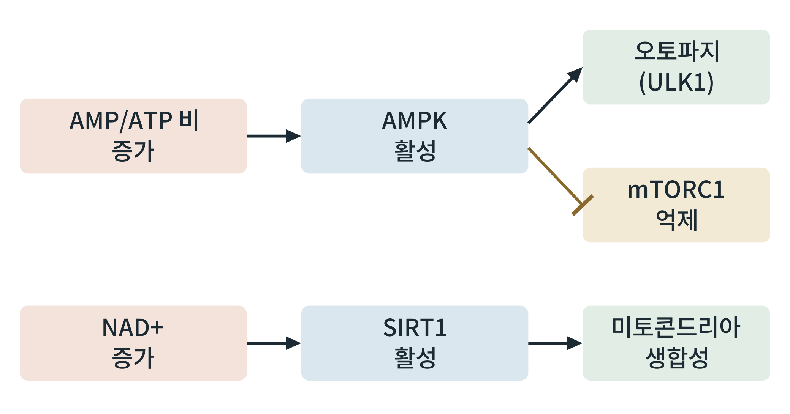

## 제28장 공복 신호: AMPK, 시르투인, 오토파지

> **이 장의 출발점** 1992년 일본 도쿄대학의 오스미 요시노리(大隅良典)는 효모를 굶겨 액포(vacuole) 안에 세포 성분이 쌓이는 모습을 현미경으로 관찰했다. 이어 그는 이 과정이 일어나지 않는 돌연변이 효모를 분리했고, 1993년 오토파지(autophagy, 자가포식)에 필요한 유전자를 찾는 길을 열었다(Tsukada & Ohsumi, 1993). 세포는 영양이 끊기면 자기 성분을 스스로 분해해 재활용한다는 것이다. 오스미는 이 업적으로 2016년 노벨 생리학·의학상을 받았다. 이 장은 세포 안에서 에너지 부족을 감지해 이 재활용과 연료 전환을 일으키는 신호 경로를 정리한다.

### 28.1 에너지 부족을 읽는 센서: AMPK

AMPK(AMP-activated protein kinase)는 세포의 에너지 상태를 재는 센서 효소이다. 세포가 ATP를 많이 쓰면 AMP와 ADP가 늘어, 이들이 AMPK에 붙어 활성화를 돕고, 상위 키나아제(LKB1 등)가 AMPK를 인산화해 켠다. 켜진 AMPK는 ATP를 쓰는 합성 경로를 끄고(지방산 합성의 아세틸-CoA 카르복실라아제 인산화로 억제) ATP를 만드는 분해 경로를 켠다. 24장에서 본 말로닐-CoA 감소와 지방산 산화 증가가 이 작용의 한 예이다. AMPK는 8장과 14장의 mTOR와 짝을 이루는 신호이다. 에너지가 풍부하면 mTORC1이 켜져 합성을 늘리고, 에너지가 부족하면 AMPK가 켜져 mTORC1을 억제하고 합성을 줄인다.

### 28.2 NAD+를 읽는 센서: 시르투인

시르투인(sirtuin)은 NAD+를 써서 단백질의 아세틸기를 떼는 효소 계열이다. 공복에서는 세포 안 NAD+가 늘어 SIRT1 같은 시르투인이 활성화된다. SIRT1은 PGC-1α를 탈아세틸화해 활성화하고, 이로써 미토콘드리아 생합성과 지방산 산화가 늘어난다. AMPK와 SIRT1은 서로를 돕는 것으로 알려져 있다. AMPK가 NAD+를 올려 SIRT1을 돕고, SIRT1이 LKB1을 탈아세틸화해 AMPK를 돕는다는 보고가 있다. 다만 이 되먹임이 사람 조직에서 얼마나 일어나는지는 설치류와 세포 실험보다 근거가 약하다.

**그림 28-1. 공복의 두 에너지 센서.** AMP/ATP 비가 오르면 AMPK가 켜져 오토파지의 시작 효소(ULK1)를 활성화하고 mTORC1을 억제한다. NAD+가 오르면 SIRT1이 켜져 미토콘드리아 생합성을 늘린다. 두 센서는 서로의 활성을 돕는다고 보고되었으나, 그림은 각 센서의 주된 출력만 간략히 나타낸다.

그림 28-1에서 읽을 점은 두 가지이다. 첫째, 센서가 둘이고 감지하는 신호가 다르다. AMPK는 에너지 전하(AMP/ATP)를, SIRT1은 산화환원 상태(NAD+)를 읽는다. 둘째, 출력이 서로 다른 목표를 가진다. 오토파지는 세포 성분을 분해해 재활용하는 쪽이고, 미토콘드리아 생합성은 에너지 생산 능력을 늘리는 쪽이다. 즉 공복에서 세포는 쓸 수 있는 것을 재활용하는 동시에 에너지 생산 설비를 늘린다.

### 28.3 오토파지: 세포 안의 재활용

오토파지는 세포질의 성분이 이중막 소포(오토파고솜)에 싸여 리소솜으로 가서 분해되는 과정이다. 영양이 있을 때는 mTORC1이 ULK1을 인산화해 오토파지를 꺼 두고, 영양이 줄면 mTORC1이 꺼지고 AMPK가 ULK1을 직접 인산화해 켠다. 오토파지로 분해된 성분은 아미노산, 지방산 같은 재료가 되어 세포 안 에너지원과 합성 재료가 된다. 또 손상된 미토콘드리아를 골라 없애는 미토파지도 이 경로의 한 갈래이다. 간에서는 오토파지가 공복 동안 글리코겐과 지질방울의 분해에 기여한다는 보고가 있다.

**표 28-1. 공복 센서와 출력의 정리.**

| 센서 | 감지 신호 | 켜지는 경로 | 꺼지는 경로 | 주요 결과 |
|---|---|---|---|---|
| AMPK | AMP/ATP 비 증가 | 지방산 산화, 포도당 흡수, 오토파지(ULK1) | 지방산·콜레스테롤 합성, mTORC1 | ATP 생산 증가, 합성 감소 |
| SIRT1 | NAD+ 증가 | PGC-1α 탈아세틸화, 미토콘드리아 생합성 | (해당 없음) | 산화 능력 증가 |
| mTORC1 | 아미노산, 인슐린 높음 | 단백질·지질 합성, 오토파지 억제 | 공복에서 억제 | 식후에는 켜지고 공복에는 꺼짐 |

표 28-1은 세 신호가 한 방향으로 움직임을 보여 준다. 공복에서는 합성을 끄고 분해와 재활용을 켜며, 식후에는 반대이다. 이 반대 방향이 29장에서 다루는 전환 스위치의 분자 기반이다.

### 28.4 약물 설계의 관점

AMPK는 대사 질환의 오래된 약물 표적이다. 메트포르민은 AMPK 활성화와 연결되어 설명되어 왔으나 23장에서 본 것처럼 기전은 여전히 논의 중이다. 직접 AMPK 활성화제는 개발이 이어지고 있으나 임상 성공이 제한적이었다. 시르투인 활성화제(레스베라트롤 등)와 NAD+ 전구체(니코틴아미드 리보사이드 등)는 사람 시험에서 효과가 일관되지 않다. 이 센서들은 세포 안 여러 경로를 한꺼번에 건드리므로 선택성과 안전성이 약물 설계의 중심 과제이다. 오토파지를 약물로 조절하는 접근도 연구 중이며, 지나친 활성화나 억제 모두 해가 될 수 있다.

### 이 장의 요점

- AMPK는 AMP/ATP 비를 읽어 합성 경로를 끄고 분해와 산화를 켜는 센서이며, mTORC1을 억제하고 ULK1을 켜 오토파지를 시작한다.
- 시르투인(SIRT1)은 NAD+를 읽어 PGC-1α를 활성화해 미토콘드리아 생합성을 늘린다.
- 오토파지는 세포 성분을 분해해 재활용하는 과정이며, 영양이 있을 때는 mTORC1이 막고 공복에서 풀린다.
- 공복에서는 합성을 줄이고 재활용과 산화를 늘리는 쪽으로 세포 신호가 한 방향으로 정렬된다.
- AMPK와 시르투인 약물은 선택성과 사람에서의 일관된 효과가 과제이다.

#### 참고문헌

Tsukada, M., & Ohsumi, Y. (1993). Isolation and characterization of autophagy-defective mutants of *Saccharomyces cerevisiae*. *FEBS Letters, 333*(1–2), 169–174. https://doi.org/10.1016/0014-5793(93)80398-E

Herzig, S., & Shaw, R. J. (2018). AMPK: Guardian of metabolism and mitochondrial homeostasis. *Nature Reviews Molecular Cell Biology, 19*(2), 121–135. https://doi.org/10.1038/nrm.2017.95

Mizushima, N., & Komatsu, M. (2011). Autophagy: Renovation of cells and tissues. *Cell, 147*(4), 728–741. https://doi.org/10.1016/j.cell.2011.10.026

Cantó, C., & Auwerx, J. (2009). PGC-1α, SIRT1 and AMPK, an energy sensing network that controls energy expenditure. *Current Opinion in Lipidology, 20*(2), 98–105. https://doi.org/10.1097/MOL.0b013e328328d0a4
