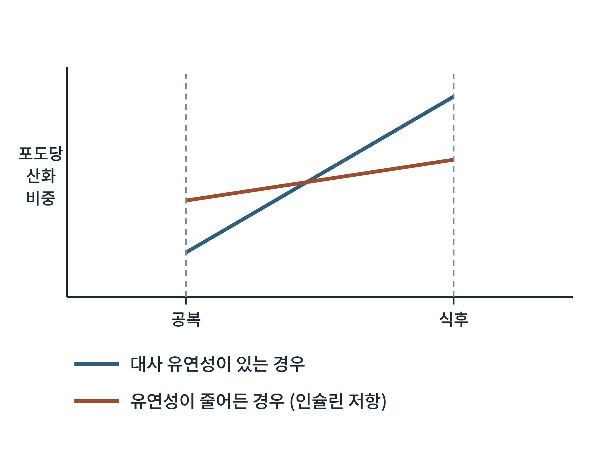

## 제29장 식후와 공복의 전환 스위치: 대사 유연성

> **이 장의 출발점** 1963년 영국 케임브리지의 필립 랜들(Philip Randle)과 동료들은 쥐의 심장과 횡격막 근육에 지방산이나 케톤체를 주면 포도당 이용이 줄어드는 것을 측정해, 연료들이 서로 경쟁한다는 포도당-지방산 회로를 제안했다(Randle et al., 1963). 근육은 지방산이 많으면 포도당을 덜 쓰고, 포도당이 많으면 지방산을 덜 쓴다는 것이다. 세월이 흘러 2000년에 켈리와 만다리노는 인슐린 저항이 있는 사람의 근육이 식후에 포도당 쪽으로 연료를 바꾸지 못하고, 공복에도 지방산 쪽으로 온전히 바꾸지 못하는 모습을 정리했다(Kelley & Mandarino, 2000). 이 장은 5부와 6부를 잇는 전환 스위치가 무엇이며 어떻게 고장 나는지를 다룬다.

### 29.1 대사 유연성이란 무엇인가

대사 유연성(metabolic flexibility)은 몸이 연료의 가용성에 맞추어 쓰는 연료를 바꿀 수 있는 능력이다. 공복에서는 지방산 산화 비중이 높아지고, 식후에는 포도당 산화 비중이 높아지며, 이 전환이 빠르고 폭이 크면 유연성이 높다고 말한다. 측정은 호흡교환율(respiratory exchange ratio)로 흔히 한다. 호흡교환율은 이산화탄소 배출량을 산소 소비량으로 나눈 값으로, 순수한 포도당 산화에서는 1.0에, 순수한 지방 산화에서는 약 0.7에 가깝다. 공복에서 낮고 식후에 높아지면 연료가 잘 바뀌는 것이다.

**그림 29-1. 대사 유연성의 개념도.** 유연성이 있는 몸은 공복에는 포도당 산화 비중이 낮고(지방 산화가 중심), 식후에는 높아져 전환 폭이 크다. 유연성이 줄어든 몸(인슐린 저항 등)은 공복에도 포도당 쪽 비중이 높게 남고, 식후에 충분히 올라가지 못해 전환 폭이 작다. 세로축은 포도당 산화 비중의 상대 수준을 나타내는 개념도이다.

그림 29-1에서 읽을 점은 두 가지이다. 첫째, 유연성의 핵심은 값이 아니라 전환 폭이다. 공복과 식후의 차이가 클수록 유연하다. 둘째, 유연성이 줄어들면 두 선이 교차해 공복에서는 포도당 쪽으로, 식후에서는 지방 쪽으로 기울어 있다. 즉 상황에 맞는 연료를 고르지 못한다. 이 모습은 켈리와 만다리노가 근육에서 관찰한 모양과 같은 방향이지만, 그림의 선 값은 설명용이다.

### 29.2 전환 스위치의 분자 구성

식후와 공복을 가르는 분자 스위치는 이미 앞 장들에서 하나씩 나왔다. 이 절은 이를 한 곳에 모은다.

**표 29-1. 식후와 공복의 전환 스위치.**

| 스위치 | 식후 상태 | 공복 상태 | 관련 장 |
|---|---|---|---|
| 인슐린/글루카곤 비 | 높음 | 낮음 | 15장, 23장 |
| AMPK/mTORC1 | mTORC1 켜짐 | AMPK 켜짐, mTORC1 억제 | 14장, 28장 |
| 말로닐-CoA / CPT1 | 말로닐-CoA 높음, 지방산 산화 억제 | 말로닐-CoA 낮음, 산화 증가 | 24장 |
| PDH 활성 | 켜짐(포도당 산화) | 꺼짐(PDK 활성, 피루브산 보존) | 이 장 |
| 간 케톤 생성(HMGCS2) | 꺼짐 | 켜짐 | 25장 |
| 지방 분해(ATGL, HSL) | 억제 | 활성 | 24장 |

표 29-1에서 읽을 점은 스위치가 하나가 아니라 여러 층이라는 점이다. 호르몬 층(인슐린/글루카곤), 세포 센서 층(AMPK/mTORC1), 효소 층(CPT1, PDH, HMGCS2)이 같은 방향으로 움직여야 연료가 제대로 바뀐다. 피루브산 탈수소효소(pyruvate dehydrogenase, PDH)는 해당과정과 TCA 회로를 잇는 문이다. 공복에서 지방산 산화가 높아지면 아세틸-CoA와 NADH가 늘어 PDH 키나아제를 켜서 PDH를 꺼 포도당 산화를 줄이는데, 이것이 랜들 회로의 한 해석이다.

### 29.3 유연성이 줄어드는 상태

켈리와 만다리노 이후 대사 유연성 저하는 인슐린 저항과 비만에서 흔히 관찰되었다. 근육에서 공복의 지방산 산화가 충분히 올라가지 못하거나, 식후의 포도당 산화가 충분히 오르지 못한다는 보고가 있고, 원인으로 미토콘드리아 기능 저하, 이소성 지질 대사산물 축적, 만성적인 높은 인슐린과 높은 유리지방산 같은 후보가 거론된다. 21장에서 본 인슐린 저항의 분자 가설들과 겹치는 부분이다. 다만 유연성 저하가 인슐린 저항의 원인인지 결과인지, 그리고 호흡교환율로 잰 값이 조직 수준의 변화를 얼마나 반영하는지는 논쟁이 남아 있다.

### 29.4 약물 설계의 관점

대사 유연성은 약물 효과의 평가 지표이자 표적이다. 체중 감량과 인슐린 감수성 개선이 유연성을 회복하는지가 연구되고 있고, 단식이나 시간제한 식사가 유연성을 높인다는 가설도 있다(30장). 약물 설계에서 유연성을 직접 표적으로 삼기는 어렵다. 스위치가 여러 층에 걸쳐 있어 한 효소를 건드려도 다른 층이 보상할 수 있기 때문이다. 따라서 임상시험에서는 호흡교환율, 연료 산화량, 인슐린 감수성을 함께 측정하는 방식이 쓰인다. 1권 3·8장에서 다룬 센서와 이 장의 스위치를 묶으면, 어떤 약물이 어느 층의 스위치를 바꾸는지를 구분하는 틀이 된다.

### 이 장의 요점

- 대사 유연성은 연료 가용성에 맞추어 포도당과 지방 사이에서 쓰는 연료를 바꾸는 능력이며, 핵심은 전환 폭이다.
- 전환 스위치는 호르몬(인슐린/글루카곤), 세포 센서(AMPK/mTORC1), 효소(CPT1, PDH, HMGCS2)의 세 층으로 구성된다.
- 랜들 회로는 지방산이 많으면 포도당 산화가 줄고 그 반대도 성립한다는 연료 경쟁 이론이다.
- 인슐린 저항과 비만에서는 유연성이 줄어든다는 보고가 많지만, 원인과 결과의 방향은 논쟁 중이다.
- 약물 평가에서는 호흡교환율, 연료 산화량, 인슐린 감수성을 함께 측정해 어느 층의 스위치가 바뀌는지 구분한다.

#### 참고문헌

Randle, P. J., Garland, P. B., Hales, C. N., & Newsholme, E. A. (1963). The glucose fatty-acid cycle: Its role in insulin sensitivity and the metabolic disturbances of diabetes mellitus. *The Lancet, 281*(7285), 785–789. https://doi.org/10.1016/S0140-6736(63)91500-9

Kelley, D. E., & Mandarino, L. J. (2000). Fuel selection in human skeletal muscle in insulin resistance: A reexamination. *Diabetes, 49*(5), 677–683. https://doi.org/10.2337/diabetes.49.5.677

Goodpaster, B. H., & Sparks, L. M. (2017). Metabolic flexibility in health and disease. *Cell Metabolism, 25*(5), 1027–1036. https://doi.org/10.1016/j.cmet.2017.04.015
