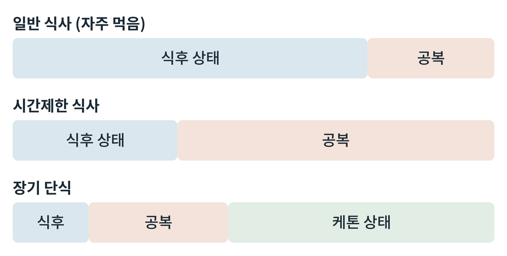

## 제30장 공복 대사의 응용: 단식, 시간제한 식사, 식물성 케톤식

> **이 장의 출발점** 1965년 스코틀랜드 던디의 병원에 비만으로 입원한 27세 청년 앵거스 바비에리(Angus Barbieri)는 의사의 감독 아래 비타민과 전해질만 보충하며 단식을 시작했다. 그는 약 1년 넘게 이어진 단식 끝에 크게 체중을 줄였고, 담당 의사들은 이를 1973년에 보고했다(Stewart & Fleming, 1973). 이 사례는 지금도 안전성이 확인된 방법으로 소개되지 않으며, 의학적 감독 아래의 예외로만 읽힌다. 이 장은 6부에서 다룬 공복 대사가 단식, 시간제한 식사, 케톤식이라는 응용에서 어떻게 나타나는지, 그리고 무엇이 확인되었고 무엇이 아직 아닌지를 정리한다.

### 30.1 응용 방식이 공복 대사를 건드리는 방법

세 응용은 모두 공복 대사의 일부를 불러온다. 간헐적 단식과 시간제한 식사는 식후 상태에서 보내는 시간을 줄이고 공복 상태에서 보내는 시간을 늘린다. 장기 단식은 22장의 장기 단식기까지 가서 케톤 상태에 이른다. 식물성 케톤식을 포함한 케톤식은 먹으면서도 탄수화물을 줄여 인슐린을 낮게 유지하고 케톤 생성을 켜서, 공복 대사의 일부를 식사로 흉내 낸다는 접근이다.

**그림 30-1. 식사 방식에 따른 하루 대사 상태의 구성.** 일반 식사에서는 식후 상태가 대부분이고 공복 상태는 짧다. 시간제한 식사는 식후 상태의 창을 줄여 공복 상태의 비중을 늘린다. 장기 단식은 공복을 넘어 케톤 상태까지 이어진다. 막대의 길이는 개념을 보이기 위한 것이며 실제 시간에 비례하지 않는다.

그림 30-1에서 읽을 점은 두 가지이다. 첫째, 세 방식은 같은 연속선 위에 있다. 공복 상태에 머무는 시간이 길수록 22장의 시간표에서 뒤쪽 단계로 간다. 둘째, 케톤 상태는 공복이 충분히 길 때에만 나타난다. 시간제한 식사만으로 케톤 상태에 이르는지는 공복의 길이, 마지막 식사의 구성, 개인의 글리코겐 저장량에 따라 달라지므로 일률적으로 말할 수 없다.

### 30.2 방식별 비교

**표 30-1. 단식, 시간제한 식사, 케톤식의 비교.**

| 방식 | 공복 대사와의 관계 | 대사 상태 | 알려진 이점 가설 | 알려진 한계·주의 |
|---|---|---|---|---|
| 시간제한 식사 | 매일 식사 창을 줄여 공복 시간을 늘림 | 흡수후기 중심, 케톤은 제한적 | 체중과 대사 지표 개선 가능성 | 단순한 열량 감소와 구별 필요, 장기 근거 제한 |
| 격일·주기적 단식 | 공복 단계의 뒷부분까지 주기적으로 도달 | 단식기, 일부 케톤 상승 | 체중 감소, 인슐린 감수성 개선 가능성 | 순응도와 제지방량 감소, 임상시험 기간 제한 |
| 장기 단식 | 장기 단식기 | 케톤 상태, 단백질 손실 | 임상 감독 아래의 연구 | 전해질 이상, 근육 손실, 재급식 증후군 위험 |
| 케톤식(식물성 포함) | 식사로 낮은 인슐린과 케톤 생성을 유지 | 영양적 케톤 상태 | 체중 감소, 혈당 개선, 신경질환 보조 | 탄수화물 제한 순응도, 지질 변화, 장기 안전성 확인 필요 |

표 30-1에서 읽을 점은 이점 가설과 한계가 한 줄에 같이 있다는 것이다. 이점은 대부분 가설이거나 단기 시험의 결과이고, 한계는 열량 감소 효과와의 분리, 제지방량 보존, 장기 안전성이다. 이 책은 6부에서 다룬 대사 기전이 이 방식들의 효과를 설명할 후보를 제공하지만, 그 기전이 사람에서 효과의 원인임을 증명하지는 않는다고 본다.

### 30.3 안전성과 금기

공복 대사를 응용하는 방식은 사람에 따라 위험이 다르다. 1형 당뇨병 환자와 인슐린이나 설포닐유레아를 쓰는 당뇨병 환자는 저혈당과 케톤산증 위험이 있어 의료 감독이 필요하다. 임신과 수유, 섭식장애 병력이 있는 사람, 영양불량, 어린이와 청소년, 심한 신장·간 질환이 있는 사람은 일반적으로 단식 계열 방식의 대상에서 제외하거나 신중히 평가한다. SGLT2 억제제를 복용 중인 사람은 25장에서 본 케톤산증 위험이 올라간다. 장기 단식 뒤의 재급식은 전해질 이상(재급식 증후군)을 일으킬 수 있어 단계적으로 해야 한다. 이 책은 치료 지침을 제시하는 책이 아니므로, 구체적 적용은 의료진과 임상 지침을 따라야 한다.

### 30.4 약물 설계의 관점

단식과 케톤식은 약물과 경쟁하기도 하고 병용되기도 한다. 약물이 식욕을 줄여 사실상 장기간 낮은 섭취를 만드는 경우, 공복 대사의 어떤 부분이 함께 나타나는지(케톤, 지방 분해, 근육 단백질 소모)가 약물 평가의 질문이 된다. 또 식사 방식이 약물의 효과나 부작용(예: 위장관 증상, 저혈당 위험)을 바꿀 수 있다. 약물 개발에서는 식사 방식을 통제하거나 층화해 약물 효과를 구분하는 설계가 필요하다. 이 점은 3권 임상시험 설계에서 다시 다룬다.

### 6부 점검: 공복 에너지 수지표

6부(22~30장)의 내용을 연료 공급원별로 정리한다. 공복의 에너지는 저장고(글리코겐, 지방, 단백질)에서 나오며, 시간이 지날수록 공급원이 바뀐다.

**표 30-2. 공복 에너지 수지표(구조).**

| 공급원 | 쓰는 조직 | 시간표에서의 위치 | 신호 | 해당 장 |
|---|---|---|---|---|
| 간 글리코겐 | 혈당을 통해 뇌, 적혈구 | 흡수후기에 주도, 약 하루 안에 소진 | 글루카곤 증가, 인슐린 감소 | 23장 |
| 포도당 신생(젖산, 아미노산, 글리세롤) | 뇌, 적혈구 | 단식기에 중심 | 글루카곤, 코르티솔 | 23장, 26장 |
| 지방(유리지방산) | 근육, 심장, 간 | 단식기부터 주 연료 | 인슐린 감소, 카테콜아민 | 24장 |
| 케톤체 | 뇌, 심장, 근육 | 장기 단식에서 증가 | 간 HMGCS2 활성 | 25장 |
| 단백질 | 포도당 신생 재료 | 단식 초기에 증가, 이후 감소 | 코르티솔, 케톤 되먹임 | 26장 |
| 세포 재활용(오토파지) | 세포 내 | 에너지 부족 전반 | AMPK, mTORC1 억제 | 28장 |

표 30-2는 공복이 하나의 연료를 쓰는 것이 아니라 여러 저장고를 시간 순서로 바꾸어 쓰는 구조임을 보여 준다. 5부(식후)에서 저장의 한계가 인슐린 저항으로 이어졌다면, 6부(공복)에서는 이 연료 교대가 제대로 일어나지 않을 때 대사 유연성 저하로 나타난다(29장). 7부는 이 연료 흐름이 간, 지방, 근육, 뇌, 신장 같은 조직에서 어떻게 통합되는지를 다룬다.

### 이 장의 요점

- 시간제한 식사, 주기적 단식, 장기 단식, 케톤식은 모두 공복 대사의 일부를 불러오는 연속선 위의 방식이다.
- 케톤 상태는 공복이 충분히 길 때 나타나며, 시간제한 식사만으로 도달하는지는 일률적으로 말할 수 없다.
- 이점 가설의 상당수는 단기 시험의 결과이거나 가설이며, 열량 감소 효과와의 분리와 제지방량 보존, 장기 안전성이 한계이다.
- 1형 당뇨병, 인슐린·설포닐유레아 사용, 임신·수유, 섭식장애 병력, SGLT2 억제제 사용 등에서는 위험이 달라 의료 감독이 필요하다.
- 6부의 연료 교대는 글리코겐, 포도당 신생, 지방, 케톤체, 단백질, 오토파지의 순으로 시간표에 맞추어 일어난다.

#### 참고문헌

Stewart, W. K., & Fleming, L. W. (1973). Features of a successful therapeutic fast of 382 days' duration. *Postgraduate Medical Journal, 49*(569), 203–209. https://doi.org/10.1136/pgmj.49.569.203

de Cabo, R., & Mattson, M. P. (2019). Effects of intermittent fasting on health, aging, and disease. *New England Journal of Medicine, 381*(26), 2541–2551. https://doi.org/10.1056/NEJMra1905136

Cahill, G. F., Jr. (2006). Fuel metabolism in starvation. *Annual Review of Nutrition, 26*, 1–22. https://doi.org/10.1146/annurev.nutr.26.061505.111258
