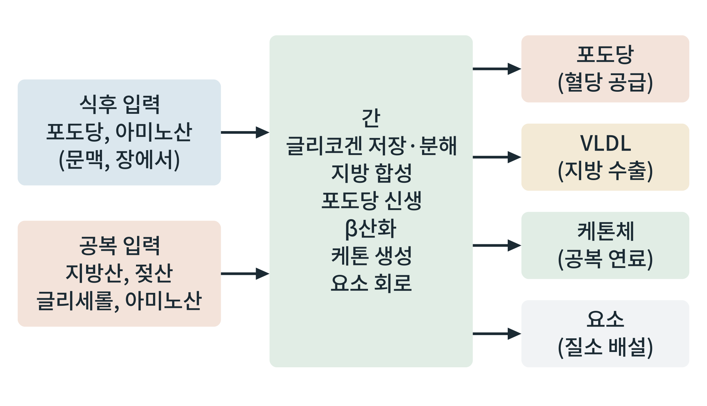

# 제7부 조직별 대사의 통합

## 제31장 간: 대사의 중앙 정거장

> **이 장의 출발점** 1850년대 프랑스 파리에서 클로드 베르나르(Claude Bernard)는 개의 간에 문맥 정맥으로 물을 흘려 간 속의 당을 씻어 낸 뒤에도, 몇 시간 뒤 같은 간에서 다시 당이 만들어진다는 것을 보였다. 간이 혈액에서 당을 받기만 하는 기관이 아니라 스스로 당을 만들어 내보내는 기관이라는 발견이었고, 그는 이 물질을 글리코겐이라 불렀다(Bernard, 1857). 베르나르는 이 발견에서 몸 안의 환경이 일정하게 유지된다는 생각으로 나아갔다. 이 장은 7부의 첫 장으로, 앞의 5부와 6부에서 흩어져 나온 간의 일을 한 장기에서 모아 읽는다.

### 31.1 간이 정거장인 이유

간은 구조상 몸의 연료가 오가는 길목에 놓여 있다. 장에서 흡수된 영양소는 문맥(간문맥)을 타고 먼저 간을 지나 전신으로 간다. 그래서 식사 뒤 장에서 오는 포도당과 아미노산의 상당 부분이 간에서 처음 처리된다. 공복에는 말초(지방조직, 근육)에서 나온 유리지방산, 젖산, 글리세롤, 아미노산이 간동맥과 문맥을 통해 간으로 들어와 포도당과 케톤체가 된다. 간은 입력이 식후와 공복에 바뀌어도 혈당과 혈중 연료를 일정 범위에 두는 역할을 한다.

**그림 31-1. 식후와 공복의 입력, 간의 기능, 출력.** 식후에는 포도당과 아미노산이 문맥으로 들어오고, 공복에는 지방산, 젖산, 글리세롤, 아미노산이 들어온다. 간은 이 입력을 글리코겐 저장·분해, 지방 합성, 포도당 신생, β산화, 케톤 생성, 요소 회로로 처리하고, 포도당, VLDL, 케톤체, 요소를 내보낸다.

그림 31-1에서 읽을 점은 입력이 둘이고 출력이 넷이라는 구조이다. 같은 장기가 식후에는 저장 쪽 경로를, 공복에는 생산 쪽 경로를 켠다. 출력 가운데 포도당과 케톤체는 다른 장기의 연료이고, VLDL은 지방을 다른 장기에 보내는 수단이며, 요소는 질소의 배출 경로이다. 간 자신이 연료를 쓰는 양은 이 출력의 크기에 비해 크지 않고, 간의 일은 교환과 분배이다.

### 31.2 식후와 공복에서 간이 하는 일

**표 31-1. 식후와 공복에서 간의 대사.**

| 대사 경로 | 식후(인슐린 높음) | 공복(글루카곤 높음) | 관련 장 |
|---|---|---|---|
| 글리코겐 | 합성(글리코겐 합성효소) | 분해(포스포릴라아제) | 18장, 23장 |
| 포도당 | 흡수와 이용(GLUT2, 글루코키나아제) | 포도당 신생과 방출(글루코스-6-포스파타아제) | 23장 |
| 지방산 | 신규 합성, 에스테르화, VLDL 분비 | β산화 증가, 케톤 생성 | 18장, 25장 |
| 아미노산 | 단백질 합성, 일부 산화 | 포도당 신생 재료, 요소 회로 | 26장 |
| 담즙산과 콜레스테롤 | 담즙산 분비로 지방 소화 보조 | 담즙산 합성 지속 | 35장 |

표 31-1에서 읽을 점은 경로의 방향이 인슐린과 글루카곤의 비율에 따라 바뀐다는 것이다. 식후의 지방 신규 합성(de novo lipogenesis)은 인슐린이 SREBP-1c를, 포도당이 ChREBP를 켜서 지방 합성 효소들의 발현을 올리는 경로로 알려져 있다. 공복에는 PPARα가 지방산 산화와 케톤 생성 유전자를 켠다(27장). 이 전환이 제대로 일어나지 않으면 21장에서 본 것처럼 간이 인슐린 저항 상태에서 포도당 신생은 계속되고 지방 합성도 이어지는 선택적 저항이 나타난다.

### 31.3 간 안의 분업: 구역화

간 소엽 안에서도 위치에 따라 대사 일이 나뉜다. 문맥에 가까운 문맥주위 구역(periportal)은 산소와 영양소가 먼저 닿는 곳이어서 β산화, 포도당 신생, 요소 회로가 상대적으로 많다. 중심정맥에 가까운 중심정맥주위 구역(pericentral)은 해당과정과 지방 합성이 상대적으로 많다는 보고가 있다. 이 구역화는 한 소엽 안에서 포도당 신생과 해당이 동시에 일어나는 모순처럼 보이는 현상을 설명한다. 지방간이 소엽의 특정 구역에서 먼저 나타나는 경향도 이 구역화와 관련이 있다는 해석이 있다(36장).

### 31.4 약물 설계의 관점

간은 비만과 당뇨병 약물의 표적이자 부작용이 모이는 장기이다. 메트포르민은 간의 포도당 생산을 줄이고(23장), 글루카곤 수용체 길항제는 포도당 신생을 줄이지만 지방간과 지질 변화가 문제가 되었다. 갑상선 호르몬 수용체 β 선택적 작용제는 간의 지방 산화를 높여 지방간 치료제로 개발되었다. GLP-1 작용제는 간 수용체에 직접 작용하기보다 체중 감소와 인슐린 감수성 개선을 통해 간 지방을 줄이는 것으로 해석된다. 약물이 간으로 가는 비율이 높거나(경구 약물의 첫 통과 효과) 간 효소를 억제 또는 유도하는 성질은 약물 상호작용과 독성의 원인이므로, 약물 설계에서는 간 노출과 간 효과를 함께 보아야 한다.

### 이 장의 요점

- 간은 문맥을 통해 장에서 오는 영양소를 가장 먼저 처리하고, 공복에는 말초에서 오는 연료를 받아 포도당과 케톤체로 바꾸어 내보낸다.
- 같은 장기가 식후에는 저장(글리코겐, 지방 합성), 공복에는 생산(포도당 신생, β산화, 케톤 생성)을 켠다.
- 전환의 방향은 인슐린/글루카곤 비와 전사인자(SREBP-1c, ChREBP, PPARα)가 정한다.
- 간 소엽 안에서 문맥주위 구역과 중심정맥주위 구역이 서로 다른 경로를 많이 쓴다.
- 간은 약물 표적이면서 약물 독성이 모이는 장기이므로, 약물의 간 노출과 간 효과를 함께 평가한다.

#### 참고문헌

Bernard, C. (1857). Sur le mécanisme physiologique de la formation du sucre dans le foie. *Comptes Rendus de l'Académie des Sciences, 44*, 578–586.

Rui, L. (2014). Energy metabolism in the liver. *Comprehensive Physiology, 4*(1), 177–197. https://doi.org/10.1002/cphy.c130024

Petersen, M. C., Vatner, D. F., & Shulman, G. I. (2017). Regulation of hepatic glucose metabolism in health and disease. *Nature Reviews Endocrinology, 13*(10), 572–587. https://doi.org/10.1038/nrendo.2017.80

Gebhardt, R., & Matz-Soja, M. (2014). Liver zonation: Novel aspects of its regulation and its impact on homeostasis. *World Journal of Gastroenterology, 20*(26), 8491–8504. https://doi.org/10.3748/wjg.v20.i26.8491
