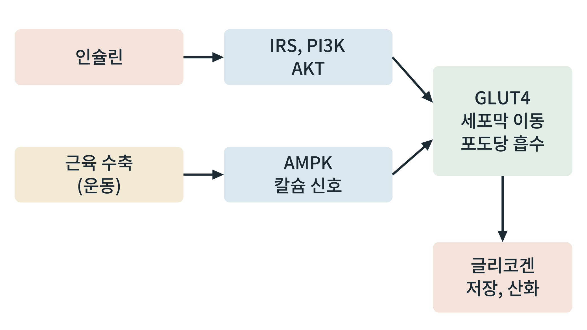

## 제32장 근육: 최대의 포도당 소비처와 아미노산 저장소

> **이 장의 출발점** 1966년 스웨덴 스톡홀름의 얀 베리스트룀(Jonas Bergström)과 에릭 훌트만(Eric Hultman)은 사람의 허벅지 근육에서 바늘로 작은 조직을 떼어 내는 생검을 써서 운동 뒤 근육 글리코겐을 측정했다. 한쪽 다리만 운동시킨 뒤 탄수화물을 먹게 하자, 운동한 다리의 근육에서만 글리코겐이 운동 전보다 높은 수준까지 쌓였고 운동하지 않은 다리는 그렇지 않았다(Bergström & Hultman, 1966). 근육 글리코겐 저장을 좌우하는 신호가 혈액 속에 있지 않고 근육 자체에 있다는 결과였다. 이 장은 근육이 연료를 어떻게 받아들이고 저장하며 쓰는지를 다룬다.

### 32.1 근육은 몸 연료 이용의 큰 몫이다

골격근은 체중의 상당 부분을 차지하고, 식후 포도당 처리와 공복 지방산 이용 양쪽에서 큰 몫을 가진다. 식후에 인슐린이 오르면 혈중 포도당의 상당 부분이 근육으로 들어가는 것으로 알려져 있다(18장). 또 근육은 몸 전체 단백질의 가장 큰 저장소여서, 공복에서는 포도당 신생의 재료인 아미노산 공급처가 된다(26장). 근육 글리코겐은 근육 안에서만 쓰이고 혈당으로 내보내지 못하므로(23장), 근육의 포도당 저장은 근육 자신의 연료 창고이다.

### 32.2 포도당 흡수의 두 경로

근육의 포도당 흡수는 GLUT4가 세포막으로 이동해야 일어난다. 이 이동을 일으키는 신호가 둘이다.

**그림 32-1. 근육 포도당 흡수를 여는 두 신호.** 인슐린은 IRS, PI3K, AKT를 거치고, 근육 수축(운동)은 AMPK와 칼슘 신호를 거쳐 GLUT4를 세포막으로 이동시킨다. 두 경로는 서로 독립적이어서, 인슐린 저항이 있어도 운동에 의한 흡수는 상당 부분 유지된다고 알려져 있다.

그림 32-1에서 읽을 점은 두 가지이다. 첫째, GLUT4가 두 경로의 합류점이다. 약물이나 운동이 이 지점의 상류 어디를 건드리든 포도당 흡수를 높일 수 있다. 둘째, 인슐린 저항(21장)에서는 위쪽 경로가 약해지는 반면 운동 경로는 상대적으로 보존된다고 해석된다. 이 독립성이 운동이 인슐린 저항 상태에서도 혈당을 낮추는 이유를 설명하는 하나의 틀로 쓰이며, 사람에서의 정량적 기여는 연구마다 다르다.

### 32.3 상태별 근육의 연료와 신호

**표 32-1. 근육의 상태별 연료 이용.**

| 상태 | 주 연료 | 핵심 신호 | 비고 |
|---|---|---|---|
| 휴지, 식후 | 포도당(인슐린 자극), 지방산 | 인슐린, GLUT4 | 포도당을 글리코겐으로 저장 |
| 휴지, 공복 | 지방산, 케톤체 | 낮은 인슐린, 높은 유리지방산 | 포도당 사용 감소(랜들 회로) |
| 가벼운 운동 | 지방산 비중 높음 | 산소, AMPK | 지속 가능 |
| 강한 운동 | 글리코겐, 포도당 비중 증가 | 칼슘, AMPK, 카테콜아민 | 젖산 생성, 코리 회로 |
| 운동 뒤 회복 | 글리코겐 재합성 | 인슐린 감수성 상승 | 베리스트룀 1966 관찰과 연결 |

표 32-1은 근육이 상태에 따라 연료를 바꾸는 장기의 대표임을 보여 준다. 29장의 대사 유연성 개념이 가장 직접적으로 측정되는 조직이 근육이며, 운동은 이 유연성을 높이는 개입으로 알려져 있다. 근육 섬유 유형에 따라서도 차이가 있다. 지구력 중심의 느린 섬유는 산화 대사가 강하고 미토콘드리아가 많으며, 빠른 섬유는 해당 대사가 상대적으로 강하다.

### 32.4 근육이 내보내는 신호

근육은 소비 장기이면서 내분비 장기이기도 하다. 근육 수축으로 분비되는 단백질을 통틀어 마이오카인(myokine)이라 한다. 운동 중 근육에서 나오는 IL-6는 간과 지방조직에 작용해 포도당 생산과 지방 분해를 조절한다는 보고가 있다. 마이오카인은 근육이 다른 장기와 대화하는 수단이며, 35장에서 장기 간 신호로 다시 다룬다. 근육에서 나오는 아미노산(알라닌, 글루타민)과 젖산도 대사 신호로서 다른 장기의 연료가 된다(23장, 26장). 다만 개별 마이오카인이 사람에서 어느 정도의 생리적 역할을 하는지는 설치류 결과보다 근거가 약한 경우가 많다.

### 32.5 약물 설계의 관점

근육은 체중 감량 약물에서 보존해야 할 조직이다(26장). 체중이 줄 때 근육 손실을 줄이려는 약물(미오스타틴/액티빈 경로 억제 등)과 운동 병행이 연구되고 있다. 근육의 포도당 흡수를 높이는 접근으로는 AMPK 활성화제, 인슐린 감작제가 있고, 운동 모방 약물(exercise mimetic)이라는 개념이 연구되었으나 운동이 가진 전신 효과를 약물 하나로 대체한다는 보고는 아직 없다. 인크레틴 계열 약물이 체중 감소 중 제지방량에 미치는 영향은 임상시험 결과를 약물별로 확인해야 한다(16장).

### 이 장의 요점

- 근육은 식후 포도당 처리와 공복 지방산 이용에서 큰 몫을 가지며, 전신 단백질의 가장 큰 저장소이다.
- GLUT4의 세포막 이동은 인슐린 경로와 운동(AMPK, 칼슘) 경로의 두 신호가 연다.
- 인슐린 저항에서 운동 경로는 상대적으로 유지되어, 운동이 혈당을 낮추는 이유의 한 틀이 된다.
- 근육은 상태에 따라 연료를 바꾸는 조직이며, 대사 유연성 연구의 중심 조직이다.
- 근육은 마이오카인과 대사 산물로 다른 장기와 신호를 주고받으며, 체중 감량 약물에서는 근육 보존이 설계 과제이다.

#### 참고문헌

Bergström, J., & Hultman, E. (1966). Muscle glycogen synthesis after exercise: An enhancing factor localized to the muscle cells in man. *Nature, 210*(5033), 309–310. https://doi.org/10.1038/210309a0

DeFronzo, R. A., & Tripathy, D. (2009). Skeletal muscle insulin resistance is the primary defect in type 2 diabetes. *Diabetes Care, 32*(Suppl. 2), S157–S163. https://doi.org/10.2337/dc09-S302

Richter, E. A., & Hargreaves, M. (2013). Exercise, GLUT4, and skeletal muscle glucose uptake. *Physiological Reviews, 93*(3), 993–1017. https://doi.org/10.1152/physrev.00038.2012

Pedersen, B. K., & Febbraio, M. A. (2012). Muscles, exercise and obesity: Skeletal muscle as a secretory organ. *Nature Reviews Endocrinology, 8*(8), 457–465. https://doi.org/10.1038/nrendo.2012.49
