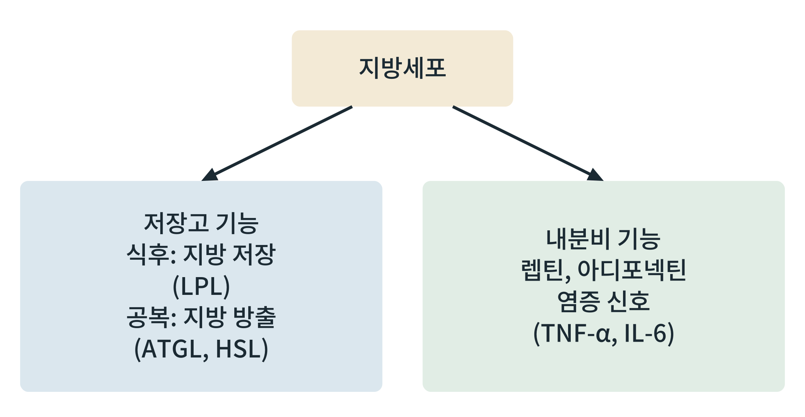

## 제33장 지방조직: 저장소이자 내분비 기관

> **이 장의 출발점** 1993년 미국 하버드 대학의 고크한 호타미실리(Gökhan Hotamisligil)와 브루스 스피겔만(Bruce Spiegelman) 등은 비만한 쥐의 지방조직에서 종양괴사인자 알파(tumor necrosis factor-alpha, TNF-α)가 많이 만들어진다는 것을 보고했다. 이 단백질을 중화하자 쥐의 인슐린 감수성이 올라갔다(Hotamisligil et al., 1993). 그때까지 지방조직은 중성지방을 쌓아 두는 창고로 여겨졌지만, 이 연구는 창고가 신호를 내보내 다른 조직의 인슐린 반응을 바꿀 수 있음을 보였다. 이듬해 렙틴이 지방세포에서 나오는 호르몬으로 확인되면서(1권 3장) 지방조직은 내분비 기관으로 자리 잡았다. 이 장은 지방조직의 두 얼굴을 같이 읽는다.

### 33.1 저장고로서의 지방조직

지방조직의 기본 일은 에너지를 중성지방 형태로 저장하고 필요할 때 내놓는 것이다. 식후에는 인슐린이 지방세포 표면과 모세혈관의 지단백질 리파아제(lipoprotein lipase, LPL)를 올려 혈액 속 중성지방(킬로미크론, VLDL)에서 지방산을 떼어 지방세포로 보내고(18장), 지방세포는 이를 다시 중성지방으로 합쳐 지방방울에 넣는다. 지방세포 안에서 지방산을 중성지방으로 묶으려면 글리세롤 3-인산이 필요한데, 이것은 포도당에서 오는 해당과정 산물에서 온다. 공복에는 24장에서 본 ATGL, HSL, MGL이 중성지방을 분해해 지방산과 글리세롤을 혈액에 내놓는다.

**그림 33-1. 지방세포의 두 기능.** 지방세포는 식후 저장과 공복 방출이라는 저장고 기능과, 렙틴, 아디포넥틴, 염증 신호를 내는 내분비 기능을 함께 가진다.

그림 33-1에서 읽을 점은 두 기능이 한 세포에서 같이 일어난다는 점이다. 저장 상태(지방세포의 크기와 수, 지방량)가 내분비 신호의 양과 종류를 바꾸고, 반대로 내분비 신호가 저장 상태를 되먹임한다. 렙틴은 지방량에 비례해 늘어나 시상하부에 에너지 저장량을 알리고(27장), 아디포넥틴은 비만에서 줄어드는 방향으로 변한다고 보고되어 있다.

### 33.2 내분비 기관으로서의 지방조직

**표 33-1. 지방조직이 분비하는 주요 신호.**

| 분비물 | 지방량과의 관계 | 주 표적 | 작용 |
|---|---|---|---|
| 렙틴 | 지방량에 비례해 증가 | 시상하부 | 식욕 억제, 에너지 소비 조절 |
| 아디포넥틴 | 비만에서 감소하는 경향 | 간, 근육 | 인슐린 감수성 개선 보고 |
| TNF-α, IL-6 등 | 비만 지방조직에서 증가 | 지방, 간, 근육 | 염증, 인슐린 신호 약화 보고 |
| 유리지방산 | 공복과 비만에서 증가 | 간, 근육 | 연료, 이소성 지방 부담 |
| 아디프신·레시스틴 등 | 종과 조건에 따라 다름 | 여러 조직 | 사람에서의 역할은 논의 중 |

표 33-1에서 읽을 점은 지방조직 신호의 상당수가 방향성이 불분명하거나 종 사이 차이가 크다는 것이다. 렙틴 외의 많은 아디포카인은 설치류 결과가 사람에서 반복되지 않았다. 따라서 이 책은 이 표의 항목을 확립된 사실과 가설로 구분해 읽도록 한다. 한편 비만 지방조직에는 대식세포가 모이고 염증 신호가 늘어난다는 관찰은 21장의 인슐린 저항 가설(염증)과 이어진다.

### 33.3 갈색, 베이지, 백색 지방

지방조직은 한 종류가 아니다. 백색지방은 에너지 저장과 내분비를 맡고, 갈색지방은 UCP1을 통해 열을 만든다(12장, 20장). 백색지방 안에서 찬 환경이나 자극에 의해 UCP1을 가진 세포가 나타나는 현상을 베이지화(beiging)라 한다. 성인에서도 갈색지방 활성이 확인되어 약물 표적 후보가 되었으나, 사람 성인에서 갈색지방이 전체 에너지 소비에 기여하는 크기는 작다는 평가가 많다. 또 지방이 쌓이는 위치도 중요하다. 피하지방은 저장 용량이 크고 상대적으로 안전하며, 내장지방과 이소성 지방(간, 근육 등)이 대사 위험과 더 연결된다는 것이 21장에서 본 지방조직 확장성 가설이다.

### 33.4 약물 설계의 관점

지방조직은 약물이 체중 변화로 가장 직접 영향을 미치는 조직이다. 체중이 줄면 지방세포가 작아지고 렙틴이 줄어(27장) 공복 신호가 켜진다. 티아졸리딘디온(TZD, PPARγ 작용제)은 지방세포 분화를 돕고 지방을 피하 쪽으로 보내 인슐린 감수성을 올리지만, 체중 증가와 부종 같은 부작용이 있다. 렙틴과 그 유사체는 렙틴 결핍 환자에서는 효과가 크지만 일반 비만에서는 효과가 제한적이었다(27장). 베타3 아드레날린 수용체 작용제처럼 갈색지방을 켜려는 접근도 연구되었다. 지방조직의 크기를 줄이는 접근(입력 감소)과 지방조직의 기능을 바꾸는 접근(저장 용량, 염증, 분비 프로필)을 구분해 보는 것이 약물 설계의 틀이다.

### 이 장의 요점

- 지방조직은 식후에 LPL을 통해 지방을 저장하고 공복에 ATGL, HSL, MGL로 방출하는 저장고이다.
- 지방조직은 렙틴, 아디포넥틴, 염증 신호를 내는 내분비 기관이기도 하며, 저장 상태와 분비 신호가 서로 영향을 준다.
- 렙틴 외 많은 아디포카인은 설치류 결과가 사람에서 반복되지 않아 확립된 사실과 가설을 구분해야 한다.
- 백색지방, 갈색지방, 베이지 지방이 있고, 지방의 위치(피하와 내장·이소성)에 따라 대사 위험이 다르다.
- 약물은 지방 저장량을 줄이는 접근과 지방조직의 기능(분화, 염증, 분비)을 바꾸는 접근으로 나눌 수 있다.

#### 참고문헌

Hotamisligil, G. S., Shargill, N. S., & Spiegelman, B. M. (1993). Adipose expression of tumor necrosis factor-α: Direct role in obesity-linked insulin resistance. *Science, 259*(5091), 87–91. https://doi.org/10.1126/science.7678183

Rosen, E. D., & Spiegelman, B. M. (2014). What we talk about when we talk about fat. *Cell, 156*(1–2), 20–44. https://doi.org/10.1016/j.cell.2013.12.012

Scherer, P. E. (2006). Adipose tissue: From lipid storage compartment to endocrine organ. *Diabetes, 55*(6), 1537–1545. https://doi.org/10.2337/db06-0263

Virtanen, K. A., Lidell, M. E., Orava, J., Heglind, M., Westergren, R., Niemi, T., Taittonen, M., Laine, J., Savisto, N.-J., Enerbäck, S., & Nuutila, P. (2009). Functional brown adipose tissue in healthy adults. *New England Journal of Medicine, 360*(15), 1518–1525. https://doi.org/10.1056/NEJMoa0808949
